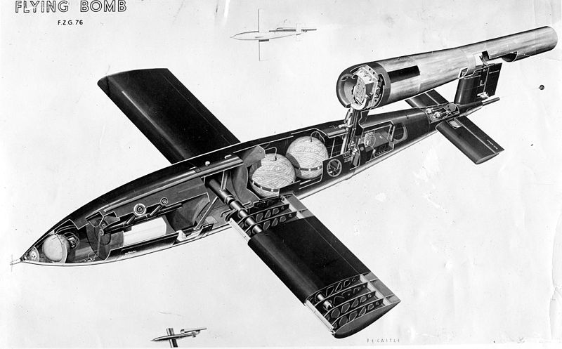
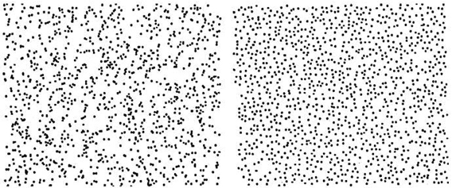
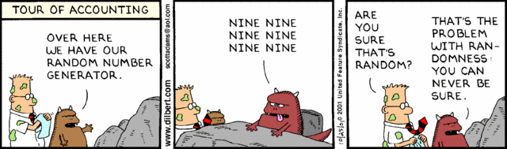
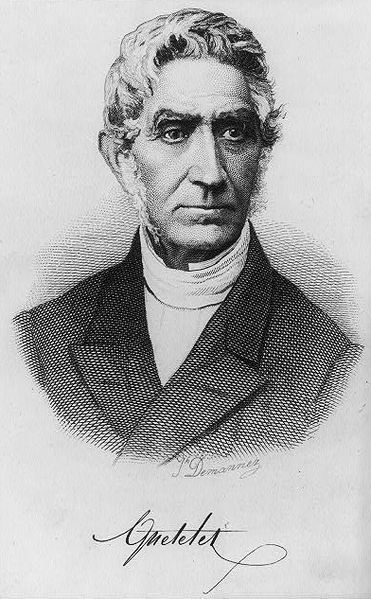
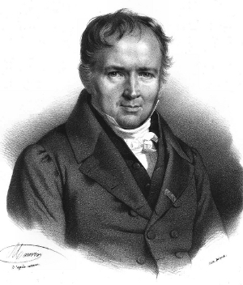
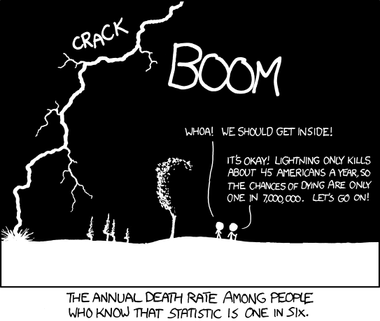
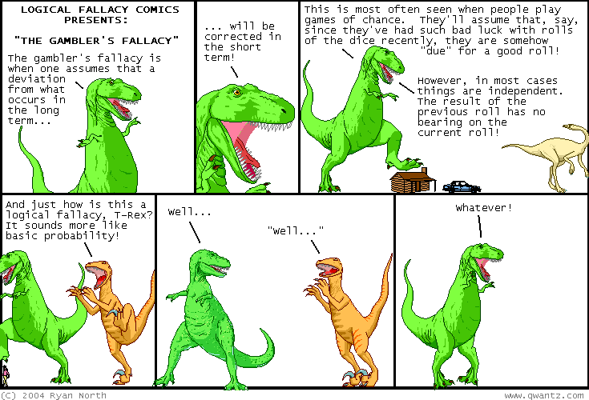
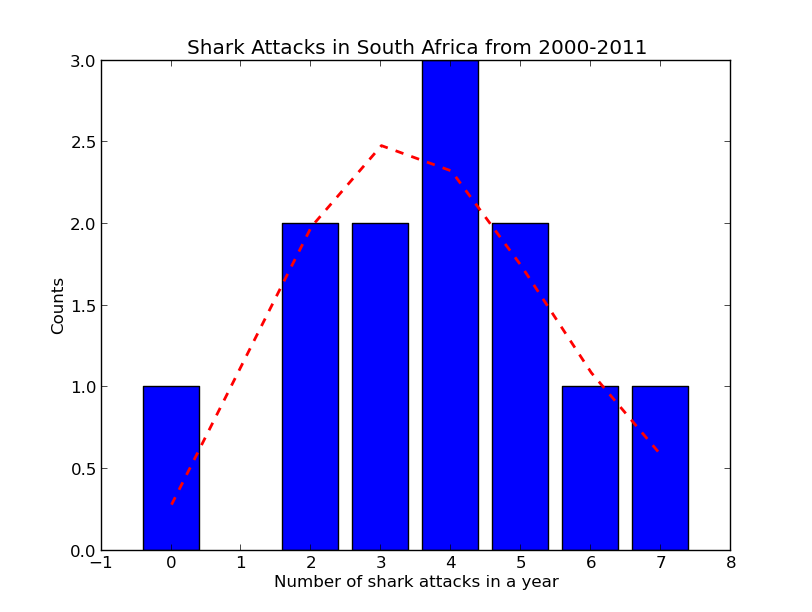
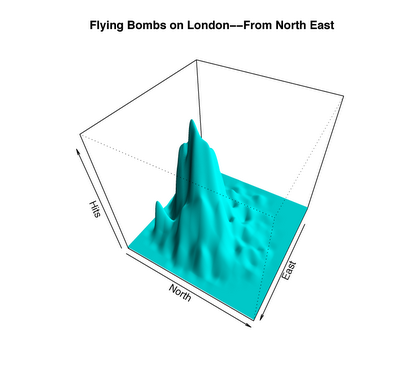
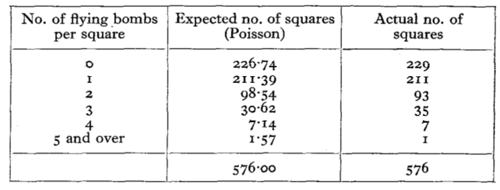

# **W**hat does randomness look like?

On 13 June 1944, a week after the allied invasion of Normandy, a loud buzzing sound rattled through the skies of battle-worn London**.** The source of the sound was a newly developed German instrument of war, the V-1 flying bomb**.** A precursor to the cruise missile, the V-1 was a self-propelled flying bomb, guided using gyroscopes, and powered by a simple pulse jet engine that gulped air and ignited fuel 50 times a second**.** This high frequency pulsing gave the bomb its [characteristic sound](http://www.youtube.com/watch?v=MCdlBc__3kg) , earning them the nickname *buzzbombs**.***

From June to October 1944, the Germans launched 9,521 buzzbombs from the coasts of France and the Netherlands, of which 2,419 reached their targets in London**.** The British worried about the accuracy of these aerial drones**.** Were they falling haphazardly over the city, or were they hitting their intended targets**?** Had the Germans really worked out how to make an accurately targeting self-guided bomb**?**

Fortunately, they were scrupulous in maintaining a [bomb census](http://www.bombsight.org/) , that tracked the place and time of nearly every bomb that was dropped on London during World War II**.** With this data, they could statistically ask whether the bombs were falling randomly over London, or whether they were targeted**.** This was a math question with very real consequences**.**

Imagine, for a moment, that you are working for the British intelligence, and you’re tasked with solving this problem**.** Someone hands you a piece of paper with a cloud of points on it, and your job is to figure out if the pattern is random**.**

Let’s make this more concrete. Here are two patterns, from Steven Pinker’s book, [The Better Angels of our Nature](http://www.indiebound.org/book/9780143122012) **.** One of the patterns is randomly generated. The other imitates a pattern from nature**.** Can you tell which is which?

Thought about it**?**

Here is Pinker’s explanation.

> The one on the left, with the clumps, strands, voids, and filaments (and perhaps, depending on your obsessions, animals, nudes, or Virgin Marys) is the array that was plotted at random, like stars**.** The one on the right, which seems to be haphazard, is the array whose positions were nudged apart, like glowworms

That’s right, glowworms. The points on the right records the positions of glowworms on the [ceiling of the Waitomo cave](http://www.waitomo.com/SiteCollectionImages/glowworms/Waitomo-Glowworm-Caves-New-Zealand-boat-group.jpg)  in New Zealand**.** These glowworms aren’t sitting around at random, they’re competing for food, and nudging themselves away from each other**.** They have a vested interest against clumping together**.**

*Update: [Try this out](http://bl.ocks.org/4358325)  for yourself**.** After reading this article, [praptak](http://news.ycombinator.com/item?id=4956101)  and [roryokane](http://news.ycombinator.com/item?id=4956282)  over at [hacker news](http://news.ycombinator.com/item?id=4954905)  wrote a script that will generate random and uniform distributions in your browser, nicely illustrating the point**.***

**Try to uniformly sprinkle sand on a surface, and it might look like the pattern on the right**.** You’re instinctively avoiding places where you’ve already dropped sand**.** Random processes have no such prejudices, the grains of sand simply fall where they may, clumps and all**.** It’s more like sprinkling sand with your eyes closed**.** They key difference is that randomness is not the same thing as uniformity**.** True randomness can have clusters, like the constellations that we draw into the night sky**.****

Here’s another example. Imagine a professor asks her students to flip a coin 100 times**.** One student diligently did the work, and wrote down their results**.** The other student is a bit of a slacker, and decided to make up fake coin tosses instead of doing the experiment**.** Can you identify which student is the slacker?

> **Student 1:**
>
> THHHTHTTTTHTTHTTTHHTHTTHT
>
> HHHTHTHHTHTTHHTTTTHTTTHTH
>
> TTHHTTTTTTTTHTHHHHHTHTHTH
>
> THTHTHHHHHTHHTTTTTHTTHHTH
>
> **Student 2:**
>
> HTTHTTHTHHTTHTHTHTTHHTHTT
>
> HTTHHHTTHTTHTHTHTHHTTHTTH
>
> THTHTHTHHHTTHTHTHTHHTHTTT
>
> HTHHTHTHTHTHHTTHTHTHTTHHT

Take a moment to reason this through**.**

The first student’s data has clusters – long runs of up to eight tails in a row**.** This might look surprising, but it’s actually what you’d expect from random coin tosses (I should know – I did a hundred coin tosses to get that data**!**) The second student’s data in suspiciously lacking in clusters**.** In fact, in a hundred coin tosses, they didn’t get a single run of four or more heads or tails in a row**.** This has about a 0.1% chance of ever happening, suggesting that the student fudged the data (and indeed I did)**.**

Image by Scott Adams.

Trying to work out whether a pattern of numbers is random may seem like an arcane mathematical game, but this couldn’t be further from the truth**.** The study of random fluctuations has its roots in nineteenth century French criminal statistics**.** As France was rapidly urbanizing, population densities in cities began to shoot up, and crime and poverty became pressing social problems.

In 1825, France began to collect statistics on criminal trials**.** What followed was perhaps the first instance of statistical analysis used to study a social problem**.** [Adolphe Quitelet](http://en.wikipedia.org/wiki/Adolphe_Quetelet)  was a Belgian mathematician, and one of the early pioneers of the social sciences**.** His controversial goal was to apply probability ideas used in astronomy to understand the laws that govern human beings**.**

In the words of [Michael Maltz](http://tigger.uic.edu/~mikem/Poisson.PDF) ,

> In finding the same regularity in crime statistics that was found in astronomical observations, he argued that, just as there was a true location of a star (despite the variance in the location measurements), there was a true level of criminality: he posited the construct of l’homme moyen (the “average man”) and, moreover, l’homme moyen moral**.** Quetelet asserted that the average man had a statistically constant “penchant for crime,” one that would permit the “social physicist” to calculate a trajectory over time that “would reveal simple laws of motion and permit prediction of the future” (Gigerenzer et al, 1989)**.**

Quitelet noticed that the conviction rate of criminals was slowly falling over time, and deduced that there must be a downward trend in  the “penchant for crime” in French citizens**.** There were some problems with the data he used, but the essential flaw in his method was uncovered by the brilliant French polymath and scientist [Siméon-Denis Poisson](http://en.wikipedia.org/wiki/Poisson) **.**

Poisson’s idea was both ingenious and remarkably modern**.** In today’s language, he argued that Quitelet was missing a *model* of his data**.** He didn’t account for how jurors actually came to their decisions**.** According to Poisson, jurors were fallible. The data that we *observe* is the rate of convictions, but what we want to *know* is the probability that a defendant is guilty**.** These two quantities aren’t the same, but they can be related**.** The upshot is that when you take this process into account, there is a certain amount of variation inherent in conviction rates, and this is what one sees in the French crime data**.**

In 1837, Poisson published this result in “*Research on the Probability of Judgments in Criminal and Civil Matters*“**.** In that work, he introduced a formula that we now call the [Poisson distribution](http://en.wikipedia.org/wiki/Poisson_distribution) **.** It tells you the odds that a large number of infrequent events result in a specific outcome (such as the majority of French jurors coming to the wrong decision)**.** For example, let’s say that on average, 45 people are struck by lightning in a year**.** Feed this in to Poisson’s formula, along with the population size, and it will spit out the odds that, say, 10 people will be struck by lightning in a year, or 50, or a 100**.** The assumption is that lightning strikes are independent, rare events that are just as likely to occur at any time**.** In other words, **Poisson’s formula can tell you the odds of seeing unusual events, simply due to chance**.****

By Randall Munroe

One of the first applications of Mr. Poisson’s formula came from an unlikely place**.** Leap sixty years ahead, over the Franco-Prussian war, and land in 1898 Prussia**.** [Ladislaus Bortkiewicz](http://en.wikipedia.org/wiki/Ladislaus_Bortkiewicz) , a Russian statistician of Polish descent, was trying to understand why, in some years, an unusually large number of soldiers in the Prussian army were dying due to horse-kicks**.** In a single army corp, there were sometimes 4 such deaths in a single year**.** Was this just coincidence**?**

A single incidence of death by horse kick is rare (and assumedly independent, unless the horses have a hidden agenda)**.** Bortkiewicz realized that he could use Poisson’s formula to work out how many deaths you expect to see**.** Here is the prediction, next to the real data.

See how well they line up**?** The sporadic clusters of horse-related deaths are just what you would expect if horse-kicking was a purely random process**.** *Randomness comes with clusters.*

By Ryan North

I decided to try this out for myself**.** I looked for publicly available datasets for deaths due to rare events, and came across the [International Shark Attack File](http://www.flmnh.ufl.edu/fish/sharks/statistics/statsw.htm) , that tabulates worldwide incidents of sharks attacking people**.** Here’s the data of shark attacks in South Africa.

The numbers are fairly low, with an average of 3**.**75. But compare 2008 and 2009. One year has zero shark attacks, and the next has 6**.** And then in 2010, there are 7. You can already imagine the headlines crying out, “*Attack of the sharks**!***“. But is there really a shark rebellion, or would you expect to see these clusters of shark attacks due to chance**?** To find out, I compared the data to Mr. Poisson’s prediction**.**

“Anyone else see the shark fin**?**” Nice catch, by [@Gareth\_Elms](https://twitter.com/Gareth_Elms/status/282511647132770304)

In blue are the observed counts of years with a 0,1,2,3.. shark attacks**.** For example, the long blue bar represents the 3 years in which there were 4 shark attacks (2000, 2005 and 2006)**.** The red dotted line is the Poisson distribution, and it represents the outcomes that you would expect if the shark attacks were a purely random process**.** It fits the data well – I found no evidence of clustering beyond what is expected by a Poisson process (p=0**.**87). I’m afraid this rules out the great South African shark uprising of 2010**.** The lesson, again, is that *randomness isn’t uniform***.**

Which brings us back to the buzzbombs**.** Here’s a visualization of the number of bombs dropped over different parts, [reconstructed by Charles Franklin](http://madvis.blogspot.com/2010/09/flying-bombs-on-london-summer-of-1944.html)  using the original maps in the British Archives in Kew**.**

***Note**: A clarification**.** The plot above shows the distribution of bombs that were dropped over London**.** The question I’m asking is, if you zoom in to the part of the city most heavily under attack (essentially the mountain that you see in the figure above), are the bombs being guided more precisely, to hit specific targets**?***

It’s far from a uniform distribution, but does it show evidence of precise targeting**?** At this point, you can probably guess how to answer this question**.** In a report titled [*An Application of the Poisson Distribution*](http://www.actuaries.org.uk/sites/all/files/documents/pdf/0481.pdf) , a British statistician named R. D. Clarke wrote,

> During the flying-bomb attack on London, frequent assertions were made that the points of impact of the bombs tended to be grouped in clusters**.** It was accordingly decided to apply a statistical test to discover whether any support could be found for this allegation**.**

Clarke took a 12 km x 12 km heavily bombed region of South London, and sliced it up in to a grid**.** In all, he divided it into 576 squares, each about the size of 25 city blocks**.** Next, he counted the number of squares with 0 bombs dropped, 1 bomb dropped, 2 bombs dropped, and so on**.**

In all, 537 bombs fell over these 576 squares**.** That’s a little under one bomb falling per square, on average**.** He plugged this number into Poisson’s formula, to work out how much clustering you would expect to see by chance**.** Here’s the relevant table from his paper:

Compare the two columns, and you can see how incredibly close the prediction comes to reality**.** There are 7 squares that were hit by 4 bombs each - but this is what you would expect by chance**.** **Within a large area of London, the bombs weren’t being targeted**.** They rained down at random in a devastating, city-wide game of Russian roulette**.****

The Poisson distribution has a habit of creeping up in [all sorts of places](http://www.aabri.com/SA12Manuscripts/SA12083.pdf) , some inconsequential, and others life-altering**.** The number of [mutations](http://www.genetics.org/content/164/2/797)  in your DNA as your cells age**.** The number of cars ahead of you at a traffic light, or patients in line before you at the emergency room**.** The number of typos in each of my blog posts. The number of patients with leukemia in a given town**.** The numbers of births and deaths, marriages and divorces, or suicides and homicides in a given year**.** The number of fleas on your dog**.**

From mundane moments to matters of life and death, these Victorian scientists have taught us that randomness plays a larger role in our lives than we care to admit**.** Sadly, this fact offers little consolation when the cards in life fall against your favor**.**

> “So much of life, it seems to me, is determined by pure randomness**.**” - Sidney Poitier

**References**

[Shark attacks and the Poisson approximation](http://www.stat.ualberta.ca/people/schmu/preprints/poisson.pdf) **.** A nice introduction to using Poisson’s formula, with applications including the [birthday paradox](http://en.wikipedia.org/wiki/Birthday_problem) , one of my favorite examples of how randomness is counter-intuitive**.**

[From Poisson to the Present](http://tigger.uic.edu/~mikem/Poisson.PDF) : Applying Operations Research to Problems of Crime and Justice**.** A good read about the birth of operations research as applied to crime**.**

[Applications of the Poisson probability distribution](http://www.aabri.com/SA12Manuscripts/SA12083.pdf) **.** Includes a list of many applications of the Poisson distribution**.**

Steven Pinker’s book [The Better Angels of our Nature](http://www.indiebound.org/book/9780143122012)  has many great examples of how our intuition about randomness is generally wrong**.**

Want to know more about the accuracy of the flying bombs**?** The story is surprisingly rich, involving counterintelligence and espionage**.** Here’s a [teaser](http://news.ycombinator.com/item?id=4955201) .

### Share this:
