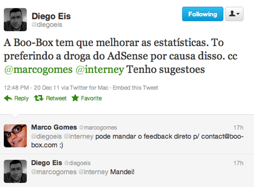

# **S**ua marca não deve responder reclamações públicas em redes sociais

Publicado em 2012-06-25

|  |
| --- |
| 5 [inShare](#) |

Empresas perdem bons canais de quando usam seus perfis nas mídias sociais como ferramenta de atendimento**.**

*Este é um [artigo meu que foi publicado no ProXXima](http://www.proxxima.com.br/proxxima/negocios/noticia/2012/06/18/Marca-nao-deve-responder-reclamacoes-publicas-nas-redes-sociais-) , considerado o maior conjunto de notícias e informações sobre o mundo da comunicação e do marketing digital, parte do grupo [Meio & Mensagem](http://www.meioemensagem.com.br/) **.***

Seria este o melhor jeito da Claro usar o Twitter**?**

A relação entre empresas e as é hoje um tema muito discutido no mercado da internet**.** As companhias, cada vez mais inseridas na vida de seus clientes na web, os condicionam a reclamarem abertamente em suas páginas e perfis de mídias sociais**.** No entanto, a eficácia deste canal é um ponto a ser reavaliado**.** Em conversa com meu amigo e sócio [Edney Souza](http://interney.net)  (@[interney](http://twitter.com/interney) ), surgiu uma questão interessante: ao resolver imediatamente os problemas relatados no Twitter e Facebook, as marcas não estão condicionando seus clientes ao uso constante deste SAC improvisado**?** Qual o real preparo da área de atendimento para lidar com o público 2**.**0?

Trabalho com [tecnologias para publicidade em redes sociais](http://boo-box.com)  tenho acesso a uma audiência mensal superior a 80 milhões de pessoas, divulgando desde startups, como o [GetNinjas](http://getninjas.com.br) , até grandes grupos, como a [Unilever](http://unilever.com.br) **.** Com uma rede de 42 mil publishers – produtores de conteúdo, profissionais e amadores usam o sistema da minha empresa para se profissionalizar e ganhar dinheiro com anúncios, de acordo com a relevância e a audiência individual**.** Sendo assim, a nossa atividade nos faz avaliar constantemente a eficácia do SAC 2**.**0.

Como todo grande sistema de tecnologia, recebemos diariamente centenas de elogios, dúvidas, reclamações e pedidos de ajuda**.** Essas manifestações chegam pelos mais diversos canais, de SMS enviados aos nossos executivos até cartas recebidas pelo Correio, e claro, também pelo Facebook e Twitter**.** Após cinco anos lidando diretamente com clientes nas redes sociais, hoje possuímos conhecimento para organizar nosso SAC 2**.**0, assumindo a divisão: elogios, sugestões e dúvidas para o ambiente público, e reclamações para o canal privado**.**

Caso de usuário sendo incentivado a usar um canal privado**.**

Ao incentivar que o cliente use os perfis das mídias sociais para expor um elogio ou resolver dúvidas, as marcas estão potencializando manifestações positivas e ampliando o diálogo**.** Já as reclamações e críticas, que são valiosas para a evolução da empresa, quando feitas em ambiente público, podem gerar uma reação em cadeia incontrolável**.** Uma queixa feita por um cliente pode ser compartilhada por qualquer pessoa, gerando críticas muitas vezes infundadas e danos desnecessários à imagem da marca**.**

A principal questão sobre o SAC 2**.**0 é que este tipo de atendimento cresceu sem planejamento prévio**.** O cliente que se comunica pelos canais oficiais e não é atendido, recorre às redes sociais, expressando seu caso abertamente e consegue, na maioria das vezes, uma solução imediata, o que os condiciona a usar este canal**.** Uma opção é sempre que surgir uma reclamação aberta, incentivar que o cliente se manifeste através de canais oficiais, que sejam privados e seguros**.**

Saber aproveitar o canal direto também é importante**.** A ferramenta não deixa de ser uma excelente opção para receber sugestões e novas ideias**.** Utilizar as redes sociais para se comunicar com seu público-alvo e absorver informações é uma forma de mostrar a face positiva do ambiente digital e perfis de cada marca**.** Vale destacar ainda que é necessário alinhar as estratégias das áreas de atendimento ao consumidor com as de , para que a os canais de comunicação da empresa na web estejam em sintonia**.** É preciso pensar no poder das redes sociais como mídia, para divulgar mensagens da marca de maneira massiva, atingindo audiências superiores às da TV ou revistas**.**

Marcas devem potencializar manifestações positivas e ampliar o diálogo**.** Reclamações e críticas, muito valiosas para a evolução da empresa, devem ser direcionadas para canais privados**.**

A mudança de comportamento das marcas em relação às exigências de seus clientes conta com a forte participação no ambiente digital e é importante, inclusive, para a saúde das próprias redes sociais**.** Afinal, nós não queremos que o ambiente agradável e descontraído do Facebook e Twitter seja convertido no muro das lamentações 2**.**0, não é mesmo?

### Textos relacionados:
