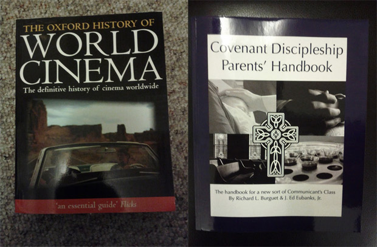

É uma sensação muito boa. Chegar em casa e ter uma caixa te esperando. Uma encomenda, algo que tu comprou pela internet há alguns dias ou semanas e só chegou agora. Talvez tu nem lembre mais o que era, ou talvez já nem tenha unhas intactas de tanta ansiedade, mas de qualquer jeito é uma sensação muito boa.

  

Você chega em casa, abre a fita adesiva, tira aquilo da caixa. Algo que tu não tinha antes, agora tem. A magia do consumismo aquecendo seu coração.

  

Isso sempre foi alegria o suficiente para mim. Mas não para o programador [Darius Kazemi](http://tinysubversions.com/).

  

  
  

Ele comprou este CD. Mas não escolheu.

  

### Uma festa supresa para si mesmo

  

Programadores têm o superpoder de controlar computadores em seu nível mais fundamental. Com um pouco de criatividade, isso significa alterar o que é possível na própria vida real.

  

O conceito de uma festa surpresa para si mesmo é absurdo, já que obviamente não temos a capacidade de fazer algo sem saber que estamos fazendo aquilo. Logo, nunca seria uma surpresa.

  

Mas o que o amigo Kazemi fez é bem isso.

  

Ele programou um script que entra na Amazon.com e compra algo, sozinho. De início, ele quis fazer algo que visse o histórico de compras e a lista de desejos dele, então escolhesse algum produto dali, mas acabou se decidindo pela aleatoriedade. A Amazon é a maior loja online do mundo, com absolutamente todo tipo de coisa legal em estoque, e o script escolhe algo aleatoriamente. Compra. E ele recebe.

  

Imagina que coisa linda. Chegar em casa e ter alguma encomenda pra você, que você mesmo comprou, mas que você não faz a menor ideia do que possa ser! Será um CD? Um livro? Um pano de prato? Um pôster de algo que você nem conhece? Uma furadeira? Uma capinha de iPhone?

  

A única, e bem necessária, limitação do script é o preço: todo mês o cara coloca 50 dólares de crédito na conta do seu “experimento”. O item é escolhido aleatoriamente, mas só é comprado se estiver dentro do orçamento.

  

No Tumblr [Random Shopper](http://randomshopper.tumblr.com/) ele dá mais detalhes do “projeto” e se comprometeu a escrever sobre os itens que receber. Esta, aliás, é uma das partes mais interessantes: ele realmente usa/assiste/lê/analisa as suas compras, e geralmente tira conclusões bastante inteligentes e perspicazes sobre suas aquisições aleatórias.

  

  
  

Ele comprou estes livros. Mas não escolheu.

  

Eu achei a ideia genial. Aos que o criticam por jogar dinheiro fora, ele se defende talvez da única forma realmente possível: “é arte”. Há quem gaste 50 dólares por mês em pincéis, tintas e telas. Ele gasta com isso.

  

E quem vai dizer que está errado?

  
[anexo ausente]  
  

Artigos Relacionados

  

[O Manifesto da Geração M](http://rss.feedsportal.com/c/32911/f/530922/s/26803c80/l/0Lpapodehomem0N0Bbr0Co0Emanifesto0Eda0Egeracao0Em0C/story01.htm)

  

[Slavoj Žižek: Velhacaria Hipster | WTF #9](http://rss.feedsportal.com/c/32911/f/530922/s/2688c120/l/0Lpapodehomem0N0Bbr0Cslavoj0Ezizek0Evelhacaria0Ehipster0C/story01.htm)

  

[Julian Assange entrevista Noam Chomsky e Tariq Ali | O mundo amanhã #11](http://rss.feedsportal.com/c/32911/f/530922/s/2689ea83/l/0Lpapodehomem0N0Bbr0Cjulian0Eassange0Eentrevista0Enoam0Echomsky0Ee0Etariq0Eali0Eo0Emundo0Eamanha0E110C/story01.htm)

  

[Zeitgeist 2012: o que aconteceu no seu mundo esse ano](http://rss.feedsportal.com/c/32911/f/530922/s/2689ea86/l/0Lpapodehomem0N0Bbr0Czeitgeist0E20A120Eo0Eque0Eaconteceu0Eno0Eseu0Emundo0Eesse0Eano0C/story01.htm)

  

[Nirvana e Paul McCartney em 12.12.12: esse dia foi foda](http://rss.feedsportal.com/c/32911/f/530922/s/2692f397/l/0Lpapodehomem0N0Bbr0Cnirvana0Ee0Epaul0Emccartney0Eem0E120E120E120Eesse0Edia0Efoi0Efoda0C/story01.htm)

  
  
  
[[anexo ausente]](http://da.feedsportal.com/r/151883548589/u/49/f/530922/c/32911/s/26943a23/kg/342/a2.htm) [anexo ausente]  
  

[[anexo ausente]](http://feeds.feedburner.com/~ff/PapodehomemLifestyleMagazine?a=Qam4jC4FsF0:OnkIMf6IWWc:yIl2AUoC8zA)  [[anexo ausente]](http://feeds.feedburner.com/~ff/PapodehomemLifestyleMagazine?a=Qam4jC4FsF0:OnkIMf6IWWc:qj6IDK7rITs) [[anexo ausente]](http://feeds.feedburner.com/~ff/PapodehomemLifestyleMagazine?a=Qam4jC4FsF0:OnkIMf6IWWc:-BTjWOF_DHI)

  
[anexo ausente]  
  
  
  
from Papo de Homem - Lifestyle Magazine <http://da.feedsportal.com/c/32911/f/530922/s/26943a23/l/0Lpapodehomem0N0Bbr0Cconsumismo0Ealeatorio0C/ia1.htm>
