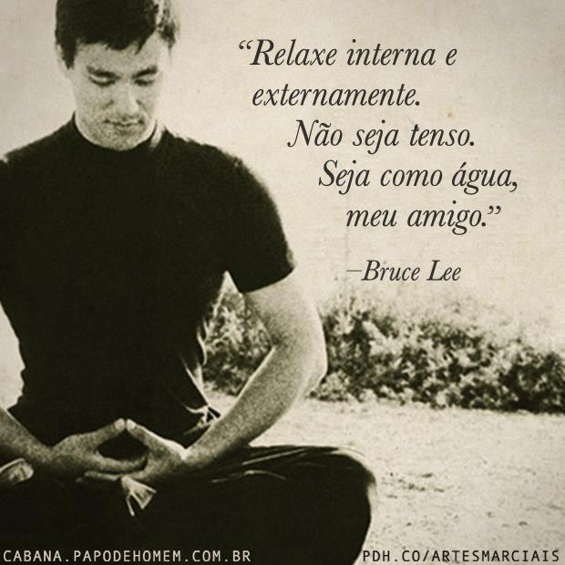
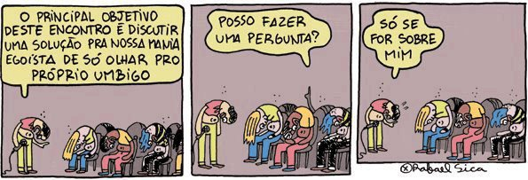

> “Com empatia nós não direcionamos, nós seguimos. Não apenas faça algo, esteja lá. Empatia repousa na nossa habilidade de estar presente sem opinião.”
>
>   
>
> ― [Marshall B. Rosenberg](http://en.wikipedia.org/wiki/Marshall_Rosenberg), criador da [Comunicação não violenta](http://pt.wikipedia.org/wiki/Comunica%C3%A7%C3%A3o_n%C3%A3o_violenta)

  
  

Uma das principais reclamações de mulheres é sobre a ansiedade masculina em querer resolver. Nós dificilmente somos capazes de repousar em situações de caos, o que é uma forma de não nos relacionarmos com nossas parceiras do jeito que elas se apresentam.

  

Essa ansiedade também pode se manifestar de outras maneiras, como o cacoete de fazer inserções a todo momento – até mesmo antes do outro terminar sua fala, contaminar o que é dito com significações próprias, concordar/discordar, agitar os braços ou pernas, sempre querer algo, ao invés de **repousar sem tendências**, simplesmente presente.

  

  

A **escuta profunda** brota de um estado de relaxamento, não do esforço em aparar arestas. Toda a abertura, acolhimento e empatia necessários para ouvir encontram solo fértil ao se oferecer uma postura relaxada.

  

### Ouça além do concreto

  

As pessoas se comunicam em vários níveis. Tudo fala. As roupas, os olhares, a respiração, um jeito específico de se curvar ou se levantar, a forma como batemos as mãos ou os pés. Cada pequeno detalhe tem voz, toca uma música.

  

Assim como é preciso treinar os ouvidos para discernir timbres, tons e efeitos em uma música, também precisamos treinar para realmente ouvir, comunicar e gerar conexão.

  

Quem já teve a oportunidade de assistir uma orquestra tocando ao ar livre pode relatar como o ambiente inteiro se relaciona com o que está sendo tocado. Não é algo metafísico, nem fantasioso. O vento sopra de uma forma diferente, todos se olham, sorriem silenciosamente, as árvores balançam, os pássaros enlouquecem.

  

Quando uma pessoa fala, algo similar acontece. Há uma variedade de outras ações sendo executadas ao redor e isso pode facilitar ou dificultar o processo. Às vezes, ela pode estar querendo desabafar, mas o ambiente não é favorável. Algum ruído pode surgir ou pode ser que haja pessoas ao redor em outra sintonia. Um sujeito atento pode tomar uma ação simples como trocar de lugar, alterando os níveis de abertura e conforto.

  

Enquanto ouve, é importante não só estar atento aos sinais abstratos mas observar as reações físicas do outro. Será que está se distraindo? Está se mexendo demais, está desconfortável, tentando encerrar o assunto, está indiferente?

  

### Ouça além de si mesmo

  

  

crédito: Rafael Sica | <http://rafaelsica.zip.net/>

  

Certa vez conheci um cara, dentista, seus vinte e cinco anos. Bonito, inteligente, cheio da grana, dono de bom gosto para música, para as artes, comida. Tudo no lugar. Ótima pessoa, exceto pelo quão insuportável é sentar ao seu lado para conversar sobre qualquer coisa.

  

Se você conhecesse uma banda nova, ele tinha uma outra melhor. Se você o convidasse para almoçar, ele narrava seus feitos gastronômicos pelas praias do nordeste. Se você tivesse visitado uma bela cachoeira escondida por alguma via alternativa perto da cidade, ele sabia de alguma outra ainda mais bonita.

  

Por outro lado, também já encontrei um cara genial, capaz de abraçar você em qualquer coisa. Sempre se interessava, fazia perguntas, se surpreendia de modo genuíno. E isso tornava sua presença bastante agradável.

  

Entrar no mundo do outro é sair de seus próprios preconceitos e limites pré-estabelecidos. Da mesma forma como fazemos ao visitar outros países. Não adianta chegar querendo feijoada, você acaba sendo obrigado a comer o que tem.

  

Ouvir é cocriar, fazer sentido, agir, enriquecer. Não apenas a habilidade de decodificar sons, mas também de dar importância, atenção, de se relacionar com o interlocutor.

  

De nada adianta entrar no mundo do outro e não se relacionar com ele de uma maneira positiva. É útil estimular a conversa, perguntar, valorizar trazendo outras referências, outras visões, ajudar o outro a se expressar, retomar o foco, ir construtivamente contra – e, acima de tudo, se envolver de coração.

  

### Treine ouvir o silêncio

  

*Link TEDx*

  

Se não conhece nenhum método para se desenvolver nessa direção, recomendo começar por este vídeo:

  

*Link Youtube*

  

### Ouvir é construir uma fala poderosa

  
> “O fenômeno da comunicação depende não do que é transmitido, mas do que acontece com a pessoa que recebe a mensagem.”
>
>   
>
> – [Humberto Maturana](http://pt.wikipedia.org/wiki/Humberto_Maturana)

  

Repousar, observar a própria mente, entrar e enriquecer o mundo do outro, relacionar-se com a situação por completo. São todas atitudes que conduzem a ações cortantes, diretas.

  

Um homem capaz de ouvir é alguém que vive em um universo vasto, repleto de riquezas ainda não descobertas.

  

Eu mesmo queria encontrar mais pessoas assim. Capazes de atravessar minhas bobagens e me dizer o que preciso, não o que quero ouvir.

  

E vocês, estão realmente ouvindo? Estão sendo ouvidos?

  

### Mecenas: [Schweppes](http://pdh.co/schweppes7)

  
  

*Link YouTube*

  

*Meninos falam. Se atropelam em busca de atenção. Homens escutam além das palavras.*

  

*Todos têm muito a dizer, mas parte do que nos torna capazes de desenvolver relações melhores é a capacidade em realmente escutar.*

  

*Schweppes tem dito boas coisas a respeito do amadurecimento de um homem, vá até eles dar uma olhada. Recomendamos.*

  
[anexo ausente]  
  

Artigos Relacionados

  

[Hugh Laurie, muito além de House | Homens que você deveria conhecer #37](http://rss.feedsportal.com/c/32911/f/530922/s/26378429/l/0Lpapodehomem0N0Bbr0Chugh0Elaurie0Emuito0Ealem0Ede0Ehouse0Ehqvdc0C/story01.htm)

  

[6 anos do PapodeHomem](http://rss.feedsportal.com/c/32911/f/530922/s/26442819/l/0Lpapodehomem0N0Bbr0C60Eanos0Edo0Epapodehomem0C/story01.htm)

  

[Pare de equilibrar sua vida com o seu trabalho](http://rss.feedsportal.com/c/32911/f/530922/s/264d8cbc/l/0Lpapodehomem0N0Bbr0Co0Eequilibrio0Eentre0Evida0Ee0Etrabalho0Ee0Eum0Eerro0C/story01.htm)

  

[Carta aberta aos humoristas do Brasil](http://rss.feedsportal.com/c/32911/f/530922/s/264f9b76/l/0Lpapodehomem0N0Bbr0Ccarta0Eaberta0Eaos0Ehumoristas0Edo0Ebrasil0C/story01.htm)

  

[Hara Kiri, a revista francesa das capas mais bizarras do mundo](http://rss.feedsportal.com/c/32911/f/530922/s/265738fe/l/0Lpapodehomem0N0Bbr0Chara0Ekiri0Ea0Erevista0Efrancesa0Edas0Ecapas0Emais0Ebizarras0Edo0Emundo0C/story01.htm)

  
  
  
[[anexo ausente]](http://da.feedsportal.com/r/151883313092/u/49/f/530922/c/32911/s/2660f5a6/a2.htm) [anexo ausente]  
  

[[anexo ausente]](http://feeds.feedburner.com/~ff/PapodehomemLifestyleMagazine?a=76O0SGqmJBg:wJPGLGehFv0:yIl2AUoC8zA) [[anexo ausente]](http://feeds.feedburner.com/~ff/PapodehomemLifestyleMagazine?a=76O0SGqmJBg:wJPGLGehFv0:D7DqB2pKExk) [[anexo ausente]](http://feeds.feedburner.com/~ff/PapodehomemLifestyleMagazine?a=76O0SGqmJBg:wJPGLGehFv0:qj6IDK7rITs) [[anexo ausente]](http://feeds.feedburner.com/~ff/PapodehomemLifestyleMagazine?a=76O0SGqmJBg:wJPGLGehFv0:-BTjWOF_DHI)

  
[anexo ausente]  
  
  
  
from Papo de Homem - Lifestyle Magazine <http://da.feedsportal.com/c/32911/f/530922/s/2660f5a6/l/0Lpapodehomem0N0Bbr0Couvir0Ealem0Edas0Epalavras0Eo0Eque0Ee0Ee0Ecomo0Efazer0C/ia1.htm>
