Mesmo que você seja exclusivamente desenvolvedor front-end ou programador e passe bem longe de qualquer assunto relativo a design é importante saber um pouco sobre tipografia. Afinal, a maior parte do conteúdo da web é texto. Alguns até argumentam que [95% da informação disponível na internet está em linguagem escrita](http://informationarchitects.net/blog/the-web-is-all-about-typography-period/)… Estatísticas polêmicas a parte, o fato é que é fundamental começarmos a tratar a tipografia não apenas como algo bonitinho e sim como uma parte fundamental da user interface.

  

Se a maior parte do tempo que um usuário gasta em um site é lendo o conteúdo é nossa obrigação fazer disto uma tarefa fácil e agradável. A regra fundamental de “não faça o usuário pensar” deve também ser estendida a tipografia. Podemos adicionar “não faça o usuário forçar a vista”, “não faça o usuário colar a cara no monitor para entender o seu conteúdo”… Um site deve ser fácil de usar e para isto ele precisa ser fácil de ler. E usar desculpas do tipo “Ah, mas ele pode aumentar o tamanho do texto pelo browser” é demagogia pura. Imaginar que todo usuário final sabe configurar o tamanho do texto é uma ilusão confortável. Minha tia demora para encontrar o ícone do jogo de paciência na área de trabalho e me liga toda vez que precisa espetar o pen drive na entrada USB… Conhecer tipografia é garantir que o seu usuário tenha uma boa experiência de navegação independente de seu nível de conhecimento técnico e, consequentemente, que seu cliente não perca visitas. Para isto é necessário conhecer alguns conceitos básicos. E pode ser até divertido… Não vou vomitar regras neste artigo nem ensinar como criar e escolher fontes. A minha intenção aqui é fornecer algumas dicas teóricas e práticas sobre como melhorar a experiência de leitura na internet. Vamos a elas!

  

(E não. Simplesmente [ficar longe da Comics Sans](http://www.comicsanscriminal.com/) não te faz um expert em tipografia para a internet.)

  

## Alinhamento

  

A nossa direção natural de leitura no ocidente começa pelo canto superior esquerdo e depois caminha para a direita. Este é um dos motivos pelos quais textos alinhados a esquerda ou justificados são mais fáceis de ler, já que todas as linhas são iniciadas em um mesmo ponto.

  

Blocos de texto alinhados a direita são difíceis de ler já que o ponto inicial de cada linha é completamente irregular. Textos centralizados também possuem o mesmo problema, mas podem ser usados para destacar blocos curtos de informações como títulos e citações.

  

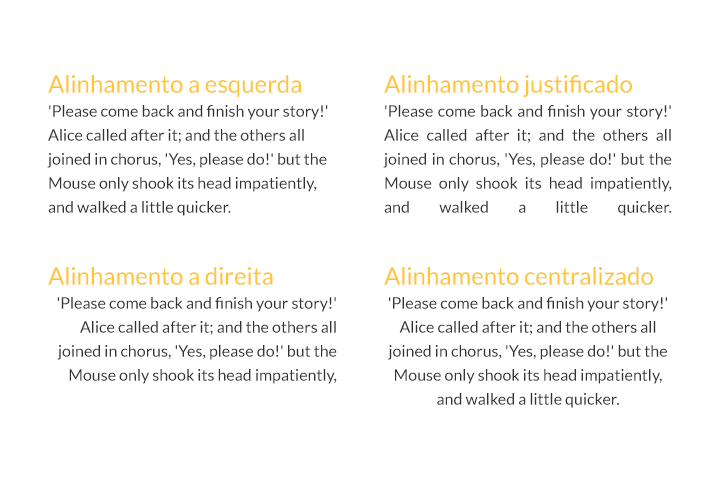

  

O caso de textos justificados é um pouco mais complexo. O problema principal aqui é que na internet não existe hifenização. Por conta disto lacunas (também conhecidas como rios) são criadas entre as palavras o que torna a leitura muito desagradável. Ou seja, justifique apenas textos bem curtos que você possui um controle total. Palavra por palavra. Se é algo dinâmico esqueça pois muitas vezes o cliente final não vai ter este tipo de cuidado….

  

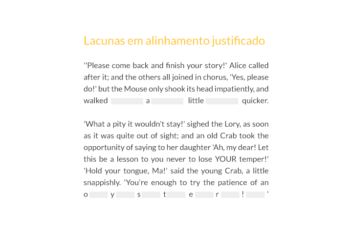

  

É claro que nenhuma destas regras é inquebrável. Mas para quebrar regras é necessário primeiro conhece-las bem. Então se estiver na dúvida sobre qual alinhamento escolher faça o seguro e alinhe à esquerda sem justificar.

  

## Classificação de Tipos

  

A tipografia para internet é dividida em 5 famílias genéricas de fonte. Existem outras divisões e categorias utilizadas em design. Mas como o foco aqui é internet, só vou destrinchar o que está valendo para a web. As imagens dos exemplos abaixo foram retiradas da documentação da W3C no esboço [CSS Font Modules Level 3](http://dev.w3.org/csswg/css3-fonts/).

  

#### Serif

  

São os tipos que contem serifas, ou seja, pequenos traços, ornamentos e/ou prolongamentos que ocorrem no fim das hastes das letras.  
**Exemplos de tipos:** Times New Roman, Baskerville, Bookman, Century, Georgia, Garamond e Rockwell.

  

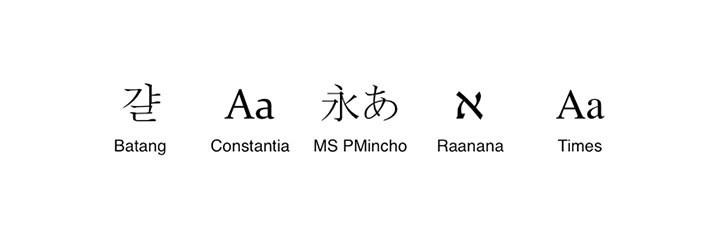

  

#### Sans-serif

  

Literalmente “sem serifa”. Este conjunto de tipos possui caracteres com hastes simples, sem nenhum tipo de ornamento.  
**Exemplos de tipos:** Helvetica, Arial, Futura, Gill Sans, Univers e Frutiger

  

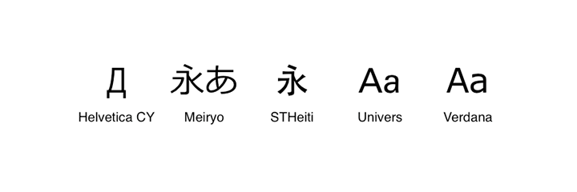

  

#### Cursive

  

As fontes desta familia possuem caracteres inclinados, ligados e/ou conectados remetendo a escrita manuscrita. Também conhecida como Script ou Brush.  
**Exemplos de tipos:** Comic Sans MS, Blackadder ITC, Lucida Handwriting, Brush Script

  

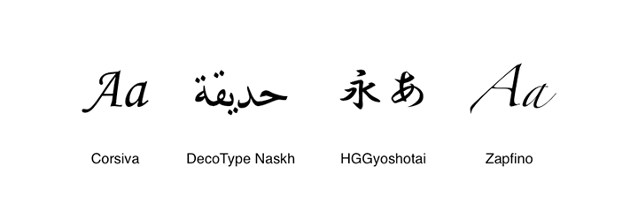

  

#### Fantasy

  

São fontes puramente decorativas, mas que ainda representam caracteres. Normalmente não possuem uma boa legibilidade.  
**Exemplos de tipos:** Papyrus, Impact, Haettenschweiler, Copperplate

  

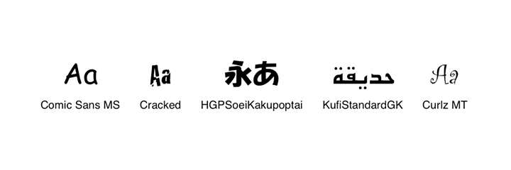

  

#### Monospace

  

Todos os caracteres das fontes monospace possuem a mesma largura fixa. Este tipo é frequentemente utilizado para códigos de computador.  
**Exemplos de tipos:** Courier, Prestige Elite, Fixedsys e Monaco

  

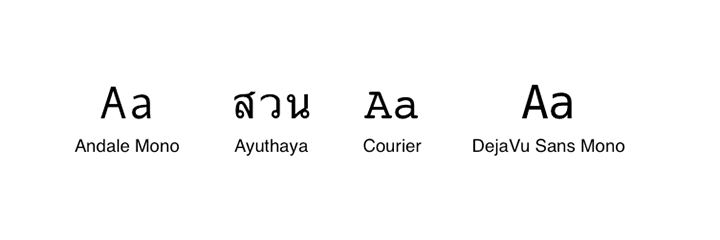

  

Algumas fontes podem entrar em mais de uma categoria. Por exemplo a Courier é monospace E serifada.

  

#### Qual família escolher

  

Não vou entrar muito neste mérito por que isto já seria conteúdo suficiente para não apenas um artigo mais livros inteiros sobre o assunto… Mas, considerando a internet como meio, muitas vezes a escolha recai entre as duas principais categorias serifa e sem-serifa. Afinal, ninguém em sã consciência vai utilizar um tipo fantasy ou cursive para longos blocos de texto na web. Eu espero. Por um tempo existiu um mito de que fontes sem serifa tem a legibilidade melhor na internet por que os browsers renderizam as serifas com menos nitidez… Mas isto só é valido se você for considerar um font-size menor que 12 pontos. Em tamanhos maiores as duas categorias ficam empatadas e o que deve ditar a escolha é o estilo geral do design da página. Se você não é designer e não faz ideia como escolher, o tipógrafo [Oliver Reichestein criou uma analogia interessante](http://typotalks.com/berlin/de/blog/2011/05/19/oliver-reichenstein-we-are-the-medium/): Os tipos serifados são como padres e os sem serifa são como hackers. Vou explicar melhor… Um não é exatamente melhor que o outro, mas padres possuem uma visão de mundo mais autoritária, enquanto hackers são mais democráticos. É uma dica interessante, mas não leve isto tão a sério. Não da para resumir toda a história da tipografia em uma analogia. Combinar os dois tipos de fonte também pode causar um efeito de contraste interessante.

  

## Tamanho

  

Se você fez trabalhos para escola ou faculdade provavelmente se lembra daquelas regrinhas da ABNT para diagramação de texto como tipo Times New Roman, tamanho 12, espaçamento entrelinha 1.5. E isto é bom. Para um papel. O computador não é um papel. O tamanho padrão de texto de um browser é 16px. Este não é um número aleatorio. Ele foi escolhido por uma razão. Quando lemos um livro ou um trabalho acadêmico seguramos o papel a uma distância bem próxima dos olhos. Quando mexemos em um computador desktop ou notebook a distância em relação a tela é muito maior. Por isto é necessário que o texto esteja em um tamanho confortável em relação a esta distância. E isto deve ser customizado de acordo com a mídia, afinal, esta distância de leitura também vai variar em um smartphone, tablet, televisão… E todos estes fatores devem ser levados em conta. No geral, quanto maior a distancia do leitor em relação ao meio maior deverá ser o tamanho da letra. Se estiver na dúvida faça o seguro e utilize 16 px.

  

#### A unidade de medida ideal

  

Existem diversas medidas para texto aceitas para tipografia na internet. São elas ponto (1/72 de uma polegada), pica (12 pontos), milímetro, porcentagem, EM e pixel. Vou me focar nas duas últimas já que são as mais utilizadas para a web.

  

Para quem não sabe 1 EM (ou um quadratim) é uma medida relativa e corresponde ao tamanho do corpo quadrado da letra M de uma fonte. Já um pixel é uma medida absoluta e corresponde ao menor ponto possível em uma tela digital (a densidade de pixels pode variar de acordo com a mídia, mas isto é papo para outra hora).

  

Em todos os meus trabalhos para internet eu utilizo a medida EM para textos. Isto pode ser encarado como uma questão pessoal, mas eu tenho alguns argumentos a favor do EM. E não muitos em favor dos pixels…

  

**Usabilidade.** Pode ser minoria mas existe sim quem queira alterar o tamanho do texto pelo browser. Principalmente pessoas com algum tipo de deficiência visual. Você não quer que o seu layout quebre nesta hora, certo? E no caso de zoom? O texto fatalmente ficará rasterizado se você utilizar qualquer medida absoluta como é o caso dos pixels.

  

**Design responsivo.** Sempre surge um aparelho novo para complicar a vida dos devs. Por mais que estejamos preparados para smarthphones, tablets e computadores, o que fazer quando surge algo fora destes padrões? Sair por aí editando o código de todos os sites que você já desenvolveu? Largar o cliente na mão? Ficar caçando break points em pixels é um trabalho sem fim e desnecessário… Utiizar EM é garantir que seu texto possuirá boa legibilidade independente do tamanhos de tela.

  

**Proporção.** Eu sou designer e desenvolvedora front-end. Mas existem pessoas que dedicam suas vidas inteiras a tipografia e não é a toa. É uma ciência complexa e não tão subjetiva assim. Principalmente quando o assunto é proporção e distância, a questão deixa de ser gosto pessoal e passa a ser matemática. Por isso, mesmo no caso de paddings e margens, quando se trata de textos é melhor utilizar EM. Isto acontece por que 1 EM é exatamente igual ao valor quadrado da fonte ou seja, sua margem vai ficar simétrica e proporcional. E mesmo que você altere a família tipográfica, não será necessário também alterar as distâncias.

  

#### E uma dica

  

Esta regrinha é meio manjada mas é sempre bom relembrar. Você está com preguiça de calcular? Finja que EMs são pixels com um ponto no meio! Padronize para o CSS a regra { font-size: 62.5%; }. Desta maneira 1 EM equivalerá a 10 pixels. Com a base decimal fica muito mais fácil de realizar a conversão. Se você precisar de 12 pixels, por exemplo, é só colocar 1.2em, 16 pixels serão 1.6 em, etc…

  

```
 html {  
 font-size: 62.5%;  
 }
```

  

## Largura dos blocos de texto

  

É necessário também um cuidado especial com a composição do texto. Se o tamanho das linhas for muito largo ou muito estreito isto dificulta a leitura e cansa o olho mais rápido. De 10 a 15 palavras por linha é a quantidade ideal. Ou cerca de 65 caracteres (incluindo espaçamento).

  

O escritor e tipógrafo Robert Bringhurst criou uma regra útil que você pode utilizar se se você quiser uma medida ainda mais precisa para a largura. Basta multiplicar o tamanho da sua fonte em pixels por 30 que você terá a largura ideal. Por exemplo se o tamanho do texto é 16px multiplique por 30 que você terá a largura certa para a sua coluna (no caso 480px). Considerando um font-size de 62.5% o resultado final ficaria assim:

  

```
 p {  
 font-size: 1.6em;  
 max-width: 480px;  
 }
```

  

## Peso

  

O peso é a grossura dos caracteres de um tipo. Este atributo é definido pela propriedade font-weight. Pode ser normal, bold (negrito), bolder (mais negrito) e lighter (mais fino). Ou ainda, se estas opções estiverem disponíveis na fonte que você escolheu, variar entre um valor numérico de 100 a 900. Sendo a correspondência:

  

100 – Thin

  

200 – Extra Light (Ultra Light)

  

300 – Light

  

400 – Normal

  

500 – Medium

  

600 – Semi Bold (Demi Bold)

  

700 – Bold

  

800 – Extra Bold (Ultra Bold)

  

900 – Black (Heavy)

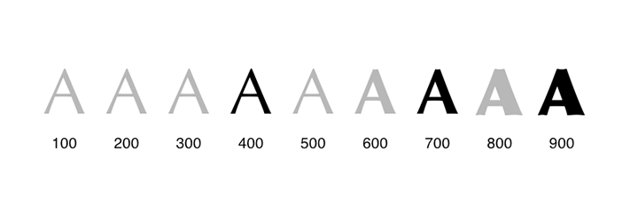

  

Cuidado aqui. Principalmente se você for usar uma fonte não web-safe. Se o peso da fonte estiver em numerais e você utilizar “bold” o seu browser irá automaticamente criar um falso negrito em torno da fonte. E isto vai atrapalhar bastante o design dela, que ficará com um aspecto grosseiro e com diferenças sutis, porém perceptíveis, na renderização de cada navegador… Verifique com cuidado quais opções de peso estão disponíveis ao escolher uma fonte. Famílias gratuitas normalmente tem opções limitadas, enquanto fontes pagas possuem uma variedade maior de pesos. Para evitar este problemas utilize a regra font-weight: normal em seu reset. Principalmente se você estiver utilizando um normatizador como o HTML5 boilerplate.

  

```
 h1, h2, h3, h4, h5, h6 {  
 font-weight: normal;  
 }
```

  

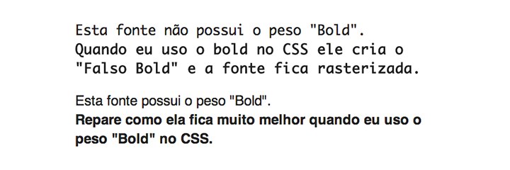

  

## Contraste

  

Ler em um monitor é cansativo. Isto acontece por que as telas são iluminadas e ficar olhando muito tempo para fontes de luz é incomodo. Para minizar esta condição é fundamental tomar um cuidado com o contraste de cores do texto.

  

Ah, o contraste 100% no caso de monitores também não é recomendável. Quando a cor do fundo for completamente branca um cinza bem escuro como #333 ou #444 é mais confortável para leitura do que o preto total (#000).

  

Lembre-se que contraste não é apenas cor. Contraste é tamanho, peso, distancia… É necessário que os links, por exemplo, possuam algum elemento que os diferencie dos demais elementos. E isto também é uma questão de usabilidade.

  

## Ritmo Vertical

  

O ritmo de um texto é definido pela hierarquia de tamanho da fonte, distancias de margens, espaçamento e entrelinhas. O ideal aqui é criar um grid horizontal para manter o ritmo equilibrado.

  

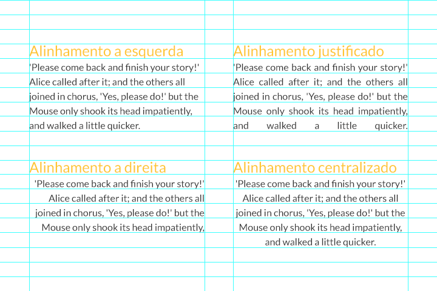

  

Ritmo vertical é um assunto complexo que poderia render [um artigo inteiro](http://24ways.org/2006/compose-to-a-vertical-rhythm/)… Mas se você for levar daqui apenas uma informação se preocupe com o valor entrelinha (line-height). Algo como 140% da altura da fonte é uma boa medida padrão. Se você quiser ser ainda mais preciso pode utilizar alguma ferramenta de calculo com base na proporção aurea como a [Golden Ratio Typography Calculator](http://www.pearsonified.com/typography/).

  

Usar números múltiplos para o tamanho das fontes também é uma boa pedida (por exemplo: 16 pixels para o texto e 32 pixels para um titulo). Manter margens e espaçamentos proporcionais também é uma ótima prática.

  

## Ligaturas

  

Ligatura ou ligadura em tipografia é quando uma ou mais letras (ou sinais gráficos) são ligadas e passam a ser representadas em um único caractere. A partir do CSS3 já é possível utilizar essa feature para web no caso de fontes Open Type. Para isto basta avisar o browser que você deseja ativar esta opção.

  

```
 h1 {  
 font-feature-settings: 'liga';  
 -webkit-font-feature-settings: 'liga';  
 -moz-font-feature-settings: 'liga';  
 -o-font-feature-settings: 'liga';  
 }
```

  

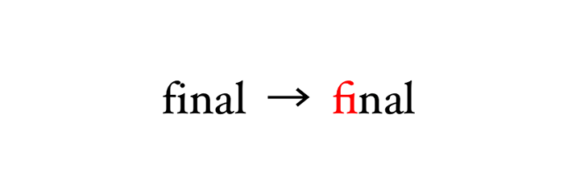

  

## Conclusão

  

Agora é só aplicar o que você aprendeu, pequeno padawan. Você pode utilizar a regra do @font-face (se não sabe como tem um [artigo aqui no próprio Tableless sobre isto](http://tableless.com.br/font-face-fonts-externas-na-web/)) ou alguma biblioteca de fontes como [Google Fonts](http://www.google.com/webfonts) ou [Typekit](https://typekit.com/). Você pode até mesmo fazer o seguro e utilizar os nossas boas e velhas amigas web safes. Mas não importa qual fonte você escolha, o importante é ter em mente que texto é interface e não decoração.

  

Capitalização, kerning, condensamento, estilo, extenção, altura x, font-stacks, fallbacks… existem muitos temas sobre tipografia web que não foram cobertos neste artigo. É um mundo inteiro de possibilidades e este é apenas um ponto de partida para criar layouts com boa legibilidade e leiturabilidade. E deixar a web um lugar um pouco mais amigável.

  

## Dicas de Leitura

  

[CSS Fonts Module Level 3](http://dev.w3.org/csswg/css3-fonts/)  
[The 100% Easy-2-Read Standard](http://informationarchitects.net/blog/100e2r/)  
[Web Design is 95% Typography](http://informationarchitects.net/blog/the-web-is-all-about-typography-period/)  
[Reactions to 95% Typography](http://informationarchitects.net/blog/webdesign-is-95-typography-partii/)  
[Five simple steps to better typography](http://www.markboulton.co.uk/journal/five-simple-steps-to-better-typography)  
[The Perfect Paragraph](http://uxdesign.smashingmagazine.com/2011/11/29/the-perfect-paragraph/)  
[On Web Typography](http://www.alistapart.com/articles/on-web-typography/)  
[CSS Typography: Techniques and Best Practices](http://sixrevisions.com/css/css-typography-02/)  
[Oliver Reichenstein: We are the Medium](http://typotalks.com/berlin/de/blog/2011/05/19/oliver-reichenstein-we-are-the-medium/)  
[Compose to a vertical rhythm](http://24ways.org/2006/compose-to-a-vertical-rhythm/)

  

### Posts Relacionados

  

[Font icons – Utilizando ícones em formato de font](http://tableless.com.br/utilizando-icones-formato-font/)

  

[Propriedade @font-face CSS – Fonts externas na web](http://tableless.com.br/font-face-fonts-externas-na-web/)

  

[Startup e propósito](http://tableless.com.br/startup-e-proposito/)

  

[Um recado da MS aos trolls do IE](http://tableless.com.br/um-recado-da-ms-aos-trolls-do-ie/)

  

[Classes Funcionais](http://tableless.com.br/classes-funcionais/)

[[anexo ausente]](http://feeds.feedburner.com/~ff/tableless?a=A3WzHQnta6s:0Ep4F1bLFl4:yIl2AUoC8zA) [](http://feeds.feedburner.com/~ff/tableless?a=A3WzHQnta6s:0Ep4F1bLFl4:D7DqB2pKExk) [[anexo ausente]](http://feeds.feedburner.com/~ff/tableless?a=A3WzHQnta6s:0Ep4F1bLFl4:7Q72WNTAKBA) [[anexo ausente]](http://feeds.feedburner.com/~ff/tableless?a=A3WzHQnta6s:0Ep4F1bLFl4:aKCwKftKxY0) [[anexo ausente]](http://feeds.feedburner.com/~ff/tableless?a=A3WzHQnta6s:0Ep4F1bLFl4:dnMXMwOfBR0) [](http://feeds.feedburner.com/~ff/tableless?a=A3WzHQnta6s:0Ep4F1bLFl4:YwkR-u9nhCs) [[anexo ausente]](http://feeds.feedburner.com/~ff/tableless?a=A3WzHQnta6s:0Ep4F1bLFl4:JEwB19i1-c4) [[anexo ausente]](http://feeds.feedburner.com/~ff/tableless?a=A3WzHQnta6s:0Ep4F1bLFl4:wF9xT3WuBAs) [[anexo ausente]](http://feeds.feedburner.com/~ff/tableless?a=A3WzHQnta6s:0Ep4F1bLFl4:V_sGLiPBpWU) [](http://feeds.feedburner.com/~ff/tableless?a=A3WzHQnta6s:0Ep4F1bLFl4:tYZ39nBRSfM)

  
[anexo ausente]  
  
  
  
from Tableless.com.br - Web Standards com Arroz e Feijão [http://tableless.com.br/um-guia-completo-de-tipografia-para-a-web/?utm\_source=feedburner&utm\_medium=feed&utm\_campaign=Feed%3A+tableless+%28Tableless%29](http://tableless.com.br/um-guia-completo-de-tipografia-para-a-web/?utm_source=feedburner&amp;utm_medium=feed&amp;utm_campaign=Feed%3A+tableless+%28Tableless%29)
