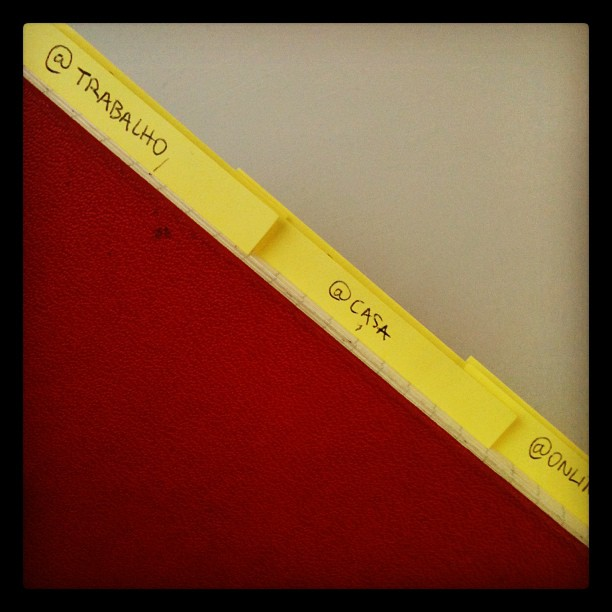
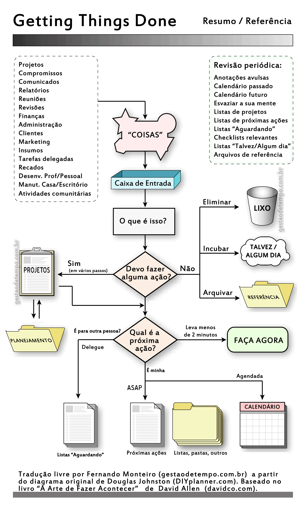

### Sent to you by Thiago Silva via Google Reader:

## 

[Como implementar o GTD sem tecnologia](http://vidaorganizada.com/organizacao/metodos-e-tecnicas/gtd/como-implementar-o-gtd-sem-tecnologia/)

via [Vida Organizada](http://vidaorganizada.com) by Thais Godinho on 12/20/12

  

Faz tempo que eu estou prometendo este post com dicas para utilizar o GTD sem tecnologia, mas eu demorei porque queria passar mais tempo lidando com o sistema só no papel novamente para escrever um relato mais completo.

Já falei aqui no blog sobre [como eu organizo meus projetos através do GTD e do Toodledo](http://vidaorganizada.com/organizacao/comece-a-se-organizar/como-eu-utilizo-o-metodo-gtd-e-o-toodledo/ "Como eu utilizo o método GTD e o Toodledo"). Porém, como recebo muitos comentários de leitores dizendo que não gostam de usar ferramentas no computador e preferem papel, eu resolvi voltar a usar somente papel para poder escrever a respeito e dar dicas sobre como poderiam ser as melhores formas de uso.

Resumindo, vou dizer que sinto muita falta do Toodledo. Em todos esses anos buscando ferramentas de organização, ele é o que mais se adequa às minhas necessidades. Eu experimentei MUITAS ferramentas até chegar a ele, e usando o papel de novo eu entendi porque gostei tanto da ferramenta. Então, antes que vocês me digam qualquer coisa, já antecipo que vou voltar ao Toodledo, por todos os motivos que já falei no outro post (linkado acima).

A agenda de papel, no entanto, pretendo manter, pois gosto de ter uma agenda física, que posso consultar a qualquer momento. Não curti a experiência de usar somente a agenda eletrônica. Mesmo tendo acesso pela Internet e com o celular, vi várias falhas no sistema que a agenda de papel nunca me proporcionou. Sendo assim, [‘bora pra 2013 com uma agenda de papel](http://vidaorganizada.com/organizacao/comece-a-se-organizar/que-agenda-usar-em-2013/ "Que agenda usar em 2013?"). =)

Mas vamos lá: como eu implementei o método GTD sem usar qualquer tipo de tecnologia? Vou falar sobre cada uma das etapas do método: coleta, processamento, ação e revisão.

### 1. Coleta

A coleta sempre foi feita por mim no papel. Continuo usando um caderno como caixa de entrada, assim como usava antes. A razão é muito simples: o caderno está sempre comigo. A única mudança que pretendo implementar é usar um caderno em formato pocket, como a minha agenda, para ocupar menos espaço na minha bolsa, no dia a dia. Carregar um caderno grande atrapalha bastante, pois não dá para ser levado para todos os lugares.

Por exemplo, se eu quiser ir a um restaurante com as minhas amigas, levo meu caderninho pocket e uma caneta sem problemas. Vai que preciso anotar algum lembrete? Já com o caderno grande, isso só será possível se eu levar uma bolsa enorme, o que não vem ao caso.

Muitas, muitas pessoas me escrevem perguntando como usar esse caderno. Eu já expliquei no post sobre o Toodledo (linkado lá em cima), mas vou explicar novamente porque é bastante simples: eu apenas escrevo a data do dia em que estou e vou anotando ali tudo o que vou recebendo de informação naquele dia. Não tem segredo, nem técnica específica, cor de caneta, nada. Simplesmente vou anotando tudo o que chega. É uma caixa de entrada, gente. É onde você vai coletar todo tipo de informação, lembrete, ideia, coisa pra fazer que chegar até você. Não é para organizar nada ali, só anotar para tirar da cabeça e não correr o risco de esquecer. Você vai organizar o que está ali no passo seguinte, na hora de processar.

### 2. Processamento

Para usar o GTD com papel, eu tenho as seguintes ferramentas:

1. Uma agenda de papel, em formato pocket, onde eu anotarei meus compromissos e tarefas relacionadas a datas específicas;
2. Um caderninho, também em formato pocket, onde eu anotarei exclusivamente as tarefas. Só as tarefas! (foto acima);
3. Uma pasta de plástico normal para guardar informações sobre os meus projetos (uma em casa e outra no trabalho);
4. Uma pasta sanfonada (12 divisórias) para usar como arquivo de referência rápida;
5. Folhas de sulfite para escrever informações sobre os projetos;
6. Canetas, clipes, grampeadores e o que mais você quiser para usar no manuseio dos materiais.

Como eu uso esses materiais: se você conhece o método GTD, já sabe mais ou menos para que serve cada uma das coisas acima. Se não conhece, recomendo de verdade que leia o livro. Isso aqui é somente a minha aplicação, que pode ser diferente para outras pessoas. Se basear somente no que eu estou falando pode não ser o suficiente e deixar muitas arestas, que só podem ser fechadas com a leitura do livro. Por isso quando vocês me escrevem com dúvidas fica complicado de responder, porque é complexo e depende da leitura mesmo, então minha resposta invariavelmente vai parecer incompleta. Enfim, na dúvida, leia o livro. =)

**Agenda de papel -** Já falei sobre isso no [post sobre que agendas usar em 2013](http://vidaorganizada.com/organizacao/comece-a-se-organizar/que-agenda-usar-em-2013/ "Que agenda usar em 2013?"). Explico que uso somente para compromissos e informações pontuais. Por favor, leia o post para entender de forma melhor.

**Caderninho com tarefas -** Muitas pessoas confundem esse caderninho com o caderno de caixa de entrada, mas eles não são a mesma coisa! Nesse caderno entrarão somente as tarefas! Organizadas por contextos! Você vai revisar suas anotações no caderno de caixa de entrada e, o que for tarefa, vai para o caderninho de tarefas. Para isso existe o diagrama do GTD:

:   Imagem: [GestãodeTempo.com.br](http://xn--gestodetempo-5bb.com.br/)

Esse diagrama tem no livro e mostra o que fazer com cada item da sua caixa de entrada, quando você for processá-la. Você analisa o primeiro item ali anotado e se pergunta se é uma ação, e vai seguindo os passos acima.

**Pastas para projetos -** Tenho uma pasta no meu trabalho e uma pasta em casa para os meus projetos. Dentro delas, eu guardo folhas de sulfite onde descrevo cada projeto. Na folha de cada projeto, está o meu planejamento dele – todas as informações que preciso ter a respeito. Em anexo, com outra folha sulfite grampeada, eu deixo a lista de tarefas relacionadas àquele projeto. Toda vez que eu reviso o projeto eu vejo se alguma tarefa já foi concluída e, se sim, eu passo a tarefa seguinte para o meu caderninho de tarefas. Isso garante que o meu caderninho de tarefas tenha somente as tarefas executáveis, e não tarefas que demandem outras antes. Isso é muito importante, pois senão o seu sistema não funciona. Se você inserir uma tarefa não-executável no caderninho, vai tudo por água abaixo pois você não confiará mais no que você está fazendo.

Não tem regra para a criação das pastas. No Toodledo, eu usava uma pasta para cada área da minha vida. Como eu não quis usar muita tralha nesse momento, deixei uma pasta para trabalho e outra para pessoal, mas porque eu pretendo usar durante pouco tempo (como falei, vou voltar para o Toodledo).

**Pasta sanfonada -** A pasta sanfonada funciona como o arquivo de referência rápida de 43 pastas do David Allen. As 43 pastas são, basicamente, 12 para os meses e 31 para os dias. Eu cheguei a ter um arquivo de pastas suspensas com as 43 pastas, mas percebi que não usava muito (não tinha tanto papel assim para arquivar ali) e uma pasta de 12 divisórias (só para meses) se mostrou suficiente.

O que é para guardar ali? Resumidamente, papéis que você vai precisar somente no mês em questão. Formulário assinado, algum boleto para pagar, coisas desses tipo. Quando chegar ao mês, verifique o que precisa tomar de providências analisando os papéis que estão guardados ali.

### 3. Ação

Todos os dias, momentos, horários que você resolver atacar a sua lista de coisas a fazer (caderninho com as tarefas organizadas por contextos), você pode seguir uma determinada ordem. Eu faço assim:

1. Olho as tarefas que preciso fazer no dia de hoje, indiscutivelmente. Se já puder fazer alguma, faço e risco. Se outra for só mais tarde (depende de horário), faço depois e passo para a lista de contextos.
2. Olho as tarefas no contexto em que me encontro. Computador, trabalho, casa etc. Pego a primeira da lista, faço e risco. Pego a segunda, faço e risco. E assim vai, até mudar de contexto.
3. Muito provavelmente, já terei feito as tarefas mais importantes do dia e as mais fáceis pelo contexto. Aí eu analiso se estou com pique total ou com a mente cansada (conheça a melhor hora do dia para você). E aí eu invisto em atividades mais adequadas para esse momento. Se eu estiver com um pique maior, faço uma tarefa mais complicada, por exemplo.
4. Meu último (porém não menos importante) fator de decisão na hora de escolher uma tarefa para fazer é a sua prioridade. Fazer as unhas ou estudar o capt. 3 da matéria X? Eu vou estudar! Suas prioridades delineiam suas ações.

Também é importante lembrar que há tarefas:

- pré-definidas (rotinas)
- que aparecem de última hora (as famosas urgências)

As rotinas devem ser feitas quando você estiver no piloto automático – naquele momento do dia em que você está com a energia baixa, sem poder de concentração. Não gaste energia com essas tarefas.

As tarefas de última hora aparecem mesmo e precisamos dar conta delas. Não tem jeito. O que você pode fazer é se organizar para garantir que, ao menos da sua parte, elas não aparecerão. Como não vivemos em uma ilha, elas são inevitáveis. Força aí!

### 4. Revisão

Revisão nada mais é do que você verificar se seus projetos e tarefas estão caminhando bem.

**Diariamente**, é necessário revisar:

- Sua pasta de referência rápida, para ver se existe algum documento hoje que demande a sua atenção;
- A sua agenda, para verificar compromissos e tarefas que precisam ser inadvertidamente feitas hoje;
- A sua lista de tarefas por contextos, para você ir fazendo todas elas aos poucos;
- A sua lista de “em espera”.

Ah, eu não tinha falado sobre ela ainda. =)

A lista de “em espera” é uma lista onde você anotará as tarefas que você espera de alguém. Por exemplo: você fez um relatório e precisa da aprovação do seu chefe para arquivar. Ok, está “em espera”. A melhor forma de fazer isso, no papel, é fazer a anotação “em espera” na frente da tarefa, na página do projeto (nas folhas de sulfite, lembra?). Ou você pode fazer uma lista em separado, o que eu particularmente acho que fica muito confuso (apesar de ser a recomendação do David Allen). O Toodledo é bom por isso: não preciso ficar copiando tarefas de novo – basta mudar seu status.

Ou seja, diariamente, você verificará tudo o que está “em espera” e poderá cobrar as pessoas envolvidas, para que seus projetos não se atrasem.

O Toodledo também oferece uma opção de “delegados”, para tarefas que você delegou a alguém. Acho uma ótima ideia, e também pode ser implementada no papel igual à lista “em espera”.

**Semanalmente**, você vai revisar:

- Sua caixa de entrada, apenas para verificar se não deixou escapar nada anotado ali (o processamento das informações deve ser feito uma vez por dia, pelo menos, para não acumular);
- Suas pastas com projetos, revisando cada um deles. Riscará as tarefas que já foram concluídas e verá quais as próximas, passando para o seu caderninho de tarefas por contextos;
- Sua lista de projetos “algum dia/talvez”.

A lista de projetos “algum dia/talvez” basicamente é uma lista com projetos que existem, mas não estão em andamento. Simples. Você pode deixar na mesma pasta dos projetos (eu deixo), com um post-it colorido indicando “algum dia/talvez”. Semanalmente, você revisará esses projetos e verá se pode começar algum deles. É divertido. =)

**Ocasionalmente**, você vai revisar:

- Seus objetivos de longo, médio e curto prazo.

O que são eles? Leia este texto [aqui](http://vidaorganizada.com/organizacao/como-definir-prioridades-e-executar-tarefas/ "Como definir prioridades e executar tarefas"). Seus objetivos são o seu norte. Eles não são tarefas, nem projetos. São seus motivos para acordar todos os dias e fazer o que tem que ser feito. Eles também demandam revisão, pois podem se tornar obsoletos com o passar do tempo, ou ainda mais fortes.

Você pode listá-los onde você quiser. Eu costumo ter uma página (folha de sulfite) no meu [control journal](http://vidaorganizada.com/casa/manutencao/como-criar-o-seu-control-journal/ "Como criar o seu control journal").

Outro dia [a leitora Vivian compartilhou seu caderno GTD](http://vidaorganizada.com/organizacao/dica-doa-leitora/dica-do-leitor-caderno-gtd/ "Dica do leitor: caderno GTD"), que ela mistura com o control journal. Só para constar, eu não faço assim. Não preciso andar com meu control journal por todo lado – preciso somente das informações da minha lista de tarefas por contextos, da minha agenda e da minha caixa de entrada. Mas isso vai da preferência de cada um.

Espero que o post tenha dado uma clareada no assunto. =)

### Textos relacionados:

- [Como eu utilizo o método GTD e o Toodledo](http://vidaorganizada.com/organizacao/comece-a-se-organizar/como-eu-utilizo-o-metodo-gtd-e-o-toodledo/)
- [O que é o método GTD?](http://vidaorganizada.com/organizacao/metodos-e-tecnicas/gtd/o-que-e-o-metodo-gtd/)
- [Dica do leitor: usando o GTD](http://vidaorganizada.com/organizacao/dica-doa-leitora/dica-do-leitor-usando-o-gtd/)
- [Utilizando a agenda de forma organizada](http://vidaorganizada.com/organizacao/comece-a-se-organizar/utilizando-a-agenda-de-forma-organizada/)
- [Dica do leitor: caderno GTD](http://vidaorganizada.com/organizacao/dica-doa-leitora/dica-do-leitor-caderno-gtd/)
- [Os cinco passos do GTD](http://vidaorganizada.com/organizacao/metodos-e-tecnicas/gtd/os-cinco-passos-do-gtd/)
- [O básico para gerenciar tarefas segundo o GTD](http://vidaorganizada.com/organizacao/comece-a-se-organizar/o-basico-para-gerenciar-tarefas-segundo-o-gtd/)
- [Resumo do método GTD](http://vidaorganizada.com/organizacao/metodos-e-tecnicas/gtd/resumo-do-metodo-gtd/)
- [Organize as to-do lists por contexto, não por assunto](http://vidaorganizada.com/organizacao/comece-a-se-organizar/organize-as-to-do-lists-por-contexto-nao-por-assunto/)
- [Algumas definições do GTD](http://vidaorganizada.com/organizacao/metodos-e-tecnicas/gtd/algumas-definicoes-do-gtd/)

  

### Things you can do from here:

- [Subscribe to Vida Organizada](http://www.google.com/reader/view/feed%2Fhttp%3A%2F%2Fvidaorganizada.com%2Ffeed%2F?source=email) using **Google Reader**
- [Get started using Google Reader](http://www.google.com/reader/?source=email) to easily keep up with **all your favorite sites**
