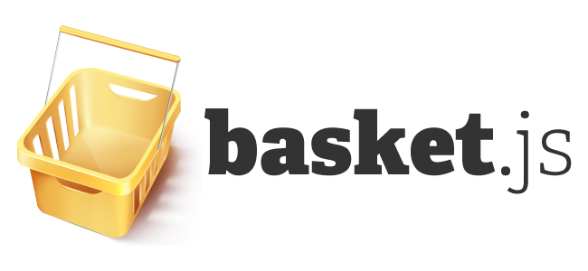

### Sent to you by Thiago Silva via Google Reader:

## 

[Basket.js: A JavaScript Loader With LocalStorage-based Script Caching](http://badassjs.com/post/40850339601)

via [Badass JavaScript](http://badassjs.com/) on 1/18/13

  

[Basket.js](http://addyosmani.github.com/basket.js/) is an interesting project that caches JavaScript files in localStorage for subsequent requests rather than relying on the browser’s built-in caching features.  I’ve long thought about doing something like this using the [FileSystem API](http://www.html5rocks.com/en/tutorials/file/filesystem/), but localStorage is probably a better idea (at least for fallback) since it is supported everywhere (even IE8).

Why do this and not just use the browser’s cache?  Because it’s [faster](http://www.stevesouders.com/blog/2011/03/28/storager-case-study-bing-google/), according to tests performed by both Google and Bing, both of which employ the technique on their sites now.  Basket.js enables you to take advantage of the same technique in your sites and apps.

It works by first loading a small stub file (Basket.js itself) and then checking to see whether your other scripts are already cached in localStorage, and if not or if they are expired, loading them via XHR and caching for subsequent loads.  Basket.js has a nice [Promise](http://wiki.commonjs.org/wiki/Promises/A)-based API, using [RSVP.js](https://github.com/tildeio/rsvp.js) which allows you to require scripts and inject them into the page to execute.

It’s a fairly simple project, but implements a very useful idea.  I’d love to see a FileSystem API based version as well to see how performance varies compared to localStorage.  Apparently they’ve already tried IndexedDB and found it to be much slower than localStorage, which I found surprising.  In either case, both the FileSystem API and IndexedDB are designed more for this use-case, and have much larger quotas than localStorage, so it would be useful to experiment with them both in the future.

It would also be interesting to combine this with the App Cache API to provide offline support.  App Cache [has a lot of problems](http://www.alistapart.com/articles/application-cache-is-a-douchebag/), so if you could get it down so that it only had to store a small HTML stub file containing a small amount of JavaScript to load everything else from the FileSystem API, IndexedDB or LocalStorage, your app would work both offline and online, without most of the headache of App Cache.  As long as the HTML stub file never needed to change, your JavaScript would be in full control of when and how things are loaded and cached.  It’s an interesting idea, and one I think would be fun to explore.

Anyway, I thought [Basket.js](http://addyosmani.github.com/basket.js/) was worth a mention.  You can check out the source on [Github](https://github.com/addyosmani/basket.js).

  

### Things you can do from here:

- [Subscribe to Badass JavaScript](http://www.google.com/reader/view/feed%2Fhttp%3A%2F%2Ffeeds.feedburner.com%2Fbadassjs?source=email) using **Google Reader**
- [Get started using Google Reader](http://www.google.com/reader/?source=email) to easily keep up with **all your favorite sites**
