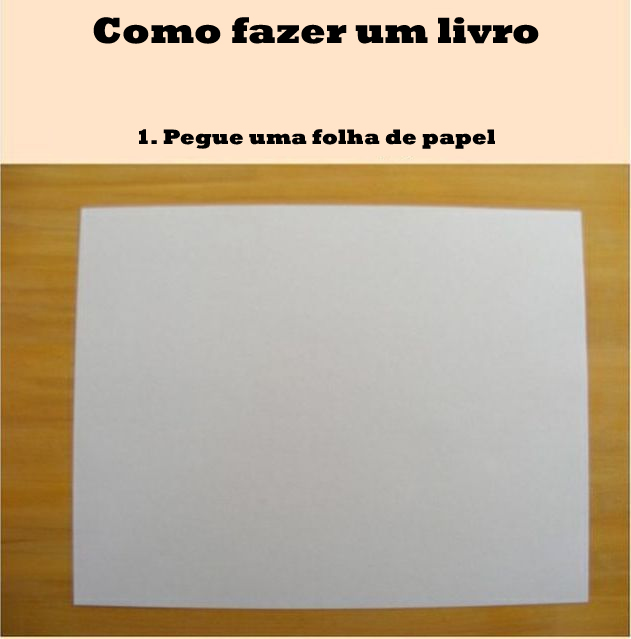
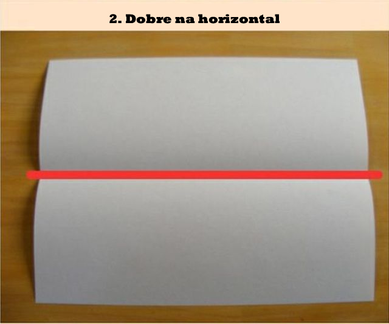
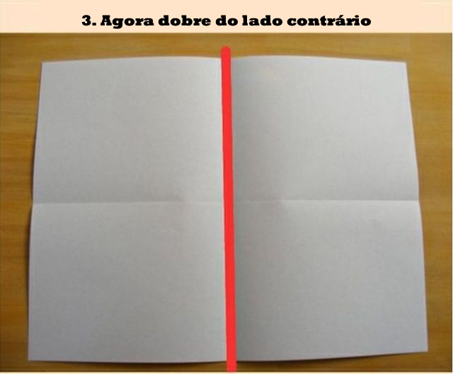
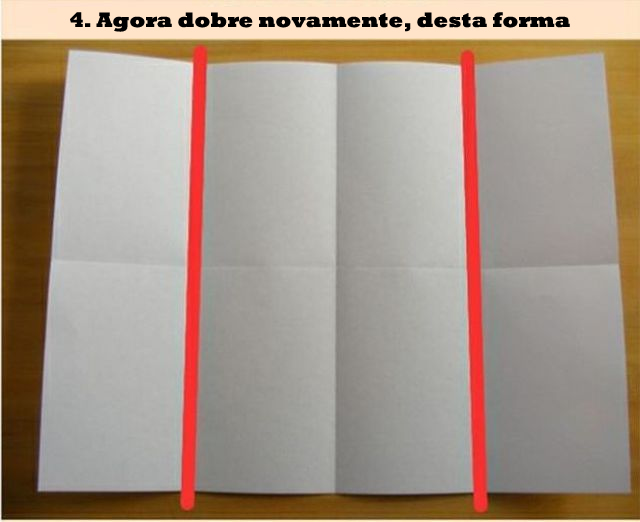
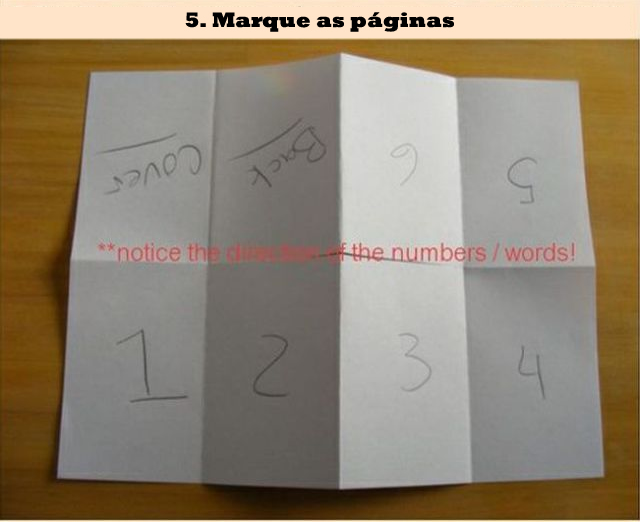
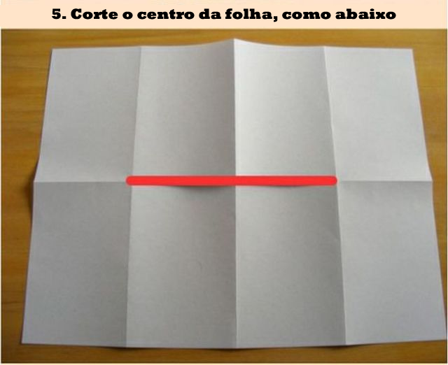
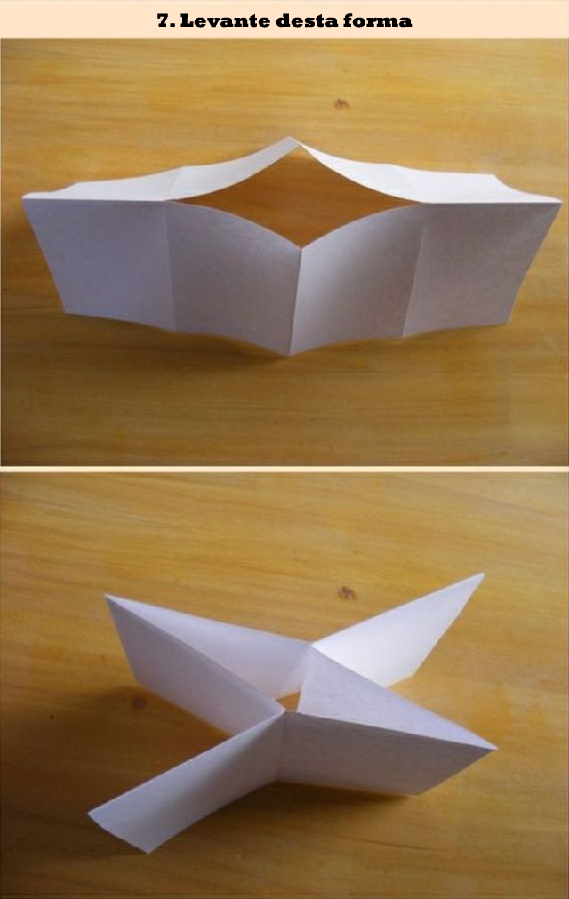
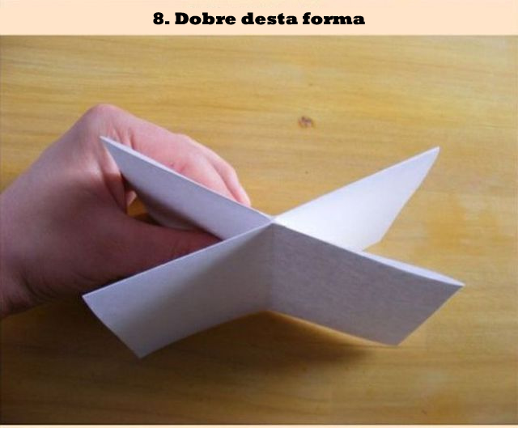
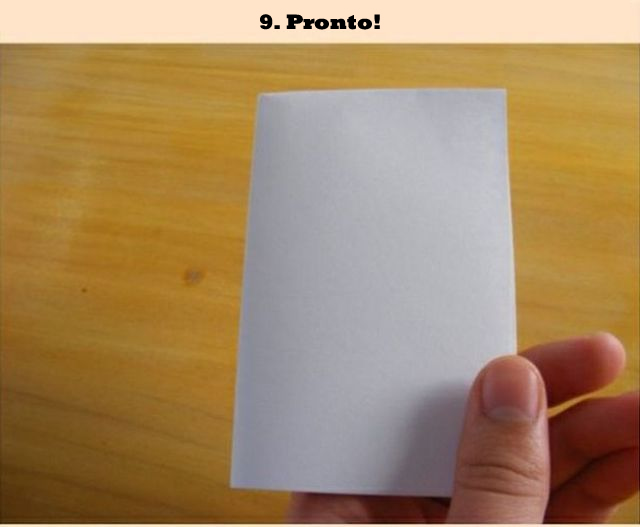
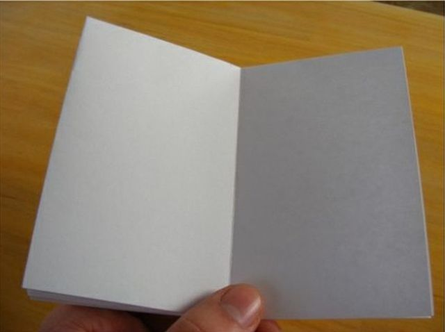

### Sent to you by Thiago Silva via Google Reader:

## 

[Coisas que não vão mudar sua vida, mas um dia poderão ser úteis: Como
dobrar um livro](http://colunistas.ig.com.br/obutecodanet/2013/01/24/coisas-que-nao-vao-mudar-sua-vida-mas-um-dia-poderao-ser-uteis-como-fazer-um-livro/)

via [O Buteco da Net](http://colunistas.ig.com.br/obutecodanet) by ONEberto on 1/24/13

  

Sabe aquelas coisas que não mudarão sua vida caso você não saiba? Pois é, uma delas é saber como criar um livro, obedecendo a paginação. Muita gente já tentou fazer e nunca conseguiu, portanto aí vai.

Notas relacionadas:

1. [Livro desfaz imagem de ‘bom moço’ de Bon Jovi e mostra fotos com várias mulheres semi-nuas](http://colunistas.ig.com.br/obutecodanet/2010/07/28/livro-desfaz-imagem-de-bom-moco-de-bon-jovi-e-mostra-fotos-com-varias-mulheres-semi-nuas/ "Permanent Link: Livro desfaz imagem de ‘bom moço’ de Bon Jovi e mostra fotos com várias mulheres semi-nuas")
2. [Autor de livro reúne as mais curiosas e diversas fotos tiradas com microscópio eletrônico](http://colunistas.ig.com.br/obutecodanet/2010/10/18/autor-de-livro-reune-as-mais-curiosas-e-diversas-fotos-tiradas-com-microscopio-eletronico/ "Permanent Link: Autor de livro reúne as mais curiosas e diversas fotos tiradas com microscópio eletrônico")
3. [Dicas interessantes que poderão ajudar seu cotidiano](http://colunistas.ig.com.br/obutecodanet/2012/02/01/dicas-interessantes-que-poderao-ajudar-seu-cotidiano/ "Permanent Link: Dicas interessantes que poderão ajudar seu cotidiano")

  

### Things you can do from here:

- [Subscribe to O Buteco da Net](http://www.google.com/reader/view/feed%2Fhttp%3A%2F%2Fcolunistas.ig.com.br%2Fobutecodanet%2Ffeed%2F?source=email) using **Google Reader**
- [Get started using Google Reader](http://www.google.com/reader/?source=email) to easily keep up with **all your favorite sites**
