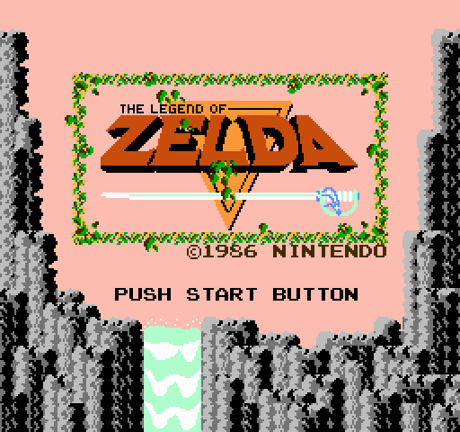
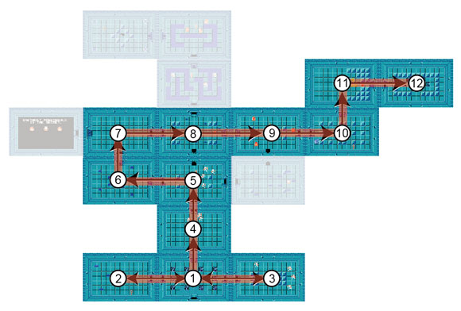

# **L**earning From The Masters: Level Design In The Legend Of Zelda

When going back to replay classic games I played as a kid to mine them for knowledge, I always fear that any games from the NES era or earlier are too old to learn much from**.**

I tend to assume that many elements of modern design will be missing: no training, bad difficulty ramping, haphazard level design, and so forth**.** Before writing this article, I was under the impression that many "good design principles" I've come to know and love were invented during the SNES era and iterated on from there**.**

The NES was the Wild West of game development, I thought, lawless and free**.**

So when I went back on Link's 25th anniversary to play the first *Zelda* game and maybe write an article about it, I was a bit gun-shy**.**

As it turns out, I was totally wrong**!** Instead of finding something outdated with a ton of nostalgia value, I found an excellent primer in the fundamentals of non-linear game design**.**

In an interview, creator Shigeru Miyamoto once said that with *The Legend of Zelda*, he wanted to evoke the feelings associated with exploration in the player:

"When I was a child," Miyamoto said, "I went hiking and found a lake**.** It was quite a surprise for me to stumble upon it. When I traveled around the country without a map, trying to find my way, stumbling on amazing things as I went, I realized how it felt to go on an adventure like this**.**" *– via [Wikipedia](http://en.wikipedia.org/wiki/Shigeru_Miyamoto#cite_ref-Sheff_51_18-0)*

To achieve this feeling, Miyamoto and company invented a number of really clever tricks to create non-linear levels that are still useful today**.**

**I can still hear the music in my dreams... MY DREAMS**!****

# **So What Are We Doing Here**?****

While going through *The Legend of Zelda*, I played each level and then did an in-depth analysis of the level on paper**.** This kind of analysis is pretty standard fare; I do it all the time on colleagues' level designs**.** There are a few things I'm always looking for:

- **Level Flow****.** How do the spaces in the level fit together? Where is the player supposed to go, and will she know how to get there**?**
- **Intensity Ramping**. Does the intensity of the experience ramp up in a satisfying way**?** Do monsters get more difficult as the level goes on**?** Does the player get a chance to learn how the enemies work and then display her mastery later on**?**
- **Variety**. Is there sufficient variety in the gameplay**?** Do enemy encounters frequently repeat themselves? Are the spaces varied in interesting ways**?**
- **Training**. If the design requires new skills from the player, does it teach and test those skills appropriately**?**

In this article, I'll apply the same methodology to the first level from the original *Legend of Zelda***.** Fortunately, this is made easier by the fact that top-down maps of the level designs are easily and readily available**.** I'm only going to cover the first dungeon in this article, but the principles apply to all of them**.**

If you'd like to check them out yourself, you can find the maps I used here: [Mike's RPG Center](http://mikesrpgcenter.com/zelda/maps.html) **.**(By the way, Mike is awesome and gave me permission to use his maps in this article**.** Thanks, Mike**.**)

# **Level Flow**

**Breakdown**

Based on my memories of the game, one of my assumptions going into this experiment was that the rooms in the dungeons were laid out haphazardly**.** I always remember getting the feeling that I was navigating my way through the rooms almost randomly, spitting in the designers' faces and getting to the end only because of my mighty gaming talents**!**

After analyzing the flow of the dungeons, I quickly abandoned this notion**.** As it turns out, the dungeon layouts are very carefully planned and the flow is very cleverly executed**.**

First, I analyzed the critical path. The critical path is the shortest path through a level without using secrets, shortcuts, or cheats**.** Basically, it's the path the designer intends the player to take through the level unless she gets really clever**.**

It's worth noting that the critical path often doesn't require a player to complete 100 percent of a level; it just requires her to complete the mandatory objectives within the level**.**

For each of the dungeons, the critical path is almost always linear**.** There are very few instances where the player is required to re-traverse ground she's already seen**.** The only exception to the linearity rule tends to be two or three rooms at the beginning of the dungeons that allow you to choose between a small subset of rooms.

 **The player begins in Room 1 and can choose to go to Room 2 or Room 3**.** Rooms off the critical path are faded (click for full size)**.****

Optional rooms (and sometimes entire paths) branch off from the critical path and reward the player with bonuses**.** The levels are also full of shortcuts that cut across the critical path**.** If the player has bombs, for example, she can skip from Room 5 to Room 8 in the above diagram**.**
