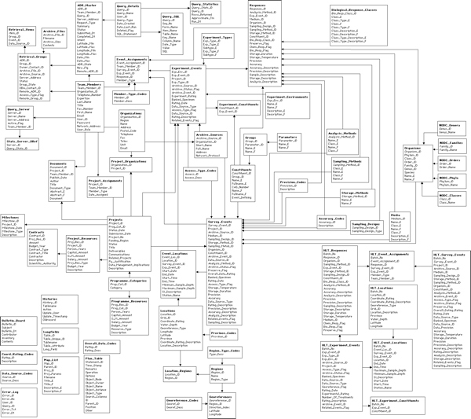
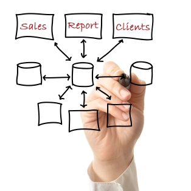
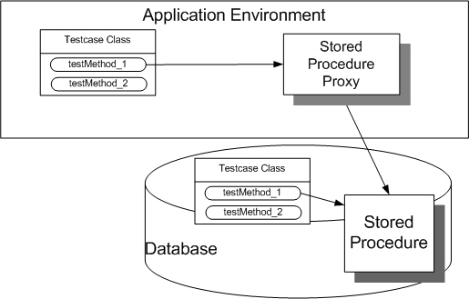
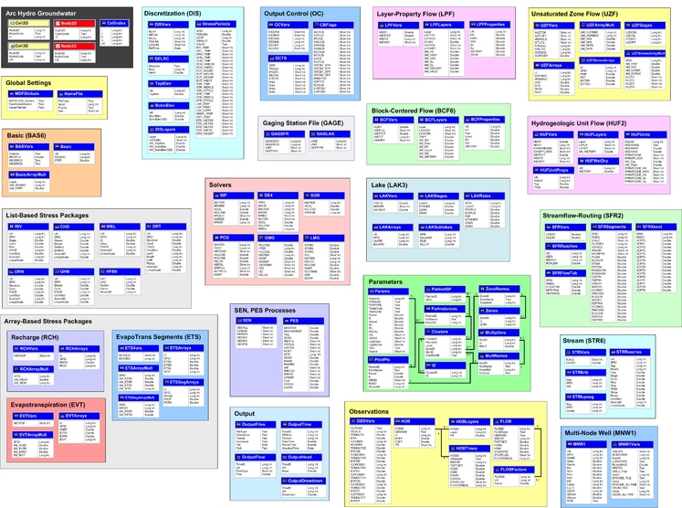
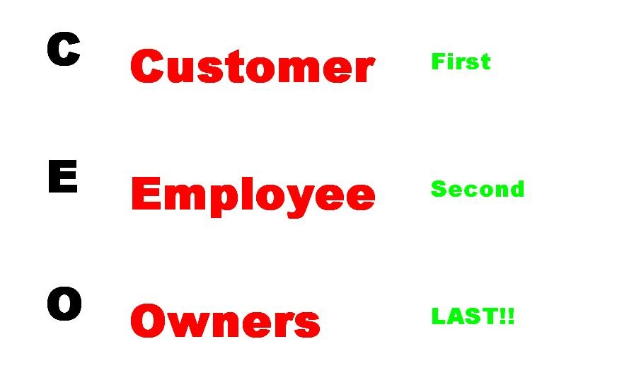
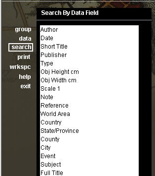
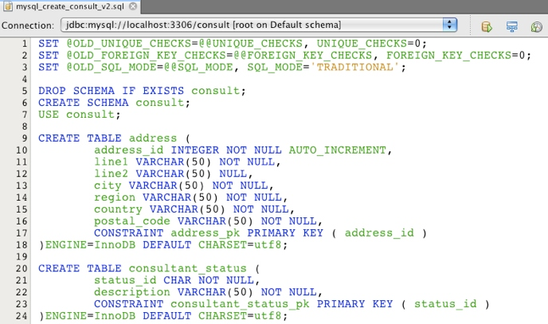
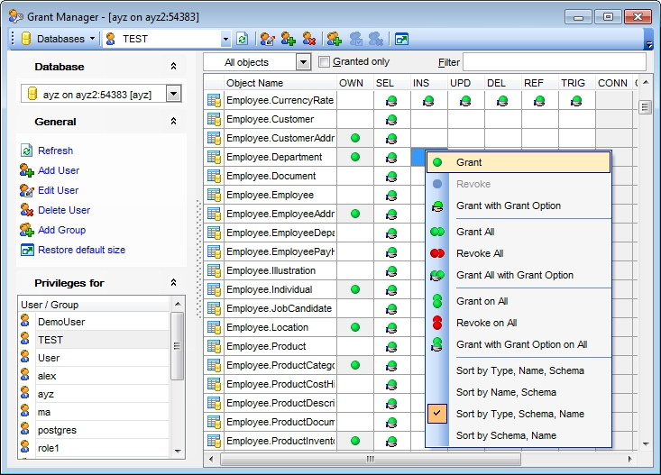
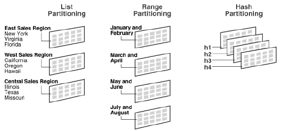
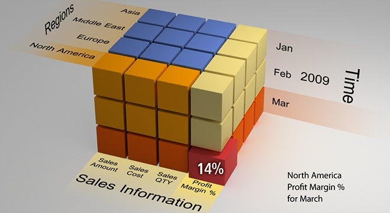

### Sent to you by Thiago Silva via Google Reader:

## 

[Dicas para trabalhar com modelos de dados grandes](http://feedproxy.google.com/~r/imasters/~3/Jd5Y_5PxBUQ/story01.htm)

via [iMasters](http://imasters.com.br) by Mauro Pichiliani on 1/30/13

  

Olá, pessoal. Como DBA há algum tempo, acabo fazendo várias consultorias em diferentes clientes que têm problemas com seus bancos de dados. Entre os cenários de bases de dados que eu encontrei, provavelmente o aspecto que mais afeta o meu trabalho é lidar com modelos de banco de dados grandes e complexos, que foram criados para satisfazer os requisitos de armazenamento dos dados.

A origem destes modelos não é incomum nos dias de hoje: com novos requisitos sendo agregados aos sistemas existentes, os desenvolvedores e outros profissionais têm que modificar os objetos do banco de dados, criar novas tabelas, relacionamentos, colunas, tipos de dados e assim por diante. Além disso, é fato que se a empresa cresce, os dados armazenados também tendem a crescer muito, o que aumenta a complexidade para executar tarefas de manutenção no modelo, nos dados, nos objetos, e no banco de dados em geral. Deste modo, a fim de ser preparado para lidar com modelos de banco de dados grandes e complexos, apresento algumas dicas que preparam o terreno e ajudaram a resolver os problemas do banco de dados do cliente que me contratou para a consultoria.

O objetivo principal deste artigo é apresentar algumas dicas para ajudar os profissionais que precisam trabalhar com modelos de bancos de dados complexos, grandes e de difícil compreensão, que qualquer um pode encontrar no trabalho do dia a dia. Normalmente, esses modelos de banco de dados armazenam milhares de gigabytes em muitos objetos relacionados, que podem ser usados por centenas de usuários simultâneos. Então, ter algum tipo de lista TODO para lidar com este tipo de bases de dados especiais pode ser boma não apenas para resolver problemas imediatos, mas também para organizar o trabalho para futuras necessidades e tarefas de manutenção. Apenas para pontuar, recomendo para aqueles que possuem pouca experiência com modelagem de banco de dados escutar o [episódio do DatabaseCast que fala sobre modelagem de dados](http://imasters.com.br/artigo/25013/banco-de-dados/databasecast-24-modelagem/). Sem mais delongas, estas são as minhas dicas para aqueles que têm de compreender e manipular rapidamente um modelo de banco de dados grande sem ser seu criador.

## 1. Identificar as maiores, mais cheias mais usadas tabelas no modelo

Todo modelo de banco de dados grande tem pelo menos uma tabela principal que contém uma elevada porcentagem do tamanho do banco de dados. Este é um fato observado através de muitos anos de experiência. Também é comum encontrar nesta tabela uma grande quantidade de colunas com tipos de dados diferentes. Na maioria dos casos, essas tabelas grandes são as mais acessadas e utilizadas pelas aplicações e, por isso, é muito útil e recomendado conhecer e reconhecer estes objetos rapidamente, uma vez que você provavelmente vai acabar trabalhando com eles mais cedo ou mais tarde. Possuir uma maneira de diferenciar essas tabelas dos outros objetos em um diagrama é um plus que pode economizar tempo quando for necessária uma olhada rápida no modelo.

## 2. Use uma ferramenta de controle de versão ou de gestão de configuração

  
 Hoje existem muitas ferramentas que oferecem recursos para acompanhar as mudanças ao longo do tempo no modelo de banco de dados, [como já citado em outro artigo](http://imasters.com.br/artigo/24026/carreira/dicas-de-produtividade-para-dbas-e-programadores/). Novas colunas, relacionamentos, mudanças de tipos de dados e outras modificações menores como estas são comuns em modelos de banco de dados grandes, que tendem a evoluir constantemente para se adaptar a novos requisitos de negócios e pedidos de mudança na aplicação. O uso de ferramentas de controle de versão pode requerer a geração de um script contendo a definição da base de dados dos objetos ou tarefa similar. Como alternativa, já existem recursos para integrar as ferramentas com IDEs existentes, tais como o Microsoft Visual Studio.NET com o Team Foundation Server. Sendo assim, o argumento de que os DBAs não precisam utilizar alguma ferramenta de controle de versão porque eles não fazem nenhum programa não é mais aceitável hoje em dia.

## 3. Saiba como imprimir o modelo de banco de dados completo ou parcial

Ah, o modelo de banco de dados impresso! Milhares de escritórios e paredes dos departamentos de TI ao redor do mundo são decorados com essas relíquias que se tornam onipresentes quando o modelo de dados se torna grande. Como eu aprendi com as muitas equipes que eu trabalhei, há sempre alguém que pede uma versão impressa de algum objeto ou até mesmo o modelo de banco de dados inteiro. Portanto, é importante sempre ter uma maneira simples, rápida e fácil de imprimir uma tabela, ou um conjunto de tabelas e seus relacionamentos. Opções para gerar arquivos PDF, imprimir o modelo de banco de dados em páginas separadas (seguido pela tediosa tarefa de grudar as folhas na ordem) e o uso de cores diferentes de papel para identificar versões e outros metadados do modelo estão entre as práticas que vem a calhar para um DBA que trabalha com uma equipe de desenvolvedores.

## 4. Identifique os objetos complementares mais utilizados (stored procedures, triggers, funções, índices)

Uma vez que o banco de dados não é composto apenas por tabelas e seus relacionamentos, é muito pragmático conhecer os outros objetos que acessam, controlam e manipulam as principais tabelas mencionadas no primeiro item deste artigo. Eu descobri que os modelos de dados grandes geralmente empregam muitas stored procedures, views, funções, triggers e outros objetos que são tão importantes quanto as tabelas que armazenam os dados. Conhecer a lógica por trás das principais linhas de código que compõem esses objetos pode economizar tempo durante a depuração, diminuir o esforço necessário para o processo de tunning e colocar o DBA em uma posição muito confortável quando há a necessidade de modificar os dados.

## 5. Tenha como visualizar o banco de dados em camadas separadas: com e sem relacionamentos, com e sem índices, com e sem constraints, etc

O mercado é inundado com ferramentas CASE de modelagem que podem ajudar os profissionais a lidar com grandes modelos de banco de dados lógicos e físicos. No entanto, se estes modelos puderem ser criados de forma interativa e incremental da mesma forma como uma imagem é criada a partir de camadas, o DBA pode ter um meio poderoso para visualizar detalhes específicos sem toda a complexidade de um modelo grande. Por exemplo, imagine um modelo de banco de dados de um ERP (Enterprise Resource Planning) que contém tabelas originais e algumas tabelas criadas para a integração com um sistema de intranet existente ou mesmo customizações adicionais ao ERP. Seria muito importante se o DBA pudesse simplesmente esconder as tabelas do modelo que vieram a partir da integração com a intranet e, assim, visualizar as informações necessárias para uma tarefa específica que exige apenas as tabelas de ERP e vice-versa. Este tipo de disposição em camadas do modelo é uma maneira muito inteligente para separar e isolar as partes do modelo que são específicas para uma tarefa, de modo a evitar a propagação da complexidade do modelo.

## 6. Use retângulos coloridos para agrupar tabelas de um mesmo subsistema

Outra abordagem que pode ser utilizada para separar e isolar partes do modelo sem modificá-lo é o uso de desenhos coloridos. Por exemplo, retângulos coloridos são praticamente um padrão de modelagem utilizado quando existe a necessidade de separar os subsistemas de um modelo. Esta técnica é fácil, simples e não apenas agrupa tabelas e relacionamentos, mas também melhora a legibilidade e a documentação do modelo. É claro, comentários sobre os elementos do modelo são muito úteis quando eles descrevem em poucas palavras informações que podem levar horas de estudo e análise para serem obtidas.

## 7. Obtenha a ordem correta para inserir, atualizar e remover os dados em tabelas específicas, respeitando os relacionamentos entre elas

  
   
 Este item é um pouco complicado, pois geralmente a ordem correta para inserir, atualizar e remover os dados em tabelas do modelo é programada na aplicação ou no interior de um objeto no banco de dados como, por exemplo, uma stored procedure. A parte complicada é que as modificações são influenciadas e moldadas por regras de negócios e, às vezes, é quase impossível separá-los. No entanto, se o DBA pode realizar essa separação e criar um script que inseria, atualize ou remova corretamente os dados nas tabelas da mesma forma como eles são feitos através da aplicação, o profissional aumenta seu arsenal de scripts e pode economizar várias horas durante um chamado ou situação emergencial. Por favor, não me interpretem mal: eu não estou sugerindo que o DBA ou qualquer outro profissional deva modificar diretamente os dados da tabela sem passar pela aplicação (o famoso forçar o dados na mão ou por debaixo do pano) a fim de resolver rapidamente um problema. O que estou sugerindo é que o conhecimento de como as tabelas interagem entre si para uma operação ou tarefa específica pode ser muito útil e deve estar no conjunto de ferramentas do DBA.

## 8. Sempre tenha uma forma rápida de procurar pelo nome dos atributos

Modelos complexos podem conter centenas ou mesmo milhares de objetos de banco de dados. É prudente ter uma maneira simples de pesquisar e obter informações de metadados a partir dele. Quase sempre é preciso saber exatamente qual tabela ou view interna do banco de dados contém a informação quando o DBA está à procura de algo. Boas ferramentas CASE de modelagem também fornecem opções e recursos adicionais para pesquisas básicas e avançadas nos elementos de modelagem mesmo se o estágio de criação do diagrama estiver no início.

## 9. Tenha um script que gere todos os objetos banco de dados com uma fração de seu dados (10% é ok)

Este ponto é mais uma dica pessoal do que uma ferramenta obrigatória. Em várias ocasiões eu precisei criar um ambiente novo de banco de dados para teste/produção/ homologação (ou para qualquer combinação destes) a partir de um modelo de banco de dados existente. Estas situações exigem que os todos os objetos devam ser criados em um servidor diferente (às vezes virtualizado) com toda a complexidade do modelo, porém com apenas uma fração de seus dados. A marca de mais ou menos 10% parece ser uma taxa de dados aceitável para começar, porque pode haver ocorrências de determinadas entidades (produtos, clientes, funcionários, configurações de aplicativos, etc) no banco de dados necessárias para que a aplicação funcione. O script necessário para criar todos os objetos é trivial e pode ser gerado automaticamente por uma ferramenta fornecida pela base de dados, mas a geração da ordem correta para inserir os dados pode ser uma tarefa complexa, como discutido no item 7.

## 10. Mantenha uma lista atualizada das permissões nos objetos mais comuns para saber rapidamente o que um usuário específico pode e não pode fazer com os objetos

Talvez a tarefa administrativa mais comum de um DBA envolva o gerenciamento de permissões. Os comandos DCL (Data Control Language) e as interfaces gráficas de usuário das ferramentas administrativas de banco de dados fornecem uma maneira adequada e simplificada para concessão, revogação e negação das permissões de um objeto para os usuários. Assim, o DBA que trabalha com um modelo complexo tem que estar ciente das permissões atribuídas para os objetos e os usuários. A separação de permissões em grupos pode ser muito útil, mas saber como indicar rapidamente qual grupo possui um conjunto específico de permissões para as tabelas de um subsistema do modelo é uma habilidade imprescindível que qualquer DBA deve possuir. Contar com uma documentação resumida e agrupada descrevendo as permissões do usuário para as principais tabelas e objetos pode ter um grande impacto na realização de tarefas administrativas diárias, especialmente se o banco de dados trata a segurança de acesso de forma diferenciada.

## 11. Saiba como prever e estimar o tamanho de objetos específicos para prever o crescimento ou encolhimento do banco de dados

Previsões baseadas em dados reais e modelos estatísticos, criados a partir de uma distribuição de dados, podem ser muito úteis quando há necessidade de criar um relatório sugerindo a alocação e/ou realocação de recursos de banco de dados que afetam os custos de hardware e largura de banda. Na minha experiência com consultoria achei mais profissionais atuando por “achismo” do que eu gostaria de admitir quando há necessidade de justificar alocação/realocação de recursos de banco de dados. Aqui a dica é simples: sempre monte suas sugestões com base em estatísticas, métricas, medidas, necessidades e demandas reais para tornar o seu argumento sólido ao invés de criá-lo na suposição e valores pobres, previstos sem uma base estatística concreta.

## 12. Mostre no modelo quais objetos possuem opções de particionamento, se eles são compactados e a quais os grupos de arquivos eles pertencem

Os bancos de dados relacionais atuais possuem muitas opções para particionamento, compressão e de separação interna dos dados armazenados dentro das tabelas. Ao fazer tarefas de manutençã,o é importante saber quais tabelas são compactadas, possuem particionamento ativado, como este particionamento é implementado e onde os dados são armazenados fisicamente (ou seja, os grupos de arquivos e os arquivos de dados). No entanto, o modelo de dados e o diagrama de ER não tem uma notação específica para representar este tipo de informação, pois isso é responsabilidade do DBA descobrir como descrever e documentar essas opções e configurações. Comentários, cores diferentes, figuras geométricas ou até mesmo uma pequena tabela indicando como o particionamento separa os dados são sugestões que podem tornar o modelo mais rico e aumentar a percepção da DBA sobre opções e configurações apenas dando uma rápida olhada no diagrama.

## 13. Em modelos OLAP centralize a tabela de fatos e tenha à mão uma maneira de visualizar as hierarquias principais, os níveis, membros e grãos de cada tabela de dimensão

Modelos de dados OLAP, implementados no estilo estrela, floco de neve (snowflake) ou uma mistura desses dois estilos, tendem a ser mais simples que os complexos modelos de dados OLTP. Uma das razões para isso é porque há mais planejamento envolvido durante a elaboração das relações e as entidades do que o planejamento de modelos OLTP. Além disso, as definições das dimensões, níveis, hierarquias e grãos cria uma estrutura lógica de dados que é facilmente visualizada após uma inspeção dos detalhes da tabela. No entanto, a documentação pobre das características de dimensões e as suas relações com os dados da tabela faz com que o modelo seja mais difícil de compreender. Uma ideia para simplificar a compreensão de um modelo de dados OLAP é centralizar a tabela fato no diagrama de tal maneira que ela se destaque das outros e possa ser claramente identificada à primeira vista. Decorar o modelo com abundância de informações agrupadas sobre a estrutura e metadados das dimensões também é uma boa prática que pode economizar tempo quando é preciso imaginar como os dados vão ser mostrados quando o usuário estiver navegando em um cubo de dados.

Depois de explicar essas dicas, é fácil perceber a maioria delas se concentra na [documentação do modelo de banco de dados e seus objetos](http://imasters.com.br/artigo/6392/sql_server/documentacao_do_dba/). Obviamente, os principais esforços no desenvolvimento de sistemas estão relacionados à implementação de novos requisitos e alteração de recursos existentes. No entanto, a comunidade de TI e especialmente os DBAs, devem insistir na tarefa de documentação não apenas no código fonte ou no software a ser entregue, mas também em artefatos que são importantes para todo o ciclo de desenvolvimento.

Ao seguir as dicas apresentadas neste artigo, os leitores podem se preparar melhor para lidar, entender e trabalhar com modelos de dados grandes e complexos. Este cenário não é incomum conforme a aplicação vai recebendo mais dados. Contar com algumas dicas e melhores práticas pode  ajudar o profissional quando é preciso lidar com dados em um banco de dados complexo e um modelo extenso. Os leitores que apreciaram as dicas deste artigo podem encontrar mais conteúdo como este no meu livro chamado [Conversando sobre Banco de dados, já a venda](http://clubedeautores.com.br/book/126042--Conversando_sobre_banco_de_dados).

[anexo ausente]

|  |  |
| --- | --- |
| [9bcafcd24ef5e7a319a7e300c0d5b221.gif](http://share.feedsportal.com/viral/sendEmail.cfm?lang=pt&title=Dicas+para+trabalhar+com+modelos+de+dados+grandes&link=http%3A%2F%2Fimasters.com.br%2Fbanco-de-dados%2Fdicas-para-trabalhar-com-modelos-de-dados-grandes%2F) | [75b9131ce15803402621ad7d693d4dd1.gif](http://res.feedsportal.com/viral/bookmark_pt.cfm?title=Dicas+para+trabalhar+com+modelos+de+dados+grandes&link=http%3A%2F%2Fimasters.com.br%2Fbanco-de-dados%2Fdicas-para-trabalhar-com-modelos-de-dados-grandes%2F) |

  
  
[[anexo ausente]](http://da.feedsportal.com/r/151884996659/u/49/f/546640/c/33212/s/280f3866/a2.htm)[anexo ausente][anexo ausente]

  

### Things you can do from here:

- [Subscribe to iMasters](http://www.google.com/reader/view/feed%2Fhttp%3A%2F%2Fimasters.uol.com.br%2Ffeed%2F?source=email) using **Google Reader**
- [Get started using Google Reader](http://www.google.com/reader/?source=email) to easily keep up with **all your favorite sites**
