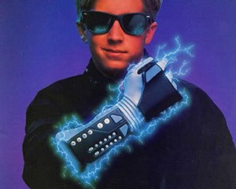
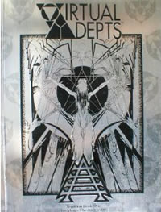
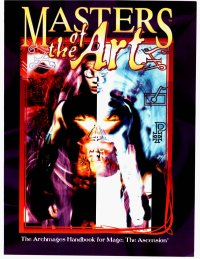
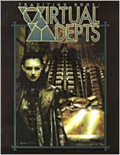

  
  
Esse artigo busca explicar um pouco mais sobre alguns tópicos importantes na vida de um [**Adepto da Virtualidade**](http://livrodosespelhos.com/tradicao-adeptos-da-virtualidade/) que são esquecidos às vezes, para facilitar a vida de jogadores iniciantes de [**Mago: A Ascensão**](http://livrodosespelhos.com/sobre-mago-a-ascensao/) que queiram jogar com a ELITE.

  

## ELITISMO

  

Talvez um dos aspectos mais importantes da vida de um Adepto seja o **ELITISMO** (assim mesmo, escrito em maiúsculas). Embora seja difícil de conceber uma sociedade onde o status social parece ser definido por pegadinhas, bravatas, contos de façanhas e atos de coragem e inteligência, no entanto, definir o sentido de ELITE entre os Adeptos é um pouco mais difícil de explicar.

  

Construir o próprio renome entre os Adeptos pode ser a diferença entre ser levado a sério em um momento crucial ou ser ridicularizado em público, tanto quanto as políticas intrincadas de postos entre os **Herméticos** ou a organização de qualquer outra [**Tradição**](http://livrodosespelhos.com/o-conselho-das-nove-tradicoes-mistikas/). A diferença se encontra na forma como esse renome é alcançado, extremamente particular da Tradição.

  

  

Compre o Tradition Book Virtual Adept First Edition

  

Para um Adepto, histórias sobre invasões de Construtos, FAQs bem feitas, feitos malucos e insanamente arriscados e boatos meticulosamente espalhados valem tanto quanto demonstrações de inteligência e sabedoria. Quanto mais feitos, sejam eles reais ou impossíveis de se provarem falsos um Adepto reúne, maior é sua lenda entre os Adeptos da Virtualidade.

  

O ELITISMO tem vários níveis, conforme avança em poder ou renome o mago. Um mago da ELITE é extremamente bem visto, sendo um elogio profundo, enquanto um mago da ELITE MÁXIMA é praticamente uma lenda viva, sendo um **Arquimestre** ou **Mestre**de feitos memoráveis. Enquanto isso, temos o reverso: um mago chamado de farrapo (ou rato) será visto como uma desgraça. Suas histórias não serão levadas a sério, suas sugestões vistas como burrada e não haverá jeito de convencer alguém a convidar o pobre coitado para uma festinha maneira na Teia…

  

  

Compre o Masters of the Art

  

### ELITISMO entre Arquimestres

  

Apesar de serem considerados a ELITE MÁXIMA, os Arquimestres da Tradição estão longe de serem pivetes anárquicos escondidos atrás de um computador, brincando de trollar a tudo e a todos. Um Adepto com esse nível de conhecimento se torna um verdadeiro servo da informação, buscando libertá-la e levá-la a todos da melhor forma possível, ainda que isso não signifique passá-la a qualquer “n00b”.

  

Um Arquimestre Adepto aprendeu a deixar de lado as brincadeiras e agir no cerne do problema, visualizando uma realidade muito mais perfeita e o que está a seu alcance para torná-la real. A virtualidade não significa irrealidade, baby. ; )

  

### Um por Todos, Todos por Um

  

Mesmo que o ELITISMO divida os Adeptos em posições um tanto anárquicas e caóticas para quem vê de fora – e crie rivalidades dentro da Tradição – os Adeptos tem um sentimento imenso de família. Ferir um Adepto é conseguir uma guerra com a Tradição inteira, mesmo que signifique defender um rival. Esse sentimento surgiu com as origens da Tradição na época da escapada da [**Tecnocracia**](http://livrodosespelhos.com/uniao-tecnocratica/), quando o grupo todo se refugiou dentro da [**Teia**](http://livrodosespelhos.com/a-teia-digital-mago-a-ascensao/).  Quando se tornaram parte do Conselho, logo notaram que a desconfiança das outras Tradições os manteve sozinhos, mesmo em um grupo. A caçada ferrenha e contínua de seus ex-aliados da Tecnocracia também não permitia uma trégua, e assim, nascia uma união mais forte que tudo.

  

## Resolvendo disputas entre Adeptos

  

A política de união Adepta não significa que tudo seja flores entre eles. Disputas surgem como em todos os grupos. E esses atritos precisam ser resolvidos, de maneira… civilizada.

  

### Disputas na Terra

  

  

Compre o Tradition Book Virtual Adept Revised

  

Quando o atrito surge entre Adeptos fora da Teia, a solução é buscar uma forma de disputa em que ambos os Adeptos tenham chance – e seja vista como um teste “válido” de raciocínio, habilidade, inteligência e percepção. Em geral essas disputas tomam a forma de um jogo de xadrez, resolução de equações impossíveis e jogos de videogame insanos. Há casos em que a disputa pode ser cancelada – quando um dos concorrentes faz uma estupidez grande demais, é dever dos outros Adeptos mostrar que ele não está certo. Isso pode significar depor um Diácono que não fala por sua Tradição, ou anarquizar o status de uma cabala inteira.

  

### Disputas na Teia

  

Enquanto as disputas na Terra podem tomar múltiplas formas, na Teia elas têm principalmente dois tipos. A mais amena Guerra de Chamas, ou as terríveis Guerras entre Centros.

  

### Guerras de Chamas

  

Essas guerras (popularmente conhecidas como *flame wars*) tomam a forma de discussões online, presenciadas por muitos outros magos. Os dois competidores se insultam, de forma cada vez mais agressiva, ou dando seus pontos de vista igualmente afiados em uma discussão. Os insultos e pontos de vista tomam a forma de bolas de fogo e chamas, que são arremessadas contra o oponente. Essas chamas não ferem realmente, mas deixam o ícone do perdedor marcado por um bom tempo.

  

  

Se os dois oponentes forem farrapos, há sempre a opção de os espectadores queimarem ambos e tornarem tudo mais divertido…

  

### Guerra entre Centros

  

Muito mais sérias, essas Guerras requerem um desafio e uma aceitação formais. Os oponentes investem sua Quintessência na criação de um computador virtual, amarrando seu próprio Avatar a ele no processo. O próximo passo é cada um criar um super-vírus, e   
  
abastecê-lo com a Quintessência gratuita da Teia. Os vírus são jogados dentro do computador, e aquele que durar mais tempo, depois de destruir o outro, vence. Os vírus podem tomar muitas formas, desde exércitos de mortos-vivos e pokémons até uma complexa batalha aérea.

  

Considerando a natureza dessas guerras, é possível que os oponentes recebam um dano considerável por brincarem com o próprio Avatar. Esse dano não é curado por mágika, apesar de não ser permanente.

  

Para aqueles que desejam aplicar a Guerra entre Centros em jogo na forma de sistema, funciona assim: o vírus é criado fazendo um teste de Computador + Inteligência (dificuldade 8). Quanto mais sucessos, mais poderoso o vírus. Para carregar o vírus com a Quintessência livre, basta usar um efeito de **Primórdio 3**.

  

A Guerra em si acontece com ações prolongadas, feitas separadamente se cada oponente é um jogador. O teste é de Avatar + Computador (sim, você usa seu Avatar no teste), com dificuldade 9, sendo vitorioso aquele que conseguir 25 sucessos primeiro. Cada sucesso na criação do vírus adiciona um sucesso ao teste prolongado, e cada cinco pontos de Quintessência canalizada para o vírus adicionam um sucesso a mais. Os testes são feitos três vezes por dia de jogo, o que torna a Guerra extremamente lenta.

  

Cada falha crítica causa um Nível de Vitalidade de dano não agravado, e falhas críticas duplas custam um ponto temporário de Avatar. Esses danos se curam como o dano comum, apesar de não ser possível curá-lo usando mágika ou absorvê-lo. O perdedor da guerra também recebe um Nível de Vitalidade de dano, além de perder pontos temporários de Avatar.

  

**Fontes:** Masters of the Art, Tradition Book Virtual Adepts, Tradition Book Virtual Adepts Revised  
**Autora:** Emi  
**Revisora:** Eva

  

[[anexo ausente]](http://feeds.feedburner.com/~ff/livrodosespelhos?a=-BouHbkEp-U:Nu-5OY7Rijk:yIl2AUoC8zA)  [[anexo ausente]](http://feeds.feedburner.com/~ff/livrodosespelhos?a=-BouHbkEp-U:Nu-5OY7Rijk:F7zBnMyn0Lo) [[anexo ausente]](http://feeds.feedburner.com/~ff/livrodosespelhos?a=-BouHbkEp-U:Nu-5OY7Rijk:V_sGLiPBpWU) [[anexo ausente]](http://feeds.feedburner.com/~ff/livrodosespelhos?a=-BouHbkEp-U:Nu-5OY7Rijk:qj6IDK7rITs)

  
[anexo ausente]  
  
  
  
from Livro dos Espelhos <http://livrodosespelhos.com/a-vida-como-adepto-da-virtualidade/>
