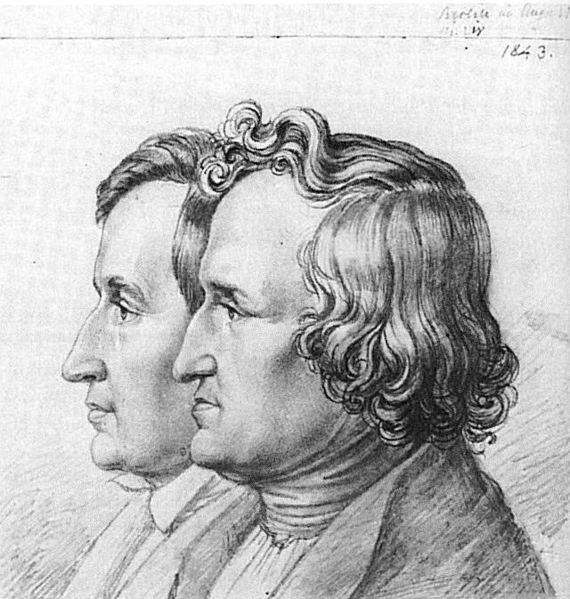

  
  

Veja o artigo Contexto histórico e os livros infantis ao longo do tempo

  
  

Em 20 de dezembro de 2012 fez 200 anos (1812) que os [Irmãos Grimm](http://pt.wikipedia.org/wiki/Irm%C3%A3os_Grimm) publicaram a primeira edição de seus contos folclóricos, “[Kinder-und Hausmärchen](http://archive.org/details/kinderundhausm00grimuoft)“, publicado em dois volumes em 1812 e 1815.

  

O curioso sobre os textos originais dos Grimm é que, como provavelmente toda literatura da época, estavam ligadas fortemente a aspectos da vida dos escritores. Essa primeira edição de 1812-15 é totalmente diversa da edição de 1857. As alterações, tanto em estilo como em conceitos da época, foram tão marcantes que atingiram o próprio conceito de contas de fadas.

  

Esse paralelo traçado sobre a descoberta (considerando a primeira edição) e a redescoberta dos contos de Grimm é um assunto tão sério na Alemanha, aliás, na Europa como um todo, que revela a própria redescoberta do [folclore](http://livroseafins.com/tag/folclore/), algo que determina a própria fonte da verdadeira identidade daquele povo, representada a partir das histórias.

  

Imergindo na história pessoal dos [Irmãos Grimm](http://livroseafins.com/tag/irmaos-grimm/), temos que Jacob (nascido em 1785) e Wilhelm (1786) ainda eram adolescentes quando começaram a coletar todos os tipos de contos populares e canções, no início do século XIX. Eles eram estudantes precoces na [Universidade de Marburg](http://www.uni-marburg.de/).

  

Por volta de 1805, a família mudou-se para a vila de [Hanau, Alemanha](http://pt.wikipedia.org/wiki/Hanau), e vivia um ambiente cercado de problemas financeiros. Muito cedo, os Irmãos perderam seu pai em 1796 e sua mãe, mais tarde, em 1808 .

  

Em 1806, Jacob interrompeu seus estudos para servir e participar das Guerras Napoleônicas. Nesse meio tempo, Wilhelm tornou-se funcionário público e foi trabalhar na Biblioteca Real com um parco salário. Em 1807, Jacob foi contratado como bibliotecário para o [Rei Jerome, irmão de Napoleão](http://pt.wikipedia.org/wiki/Fam%C3%ADlia_Bonaparte).

  

Em 1812-15, apesar de todo o cenário desfavorável, dificuldades financeiras, morte dos pais, responsabilidade de cuidar dos 3 irmãos menores, os Grimm provaram seu valor, revelando serem estudiosos inovadores no campo da [filologia](http://pt.wikipedia.org/wiki/Filologia) alemã, publicando artigos sobre literatura medieval. E eles foram mergulhando mais e mais na construção do passado da sua cultura, a partir da literatura.

  

Desde 1808, a pedido de [Clemens Brentano](http://en.wikipedia.org/wiki/Clemens_Brentano), poeta romântico, os Irmãos começaram a coletar contos populares para reuní-los em uma só obra. Em 1810, eles enviaram ao poeta cerca de 54 textos copiados (sim! eram apenas cópias), o que foi uma sorte porque Brentano perdeu o manuscrito no [mosteiro Ölenberg na Alsácia](http://www.orden-online.de/wissen/o/oelenberg/). Percebendo que o poeta não iria adiante com a publicação da coletânea de contos, os Irmãos começaram a semear a ideia entre amigos e conhecidos.

  

Foi em 1812 que outro poeta, [Achim von Arnim](http://de.wikipedia.org/wiki/Achim_von_Arnim), publicou a primeira edição dos contos reunidos que a esta altura se somavam 86. E após, em 1815, saiu outra coletânea com 70 outros, mas que ainda faziam parte da primeira edição que incluía notas de rodapé para os contos, bem como prefácios acadêmicos.

  

Mais do que reunir os contos folclóricos, em termos gerais, os Grimm procuraram coletar e preservar todos os tipos de relíquias antigas como se fossem sagradas. Consistiam de contos, mitos, músicas, fábulas, lendas, épicos, documentos e outros artefatos – não apenas contos de fadas. Eles pretendiam rastrear e captar a essência da evolução cultural e demonstrar como a linguagem natural, decorrentes das necessidades, costumes e rituais dos povos comuns, poderiam dialogar com atualidade.

  

Em 1857, outra edição dos contos foi publicada, bem mais modificada. E o trabalho passou a abordar com mais ênfase aspectos como a ação e resolução de conflitos. Os contadores de histórias da época, de um modo geral, não se davam a rodeios. Eles eram propensos a dizer as verdades que eles conheciam, mesmo que a magia, superstição, transformação miraculosa, e brutalidade estivessem envolvidos.

  

Críticas sempre hão de existir para o bem ou para o mal ou mesmo para encher a paciência de quem trabalhou duro. Algumas delas apontam  que eles interferiram na autenticidade dos contos coletados, outras, porém, diametralmente opostas, cuidam que eles apenas coletaram os contos editaram, reeditaram sem inovação. O fato é que 200 anos se passaram e 2000 se passarão e os contos ainda continuam sendo, com adapatações, modificações e versões, um enorme sucesso.

  

### Mas,  e o bloco do “e eu com isso?”

  

9 lições que podemos aprender com os Irmãos Grimm:

  

1. Estudar vale a pena;

     

   Valorizar a cultura nacional;

     

   Reunir e fazer reviver a produção literária nacional, esteja ela escrita ou não;

     

   Respeitar e aceitar as próprias origens;

     

   Não se preocupe em ser original o tempo todo, mas respeite os direitos autorais;

     

   Você pode reinventar a roda;

     

   Não coloque todos os ovos em uma cesta;

     

   Mostre seu trabalho;

     

   Cuidado com as pessoas para as quais você mostrará seu trabalho.

  

Baixe aqui a obra original: ”[Kinder-und Hausmärchen](http://archive.org/details/kinderundhausm00grimuoft)”

  

[Veja aqui a obra da primeira edição de 1812](http://commons.wikimedia.org/wiki/Category:Kinder_und_Hausm%C3%A4rchen_(Grimm)_1812_I).

  

FONTES

  

[Fonte da Imagem Museu Histórico de Hanau](http://www.zeno.org/Kunstwerke/B/Grimm,+Ludwig+Emil%3A+Jacob+und+Wilhelm+Grimm+%5B1%5D).

  

[Fonte de Imagem de destaque](http://commons.wikimedia.org/wiki/File:Kinder_title_page.jpg).

  

[Veja o artigo de Zack Zipes](http://publicdomainreview.org/2012/12/20/the-forgotten-tales-of-the-brothers-grimm/).

  

[Livros](http://livroseafins.com/)

  
Tags: [contos de fatas](http://livroseafins.com/tag/contos-de-fatas/), [folclore](http://livroseafins.com/tag/folclore/), [irmãos grimm](http://livroseafins.com/tag/irmaos-grimm/)[anexo ausente]  
  
  
  
from Livros <http://livroseafins.com/9-licoes-que-podemos-aprender-com-os-irmaos-grimm/>
