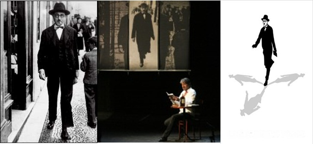
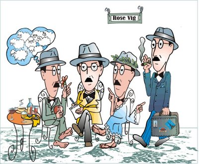
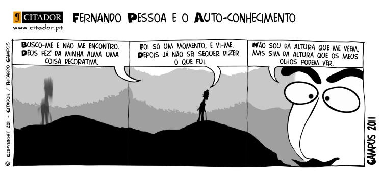

Certa vez, uma professora muito querida de semiótica, na empolgação da aula, parou alguns instantes, olhou para a turma e contou uma situação que nunca mais me saiu da cabeça: um casal de amigos se casou por causa de Fernando Pessoa. É isso mesmo. O rapaz se apaixonou pela moça assim que ela declamou o enorme, porém belíssimo, poema *Tabacaria*, do heterônimo Álvaro de Campos, só que num lugar bastante inusitado: um bar, no meio daquela agitação maluca, música alta, bebida, muita gente. Eles se descobriram enamorados e desde lá nunca mais se separaram.

  

  

A história parece até simples e seria algo fácil se Tabacaria fosse apenas um soneto, mas não é bem assim. Não é pelo tamanho do poema que se pode dar o crédito ao [poeta](http://livroseafins.com/tag/poeta/) (ele tem mais de 15 versos e está no final do post). E sim pela qualidade da poesia contida naquele texto.  Os poemas de Pessoa são instigantes, misteriosos e vão além de qualquer poema já lido antes. E, por isso, pelas intervenções da sua poesia, foi possível levantar essa questão: como o [poeta](http://livroseafins.com/tag/poeta/) de Orpheu poderia mudar a sua vida?!

  

Vamos aos fatos: Fernando Antônio Nogueira Pessoa foi um poeta singular, um dos maiores gênios literários que já caminhou neste mundo. Nasceu em Lisboa em 13 de junho de 1888 e morreu em Lisboa, no dia 30 de novembro de 1935. Foi jornalista, tradutor e crítico literário. Fundou a revista Orpheu em 1915 e teve como grande amigo Mário de Sá Carneiro.  Mas nada foi tão importante quanto a criação de vários poetas ao mesmo tempo.

  

  

Os heterônimos (não são pseudônimos) foram sua maior contribuição para a humanidade, cada um com sua biografia, traços diferentes de personalidade e ainda características literárias distintas. Cada heterônimo possui seu próprio mundo, representando o que angustiava ou encantava o seu autor. Foram cerca de 72 heterônimos, mas em 2011, o biógrafo brasileiro José Paulo Cavalcanti Filho revelou que na verdade são 127 ao todo.  Os três mais importantes e significativos são:

  

  

**Alberto Caeiro** (meu preferido) é o mestre de todos os heterônimos. Nasceu em 1889, mas não era formado, só tinha o primário. É o poeta que pensa com os sentidos. Por isso, sensacionista. É poeta do campo, das coisas mais simples e belas do mundo. Para ele o mundo não encerra mistérios, como Deus, metafísica, “sentido último das coisas”. Nada disso importa. As coisas são apenas as coisas. E é esta realidade pura, sem símbolos que constitui a sua criação. Segue um trecho do Guardador de Rebanhos:

  

*“Eu nunca guardei rebanhos,*  
*Mas é como se os guardasse.*  
*Minha alma é como um pastor,*  
*Conhece o vento e o sol*  
*E anda pela mão das Estações*  
*A seguir e a olhar.*  
*Toda a paz da Natureza sem gente*  
*Vem sentar-se a meu lado.*  
*Mas eu fico triste como um pôr de sol*  
*Para a nossa imaginação,*  
*Quando esfria no fundo da planície*  
*E se sente a noite entrada*  
*Como uma borboleta pela janela.*

  

*Mas a minha tristeza é sossego*  
*Porque é natural e justa*  
*E é o que deve estar na alma*  
*Quando já pensa que existe*  
*E as mãos colhem flores sem ela dar por isso.”*

  

  

Álvaro de Campos nasceu em 1890, era engenheiro, é o poeta modernista, que escreve as sensações da energia e do movimento bem como, as sensações de “sentir tudo de todas as maneiras”, pela experiência do tédio e da desilusão, até um pouco pessimista:

  

*“Grandes são os desertos, e tudo é deserto / Grande é a vida, e não vale a pena haver vida e da fadiga/O que há em mim é, sobretudo cansaço – / Não disto nem daquilo, / Nem sequer de tudo ou de nada: / Cansaço assim mesmo, ele mesmo, / Cansaço.”*

  

Em *Tabacaria,* o poeta trata da angústia com o cotidiano e dos sonhos de libertação ao mesmo tempo e isso é um exemplo do quanto esses versos foram vitais para o casal do conto de fadas moderno que foi citado no início deste post. Talvez a moça em questão tenha conseguido se libertar da angústia do amor até o momento, não correspondido, e enfim realizado um sonho, quem sabe?! (só uma ideia)

  

  

Ricardo Reis nasceu em 1914, era médico e é o poeta clássico, inspirado na poesia latina. Escrevia suas obras de maneira simétrica e harmônica, sempre com a razão. E como disse um professor de Literatura Portuguesa II, Fernando Pessoa – o Ortônimo era movido pela imaginação, por isso tantos heterônimos.

  

De uns tempos para cá, Fernando Pessoa, bem como seus heterônimos, tem se tornado popular nessa nova geração por meio de compartilhamentos na internet via [Facebook](http://livroseafins.com/tag/facebook/) ou Twitter. Não importa o meio, ele sempre é citado. E isso não é ruim, não. É muito bom, pois cada heterônimo com seu modo de sentir e expressar o que o incomoda na vida, só faz aproximar os novos leitores, que no fim vão se interessar pela obra do português e buscá-lo a qualquer hora, a qualquer momento e lugar.

  
  

  
  

E o que fica para os leitores do Livros e Afins é que Pessoa sempre vai mudar a vida de alguém, não importa o tempo, idade, raça, sexo ou credo. Há um poeta (ou vários no caso de Pessoa) em cada um de nós e para cada um  de nós, basta saber usá-los.  Segue alguns versos de Tabacaria, inspirem-se:

  

**TABACARIA**

  

*Não sou nada.*  
*Nunca serei nada.*  
*Não posso querer ser nada.*  
*À parte isso, tenho em mim todos os sonhos do mundo.*

  

*Janelas do meu quarto,*  
*Do meu quarto de um dos milhões do mundo que ninguém sabe quem é*  
*(E se soubessem quem é, o que saberiam?),*  
*Dais para o mistério de uma rua cruzada constantemente por gente,*  
*Para uma rua inacessível a todos os pensamentos,*  
*Real, impossivelmente real, certa, desconhecidamente certa,*  
*Com o mistério das coisas por baixo das pedras e dos seres,*  
*Com a morte a por umidade nas paredes e cabelos brancos nos homens,*  
*Com o Destino a conduzir a carroça de tudo pela estrada de nada.*

  

*Estou hoje vencido, como se soubesse a verdade.*  
*Estou hoje lúcido, como se estivesse para morrer,*  
*E não tivesse mais irmandade com as coisas*  
*Senão uma despedida, tornando-se esta casa e este lado da rua*  
*A fileira de carruagens de um comboio, e uma partida apitada*  
*De dentro da minha cabeça,*  
*E uma sacudidela dos meus nervos e um ranger de ossos na ida.*

  

*Estou hoje perplexo, como quem pensou e achou e esqueceu.*  
*Estou hoje dividido entre a lealdade que devo*  
*À Tabacaria do outro lado da rua, como coisa real por fora,*  
*E à sensação de que tudo é sonho, como coisa real por dentro.*

  

*Falhei em tudo.*  
*Como não fiz propósito nenhum, talvez tudo fosse nada.*  
*A aprendizagem que me deram,*  
*Desci dela pela janela das traseiras da casa.*  
*Fui até ao campo com grandes propósitos.*  
*Mas lá encontrei só ervas e árvores,*  
*E quando havia gente era igual à outra.*  
*Saio da janela, sento-me numa cadeira. Em que hei de pensar?*

  

*(ainda há inúmeros versos: deixo aqui o leitor na curiosidade para procurar a continuação do poema)*

  

*Álvaro de Campos, 15-1-1928*

  

[Livros](http://livroseafins.com/)

  
Tags: [poeta português](http://livroseafins.com/tag/poeta-portugues/), [alberto caeiro](http://livroseafins.com/tag/alberto-caeiro/), [fernando pessoa](http://livroseafins.com/tag/fernando-pessoa/), [álvaro de campos](http://livroseafins.com/tag/alvaro-de-campos/), [poeta](http://livroseafins.com/tag/poeta/)[anexo ausente]  
  
  
  
from Livros <http://feedproxy.google.com/~r/alessandromartins/~3/4hqu_fjoiAo/>
