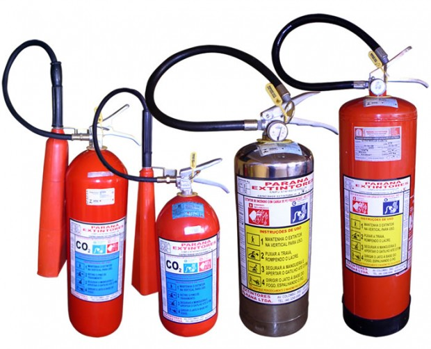
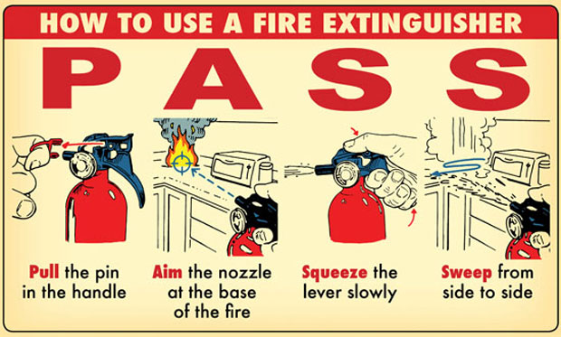
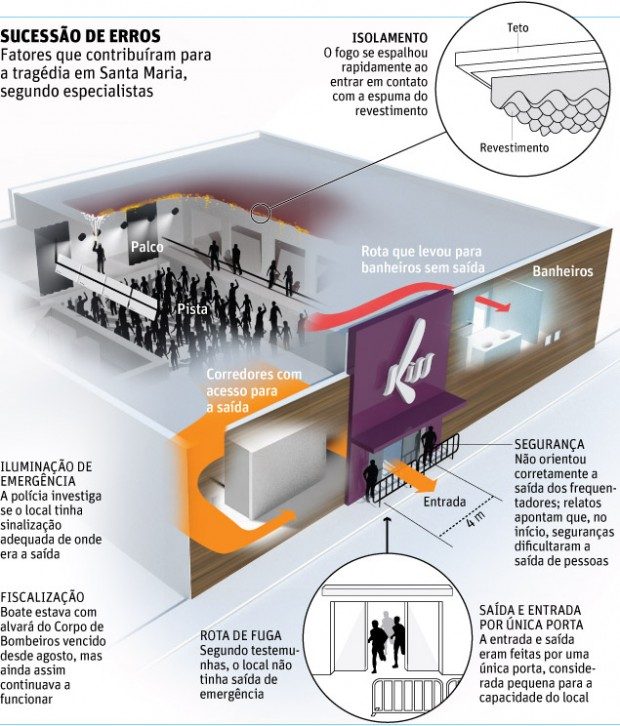

vale a pena ler tudo  
  

### Sent to you by Thiago Silva via Google Reader:

## 

[Incêndio: o que fazer em situações de risco](http://feedproxy.google.com/~r/PapodehomemLifestyleMagazine/~3/HKV_reIlTI0/story01.htm)

via [Papo de Homem - Lifestyle Magazine](http://papodehomem.com.br) by Felipe Giannella on 1/31/13

  

Quando pensei em escrever o texto, a motivação foi em fornecer informações que podem ser muito úteis a pessoas comuns que, como eu, frequentam baladas, “barzinhos”, formaturas, festas, enfim, pessoas com vida social.

Podemos não saber, mas estamos sujeitos a sofrer consequências físicas causadas por desabamentos, incêndios, quedas, entre outros, das edificações nas quais estamos inseridos.

Este texto vai tratar das questões relacionadas ao incêndio, seus principais perigos, causas e as possibilidades de prevenção relacionadas tanto à manutenção da estrutura predial, quanto da percepção de risco e atitudes de cada pessoa.

Antes de continuar, quero prestar respeito às vítimas da madrugada do recente dia 27 de janeiro em Santa Maria/RS, no qual [um incêndio matou 236 pessoas](http://www1.folha.uol.com.br/cotidiano/1222492-vocalista-confirma-uso-de-sinalizador-em-show-mas-nega-culpa-do-incendio-na-kiss.shtml) e feriu outras tantas. Esse texto foi incentivado por estes acontecimentos. Espero que o que aconteceu sirva como um alerta para as pessoas, e as incentive a buscar informações que podem afetar diretamente sua segurança e suas vidas.

### Falando um pouco sobre incêndio

O que é um incêndio?

Trata-se uma ocorrência na qual há formação de fogo e este fica descontrolado. Para a criação do fogo, é necessária a presença do chamado “Quadrilátero (ou Tetraedro) do fogo”, formado pelo **combustível** (qualquer material que pegue fogo), **comburente** (elemento que, associado ao combustível, pode fazê-lo entrar em combustão – como o oxigênio), o **calor** (necessário para iniciar a combustão) e a **reação em cadeia** (onde a temperatura das chamas consegue inflamar os demais materiais existentes no local).

Retirando qualquer um dos três primeiros componentes, não há fogo e o incêndio é apagado. Os extintores seguem essa ideia, podendo atuar nas três pontas do triângulo, mas não na reação em cadeia.

Outro ponto importante a frisar é o tipo do extintor que deve ser utilizado para cada classe de incêndio. Cada tipo de extintor age de uma forma, o que o torna mais ou menos eficaz para cada tipo de combustível. Parece complicado, mas é bem simples:

|  |  |
| --- | --- |
| [c0a5384346a045ba91a6a45dc19e74ce.jpg](http://content.artofmanliness.com/uploads//2013/01/60px-Fire_type_A.jpg) | **Classe A:** materiais sólidos como madeira, papel, tecidos e seus derivados; |
| [cde0374c4c54123c1e4335ba3b3ba947.jpg](http://content.artofmanliness.com/uploads//2013/01/60px-Fire_type_B.jpg) | **Classe B:** líquidos inflamáveis como gasolina, álcool, tinta, óleo diesel, etc; |
| [15a1b1ad599d908fc9958d63ec110dd6.jpg](http://content.artofmanliness.com/uploads//2013/01/60px-Class_C_fire_icon.jpg) | **Classe C:** redes elétricas e fiações, como em motores elétricos, geradores, equipamentos elétricos e eletrônicos, etc. |
| [9fb03400e88fe306254c1fdf6248ec9d.jpg](http://content.artofmanliness.com/uploads//2013/01/60px-Class_D_fire_icon.jpg) | **Classe D -**metais inflamáveis. |
| [abef2b38dd7f688b884c1affdd89083d.jpg](http://content.artofmanliness.com/uploads//2013/01/60px-Class_K_fire_icon.jpg) | **Classe K:**Óleos e fogos de graxa. (Nunca use água sobre um incêndio de gordura – que fará com que as chamas explodam e espalhem-se) |

*(Modelo: [The Art of Manliness](http://artofmanliness.com/2013/01/23/how-to-use-a-fire-extinguisher/))*

Os extintores mais comuns são os que contêm água, Pó Químico Seco (PQS) ou Gás Carbônico.

Repare bem nos tipos de extintores e procure-os no seu trabalho, no prédio onde você mora. Veja a diferença física e de instruções de cada um deles

### Quando usar um extintor e quando deixar o local

Se estiver num local em que surge um princípio de incêndio, você pode combatê-lo antes que ele tome proporções incontroláveis. Para isso, siga as instruções abaixo:

**1.** **Tente identificar primeiro a origem do fogo** para escolher o extintor mais indicado. Não se deve usar um extintor com carga de água para apagar um incêndio Classe B, porque ele pode propagar mais o fogo, nem de Classe C, devido aos riscos de curtos circuitos e choques elétricos. Além disso, se utilizar o PQS em equipamentos elétricos, o produto que serviria para apagar o fogo“gruda” nos componentes, arruinando seus circuitos elétricos (como placas-mãe de computadores). Na dúvida, utilize o extintor de PQS, cujos riscos ao usuário são menores;

**2.** Corte o lacre de plástico, torcendo-o;

**3.** Retire o pino de segurança;

**4.** Faça um teste rápido, pressionando o gatilho ou abrindo a válvula;

**5.** Posicione-se a uma distância segura do foco. Se estiver ventando, coloque-se de uma forma que o fogo não venha na sua direção;

**6.** Dirija o jato para a base das chamas e faça movimentos de um lado para o outro, como se você estivesse “varrendo” o fogo;

**7.** Se o fogo estiver se propagando verticalmente, mire na base das chamas e faça um movimento ascendente e lento (de baixo para cima).

Outros pontos importantes:

- Se houver vários extintores, **utilize-os de forma conjunta** para obter um resultado mais rápido.
- Não tente combater um incêndio que está se expandindo muito além do seu ponto de origem.
- **Chame sempre os bombeiros –**basta discar UM (1), NOVE (9), TRÊS (3). Mantenha os números de emergência perto dos telefones fixos e na memória dos celulares.
- Caso não lembre como usar, siga as instruções que estão no verso do extintor.

Puxe o pino que há no punho; Aponte o bocal na base do fogo; Aperte a alavanca devagar; “Varra” de um lado para o outro. (Fonte: The Art of Manliness)

A questão principal aqui é que os extintores, por exemplo, servem para combater apenas o princípio do incêndio, quando ainda há pouco fogo.

Após certo momento, **não é possível controlar o fogo apenas com o uso de extintores**, e deve-se utilizar os hidrantes, ligados a uma mangueira, alimentados pela água da rede pública (o uso de hidrantes deve ser feito apenas por pessoas minimamente treinadas, como brigadistas; se você não foi treinado, saia do local imediatamente).

Quando o incêndio toma proporções ainda maiores, é absolutamente necessário ligar para o Corpo de Bombeiros, solicitando ajuda.

Por isso a importância de haver uma brigada de incêndio de prontidão em locais de grande acúmulo de pessoas. Quanto mais pessoas, maior o número de brigadistas treinados necessários, podendo-se inclusive ser necessária a contratação de profissionais (bombeiros) para permanecer em prontidão.

A ação imediata e precisa enquanto incêndio está no seu início é fundamental para diminuir as perdas e danos.

### O que podemos fazer, na prática

Existem algumas medidas simples que podem fazer uma grande diferença nos efeitos de um incêndio. Algumas são estruturais e, portanto, de responsabilidade do projetista da edificação, do dono (pela administração do local e instalação das medidas de segurança), do corpo de bombeiros (pela avaliação da segurança do local), e possivelmente de técnicos da área de segurança do trabalho.

O que aconteceu no caso da boate Kiss, em Santa Maria (Fonte: Folha de S. Paulo)

Entre estas responsabilidades, estão:

- Instalação (e testes periódicos) de alarme de incêndio;
- Plano de evacuação/emergência/ de incêndio e pânico;
- Sinalização de acordo com a legislação;
- Rota de fuga estabelecida e visível às pessoas no local;
- Instalação de detector de fumaça e splinklers (chuveiros/pulverizadores automáticos de água, acionados pela fumaça);
- Instalação de extintores de acordo com o material combustível no local e risco de incêndio;
- Saída(s) de emergência (identificadas por placas fotoluminescentes, que brilham no escuro), de modo a garantir a evacuação imediata de todos no local, em caso de incêndio;
- Portas corta-fogo (no caso de edificações com mais de um andar, estas portas protegem as escadas utilizadas durante a fuga) e ventilação (para manter as escadas livres de fumaça);
- Instalação de iluminação de emergência;
- Compartimentação Interna Vertical e Horizontal (os pisos e paredes são construídos de modo a não permitir a passagem de fogo para salas que não estão pegando fogo);
- Manutenção adequada de todos estes equipamentos e estruturas, de modo a mantê-los funcionais.

Como se pode perceber, existem muitas medidas preventivas contra a ocorrência de um incêndio. Se uma edificação estiver em dia com suas responsabilidades legais, é bem menos provável que haja um incêndio no local, pois o fogo pode ser controlado antes de aumentar de proporção e causar maiores danos.

Ainda assim, há possibilidade de isto acontecer, no caso destas medidas preventivas não forem suficientes ou não terem uma manutenção adequada.

Você, como frequentador daquela balada que adora, tem o direito de se preocupar se a mesma segue estas medidas de segurança à risca. Exija do dono ou dos responsáveis pelo local que medidas de segurança sejam adotadas, caso perceba alguma irregularidade.

Denuncie para o Corpo de Bombeiros. Paralelamente, é importante que você esteja atento e seja observador.

A sua percepção do risco e suas atitudes são essenciais para a sua segurança – e possivelmente, a dos seus amigos – no caso da ocorrência de um incêndio.

Assim que entrar em qualquer edificação (prédio, casa ou estrutura física construída), preste atenção em identificar:

**1.** Os locais de acesso para fora do local;

**2.** saída(s) principal(is) e saída(s) de emergência(s). Elas deverão possuir uma identificação acima da porta;

**3.** Os extintores e seus tipos;

**4.** Detectores de fumaça;

**5.** Splinkers;

**6.** Luzes de emergência;

**7.** Sinalização com setas (verdes, que indicam o caminho mais curto até a saída mais próxima) e rota de fuga.

**Obs:** a*s setas verdes fotoluminescentes indicam o caminho mais curto para a saída mais próxima ao local em que você está (Rota de Fuga).*

### O que fazer durante um incêndio com fogo não controlável

Suponha que você está num local e este começa a pegar fogo. O que fazer? Primeiro de tudo o mais importante: **não entre em pânico**.

*[Link YouTube](http://youtu.be/EqWRaAF6_WY) | Também não banque o herói, muito menos o rockstar. Dá uma olhada nas infos abaixo*

É bem mais fácil pensar do que fazer na hora. Respeite o fogo, mas não perca o controle. Além disso:

**1.** Haja rapidamente. Procure identificar a saída mais próxima a você e dirija-se a ela. Tenha certeza de que é uma saída, verificando a sinalização acima da porta;

**2.** Acione o alarme de incêndio;

**3. Haverá fumaça tóxica no ar**, que pode fazê-lo desmaiar rapidamente. Procure proteger o nariz com uma camisa, pano, ou máscara – se tiver – amarrados firmemente ao rosto. Você ganhará instantes que poderão ser valiosos para a fuga.

**4.** Caso esteja no banheiro e escute o alarme de incêndio ou uma gritaria de pânico, pare imediatamente o que estiver fazendo e deixe o local. Mesmo que tenha que se afastar para ninguém vê-lo (ou sentir o cheiro), **o mais importante é sair com vida**;

**5.** Se for mulher e estiver de salto, **tire-o e jogue num canto para não atrapalhar a passagem dos outros em fuga**;  
 Se for mulher e estiver com bolsa, deixe-a no local e vá embora **sem ela**. Em incêndios, há vários casos de mulheres que perdem um braço, pois acabam prendendo a alça da bolsa no corrimão da escada e, devido ao grande número de pessoas descendo, o couro da bolsa não arrebenta e o braço é arrancado. **Melhor perder a bolsa**;

**6.** Se não conseguir sair rapidamente, procure se molhar o máximo que puder. A camada de água que se formar oferece uma pequena proteção contra o fogo, mas que pode ajudá-lo a aguentar o calor;

**7.** Tome cuidado para não cair ou causar a queda dos outros, pois pessoas que caem em passagens com grande fluxo de pessoas correm o risco de serem pisoteadas;

**8.** Mantenha-se o mais próximo do chão. Os gases tóxicos tendem a ocupar a parte superior do ambiente;

**9.** Não siga as outras pessoas. **Siga a sinalização e sua observação do local**. Muitas pessoas correm para a primeira porta que veem, outras as seguem achando que estão indo para a saída e impedem as primeiras que se enganaram de voltar pelo mesmo caminho. Este tempo perdido pode fazer diferença entre a vida e a morte;

**10.** Se for abrir portas usando maçanetas, utilize um pano ou camisa molhados para não queimar a mão. Certifique-se que não há fogo do outro lado, sentindo a irradiação de calor. Se abrir a porta e o outro lado estiver com fogo, ele pode ir em sua direção;

**11.** No caso de festas, bares e baladas, procure consumir bebidas alcoólicas até um nível em que você esteja em condições de se mover e deixar o local rapidamente.

Segurança é coisa séria.

As nossas vidas e de nossos conhecidos e amigos podem estar mais na nossa mão do que pensamos. Pequenas mudanças de atitude podem fazer grandes diferenças nos resultados de um incêndio. Temos que ter calma e estar preparados. Para no caso de qualquer sinistro ocorrer, conseguirmos escapar com vida e com saúde.

Caso saibam de alguma informação importante a acrescentar ao texto ou relatos sobre o tema, fiquem à vontade para postar nos comentários deste texto. Ficarei bem feliz em acompanhá-los.

### **Casas noturnas em São Paulo não possuem alvará de funcionamento**

[O Estadão começou uma campanha](http://www.estadao.com.br/noticias/impresso,casas-famosas-de-sp-nao-tem-alvara-,990576,0.htm) bem legal para identificar casas noturnas que oferecem risco aos frequentadores, dando mais poder às pessoas para reclamar seus direitos e exigir uma postura correta dos responsáveis pelas baladas.

As casas noturnas que não possuem alvará de funcionamento foram identificadas e seguem no link acima. Importante mencionar que somente o alvará não atesta a segurança do local. A segurança só é atestada pela presença de um [AVCB](http://www.bombeiros.com.br/br/utpub/avcb.php) (Auto de Vistoria do Corpo de Bombeiros) válido, ou seja, dentro da validade.

O AVCB pode ter outros nomes em outros estados (fora de São Paulo).

### Outras informações úteis

[Legislação para segurança](http://www.corpodebombeiros.sp.gov.br/?page_id=356) contra incêndio do estado de São Paulo.

*Este texto foi escrito com a colaboração do Engenheiro de Segurança do Trabalho Joseilton Medeiros Oliveira. Meus agradecimentos!*

[anexo ausente]

Artigos Relacionados

- [Mapa da Cachaça: 10 alambiques inesquecíveis em 2 anos de estrada](http://rss.feedsportal.com/c/32911/f/530922/s/27fe2e0c/l/0Lpapodehomem0N0Bbr0Cmapa0Eda0Ecachaca0E10A0Ealambiques0Einesqueciveis0Eem0E20Eanos0Ede0Eestrada0C/story01.htm)
- [Guia prático para organização da sua tralha digital](http://rss.feedsportal.com/c/32911/f/530922/s/27fea4aa/l/0Lpapodehomem0N0Bbr0Cguia0Epratico0Epara0Eorganizacao0Eda0Esua0Etralha0Edigital0C/story01.htm)
- [Magnetar | As personagens do Maurício de Sousa cresceram](http://rss.feedsportal.com/c/32911/f/530922/s/28043231/l/0Lpapodehomem0N0Bbr0Cmagnetar0Equando0Eas0Epersonagens0Edo0Emauricio0Ede0Esousa0Ecresceram0C/story01.htm)
- [Quando o apê dos bróders destrói a amizade](http://rss.feedsportal.com/c/32911/f/530922/s/2805a1f1/l/0Lpapodehomem0N0Bbr0Cquando0Eo0Eape0Edos0Ebroders0Edestroi0Ea0Eamizade0C/story01.htm)
- [Como fazer ceviche, passo-a-passo](http://rss.feedsportal.com/c/32911/f/530922/s/280dfdfd/l/0Lpapodehomem0N0Bbr0Ccomo0Efazer0Eceviche0Epasso0Ea0Epasso0C/story01.htm)

  
  
[[anexo ausente]](http://da.feedsportal.com/r/151885032998/u/49/f/530922/c/32911/s/2817bf05/a2.htm)[anexo ausente]

[[anexo ausente]](http://feeds.feedburner.com/~ff/PapodehomemLifestyleMagazine?a=HKV_reIlTI0:baHwdkjcCcM:yIl2AUoC8zA)  [[anexo ausente]](http://feeds.feedburner.com/~ff/PapodehomemLifestyleMagazine?a=HKV_reIlTI0:baHwdkjcCcM:qj6IDK7rITs) [[anexo ausente]](http://feeds.feedburner.com/~ff/PapodehomemLifestyleMagazine?a=HKV_reIlTI0:baHwdkjcCcM:-BTjWOF_DHI)

[anexo ausente]

  

### Things you can do from here:

- [Subscribe to Papo de Homem - Lifestyle Magazine](http://www.google.com/reader/view/feed%2Fhttp%3A%2F%2Ffeeds.feedburner.com%2FPapodehomemLifestyleMagazine?source=email) using **Google Reader**
- [Get started using Google Reader](http://www.google.com/reader/?source=email) to easily keep up with **all your favorite sites**
