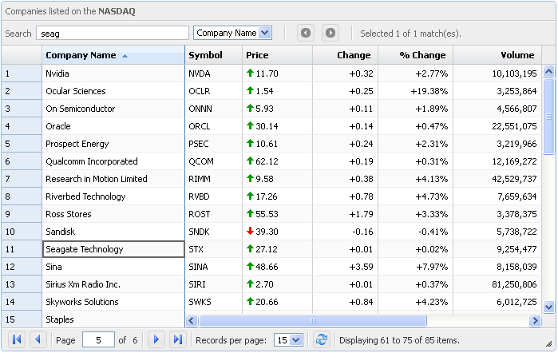

# **P**aramQuery jQuery Grid Plugin

ParamQuery grid is a lightweight jQuery grid plugin inspired by MS Excel and Google spreadsheet**.** It's based upon [jQueryUI Widget factory](http://wiki.jqueryui.com/w/page/12138135/Widget%20factory)  which is an excellent design pattern for UI controls with consistent API**.** It's free to use in any commercial or open source project and is licensed under very permissive MIT license**.**

**Features:**

- Sorting
- Paging
- Resizable columns
- Resizable height and width
- Customizable theme
- Hiding / Showing columns
- Freeze any number of Columns like Excel
- Display any data source format like HTML, Array, XML, JSON, etc
- Can be used with any server side framework e.g. ASP.NET, MVC3, JSP, JSF, PHP, etc
- Virtual Scrolling and Rendering
- Inline Editing of cells
- Consistent look and functionality across all major browsers IE(6+), Firefox, Chrome, Opera, etc
- Many more

**Note:** The above is a screenshot of the ParamQuery Grid**.** Please check the demos section to get actual feel of the grid**.**
