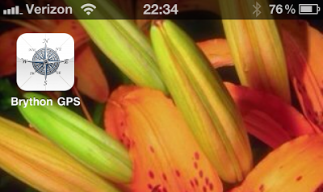
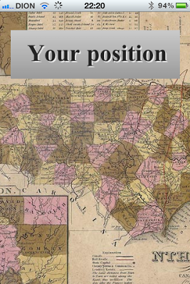
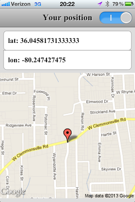
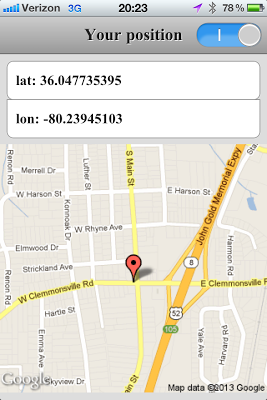

### Thanks to Brython

  
  

[](http://3.bp.blogspot.com/-wRVak9W1Mgs/UQdGgo3nlwI/AAAAAAAAB-I/0hovoJc6y6E/s1600/gps_icon.png)

  

Brython GPS icon

### 

  

### Native? Not quite...

  
  
The application launches with a splashscreen, like it should  
  

[](http://3.bp.blogspot.com/-eyNrVmqE8g8/UQdGhbcNQfI/AAAAAAAAB-Q/NS6WcOAgiNI/s1600/photo%282%29.PNG)

  

Splash page

  
But it is really a web application.  
  

[](http://3.bp.blogspot.com/--0i6LZ77wUY/UQdG2N9Pa7I/AAAAAAAAB-Y/dbcRX4xqMBQ/s1600/photo%281%29.PNG)

  

Tracking my progress

[](http://4.bp.blogspot.com/-3fdEa5cpowo/UQdHGb8CtiI/AAAAAAAAB-g/JPROEjxS1II/s1600/photo%284%29.PNG)

  

Automatically refreshes on movement

  

### Can I try it?

  
  
Absolutely. Simply point your iphone to the brython gallery url:  
  
[gallery/geo.html](http://brython.info/gallery/geo.html) then click add to home screen. You can now launch it like a native application.  
  
  

### What makes it special?

  
  
It's a web application, so of course **HTML** and **CSS**, but the code is **Python**. It leverages the new Brython feature to link to a remote python script, instead of having it inline with the html. This allows a clean separation of presentation, logic and eye candy:  
  

### The HTML

  
  

<!DOCTYPE html>

  

<html>

  

<head>

  

<title>Brython test</title>

  

<meta charset="iso-8859-1">

  

<meta name="viewport" content="user-scalable=no, width=device-width, initial-scale=1,maximum-scale=1">

  

<meta name="apple-mobile-web-app-capable" content="yes">

  

<script src="../brython.js"></script>

  

<script type="text/python" src="navi.py"></script>

  

<link rel="stylesheet" type="text/css" href="navi.css" />

  

<link rel="apple-touch-icon" href="icon.png"/>

  

<link rel="apple-touch-startup-image" href="splash.png">

  

</head>

  

<body onLoad="brython(2)">

  

<div id="header">

  

<H1>Your position</H1>

  

<div id="switch">

  

<span class="thumb"></span>

  

<input id="refr" type="checkbox" />

  

</div>

  

</div>

  

</div>

  

<div id="navarea"></div>

  

<div id="maparea"></div>

  

</body>

  

</html>

  
  
Your typical **iPhone** web application, except that there is no jQuery mobile or similar framework. There is no onclick. The only javascript is the brython.js file for Brython itself and the related body onload call of brython().  
  
So let's have a look at the Python code:  

### The Python

  
  

```
 # globals #########################  
 refr = False  
 geo = win.navigator.geolocation  
 watchid = 0  
   
   
 # functions ###########################  
 def navi(pos):  
 xyz = pos.coords  
   
 ul = UL(id="nav")  
 ul <= LI('lat: %s' % xyz.latitude)  
 ul <= LI('lon: %s' % xyz.longitude)  
   
 mapurl = "http://maps.googleapis.com/maps/api/staticmap?markers=%f,%f&zoom=15&size=320x298&sensor=true" % (xyz.latitude, xyz.longitude)  
 img = IMG(src = mapurl, id = "map")  
 try:  
 doc["nav"].html = ul.html  
 except KeyError:  
 doc["navarea"] <= ul  
 try:  
 doc["map"].src = mapurl  
 except KeyError:  
 doc["maparea"] <= img  
   
 def nonavi(error):  
 log(error)  
   
 def navirefresh(ev):  
 global refr, watchid  
 refr = False if refr else True  
 if refr == True:  
 doc["switch"].className = "switch on"  
 watchid = geo.watchPosition(navi, nonavi)  
 else:  
 doc["switch"].className = "switch"  
 geo.clearWatch(watchid)  
   
 # the setup  
 if geo:  
 geo.getCurrentPosition(navi, nonavi)  
 doc["switch"].className = "switch"  
 doc["switch"].onclick = navirefresh  
 else:  
 alert('geolocation not supported')
```

  
  
We are setting up 2 callback functions. One called if we have navigation (*navi*) support, one if we dont (*nonavi*), and finally a function (*navirefresh*) to handle the onclick of the auto refresh switch in the title bar of the application. This works pretty decently as a quick and dirty GPS application.  
  

### The CSS

  
The CSS is a bit long so I'm not posting it on the blog, but you can check out the source at the [brython.info](http://brython.info/) site or on the [SVN repository](http://code.google.com/p/brython/). The ios style switch CSS is borrowed from this article: [ios-5-style-switch-control](http://css3wizardry.com/2011/12/18/ios-5-style-switch-control/).   
  

### The tip of the iceberg

  
So there you have it. You can now use your favorite language (Python, of course) to write applications for your mobile phone or tablet. This example is slightly iPhone specific (mostly due to CSS), but the same basic structure applies to a variety of mobile devices. And it took no time whatsoever to write this.  
  
[@f\_dion](http://www.twitter.com/f_dion)  
  
from Planet Python <http://raspberry-python.blogspot.com/2013/01/iphone-app-with-python.html>
