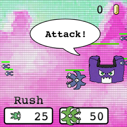
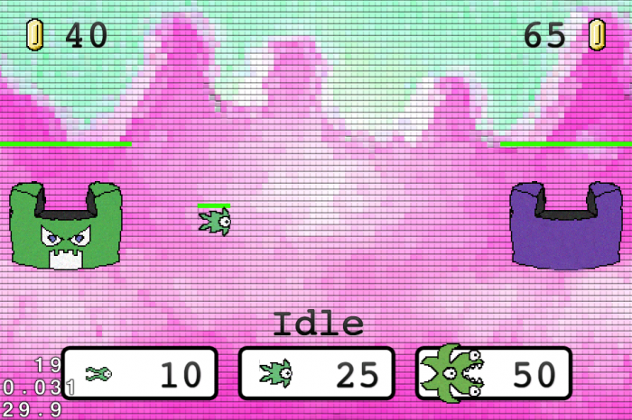
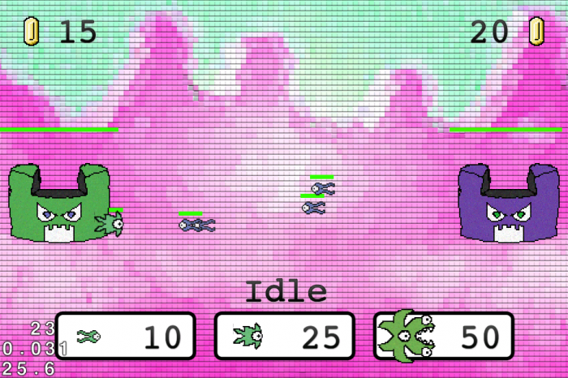
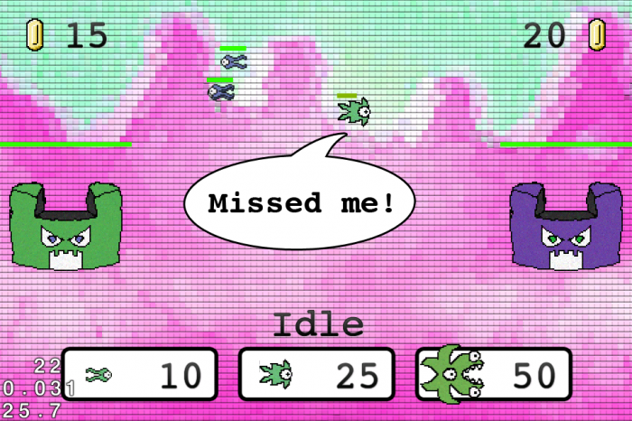
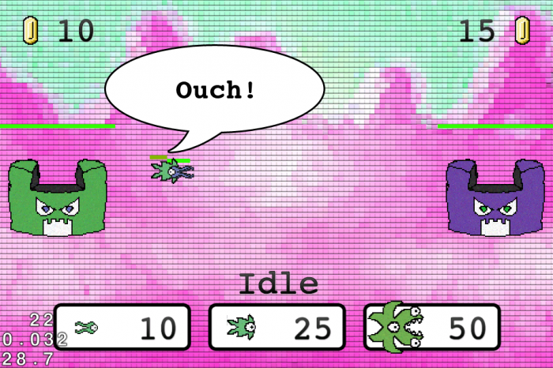
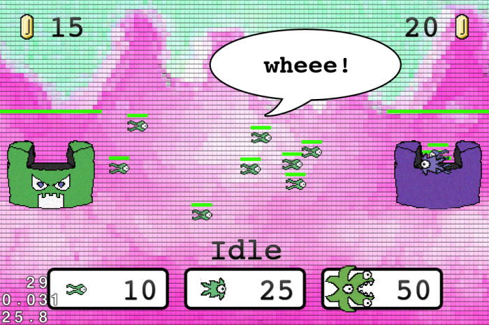
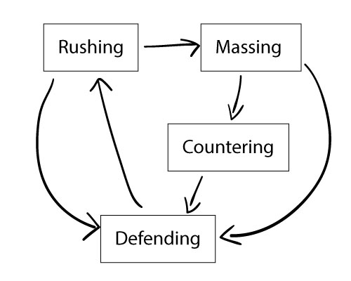
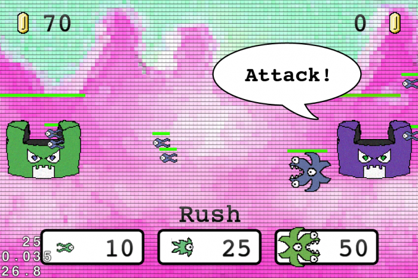

# **I**ntroduction to AI Programming for Games



Learn how to add artificial intelligence to a simple game**!**

*This is a blog post by site administrator [Ray Wenderlich](http://www.raywenderlich.com/about) , an independent software developer and gamer**.***

When you make a game, you often have enemies for the player to combat**.** You want these enemies to seem intelligent and present a challenge to the player to keep the game fun and engaging**.**

You can do this through a variety of techniques collectively known as artificial intelligence (AI) programming**.** This is a huge field – entire books have been written on the subject**!** There are many subtopics, from pafhfinding to steering to planning to state machines to behavior trees and more**.**

Obviously I can’t cover everything in this introductory tutorial, but I can show you how to get started with a hands-on example of adding AI into a simple game**!**

In the process of adding AI into this game, you’ll learn about two common AI techniques along the way: steering and finite state machines**.**

You’ll see that when adding AI into a game, the techniques you use don’t necessarily have to be complicated to be good AI – as long as the game is fun, you win**!**

This tutorial covers making a game with Cocos2D on iOS**.** Most of the tutorial is not Cocos2D specific, so you should be able to follow along even if you aren’t familiar with it**.** However, it you would like to learn more about Cocos2D, you can check out some of our [other Cocos2D tutorials](http://www.raywenderlich.com/tutorials#cocos2d) on this site**.**

## Introducing Monster Wars

To keep the focus on AI programming and not all the extra stuff, I have created a starter project for you, called Monster Wars**!**

[Download the starter project](http://cdn4.raywenderlich.com/downloads/MonsterWars5-TutorialStarter.zip) , open it in Xcode, and build and run to check it out**.** You’ll see something like the following:

[](http://cdn2.raywenderlich.com/wp-content/uploads/2012/10/01_MonsterWarsStart.png)

I didn’t have time to add instructions, so here’s how you play:

- You get money every so often, which you can see in the upper left**.** You can use it to buy units, by tapping the buttons at the bottom**.**
- There are three enemy types: Quirk (fast and cheap), Zap (ranged attackers), and Munch (slow but has AOE chomp)**.**
- You can switch your units from attacking to defending by tapping on your castle (the green one on the left)**.**
- If your units destroy the enemy’s castle, you win**!**

Of course, the game is not a challenge right now, because the enemy doesn’t have any smarts**!** He doesn’t choose units or choose when to attack or defend – that’s your job in this tutorial**!** :]

You’ll also notice the movement is kind of “jaggedy” when monsters arrive at their destination – this is another thing you will fix**.**

Feel free to take a look at the code in the project to get familiar with how things are put together**.** Then keep reading to get started with adding some AI**!**

*Note:* Don’t laugh too much at the poorly drawn art – I am a pretty bad artist**!** ;]

## The Simplest Solution

In this first section I want to show you how easy AI can be – it can just be “normal” coding if that’s all your game needs**!** You only need to add more complicated techniques if it would benefit your game**.**

So in this first section, you’ll get some basic AI in the simplest possible way – making decisions in an update loop with an if/else statement**!**

In this game, there is an object called AIPlayer that represents the enemy team/castle**.** It has an update method that gets called every frame, and that’s where you’ll put your code**.**

Open *AIPlayer**.**m* and at the end of the update method, add the following:

|  |
| --- |
| ``` // Attack/Defend decision if (self.layer.aiTotalValue > self.layer.humanTotalValue) {     if (!self.attacking) {         NSLog(@"AI: Now attacking");         [self.layer setPlayer:self attacking:YES];     } } else {     if (self.attacking) {         NSLog(@"AI: Now defending");         [self.layer setPlayer:self attacking:NO];     } }   // Make build decision if (self.layer.aiQuirkValue < self.layer.humanZapValue && self.coins > COST_QUIRK) {     [self.layer spawnQuirkForPlayer:self]; } else if (self.layer.aiZapValue < self.layer.humanMunchValue && self.coins > COST_ZAP) {     [self.layer spawnZapForPlayer:self]; } else if (self.layer.aiMunchValue < self.layer.humanQuirkValue && self.coins > COST_MUNCH) {     [self.layer spawnMunchForPlayer:self]; } else if (self.layer.humanTotalValue == 0) {     while (self.coins > COST_ZAP + COST_QUIRK) {         [self.layer spawnQuirkForPlayer:self];         [self.layer spawnZapForPlayer:self];     } } ``` |

Every frame, the AI asks itself a simple question: am I more powerful than the human**?** If so, ATTACK!

It also uses a simple if/else statement to decide which unit to build next:

- Quirks are strong vs**.** Zaps. So if the human has more value of Zaps than we has value of Quirks, the AI will build a quirk if it can afford it**.**
- Zaps are strong vs. Munches. So if the human has more value of Munches than the AI has value of Zaps, the AI will build a zap if it can afford it**.**
- Munches are strong vs. Quirks. So if the human has more value of Quirks than the AI has value of Munches, the AI will build a Munch if it can afford it**.**
- Finally, if the human doesn’t have anything, the AI will attempt to rush it by blowing all it’s money on Zap + Quirk combos**.**

Pretty simple algorithm, eh**?** Nothing fancy about it – but it actually gives a fairly decent challenge**!** Build and run, and see if you have what it takes to beat the game**!**

[](http://cdn4.raywenderlich.com/wp-content/uploads/2012/10/02_BasicAI.png)

## Movement Problems

So far so good, but I don’t know about you, but that “jaggedy movement” behavior is driving me mad**!**

The reason this is happening is because of how Monster**.**m’s updateMove method is coded. Here’s what it looks like now:

|  |
| --- |
| ``` - (void)updateMove:(ccTime)dt {       if (self.maxAcceleration <= 0 || self.maxVelocity <= 0) return;       BOOL hasTarget = FALSE;     CGPoint moveTarget;     GameObject * enemy = [self.layer closestEnemyToGameObject:self];     float distance = ccpDistance(self.position, enemy.position);     static float ATTACK_THRESHHOLD = 150;       if (self.attacking || (enemy && distance < ATTACK_THRESHHOLD)) {         if (!enemy) {             enemy = [self.layer playerForTeam:[self.layer oppositeTeam:self.team]];             distance = ccpDistance(self.position, enemy.position);         }         if (enemy) {             hasTarget = YES;             moveTarget = enemy.position;             if (self.isRanged) {                 CGPoint vector = ccpNormalize(ccpSub(self.position, enemy.position));                 moveTarget = ccpAdd(enemy.position, ccpMult(vector, self.rangedRange));                 distance = ccpDistance(self.position, moveTarget);             }         }     } else {         Player * player = [self.layer playerForTeam:self.team];         if (player) {             hasTarget = YES;             moveTarget = player.position;         }     }         if (hasTarget) {         CGPoint direction = ccpNormalize(ccpSub(moveTarget, self.position));         CGPoint newPosition = ccpAdd(self.position, ccpMult(direction, self.maxVelocity * dt));                 CGSize winSize = [CCDirector sharedDirector].winSize;         newPosition.x = MAX(MIN(newPosition.x, winSize.width), 0);         newPosition.y = MAX(MIN(newPosition.y, winSize.height), 0);         self.position = newPosition;     } } ``` |

You see that each frame this moves the monster closer to a desired target, but:

- There’s no tolerance for “close enough”
- There are small rounding errors that cause problems
- The method has no concept of acceleration – only velocity
- If a Quirk is near a Zap, it tries to move away from the Zap in the opposite direction of where the Zap is**.** But if the Zap is literally on top of the Quirk, problems arize, because the Zap is quicker than the Quirk so it sort of moves randomly in place and seems “stuck”**.**

In other words, this movement algorithm is pretty simple, but stupid**.** You need something better**!**

You might not realize it, but AI programming is not only about deciding what to do, but also deciding how to do it intelligently**.** In other words, the AI in this game needs to not only decide when to attack and what units to build, but also how the units should intelligently move**!**

The fields of AI programming related to movement are known as pathfinding and steering**.** We’ve covered A\* pathfinding in an [earlier tutorial](http://www.raywenderlich.com/4946/introduction-to-a-pathfinding)  on this site, so this tutorial will focus on steeering, which is a fancy way of saying “figuring out the best way to get an object from here to there”**!**

*Note:* Wondering why you can’t just use the plain old CCMove actions you know and love in Cocos2D**?** Those actions are great when you are trying to do simple things**.** However, the more complicated your game gets, the more likely you are to want to set velocity and acceleration directly with steering algorithms. This gives you much more flexibility and control**.**

## Introduction to Steering

If you open an game AI texbook, you will find tons of different examples of steering behaviors you can add into your game**.** They are often in different variants such as “just velocity”, or “velocity plus acceleration”**.**

In this game, you want to use acceleration for more natural movement, so you will be focusing on the “velocity plus acceleration” variants**.**

Here are a few example of steering behaviors:

- *Seek:* Move toward a target (but possibly overshoot)**.**
- *Flee:* Move away from a target**.**
- *Arrive:* Move toward a target (with the goal of landing exactly on the target by decellerating)**.**
- *Wander:* Move around randomly**.**
- *Separate:* Keep a certain distance from a target**.**
- *Path following:* Follow along a given path**.**

There are many more beyond this too**.** And the coolest part is you can mix and match different behavior from the above list for some cool and dynamic effects**!**

In this tutorial, you’ll try out a few (but not all) of these steering behaviors**.** Hopefully by the time you’re done with this tutorial your appetite will be whet and you’ll be ready to investigate a few more**!**

Let’s start with the simplest of these steering behaviors – seek**!**

## Seeking Success

The idea behind *seek* is very simple:

- Figure out the direction to the target**.**
- Max acceleration in that direction**!**

However this turns out to be a bit overzealous in practice**.** To see what I mean, inside *Monster.m* add a new seek method as follows:

|  |
| --- |
| ``` - (CGPoint)seekWithTarget:(CGPoint)target {     CGPoint direction = ccpNormalize(ccpSub(target, self.position));     return ccpMult(direction, self.maxAcceleration); } ``` |

This does exactly as I described above**.** It creates a unit vector (i.e**.** a vector of length 1) in the direction of the target, then multiplies the result by the max acceleration**.** This results in a max acceleration vector in the direction of the target**.**

Next, replace the if (hasTarget) clause at the end of updateMove: with the following:

|  |
| --- |
| ``` if (hasTarget) {             // Calculate amount to accelerate, based on goal of arriving at nearest enemy,     // and separating from nearby enemies     CGPoint seekComponent = [self seekWithTarget:moveTarget];     CGPoint newAcceleration = seekComponent;       // Update current acceleration based on the above, and clamp     self.acceleration = ccpAdd(self.acceleration, newAcceleration);     if (ccpLength(self.acceleration) > self.maxAcceleration) {         self.acceleration = ccpMult(ccpNormalize(self.acceleration), self.maxAcceleration);     }       // Update current velocity based on acceleration and dt, and clamp     self.velocity = ccpAdd(self.velocity, ccpMult(self.acceleration, dt));     if (ccpLength(self.velocity) > self.maxVelocity) {         self.velocity = ccpMult(ccpNormalize(self.velocity), self.maxVelocity);     }       // Update position based on velocity     CGPoint newPosition = ccpAdd(self.position, ccpMult(self.velocity, dt));     CGSize winSize = [CCDirector sharedDirector].winSize;     newPosition.x = MAX(MIN(newPosition.x, winSize.width), 0);     newPosition.y = MAX(MIN(newPosition.y, winSize.height), 0);     self.position = newPosition;         } ``` |

Here you call the seekWithTarget: method you just wrote to figure out the new acceleration, and add it to the current acceleration**.** You also make sure the acceleration isn’t greater than the max acceleration**.**

Based on the acceleration, you figure out the new velocity, and then based on the velocity you figure out your position**.** If you’re confused about the relationship between position, velocity, and acceleration over time, crack open your old Physics textbook :]

And that’s it**!** Build and run, switch to attack mode, and build a Zap**.** The AI will build a few Quirks to counter, and you’ll see some strange behavior:

[](http://cdn5.raywenderlich.com/wp-content/uploads/2012/10/03_MissedMe.png)

The Zaps will fly into the Quirk, and then continue flying right past**!** This is because their acceleration is carrying them past the Zap, and they then have to counter-accelerate to hit the Zap again, so basically end up acting like very drunken monsters :]

What you want is for the Zaps to take their current acceleration into mind and decellerate at the right time so they land at their target – and this is why you need *arrive***!**

## Arriving at Awesomeness

On the other hand, the idea behind *arrive* is the following:

- If you are getting close to the target, figure out your “target velocity”, which should get smaller and smaller the closer you are to the target**.**
- Set the acceleration to the amount needed to increase the current velocity to the target velocity, reduced a factor of how long you want the decelleration to take**.**
- Also add a wiggle room where it’s “close enough”, and a target area to start slowing down in**.**

Let’s see what this looks like in code**.** Add this method to *Monster.m*:

|  |
| --- |
| ``` - (CGPoint)arriveWithTarget:(CGPoint)target {       // 1     CGPoint vector = ccpSub(target, self.position);     float distance = ccpLength(vector);       // 2     float targetRadius = 5;      float slowRadius = targetRadius + 25;     static float timeToTarget = 0.1;       // 3     if (distance < targetRadius) {         self.velocity = CGPointZero;         self.acceleration = CGPointZero;         return CGPointZero;     }       // 4     float targetSpeed;     if (distance > slowRadius) {         targetSpeed = self.maxVelocity;     } else {         targetSpeed = self.maxVelocity * distance / slowRadius;     }       // 5     CGPoint targetVelocity = ccpMult(ccpNormalize(vector), targetSpeed);         CGPoint acceleration = ccpMult(ccpSub(targetVelocity, self.velocity), 1/timeToTarget);       // 6     if (ccpLength(acceleration) > self.maxAcceleration) {         acceleration = ccpMult(ccpNormalize(acceleration), self.maxAcceleration);     }     return acceleration; } ``` |

Let’s go over this section by section:

1. Figures out the vector in the direction of the target, and how long it is**.**
2. Sets up some constants. 5 points is “close enough”, and the monster should start slowing down when it’s within 25 points of the target**.** It should take 0.1 seconds to decellerate.
3. If the monster is “close enough”, instantly return**.**
4. Figure out the target speed. If the monster is far away, it should be max velocity – otherwise, slower and slower the closer it gets to the target**.**
5. Set the acceleration to the amount needed to increase the current velocity to the target velocity, reduced a factor of how long you want the decelleration to take**.**
6. Makes sure the acceleration isn’t greater than the max acceleration, and truncates it if so**.**

Then inside updateMove, change the beginning of the if (hasTarget) clause as follows:

|  |
| --- |
| ``` //CGPoint seekComponent = [self seekWithTarget:moveTarget]; CGPoint arriveComponent = [self arriveWithTarget:moveTarget]; CGPoint newAcceleration = arriveComponent; ``` |

Build and run, and now the Quirks should be much more successful in their attacks**!**

[](http://cdn4.raywenderlich.com/wp-content/uploads/2012/10/04_Ouch.png)

## Slyly Separating

One last steering behavior example to show you, then we’ll move onto another topic**.** Right now, if you spawn a set of Quirks they sit right on top of each other, making it difficult to see as a player that there are multiple quirks**.** Woudln’t it be better if they spread out a bit!

You can do that with the *separate* steering behavior**.** The basic idea behind this is the following:

- Loop through all objects you want to stay apart from (allies, in your case)
- For each nearby object, accelerate away from that object

Let’s see what this looks like in code**.** Add this new method to *Monster**.**m*:

|  |
| --- |
| ``` - (CGPoint)separate {     CGPoint steering = CGPointZero;         NSArray  * allies = [self.layer alliesOfTeam:self.team];     for (GameObject * ally in allies) {         if (ally == self) continue;         CGPoint direction = ccpSub(self.position, ally.position);         float distance = ccpLength(direction);         static float SEPARATE_THRESHHOLD = 20;           if (distance < SEPARATE_THRESHHOLD) {             direction = ccpNormalize(direction);             steering = ccpAdd(steering, ccpMult(direction, self.maxAcceleration));         }     }     return steering; } ``` |

Notice that it just keeps adding on additional acceleration factors for each object that it needs to stay apart from, and returns the sum**.** The calling method will make sure that the acceleration is truncated to the max acceleration in the end**.**

Next, inside updateMove: update the beginning of the if (hasClause) block with the following:

|  |
| --- |
| ``` //CGPoint seekComponent = [self seekWithTarget:moveTarget]; CGPoint arriveComponent = [self arriveWithTarget:moveTarget]; CGPoint separateComponent = [self separate]; CGPoint newAcceleration = ccpAdd(arriveComponent, separateComponent); ``` |

Note that to combine two different steering behaviors, one thing you can do is simply add them together**.** Alternatively, you could weight each component differently – it depends what you want for your game**.**

Build and run, and spawn a bunch of Quirks**.** The movement of the monsters should feel dynamic and really good**!**

[](http://cdn2.raywenderlich.com/wp-content/uploads/2012/10/05_Whee.png)

It’s pretty cool how steering behaviors can combine like this for such cool effects, eh**?**

## An Improved Strategy

So far you actually have a fairly playable game, so if this was good enough for what you wanted, you could quit at this point**!**

However, I have a very easy strategy to win that works every time for me:

- Stay on defense**.**
- Wait until the AI builds something, and build 2 Zaps**.**
- Build 2 more Zaps.
- Build a Munch**.**
- Switch to attack, and keep building quirks till you win**!**

Let’s see if we can make this AI a little bit smarter**.**

The problem is you’re basically doing a “defend and counter to gain money advantage”, followed by a “mass and overwhelm” strategy**.** Wouldn’t it be great if you could develop an AI smart enough do this as well**?**

You can definitely do this, but you’re going to need to use a new AI concept to help you out with this – Finite State Machines**!**

## Introducing Finite State Machines

There are many ways to implement Finite State Machines, but at the simplest form they are quite simple:

- Keep track of what “state” you’re in
- Have conditions that say when you switch from one “state” to another
- Then do different things based on what state you are in**!**

To make the AI in this game smarter you are going to develop four different states:

1. *Defending*: While the base is under attack, build units to counter the human wisely**.**
2. *Rushing*: Send everything you’ve got to attack, and send quirks to Support**!**
3. *Massing*: Save up money to mass the pesky human later**.**
4. *Countering*: Wait for the dumb human to attack your base so you can counter with overwhelming intelligence, and follow-up with a counterattack**.**

Whenever I work with state machines, I find it really helpful to draw a diagram that shows how the states can transition between each other**.** Here’s the diagram for this game:

[](http://cdn3.raywenderlich.com/wp-content/uploads/2012/12/rushing_diagram1.jpg)

Here are a few notes on the state transitions:

- In general, this game’s states are in a big circle: Defending -> Rushing -> Massing -> Countering**.** However, any state switches to Defending if the base is under attack**.**
- As soon as the base is no longer under attack, it switches from Defending to Rushing**.**
- As soon as the AI’s army is destroyed, it switches from Rushing to Massing**.**
- As soon as the AI saves up enough money, it switches from Massing to Countering**.**
- As soon as the base is under attack, it switches from Countering to Defending**.**

Now that you’ve got the strategy in mind, let’s try it out in this game**!** :]

## Simplest Implementation

Let’s try out the simplest way to get this working first – I’ll later show you a better way**.**

Open AIPlayer.m and add an enumeration for the different states and a private instance variable as follows:

|  |
| --- |
| ``` typedef enum {     StateMassing = 0,     StateCountering,     StateDefending,     StateRushing } State;   @implementation AIPlayer  {     State _state; } ``` |

Then replace the update: method with the following:

|  |
| --- |
| ``` - (void)update:(ccTime)delta {     [super update:delta];       if (_state == StateMassing) {                 NSArray  * enemies = [self.layer enemiesWithinRange:200 ofPlayer:self];         if (enemies.count > 0) {             _state = StateDefending;             return;         } else if (self.layer.aiTotalValue + self.coins >= COST_MUNCH + COST_ZAP*2) {             _state = StateCountering;             return;         }         [self.layer setPlayer:self attacking:NO];     } } ``` |

The massing state is quite simple – it just checks to see if the base is under attack (and switches to defense if so), or if it’s saved up enough money (and switches to the counter state if so)**.** Otherwise, all it does is just sit there and save money, making sure it’s in defending state while it’s doing so**.**

Add the next case to the bottom of update:

|  |
| --- |
| ``` else if (_state == StateCountering) {     NSArray  * enemies = [self.layer enemiesWithinRange:200 ofPlayer:self];     if (enemies.count > 0) {         while (self.coins > COST_QUIRK) {             if (self.layer.aiQuirkValue < self.layer.humanZapValue && self.coins > COST_QUIRK) {                 [self.layer spawnQuirkForPlayer:self];             } else if (self.layer.aiZapValue < self.layer.humanMunchValue && self.coins > COST_ZAP) {                 [self.layer spawnZapForPlayer:self];             } else if (self.layer.aiMunchValue < self.layer.humanQuirkValue && self.coins > COST_MUNCH) {                 [self.layer spawnMunchForPlayer:self];             } else {                 [self.layer spawnQuirkForPlayer:self];             }         }         _state = StateDefending;         return;     } } ``` |

In the countering case, it just sits there and waits for the base to get attacked**.** The AI has more patience than you! :]

When it does get attacked, it simply spends all the money its saved up to repel the enemy with overwhelming force**.** Note this logic is not exactly the same as the “countering” logic earlier, because it has a difference in that it spends all money no matter what**.**

It then switches to the defending state**.** Add that case to the bottom of update: next:

|  |
| --- |
| ``` else if (_state == StateDefending) {     NSArray  * enemies = [self.layer enemiesWithinRange:200 ofPlayer:self];     if (enemies.count == 0) {         _state = StateRushing;         return;     }       [self.layer setPlayer:self attacking:NO];       if (self.layer.aiTotalValue == 0 || self.layer.humanTotalValue > self.layer.aiTotalValue * 2) {         if (self.layer.aiQuirkValue < self.layer.humanZapValue && self.coins > COST_QUIRK) {             [self.layer spawnQuirkForPlayer:self];         } else if (self.layer.aiZapValue < self.layer.humanMunchValue && self.coins > COST_ZAP) {             [self.layer spawnZapForPlayer:self];         } else if (self.layer.aiMunchValue < self.layer.humanQuirkValue && self.coins > COST_MUNCH) {             [self.layer spawnMunchForPlayer:self];         } else if (self.layer.humanTotalValue == 0) {             while (self.coins > COST_ZAP + COST_QUIRK) {                 [self.layer spawnQuirkForPlayer:self];                 [self.layer spawnZapForPlayer:self];             }         }     } } ``` |

As long as the base is under attack, it keeps countering the enemy**.** When there are no more enemies within range, it switches to rushing**.**

Add the final rushing state next:

|  |
| --- |
| ``` else if (_state == StateRushing) {     // Check if should change state     NSArray  * enemies = [self.layer enemiesWithinRange:200 ofPlayer:self];     if (enemies.count > 0) {         _state = StateDefending;         return;     } else if (self.layer.aiTotalValue == 0) {         _state = StateMassing;         return;     }       [self.layer setPlayer:self attacking:YES];       // Make build decision     if (self.layer.aiTotalValue >= self.layer.humanTotalValue) {         [self.layer spawnQuirkForPlayer:self];     } } ``` |

This state simply keeps sending quirks until it’s losing or under attack**.** When it’s losing, it switches back to the massing state**.**

It’s almost time to try this out, but first let’s add some test code so you can easily see what state the AI is in**.** You will display the AI’s current state in a label on the screen**.**

To do this add the following method (still in *AIPlayer**.**m*):

|  |
| --- |
| ``` - (NSString  *)stateName {     if (_state == StateMassing) {         return @"Massing";     } else if (_state == StateCountering) {         return @"Countering";     } else if (_state == StateDefending) {         return @"Defending";     } else if (_state == StateRushing) {         return @"Rushing";     } else {         return @"Unknown";     } } ``` |

And declare it in *AIPlayer**.**h*:

|  |
| --- |
| ``` - (NSString  *)stateName; ``` |

And finally, in *HelloWorldLayer**.**h* add this to the bottom of the update: method:

|  |
| --- |
| ``` [_stateLabel setString:_aiPlayer.stateName]; ``` |

That’s it**!** Build and run and you’ll see your old strategy no longer works – it takes a bit more intelligence and tricks to beat the AI now**!** Can you do it? :]

## Gratuitous Sounds

Wouldn’t it be cool if you added a sound effect with the AI switches to a state, so the player has a hint what state the AI is currently in**?**

Your first idea of how to do so might be to implement a “changeState” method that you call instead of changing the state directly**.** Inside the changeState method, you could switch on what the new state is, and play the appropriate sound effect**.**

That would work, but you might notice things are starting to get a little ugly here:

- You’re starting to have code that switches on each state split into different areas – the update statement, the stateName method, the changeState method**.** You’d think the code for each state would be better off together**!**
- That big if/else statement in update: is starting to get long and ugly**.** Imagine what would happen if this game was more complicated than this simple example**!**

So in this section you’re going to refactor your code a bit to make things a bit cleaner – instead of having each state’s code be separated all over the place like this, you’re going to make a class for each state**.**

Create a new class with the *iOS\Cocoa Touch\Objective-C* class template, name it *AIState*, and make it a subclass of *NSObject***.** Then replace AIState.h with the following:

|  |
| --- |
| ``` @class AIPlayer;   @interface AIState : NSObject    - (void)enter:(AIPlayer *)player; - (void)execute:(AIPlayer *)player; - (void)exit :(AIPlayer *)player; - (NSString  *)name;   @end ``` |

This just defines a few method that each state can override**.** They will be implemented as empty – replace AIState**.**m as follows:

|  |
| --- |
| ``` #import "AIState.h"   @implementation AIState   - (NSString  *)name {     return nil; }   - (void)enter:(AIPlayer *)player { }   - (void)execute:(AIPlayer *)player { }   - (void)exit :(AIPlayer *)player { }   @end ``` |

Next, switch to *AIPlayer**.**m*, remove the old enum and instance variable, and add a new import and instance variable for the current AIState instance:

|  |
| --- |
| ``` #import "AIState.h"   /*typedef enum {     StateMassing = 0,     StateCountering,     StateDefending,     StateRushing } State;*/   @implementation AIPlayer  {     //State _state;     AIState * _currentState; } ``` |

Next replace update: and changeState: with these much simpler versions:

|  |
| --- |
| ``` - (void)update:(ccTime)delta {     [_currentState execute:self];     [super update:delta]; }   - (NSString  *)stateName {     return _currentState.name; } ``` |

Also, the new state classes will need a way to switch states, so add a new mehod so they can do this:

|  |
| --- |
| ``` - (void)changeState:(AIState *)state {       [_currentState exit :self];     _currentState = state;     [_currentState enter:self];   } ``` |

And predeclare this method in *AIPlayer**.**h*:

|  |
| --- |
| ``` - (void)changeState:(AIState *)state; ``` |

Next you need to move all your state code that was in *AIPlayer**.**m* to subclasses of AIState. To save you some time, I have already done this for you, just download these [resources for the tutorial](http://cdn3.raywenderlich.com/downloads/MonsterWars6-Resources.zip)  and add them to your project**.** It also includes the extra code to play a sound effect when it enters some of the states**!**

Finally, inside *AIPlayer**.**m* add this import:

|  |
| --- |
| ``` #import "AIStateMass.h" ``` |

And at the end of viewDidLoad, add this to set the initial state:

|  |
| --- |
| ``` _currentState = [[AIStateMass alloc] init]; ``` |

And that’s it**!** Build and run, and now your state code should be a bit cleaner – and it should play some auto-tuned sound effects (made by yours truly) when the AI switches states**!**

[](http://cdn3.raywenderlich.com/wp-content/uploads/2012/10/06_Attack.png)

## Where To Go From Here**?**

Here is an [example project](http://cdn5.raywenderlich.com/downloads/MonsterWars6-AITutorial.zip)  with all of the code from the above tutorial series**.**

Remember, that this tutorial just barely scratches the surface with Game AI – there is a ton more you can learn from here, and more elegant ways to do what I showed you above**.**

But also remember that the real goal of game AI to is to make your game fun – so don’t make things more compilcated than they need to be**!** :]

Here are some recommended resources for learning more about Game AI:

- [Artificial Intelligence for Games by Ian Millington](http://amzn.to/U34Lmh) : Huge resource with tons of info on almost everything related to AI**.** Code snippets are a bit on the abstract side though**.**
- [Programming Game AI by Example by Mat Buckland](http://amzn.to/U3528V) : Examples here are definitely more practical, but not as much info as the first book**.**

*Harken all AI programmers**!*** Do you have a cool AI technique you would like to share with readers of this site**?** I would absolutely love it if you’d like to extend the sample game in this tutorial to demonstrate it and write a follow-up to this tutorial about it**.** Contact me if you’re interested in this**!**

If you have any questions or comments about this tutorial, please join the forum discussion below**!**

  
 *This is a blog post by site administrator [Ray Wenderlich](http://www.raywenderlich.com/about) , an independent software developer and gamer**.***

[iPhone](http://www.raywenderlich.com/category/iphone "View all posts in iPhone") Category:

Tags: [cocos2D](http://www.raywenderlich.com/tag/cocos2d) , [game](http://www.raywenderlich.com/tag/game) , [ios6](http://www.raywenderlich.com/tag/ios6) , [iPhone](http://www.raywenderlich.com/tag/iphone) , [sample code](http://www.raywenderlich.com/tag/sample-code) , [tutorial](http://www.raywenderlich.com/tag/tutorial)
