### Sent to you by Thiago Silva via Google Reader:

## 

[Top 10 – Melhores Animes de 2012](http://www.vortexcultural.com.br/tv/top-10-melhores-animes-de-2012/)

via [Vortex Cultural - HQ's, Literatura, Games, Resenhas, Podcast, Cinema, Música e Séries](http://www.vortexcultural.com.br) by Noots on 1/4/13

  

Tentei por bastante tempo, mas falhei em pensar numa introdução que não parecesse já ter sido usada por Sérgio Chapelin em alguma Retrospectiva da Globo. Então não farei introdução. Quero apenas, antes de ir à lista daquelas que, em minha opinião, foram as melhores animações lançadas no Japão em 2012, dizer que elaborar esse Top foi difícil e que o resultado final não me agradou muito. Vejam bem, muitas das séries com grande potencial desse ano começaram somente em outubro, e, portanto, ainda se encontram na metade no momento em que elaboro esta lista. Já outras se equiparem em qualidade com títulos que entraram na seleção final, mas, por razões que nem eu sei explicar em pormenores, optei por deixar de fora. É, não tem jeito. A vida é feita de escolhas e tudo. Só gostaria de fazer menções honrosas a **Kyoukaisenjou no Horizon II**, **Tsuritama**, **Natsuyuki Rendezvous**, **Nisemonogatari** e **Magi**, que, caso se tratasse de um Top 15, seriam os nomes complementares. Bem, parece que escrevi uma introdução. Mas tanto faz. Segue o que interessa:

**10º – Kuroko no Basket**

[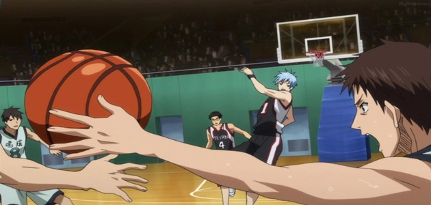](http://www.vortexcultural.com.br/tv/top-10-melhores-animes-de-2012/attachment/kuroko-no-basket-episode-19-screenshot-022/)

Devido a um *boom* de popularidade que há muito não se via, em menos de um ano o primeiro trabalho de Tadatoshi Fujimaki na maior antologia para garotos do Japão, a Shonen Jump, passou de série constantemente ameaçada pelos cortes editoriais a segundo mangá mais vendido da Terra do Sol Nascente. Canalizando desde uma imensa (e ainda em expansão) base de admiradores até preocupantes ameaças de morte ao autor, Kuroko no Basket foi um dos poucos títulos que causou comoção em 2012. E um dos motivos foi, indubitavelmente, uma adaptação animada de 25 episódios concedida pelo estúdio Production I.G.

Se apropriando de um já conhecido modelo de mangás de esporte, que consiste na escalada do nada ao topo despendida pelos membros de uma equipe colegial sem prestígio, o anime lança mão de todos os clichês do gênero: intermináveis treinamentos, o estabelecimento de rivais, o desenvolvimento de habilidades inverossímeis (não, nada de bolas que pegam fogo), o fortalecimento de laços de amizade, etc. Aliando momentos de descontração ao frenético ritmo de partidas muitíssimo bem animadas – apesar de alguns problemas orçamentários que levaram ao reaproveitamento de tomadas aqui e acolá –, Kuroko no Basket aproveita uma fórmula já utilizada por muitos para, no fim,  empolgar como poucos.

**9º – Hyouka**

[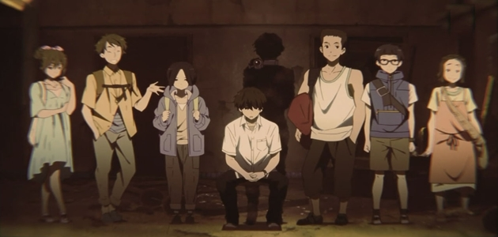](http://www.vortexcultural.com.br/tv/top-10-melhores-animes-de-2012/attachment/2w670d1/)Ao deixar de entregar a terceira temporada de Suzumiya Haruhi no Yuuutsu em 2012, ano em que o retorno da milionária franquia às telas era dado como quase certo, o Kyoto Animation decepcionou um sem número de fãs. Em vez de voltar a explorar as aventuras da série de light novels mais bem-sucedida da história, o estúdio optou por lançar duas produções inesperadas: uma totalmente original (Chuunibyou demo Koi ga Shitai!) e uma adaptação de 22 episódios da série de livros de Honobu Yonezawa (Hyouka). Esta, uma infantilidade de mensagem duvidosa. Aquela, um curioso *slice of life* pautado nos mistérios banais com que se deparam os integrantes de um Clube de Literatura Clássica – que, ao contrário do que sugerem os primeiros episódios, acaba surpreendendo.

A animação deslumbrante propiciada pela anormal soma investida no projeto, a direção segura de Yasuhiro Takemoto, competente ao apimentar o cotidiano com enquadramentos e cortes criativos, e uma trilha sonora indescritível, que comporta tanto faixas originais quanto composições de monstros da música clássica como [Johann Sebastian Bach](http://www.youtube.com/watch?v=hdyp-f0NNDA) e [Gabriel Fauré](http://www.youtube.com/watch?v=Oj86jkL7FII), conferem a Hyouka personalidade e carisma similares ao que encontramos no melancólico dia-a-dia em seus bons personagens.

**8º – Psycho-Pass**

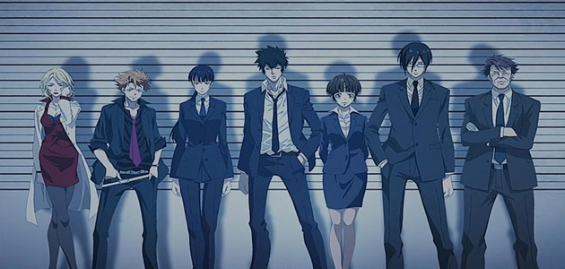

Responsável pela franquia Ghost in the Shell, que talvez seja o maior expoente da temática cyberpunk no âmbito das animações, o Production I.G resolveu revisitar os futuros tecnocráticos distópicos em Psycho-Pass. Passado num universo em que o estado mental dos indivíduos é arduamente monitorado por um sistema que os divide entre cidadãos saudáveis e criminosos latentes (aqueles que, devido à conturbação mental, podem cometer crimes violentos a qualquer momento), a série aborda a rotina de um departamento de Segurança Pública responsável por investigar casos atrelados a pessoas que perderam o controle, e que – julgadas sumariamente pelo sistema, sem nenhum intermédio humano – devem ser ou encaminhadas para tratamento ou eliminadas.

Com roteiro de Urobuchi Gen (Phantom: Requiem for the Phantom; Puella Magi Madoka Magica; Fate/Zero) e direção de Naoyoshi Shiotani (Blood-C: The Last Dark), esse thriller de ação provou ser um dos mais interessantes trabalhos originais em um ano no qual imperaram as adaptações. Mesmo que problemas pontuais possam ser apontados, os casos instigantes e ótimas cenas de ação de certo garantem seu lugar nesta lista.

**7º – Tonari no Kaibutsu-kun**

[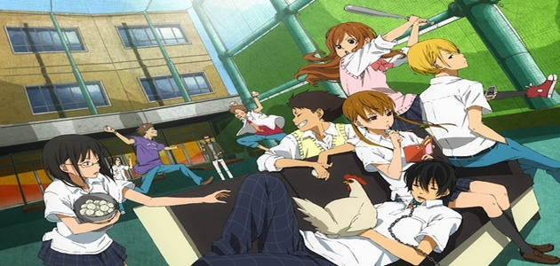](http://www.vortexcultural.com.br/tv/top-10-melhores-animes-de-2012/attachment/g_fullxfull-58555/)

Após o péssimo Sengoku Collection, o Brains Base, estúdio que vem se destacando nos últimos anos por contornar com criatividade as limitações financeiras, se redimiu ao transcrever para o audiovisual a comédia romântica Tonari no Kaibutsu-kun, primeiro grande hit da autora de mangás para garotas que atende apenas por Robiko.

Assim como Kimi ni Todoke, projeto anterior do diretor Hiro Kaburaki, com o qual é impossível não traçar um paralelo, Kaibutsu-kun parte de um pressuposto mais velho do que andar pra frente (“opostos que se atraem”) e proporciona uma diversão simples e descompromissada, voltada para adolescentes. Dispondo de um carnaval de cores e personagens carismáticos, a animação, assertiva ao conseguir encaixar melodrama em meio a piadas quase ininterruptas, mostra-se apaixonante.

**6º – Joshiraku**

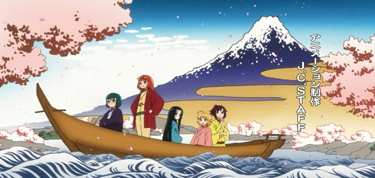

Nas discussões totalmente aleatórias que surgem durante os encontros de um grupo de cinco garotas, o gênio do humor Kouji Kumeta, aclamado por Sayonara Zetsubou Sensei, esconde um leque de ácidas criticas não só à atual indústria do entretenimento japonês, levada pelo fenômeno *moe* ao cúmulo do escapismo, como também à política e às tendências (ou doenças) sociais de sua terra. Esse é o mote de Joshiraku, mangá que muitos acreditavam ser impossível adaptar. Frente a essa descrença, o J.C Staff, estúdio conhecido por irritar fãs ao modificar diversas obras, tinha que fazer desse premeditado erro um grande acerto. E fez. Em um ano muito bom para as comédias, em que tivemos os hilariantes Thermae Romae, Binbougami ga! e Danshi Koukousei no Nichijou, nenhuma outra conseguiu tocar Joshiraku, que, com um humor ríspido, porém inteligente, se sagrou campeão em arrancar gargalhadas.

**5º – Fate/Zero (2nd Season)**

[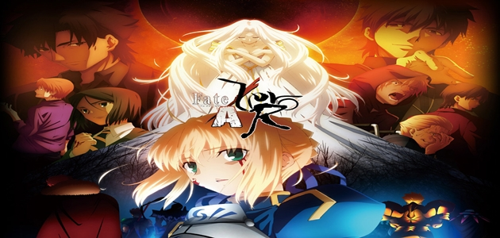](http://www.vortexcultural.com.br/tv/top-10-melhores-animes-de-2012/attachment/g_fullxfull-58555/)

Corridos alguns meses, a segunda temporada de Fate/Zero veio para fechar a trajetória de uma das Guerras do Santo Graal. Tendo eliminado na primeira parte a necessidade de introduzir personagens e explicar o universo, os 12 episódios restantes se ocuparam de entregar os confrontos épicos, sanguinolentos e imprevisíveis prometidos.

Contando com a mesma equipe e o mesmo orçamento descomunais do Ufotable, o anime contém, sem sombra de dúvida, as melhores lutas vistas na TV japonesa em 2012. Já no tocante a cenários, fluidez da movimentação e qualidade geral da animação, apenas o já citado Hyouka poderia barrá-lo. Em suma, um deleite visual, que peca apenas por seu final anticlimático.

**4º – Natsume Yuujinchou Shi**

[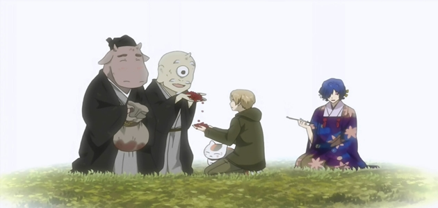](http://www.vortexcultural.com.br/tv/top-10-melhores-animes-de-2012/attachment/g_fullxfull-58555/)

Tudo o que foi dito no [texto do ano passado](http://www.vortexcultural.com.br/tv/top-10-melhores-animes-de-2011/), quando a terceira temporada do sempre excelente Natsume Yuujinchou recebeu a medalha de bronze, pode ser repetido aqui. Não há muito a acrescentar. Trata-se de uma das mais envolventes séries da atualidade, que, em seu 4º amontoado de 13 episódios, repetiu o feito dos anteriores: encantar o espectador a cada episódio.

Destoando da dinâmica de “causo da semana” que permeou os anos anteriores, um fio condutor mais nítido fez desta a temporada mais focada no mundo dos exorcistas e na prática de tal ofício – aspectos que eram antes apenas mencionados vez ou outra sem maiores explicações. Por conta disso, para desespero dos fãs que preferem as aventuras breves e autocontidas, arcos de dois ou mais episódios dominaram Natsume Yuujinchou Shi. Contudo, essa pequena alteração não turvou a essência da série.

**3º – Empate:**

**JoJo’s Bizarre Adventure**

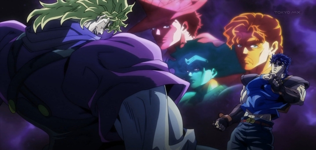

O segundo mangá mais longo da história da Shonen Jump, contando com 107 volumes publicados e ainda em produção, já recebera três versões animadas no passado, resultando num fracasso maior que o outro. Quando ninguém mais acreditava que JoJo’s Bizarre Adventure algum dia pudesse ser dignamente adaptado, o pouco expressivo David Production surpreendeu a todos, entregando um dos mais empolgantes e espirituosos títulos do ano. Qual foi o segredo? Um orçamento assombroso, uma equipe imensa e a utilização das mais modernas técnicas de animação? Não! Pelo contrário: pouco dinheiro investido – o que obrigou o time de produção a se virar com uma animação pouco movimentada, que recorreu a onomatopeias soltando na tela e outros recursos criativos para gerar emoção – e fidelidade à obra original foram os trunfos. Resgatando o clima dos animes oitentistas através de seu *character design* retrô e de uma trilha sonora saudosista – que conta, por exemplo, com [Roundabout](http://www.youtube.com/watch?v=-Tdu4uKSZ3M), da banda britânica Yes –, Jojo’s promove uma oportuna viagem ao passado.

**Uchuu Senkan Yamato 2199**

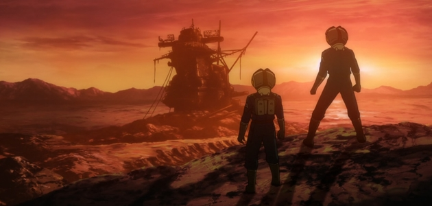

Remontando o longínquo ano de 1974, o *remake* de um dos maiores clássicos de Leiji Matsumoto veio para apresentar às novas gerações uma Space Opera tradicional, com todos os seus clichês e exageros. Em uma guerra interplanetária contra um império expansionista, os tripulantes da espaçonave Yamato devem cruzar a galáxia a fim de encontrar um meio de salvar o que restou da Terra. Amalgamando excelentes batalhas de fragatas cósmicas e personagens que despertam empatia (tanto os mocinhos quanto os vilões), o estúdio Xebec foi feliz ao recontar essa história, que mostra ainda ser atual.

**2º – Uchuu Kyoudai**

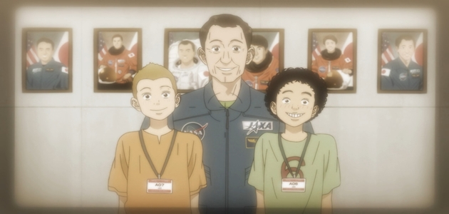

Quando o A-1 Pictures anunciou Uchuu Kyoudai, adaptação do famoso mangá homônimo de Chuuya Koyama, muitos pensaram que um projeto de longo prazo, com no mínimo um ano de duração, e que, por conta disso, se daria ao luxo de dispor de uma narrativa mais lenta, seria difícil e, por que não dizer, chato de se acompanhar semanalmente. Foi assim que pensei na época, admito. Agora, passadas quase 40 semanas, me sinto muito feliz por constatar que quebrei a cara. A falta de pressa, observa no cuidado com que cada personagem, evento e diálogo é construído provou ser o grande atrativo de Uchuu Kyoudai.

Intercalando passado, presente e futuro num clima novelesco, o anime narra a história de dois irmãos que desde a terna infância desejam se tornar astronautas. Uma vez que o mais novo deles realizou o sonho, o mais velho precisa superar seu ceticismo e encarrar seus medos a fim de não ficar para trás. Fruto de uma ostensiva pesquisa, Uchuu Kyoudai aborda de modo realístico as questões cientificas, assim como aquelas que concernem à rotina das agências espaciais. Desse modo, crível e gradualmente, o anime se tornou parte da rotina de milhares de espectadores, que aguardam ansiosos por mais um capítulo dessa jornada.

**1º – Sakamichi no Apollon**

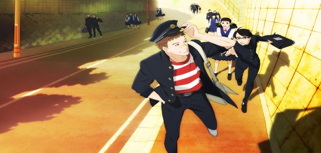

Jazz!

Oito anos após sua última obra-prima, Samurai Champloo, de 2004, Shinichiro Watanabe (Cowboy Bebop; Macross Plus), talvez o maior diretor de animes televisivos de todos os tempos, com o respaldo do Tezuka Productions, decidiu se aventurar em sua primeira adaptação: o romance de época de Yuki Kodama, Sakamichi no Apollon. Passado em 1966, o enredo entrelaça as histórias de jovens que se veem unidos por uma paixão em comum: o jazz. Paixão essa que sabidamente também é compartilhada pela dupla que comandou o projeto; o já citado diretor e a lendária compositora Yoko Kanno, responsável por pontuar musicalmente cada uma das viradas do roteiro.

Seja em belas composições originais, seja em versões de clássicos de gigantes como [Art Blakey](http://www.youtube.com/watch?v=caWY7uOlakU), [John Coltrane](http://www.youtube.com/watch?v=8L1r9hIytCA), [Miles Davis](http://www.youtube.com/watch?v=CwaxgMoLD-M), [Horace Silver](http://www.youtube.com/watch?v=h4s67e8-Ydo), [Duke Ellington](http://www.youtube.com/watch?v=JNSxiaWMGYs) e [Chet Baker](http://www.youtube.com/watch?v=o661KZwx2JQ), a música é a essência de Sakamichi no Apollon, que, ao longo de 11 episódios, reuniu drama, comédia e romance numa homenagem musical, retratando um conturbado período da história do Japão sob uma ótica sensível. Um trabalho de mestre, que não poderia ocupar outra posição.

  

### Things you can do from here:

- [Subscribe to Vortex Cultural - HQ's, Literatura, Games, Resenhas, Podcast, Cinema, Música e Séries](http://www.google.com/reader/view/feed%2Fhttp%3A%2F%2Fvortexcultural.com.br%2Ffeed%2F?source=email) using **Google Reader**
- [Get started using Google Reader](http://www.google.com/reader/?source=email) to easily keep up with **all your favorite sites**
