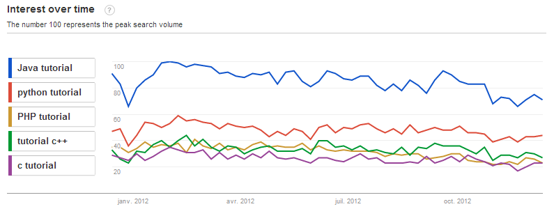

C# had the highest growth in popularity this year (2.3 %), and Python the highest growth this decade (8%).    
  

That's according to the [PYPL PopularitY of Programming Language index](https://sites.google.com/site/pydatalog/pypl/PyPL-PopularitY-of-Programming-Language), a leading index I created with data from Google Trends.  It is based on the number of searches of language tutorials on the web: the more a language tutorial is searched, the more the language is assumed to be popular.    
  

Interestingly, Python  is the second most popular programming language in the US.   The following diagram from Google Trends shows the number of language tutorial searches in 2012 in the US.[[s]](http://www.google.com/trends/explore?hl=en-US#q=Java%20tutorial%2C%20python%20tutorial%2C%20PHP%20tutorial%2C%20tutorial%20c%2B%2B%2C%20c%20tutorial&amp;geo=US&amp;date=today%2012-m&amp;cmpt=q) One can see that Python is ahead of PHP, C++ and C, but behind Java.

  
  

*Python is second most popular in the US*

  

  
  
For the ranking of the top 10 languages, see the [PYPL PopularitY of Programming Language index](https://sites.google.com/site/pydatalog/pypl/PyPL-PopularitY-of-Programming-Language).

  
  
from Planet Python <https://sites.google.com/site/pydatalog/pypl/python-blog/cisthelanguageoftheyearpythonofthedecade>
