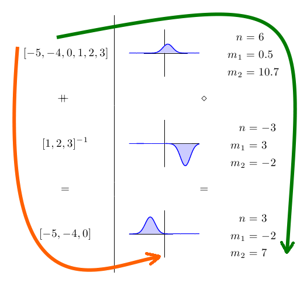

Esta é a primeira parte do primeiro de uma série de artigos sobre a [biblioteca HLearn](http://hackage.haskell.org/package/HLearn-algebra) para Haskell nos quais tenho trabalhado nos últimos meses. A ideia da biblioteca é mostrar que álgebra abstrata – especificamente [monóides](https://en.wikipedia.org/wiki/Monoid), [grupos](https://en.wikipedia.org/wiki/Group_%28mathematics%29) e [homomorfismos](https://en.wikipedia.org/wiki/Homomorphism) – é útil não apenas na programação esotérica funcional, mas também problemas de aprendizado de máquina no mundo real. Em particular, nós temos três coisas de graça ao elaborar um algoritmo de aprendizagem de acordo com estas propriedades algébricas: (1) uma versão online do algoritmo, (2) uma versão paralela do algoritmo, e (3) um procedimento para cross-validation que funciona de modo assintótico mais rápido do que a versão padrão.

  

Vamos começar com o exemplo de uma [distribuição Gaussiana](https://en.wikipedia.org/wiki/Normal_distribution). As distribuições Gaussianas são onipresentes em algoritmos de aprendizado porque descrevem com precisão a maioria dos dados. Mas, ainda mais importante, elas são fáceis de trabalhar, são totalmente determinadas pela sua média e variação, e esses parâmetros são fáceis de calcular.

  

Neste artigo, começaremos com exemplos de por que as propriedades monóide e grupo de distribuições Gaussianas são úteis na prática. Depois daremos uma olhada na matemática subjacente a esses exemplos e, finalmente,veremos que essa técnica é extremamente rápida na prática e resulta em paralelização quase perfeita.

  

## HLearn como exemplo

  

Instale as bibliotecas a partir de um shell:

  

```
 $ cabal install HLearn-distributions
```

  

Em seguida, importe as bibliotecas HLearn em um arquivo Haskell:

  

```
 > import HLearn.Algebra > import HLearn.Models.Distributions.Gaussian
```

  

E algumas bibliotecas para podermos comparar o nosso desempenho:

  

```
 > import Criterion.Main > import Statistics.Distribution.Normal > import qualified Data.Vector.Unboxed as VU
```

  

Agora vamos criar alguns dados para trabalhar. Para simplificar, usaremos um conjunto de dados inventado sobre quanto dinheiro as pessoas ganham. Cada entrada representa uma pessoa recebendo o salário. (Usamos um pequeno conjunto de dados aqui para facilitar a explicação.)

  

```
 > gradstudents = [15e3,25e3,18e3,17e3,9e3] :: [Double] > teachers = [40e3,35e3,89e3,50e3,52e3,97e3] :: [Double] > doctors = [130e3,105e3,250e3] :: [Double]
```

  

Para treinar uma distribuição Gaussiana a partir dos dados, nós simplesmente utilizamos a função train, desta maneira:

  

```
 > gradstudents_gaussian = train gradstudents :: Gaussian Double > teachers_gaussian = train teachers :: Gaussian Double > doctors_gaussian = train doctors :: Gaussian Double
```

  

A função train é um membro da HomeTrainer Type Class, sobre a qual falaremos mais adiante. Além disso, agora que treinamos algumas distribuições Gaussianas, é possível realizar todos os cálculos normais que possamos querer fazer em uma distribuição. Por exemplo, pegar média, desvio padrão, pdf e cdf.

  

Agora vamos passar para os bits interessantes. Começaremos mostrando que o Gauss é um semigrupo. Um semigrupo, por sua vez, é qualquer estrutura de dados que possui uma operação binária associativa chamada (<>). Basicamente, podemos pensar (<>) como adicionando ou agrupando as duas estruturas juntas. (Semigrupos são monóides com apenas uma função mappend.)

  

Então, como usaremos isso? Bem, e se decidimos que desejamos uma distribuição Gaussiana sobre os salários de todos? Utilizando a abordagem tradicional, teríamos que recalcular isso a partir do zero.

  

```
 > all_salaries = concat [gradstudents,teachers,doctors] > traditional_all_gaussian = train all_salaries :: Gaussian Double
```

  

Mas isso só repete o trabalho que já fizemos. Em um conjunto de dados do mundo real, com milhões ou bilhões de amostras, isso seria muito lento. Melhor seria mesclar a distribuições Gaussianas que já treinamos em uma Gaussiana final. Podemos fazer isso com a operação semigrupo (<>):

  

```
 > semigroup_all_gaussian = gradstudents_gaussian <> teachers_gaussian <> doctors_gaussian
```

  

Agora,

  

```
 traditional_all_gaussian == semigroup_all_gaussian
```

  

A parte mais legal disso é que o funcionamento da operação semigrupo leva tempo O (1), não importa a quantidade de dados que já treinamos nas distribuições Gaussiana. A abordagem simples leva o tempo O (n), então temos uma velocidade consideravelmente grande!

  

Em seguida, um monóide é um semigrupo com uma identidade. A identidade de uma distribuição Gaussiana é fácil de definir, simplesmente aplique train ao conjunto de dados vazio!

  

```
 > gaussian_identity = train ([]::[Double]) :: Gaussian Double
```

  

Agora,

  

```
 gaussian_identity == mempty
```

  

Mas ainda temos mais um truque na manga. A distribuição Gaussiana não é apenas um monóide, mas também um grupo. Os grupos aparecem o tempo todo na álgebra abstrata, mas não demos muita atenção à programação funcional por algum motivo. Bem, grupos são simples: eles são apenas monóides com um inverso. Esse inverso nos permite fazer a “subtração” em nossas estruturas de dados.

  

Então, de volta ao nosso exemplo de salário. Vamos supor que nós calculamos todos os nossos salários, mas já percebemos que incluir estudantes de graduação nos cálculos de salário foi um erro (eles não são pessoas reais, na verdade). Em uma biblioteca normal, teríamos que recalcular tudo do zero novamente, excluindo os alunos de graduação:

  

```
 > nograds = concat [teachers,doctors] > traditional_nograds_gaussian = train nograds :: Gaussian Double
```

  

Mas, como já discutimos antes, isso leva muito tempo. Podemos usar a função inverse para fazer essa mesma operação em tempo constante:

  

```
 > group_nograds_gaussian = semigroup_all_gaussian <> (inverse gradstudents_gaussian)
```

  

E agora,

  

```
 traditional_nograds_gaussian == group_nograds_gaussian
```

  

Mais uma vez, nós convertemos uma operação que teria levado o tempo O (n) para uma que leva o tempo O (1). Não pode ficar melhor do que isso!

  

## A classe tipo HomTrainer

  

Como eu já mencionei, a HomeTrainer Type Class é a base da [biblioteca HLearn](http://hackage.haskell.org/package/HLearn-algebra). Basicamente, qualquer algoritmo de aprendizagem que é também um homomorfismo de semigrupo pode ser feito de um exemplo de HomTrainer. Isso significa que se xs e ys constituem listas de pontos de dados, a classe obedece à seguinte lei:

  

```
 train (xs ++ ys) == (train xs) <> (train ys)
```

  

Isso pode ser mais fácil de ver em uma imagem:

  

[](http://imasters.com.br/desenvolvimento/distribuicoes-gaussianas-formam-um-monoided-parte-01/attachment/1-357/)

  
  

No lado esquerdo, temos alguns conjuntos de dados e, no lado direito, temos as distribuições Gaussianas correspondentes e os seus parâmetros. Pelo fato de o treinamento da Gaussiana ser um homomorfismo, não importa se seguirmos os caminhos laranja ou verde para chegarmos à nossa resposta final. Nós chegaremos exatamente à mesma resposta de qualquer maneira.

  

Com base apenas nessa propriedade, obtemos as três propriedades “grátis” que mencionei na introdução. (1) Temos um algoritmo online gratuito. A função add1dp pode ser utilizada para adicionar um novo ponto único a uma distribuição Gaussiana existente. Digamos que eu tenha me esquecido de um dos alunos de graduação – tenho certeza de que isso nunca aconteceria na vida real – eu posso adicionar o seu salário assim:

  

```
 > gradstudents_updated_gaussian = add1dp gradstudents_gaussian (10e3::Double)
```

  

Essa Gaussiana atualizada é exatamente o que conseguiríamos se tivéssemos incluído o novo ponto de dados no conjunto de dados original.

  

(2) Recebemos um algoritmo paralelo. Podemos usar a função parallel mais elevada para paralelizar qualquer aplicação de train. Por exemplo:

  

```
 > gradstudents_parallel_gaussian = (parallel train) gradstudents :: Gaussian Double
```

  

A função parallel detecta automaticamente o número de processadores que o seu computador tem e distribui uniformemente a carga de trabalho neles. Como veremos na seção de desempenho, isso resulta na paralelização perfeita da função de treinamento. A paralelização, literalmente, não poderia ser mais simples!

  

(3) Obtemos a cross-validation de forma assintótica mais rápida, mas isso não é aplicável realmente a uma distribuição Gaussiana, então vamos ignorar isso aqui.

  

Um último comentário sobre a classe HomTrainer: nós nunca temos realmente que definir a função train para o nosso algoritmo de aprendizagem de forma explícita. Tudo o que temos que fazer é definir a operação semigrupo, e o compilador vai deduzir a nossa função de treinamento pra gente!

  

Na segunda parte do artigo, vamos dar uma olhada em como é o funcionamento da operação semigrupo da distribuição Gaussiana.

  

\*\*\*

  

*Texto original disponível em <http://izbicki.me/blog/gausian-distributions-are-monoids#comment-988>*

  
[anexo ausente]  
  

[](http://share.feedsportal.com/viral/sendEmail.cfm?lang=pt&amp;title=Distribui%C3%A7%C3%B5es+Gaussianas+formam+um+mon%C3%B3ide+%E2%80%93+Parte+01&amp;link=http%3A%2F%2Fimasters.com.br%2Fdesenvolvimento%2Fdistribuicoes-gaussianas-formam-um-monoided-parte-01%2F)

  

[](http://res.feedsportal.com/viral/bookmark_pt.cfm?title=Distribui%C3%A7%C3%B5es+Gaussianas+formam+um+mon%C3%B3ide+%E2%80%93+Parte+01&amp;link=http%3A%2F%2Fimasters.com.br%2Fdesenvolvimento%2Fdistribuicoes-gaussianas-formam-um-monoided-parte-01%2F)

  
  
  
[[anexo ausente]](http://da.feedsportal.com/r/151884618274/u/49/f/546640/c/33212/s/27a10136/a2.htm) [anexo ausente]  
  
[anexo ausente]  
  
  
  
from iMasters <http://imasters.com.br/desenvolvimento/distribuicoes-gaussianas-formam-um-monoided-parte-01/>
