Este artigo irá guiar o usuário através do uso do Wizard VPC para criar um VPC multi-subnet, descrever cada item criado pelo wizard, e lançar instâncias em uma subnet VPC privada e pública.

  

Os seguintes itens serão abordados aqui:

  

Criar uma VPC

  

Explorar os diferentes objetos da VPC e o que significam

  

Lançar instâncias EC2 em uma VPC

  

Definir um IP público (EIP) e testar a conectividade publica/privada

## Criar uma VPC

  

Entre no AWS Console, clique na aba VPC e selecione o botão Get started creating a VPC para iniciar o wizard de criação da VPC.

  

[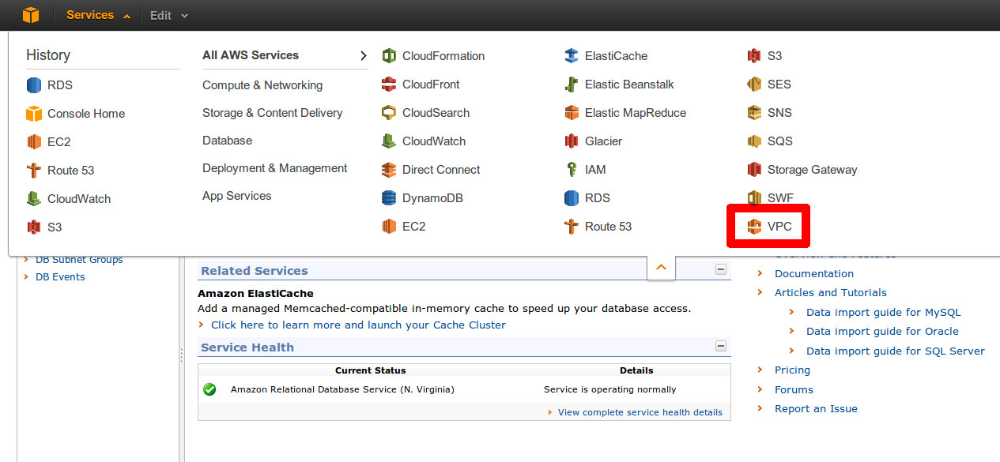](http://awshub.com.br/resources/amazon-web-services-hands-on-vpc/vpc1/) 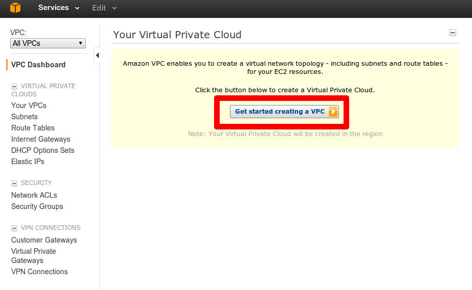

  

Selecione a segunda opção para criar uma VPC with Public and Private Subnets e clique em Continue. Note na figura que o wizard irá criar automaticamente uma instância EC2 “NAT” para servir como gateway para suas subredes privadas e fazer as conexões com a Internet. Nós iremos discutir essa instância com mais detalhes logo mais neste mesmo tutorial.

  

[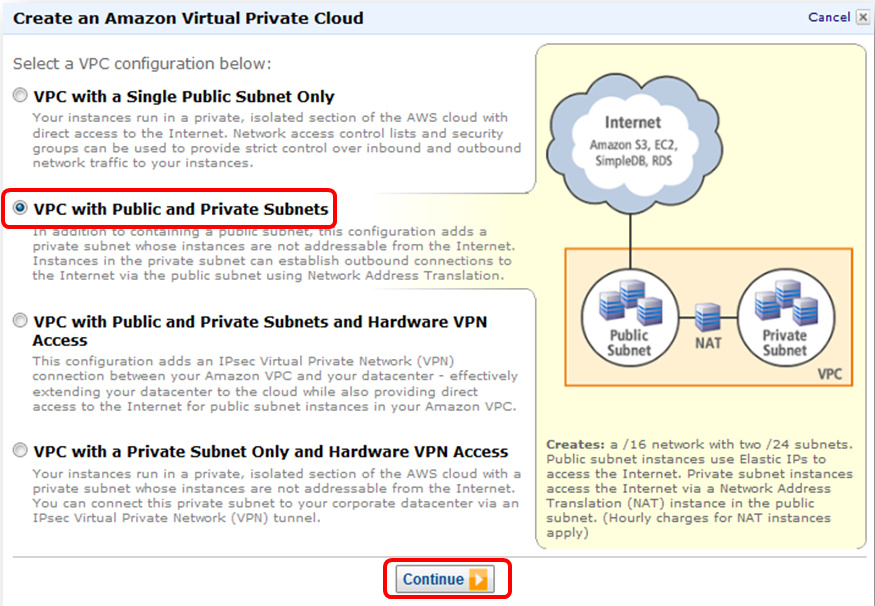](http://awshub.com.br/resources/amazon-web-services-hands-on-vpc/702-bmp/)

  

Na página de informações, edite os valores padrão para Public e Private Subnets com os valores a seguir, e clique em Create VPC:

  

Public Subnet:     10.0.0.0/23  
Private Subnet:     10.0.10.0/23

  

[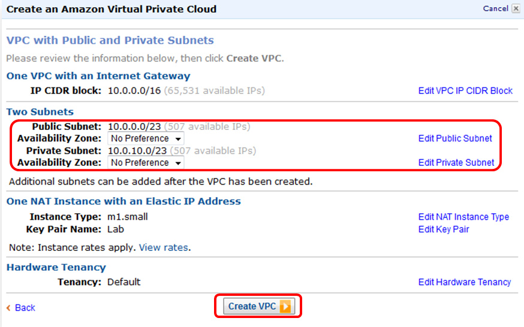](http://awshub.com.br/resources/amazon-web-services-hands-on-vpc/703-bmp/)

  

Nós estamos modificando os valores padrão para conseguir mais espaço para crescer com cada subrede (507 IPs disponíveis) para acomodar o uso de recursos adicionais da AWS, como o ELB ou o RDS na VPC, bem como ter algum espaço entre os blocos de subredes “público” e “privados” para acomodar uma expansão futura em que podemos incluir multi-AZ.

  

O wizard da VPC irá criar sua subrede e lhe avisar quando estiver tudo pronto. Note que o progresso irá pausar no meio do caminho. Por trás dos panos, o wizard está criando e iniciando a instância NAT, e é por isso que ele está esperando.

  

[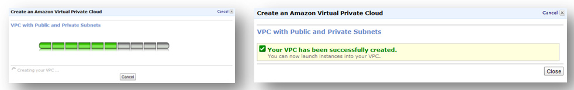](http://awshub.com.br/resources/amazon-web-services-hands-on-vpc/704-bmp/)

  

## Um passo a passo pelos objetos da VPC

  

Depois que sua VPC for criada, você será avisado que uma série de coisas foi criada para você, como poderá ver no screenshot abaixo. Os próximos passos irão lhe mostrar, um a um, os vários objetos e componentes da VPC que foram criados para você pelo Wizard.

  

[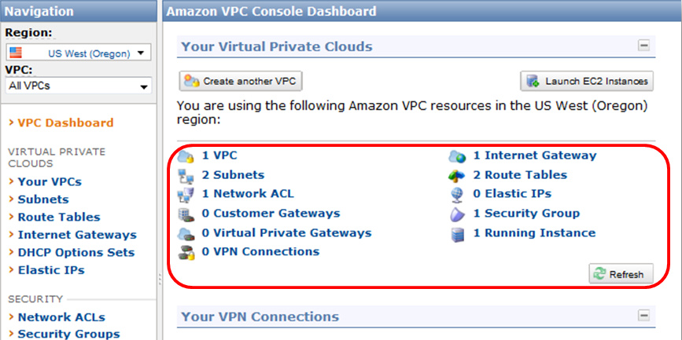](http://awshub.com.br/resources/amazon-web-services-hands-on-vpc/705-bmp/)

  

### - Your VPCs

  

O link Your VPCs lhe dá uma lista das suas VPCs, e é o melhor local para conseguir os IDs das suas VPCs. Se você criou várias VPCs, elas apareceram listadas aqui, com vários níveis de informação, como o CDIR, opções de DHCP, tabela de rotas padrão, ACL padrão da rede, e Hardware Tenancy (se um hardware físico VPC será compartilhado [padrão] ou dedicado para você).

  

[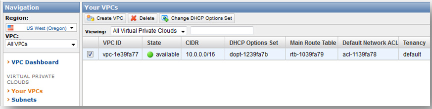](http://awshub.com.br/resources/amazon-web-services-hands-on-vpc/706-bmp/)

  

### - Subnets

  

O link Subnets lista todas as suas subredes de VPC e permite que você crie subredes adicionais através do botão Create Subnets. Note que duas subredes foram criadas porque nós falamos para o Wizard criar as duas, pública e privada.  Ao clicar em uma subrede, os detalhes dela aparecerão, incluindo o range de endereços (CIDR), availability zone, e tabela de rotas associadas e ACLs de rede.

  

[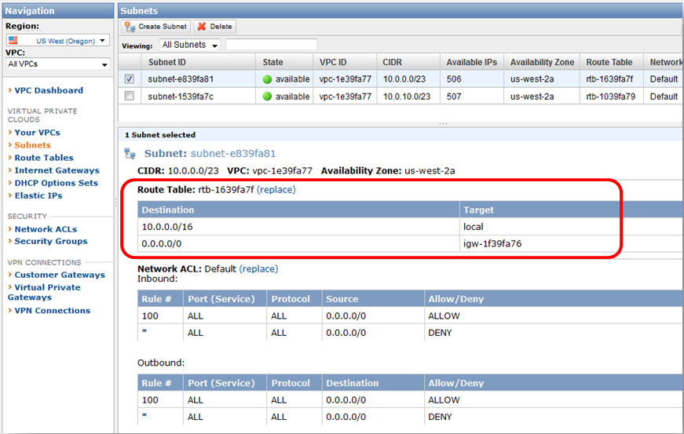](http://awshub.com.br/resources/amazon-web-services-hands-on-vpc/707-bmp/)

  

Note que essa roda padrão da subrede (0.0.0.0) é o Internet Gateway (descrito abaixo na seção Internet Gateway).  Internet Gateways podem ser identificados pelo prefixo “igw” nos seus ID’s. Essa rota faz desta subrede a sua subrede “publica” porque ela é publicamente roteável pelo Internet Gateway.

  

Se você clicar na segunda subrede verá uma tabela diferente de rotas.

  

[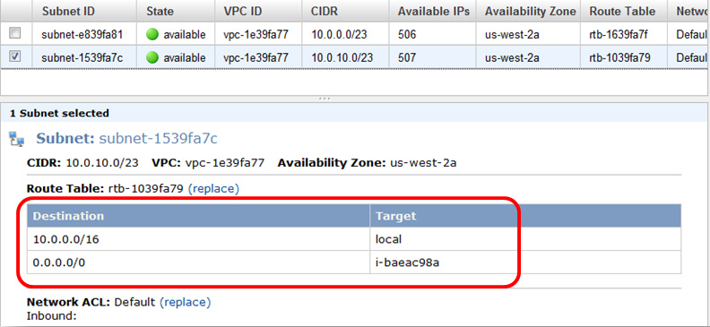](http://awshub.com.br/resources/amazon-web-services-hands-on-vpc/708-bmp/)

  

Essa rota padrão da subrede (0.0.0.0) é outra instância EC2 (descrita abaixo na seção NAT Instance). Instâncias EC2 podem ser identificadas pelo prefixo “i-” no seu ID. Essa rota faz dessa subrede a sua subrede “privada”, pois ela não é publicamente roteável pelo Internet Gateway. No lugar disso, todas as suas conexões para a Internet são direcionadas, e intermediadas, pela sua instância NAT na sua rede “publica”. O diagrama a seguir descreve essas subredes que foram criadas para você:

  

[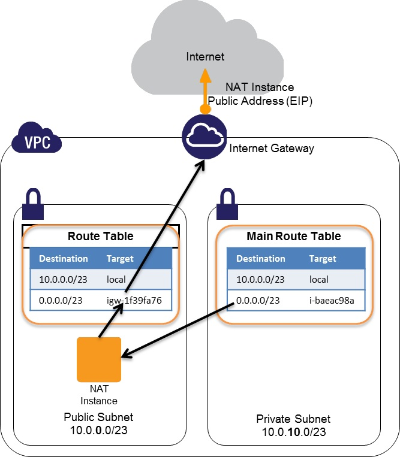](http://awshub.com.br/resources/amazon-web-services-hands-on-vpc/709b/)

  

### - Route Tables

  

O link Route Tables lista todas as suas tabelas de rotas da VPC, permite que você modifique e associe tabelas de rotas às subredes, e permite que crie tabelas de rotas adicionais para sua VPC com o botão Create Route Table. Note que duas tabelas de rotas foram criadas pelo Wizard, e são as mesmas tabelas de rotas mostradas nos detalhas da subrede na seção anterior.

  

Note as colunas Main e Associated With. A subrede definida como “Main” (Main = Yes) é a tabela de rotas padrão da sua VPC. Isso significa que todas subredes que não estão explicitamente associadas com uma tabela especifica irão usar essa tabela por padrão. A coluna Associated With mostra o número de subredes explicitamente associadas com essa tabela de rotas.

  

[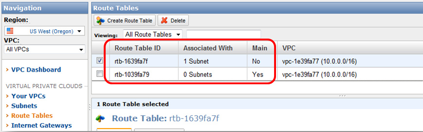](http://awshub.com.br/resources/amazon-web-services-hands-on-vpc/710-bmp/)

  

Note que apenas 1 das 2 subredes estão associadas a uma tabela de rotas. A segunda subrede não está explicitamente associada a uma tabela de rotas e, portanto, está usando a tabela de rotas “Main” (rtb-1039fa79).

  

Clicando na tabela de rotas você irá ver os detalhes das rotas, e será possível modificar as rotas da tabela, bem como associá-las a subredes adicionais.

  

[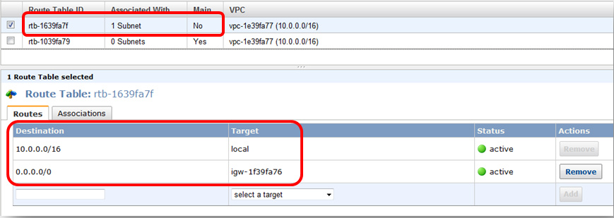](http://awshub.com.br/resources/amazon-web-services-hands-on-vpc/711-bmp/)

  

Perceba que a tabela de rotas selecionada (rtb-1639fa7f) NÃO é a tabela de rotas “Main” (Main = No), e a sua rota padrão (0.0.0.0) é o  Internet Gateway (igw-1f39fa76). Isso significa que a sua subrede “pública” está explicitamente associada com essa tabela de rotas (clique na aba Associations para verificar isso).  Se você selecionar a segunda tabela de rotas, verá que a rota padrão (0.0.0.0) é a sua instância NAT.

  

Então, o que tudo isso significa? Por padrão, o Wizard de VPC cria duas subredes e duas tabelas de rotas. A subrede “pública” é associada com a tabela de rotas que direciona o trafego, por padrão, direto para a Internet. A subrede “privada” não está associada a nenhuma tabela de rotas específicas, e por isso toma como padrão a tabela “Main”, que direciona o tráfego para a instância NAT na subrede “pública”.

  

Mais uma coisa para notar: as regras na tabela de rotas “Main” determina como as subredes serão tratadas por padrão. A partir do momento que a tabela “Main” é uma tabela de rotas “privada” (ela não direciona nenhum tráfego para o Internet Gateway), todas as subredes criadas nessa VPC serão “privadas” por padrão. Elas irão permanecer “privadas” até que sejam explicitamente associadas a uma tabela de rotas “pública” (ex.: uma dessas rotas direcione o trafego para o Internet Gateway).

  

### - Internet Gateways

  

Um Internet Gateway provê um mapeamento NAT 1-to-1 do IP interno da sua instância VPC pra um Elastic IP publicamente roteável, que você precisa associar explicitamente com sua instância “pública” de VPC. Para os propósitos deste tutorial, o Wizard VPC criou um Internet Gateway e o associou à sua VPC.

  

[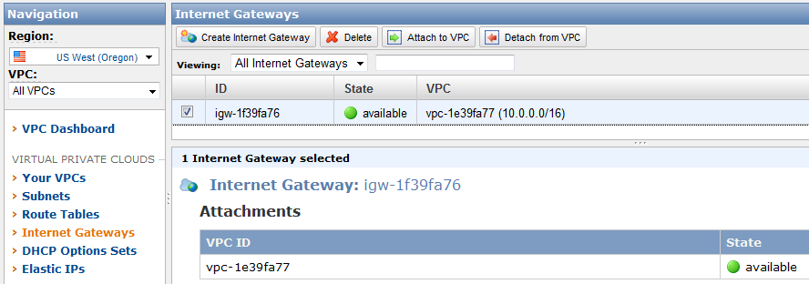](http://awshub.com.br/resources/amazon-web-services-hands-on-vpc/attachment/712/)

  

Você não precisará fazer nada específico com o seu Internet Gateway neste tutorial.  Nós iremos pontuá-lo aqui para explicar o Internet Gateway que foi criado para você, e pontuar que os Internet Gateways podem ser independentemente criados, anexados e desanexados das suas VPCs. Isso permite que você adicione ou remova  as capacidades de Internet Gateway das suas VPCs depois que elas forem criadas.

  

### - DHCP Options Sets

  

O link DHCP Options Sets permite que você controle algumas opções de DHCP que estão presentes no serviço DHCP da sua VPC no momento em que ela inicia. Por padrão, o Wizard de VPC cria uma série de opções de DHCP que falam para a sua instância VPC usar o serviço de DNS padrão disponibilizado pela AWS para resolver os nomes.

  

[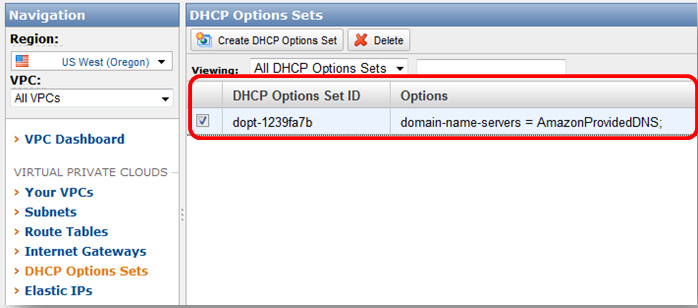](http://awshub.com.br/resources/amazon-web-services-hands-on-vpc/713-bmp/)

  

A VPC permite que você crie e anexe novas opções de DHCP a suas VPCs, incluindo definir o seu próprio servidor de DNS, servidor de NTP, e servidores de Microsoft Windows NetBIOS e tipos de nodes. Os screenshots a seguir mostram como essas opções podem ser configuradas quando estiver criando um novo DHCP Options Set.

  

[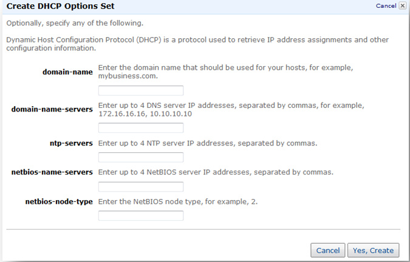](http://awshub.com.br/resources/amazon-web-services-hands-on-vpc/714-bmp/)

  

### - Elastic IPs

  

Os Elastic IPs da VPC são estáticos, endereços de IP publicamente roteáveis que você pode associar a suas instâncias VPC. Embora você não tenha iniciado nenhuma instância VPC ainda, o Wizard VPC inicia uma instância NAT VPC, cria um endereço público de Elastic IP, e associa esse EIP à instância NAT para você. Você pode ver o EIP e as associações clicando no link Elastic IPs e selecionando Address.

  

[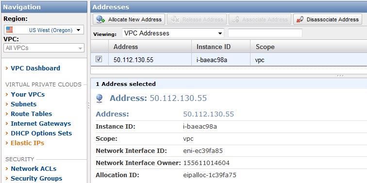](http://awshub.com.br/resources/amazon-web-services-hands-on-vpc/attachment/715/)

  

### - Network ACLs

  

A Network Access Control Lists (NACLs) atua como um tipo de firewall de subrede, controlando a entrada e a saída de toda a subrede (como uma segunda linha de defesa no topo dos grupos de segurança). Se você clicar no link Network ACLs, verá que o Wizard criou um simples NACL “padrão” para a sua VPC com uma regra Allow ALL padrão. Como as NACLs são desacopladas, nós recomendamos o seu uso apenas quando você quiser bloquear um acesso explicitamente. Por exemplo, nós nunca queremos usar TFTP ou “essa” subrede nunca deverá conversar com “aquela” subrede.

  

[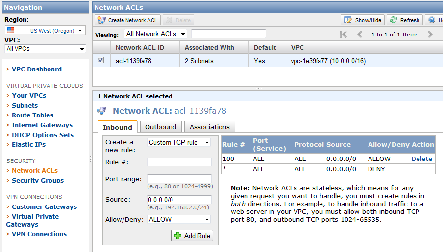](http://awshub.com.br/resources/amazon-web-services-hands-on-vpc/attachment/716/)

  

### - Security Groups

  

Os links Security Group permitem que você visualize os seus VPC Security Groups. Perceba que o Wizard VPC criou para você um Security Group chamado “default”.

  

[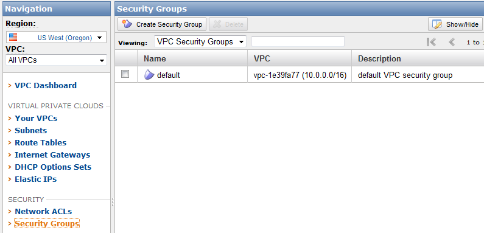](http://awshub.com.br/resources/amazon-web-services-hands-on-vpc/attachment/717/)

  

### - Instância NAT

  

Nós mencionamos a instância NAT várias vezes durante este tutorial. Em qualquer rede privada (seja ela corporativa ou doméstica), os clientes de Internet devem passar por um dispositivo que irá traduzir endereço “privado” (interno, não roteável pela Internet) para endereço “público” (externo, roteável pela Internet) para navegar pela Internet. Em casa, isso é feito basicamente por algum roteador wireless e, no trabalho, por algum firewall corporativo ou servidor de proxy web. No seu nível mais básico, esse dispositivo ou serviço provê um mapeamento 1-to-many, em que vários clientes privados são mascarados como um único endereço publico.

  

A instância NAT dá essa capacidade para a VPC, permitindo que múltiplas instâncias privadas façam requisições externas pela Internet sem precisar de um IP publico para cada uma. Não há nada especial sobre o wizard VPC que provê a instância NAT. Tecnicamente é uma instância simples, Amazon Linux com um mascaramento de IP habilitado usando iptables. Você pode encontrar as mais recentes AMIs procurando em AMIs públicas por “VPC-nat”.

  

[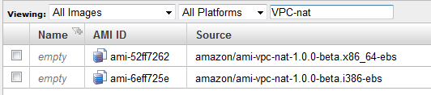](http://awshub.com.br/resources/amazon-web-services-hands-on-vpc/attachment/718/)

  

Para visualizar a instância NAT, você deve sair da aba VPC, ir para a aba EC2 no AWS Management Console e clicar no link Instances.

  

Localize a instância NAT. A melhor forma de fazer isso é procurá-la através do ID. Nós descobrimos esse ID anteriormente nas seções Subnets e Route Tables. De toda forma, é fácil localizá-la em uma nova conta AWS, pois ela será a única instância rodando (ou a única instância que ainda não possui uma tag). Clicando na instância, você poderá ver os detalhes, incluindo a VPC e a Subnet onde a instância está rodando.

  

  

Nós recomendamos que você dê um nome tipo “NAT Instance” ou algo parecido para ficar mais fácil de identificá-la posteriormente. Você pode fazer isso facilmente clicando na aba Tags ou colocando o mouse sobre a coluna Name em branco, clicando no ícone de edição, e colocando o nome diretamente no campo.

  

[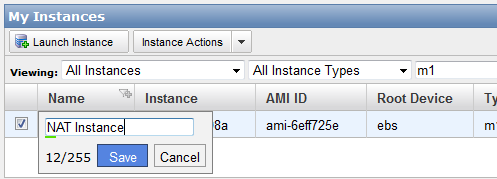](http://awshub.com.br/resources/amazon-web-services-hands-on-vpc/attachment/721/)

  

Uma última coisa à qual devemos ficar atentos sobre essa instância – nos detalhes dela, perceba que o checkbox Source/Dest. está listado como disabled.

  

  

Por padrão, a AWS assume que suas instâncias VPC são hosts da rede e não roteadores – significando que você pode apenas enviar e receber tráfego de rede endereçado ao seu endereço de IP privado.  Uma vez que o trabalho de uma instância NAT é rotear o trafego entre clientes internos e a Internet, isso requer que a opção esteja desabilitada (o que o Wizard VPC já fez para você).

  

Pra modificar essa configuração no futuro (ex.: se você quiser permitir que outras instâncias façam o roteamento do tráfego, por razões de negócio ou segurança), clique com o botão direito na instância, selecione Change Source/Dest Check, e clique na opção “Yes, Enable” ou “Yes, Disable”, dependendo da configuração atual da sua instância.

  

  

## Lançando instâncias VPC

  

### - Lançando um Servidor Privado

  

No AWS Management Console, aba EC2, clique no botão Launch Instance.  Selecione Classic Wizard e clique em Continue.

  

  

Selecione a 64-bit Amazon Linux AMI.

  

  

Mude o tipo da instância para Small (m1.small, 1.7 GB), selecione a aba VPC, e selecione a subnet 10.0.10.0/23.

  

  

Na próxima tela, deixe as configurações padrão e clique em Continue. Note que existem algumas configurações em VPC Advanced Options, nas quais você deve especificar o seu IP estático interno da sua instância.

  

  

Dâ um nome para o seu servidor privado (ex. Private Server) e clique em Continue.

  

  

Use o seu par de chaves já existente e clique em Continue.

  

  

Crie um novo VPC Security Group para o seu servidor privado. Neste exemplo, nós iremos chamá-lo de Private\_Servers e dar as permissões para todas as instâncias nesse VPC “pingarem” esses servidores.

  

  

Finalmente, revise as suas opções e clique em Launch.

  

  

Você agora tem uma instância de um servidor privado criada na sua VPC. Ache a nova instância na sua lista de instâncias EC2 e selecione-a. Na descrição da instância, note que ela possui um IP privado (10.0.11.2 no screenshot abaixo), mas não possui nenhum informação pública para conectarmos a ela (ex.: nenhum EIP ou informação de Public DNS). Essa instância é acessível apenas localmente da sua VPC (teoricamente, ela pode ser acessível localmente de dentro de uma rede corporativa se nós tivermos estabelecido uma VPN de hardware ou software para conexão com a VPC da nossa rede corporativa).

  

  

## Lançando um servidor público

  

Agora que você já possui um servidor privado, nós iremos lançar um servidor público e mostrar a diferenças entre os dois. No AWS Management Console, aba EC2, clique no botão Launch Instance. Selecione o Classic Wizard e clique em Continue. Selecione a 64-bit Amazon Linux AMI e clique em Select. Mude o tipo de instância para Small (m1.small, 1.7 GB), selecione a aba VPC, e selecione a subnet 10.0.0.0/23.

  

  

Na próxima tela, deixe as opções padrão e clique em Continue. Dê um nome para o seu servidor público (ex.: Public Server) e clique em Continue.

  

  

Na próxima tela, selecione seu par de chaves já existente e clique em Continue.  Crie um novo Security Group para os seus servidores públicos. Neste exemplo, nós criaremos um grupo chamado Public\_Servers, com as regras para permiter que qualquer um “pingue” e conecte via SSH às instâncias.

  

  

Finalmente, revise suas configurações e clique em Launch.

  

  

Você agora tem um servidor criado na sua subnet pública; mas de qualquer forma ele continua não acessível publicamente. Localize a sua nova instância na sua lista de instâncias EC2 e selecione-a. Na descrição da instância, note que ela possui um endereço de IP privado (10.0.0.28 no screenshot abaixo), mas não tem nenhum informação pública para conectarmos a ela (ex.: não possui EIP ou informação de Public DNS) – exatamente igual à sua instância privada.

  

  

Para fazer essa instância ficar publicamente acessível, nós precisamos definir um endereço Elastic IP público para ela. Na aba EC2, clique no link Elastic IPs, e mude a opção Viewing para All Addresses. Você irá ver que o Wizard VPC já criou um EIP e a vinculou à sua instância NAT. Clique no botão Allocate New Address.

  

  

Mude o tipo do EIP para VPC e clique em Yes, Allocate.

  

  

Depois, clique com o botão direito no novo EIP que será alocado e selecione Associate.

  

  

Selecione o seu Public Server no meu dropdown Instance: e clique em Yes, Associate.

  

  

Agora você será capaz de se conectar ao seu servidor público usando o novo endereço Elastic IP. No screenshot de exemplo abaixo, nós demonstramos essa conectividade com um simples “ping” no servidor.

  

  

Você acabou de criar com sucesso servidores públicos e privados na sua VPC. Fique à vontade para explorar os detalhes de ambas as instâncias para ver o relacionamento do EIP no seu servidor público e examinar a diferença entre as duas instâncias.

  

## Terminando os serviços pagos

  

Você não poderá deletar sua VPC enquanto todas as instâncias usando a VPC não estejam totalmente terminadas. Neste ponto, fique à vontade para terminar os servidores Público e Privado que criamos neste tutorial.

  

  

Depois que o Public Server for terminado, o EIP que você associou a ele irá se tornar livre e começará a coletar cobranças por tempo parado, então tenha certeza de deletar o seu EIP o mais rápido possível.

  

  

Finalmente, para deletar completamente a sua VPC, primeiro termine a instância NAT e faça um release do seu EIP; então vá até a aba VPC , no link VPCs, selecione a sua VPC, e clique no botão Delete.  

  

—

  

##### Atenção: Reiteramos a importância de você desligar os recursos que você usou apenas para seguir este tutorial. Não nos responsabilizamos por serviços não desligados.

  

—

  

Tutorial desenvolvido por [José Papo](http://twitter.com/josepapo) (AWS Tech Evangelist para a América Latina) e evangelistas/arquitetos AWS com revisão e editoração do iMasters.

  
[anexo ausente]  
  

  

  
  
  
[[anexo ausente]](http://da.feedsportal.com/r/151884258115/u/49/f/546640/c/33212/s/2761f670/a2.htm) [anexo ausente]  
  
[anexo ausente]  
  
  
  
from iMasters <http://imasters.com.br/desenvolvimento/mao-na-massa-amazon-virtual-private-cloud/>
