Auto Scaling representa mais do que uma forma de adicionar e remover servidores. É também um mecanismo de monitorar falhas de uma maneira similar à forma como os Load Balancers monitoram servidores que não respondem. Este artigo irá guiar o usuário sobre como configurar um Auto Scaling para se lançar automaticamente, monitorar, e atualizar um ELB associado com suas instancias EC2.

  

Recomendamos fortemente que você [assista ao vídeo mão na massa que explica o Auto Scaling e o demonstra o passo a passo](https://vimeo.com/55379828) antes de realizar o processo desse artigo.

  
> Importante! Tenha certeza que você apagou o Auto Scaling no final do dia. Como você verá neste artigo, o serviço faz exatamente o que você manda ele fazer, e se você simplesmente terminar os servidores, ele será notificado e irá iniciá-los novamente. 30 dias depois você irá se perguntar porque recebeu uma cobrança da AWS. Instruções de como finalizar todos esses serviços da forma correta você encontra ao final deste artigo.

  

## Principios do Auto Scaling

  

Primeiro, o Auto Scaling é um modo de medir a temperatura da Nuvem. Você usa regras para “definir o termostato”, e por baixo dos panos o Auto Scaling adiciona ou subtrai recursos EC2 à medida que for necessário, afim de manter a “temperatura” (capacidade). Segundo, o Auto Scaling assume um conjunto homogêneo de servidores. De fato, esse é o princípio básico do cloud computing: escalar horizontalmente usando uma gama de recursos fungíveis e homogêneos.

  

## Os 4 componentes-chave do Auto Scaling

  

Quando você inicia um servidor manualmente, você passa parâmetros com o qual AMI ele irá iniciar, qual o tamanho da instância, qual o security group, etc. O Auto Scaling chama isso de Launch Configuration. É um conjunto simples de parâmetros.

  

O Auto Scaling Groups diz para o sistema o que fazer com a AMI, uma vez que ela inicie. Aqui é onde você define qual AZ ela deverá iniciar, qual load balancer usar, e – o mais importante – é aí que você define o número mínimo e máximo de servidores que irão rodar.

  

Você precisa de regras que dizem para o sistema quando adicionar ou subtrair servidores. Nós conhecemos essas regras como Scaling Triggers. Um exemplo de regra seria: “se a média de CPU dos servidores no Auto Scaling group ultrapassar 65% por dez minutos, aumente o grupo em mais um servidor” e “se a média de CPU dos servidores no Auto Scaling Group ficar abaixo de 40% por dez minutos, diminua um servidor”.

  

Quando uma trigger é disparada, isso inicia o que chamamos de Scaling Event – que nada mais é do que o ato de escalar pra cima ou para baixo.

  

## Tempo é dinheiro

  

Você pode economizar muito dinheiro usando o Auto Scaling. Existem dois conceitos muito importantes que afetam diretamente os custos da AWS e, dessa forma, a maneira como sua aplicação irá escalar:

  

### O Custo Mínimo para o EC2 é de uma hora

  

Não importa se a instância EC2 roda por 60 segundos ou por 60 minutos: a AWS irá cobrar com uma hora cheira. Dessa forma, é muito importante evitar situações de ciclos curtos, como por exemplo, onde um servidor é adicionado ao grupo por dez minutos, retirado logo depois e alguns minutos após outro é adicionado.

  

### Escalar leva tempo

  

Considere o grafico abaixo. Na maioria das situações existe um tempo considerável entre quando há a necessidade do escalonamento e quando ele acontece.

  

[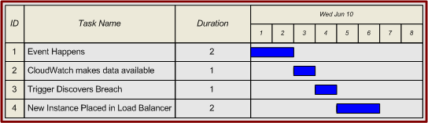](http://awshub.com.br/resources/amazon-web-services-hands-on-auto-scaling/attachment/401/)

  

Neste exemplo, a regra define uma condição particular de no mínimo dois minutos;

  

CloudWatch é um conjunto de coleções de dados que monitora as estatísticas, como por exemplo a utilização de CPU. É um conjunto de protocolos e em geral leva cerca de 60 segundos para agregar todas as informações;

  

Auto Scaling também leva outros 60 segundos;

  

Então, temos o tempo de boot do servidor. Um servidor grande e complexo pode levar alguns minutos para iniciar;

  

Finalmente, o load balancer precisa monitorar esse servidor por algum tempo antes para que ele se sinta confortável e seguro para direcionar os requests para a nova instância.

## Instalando as ferramentas de linha de comando da API Auto Scaling

  

Se você ainda não instalou as ferramentas de linha de comando da API de Auto Scaling, por favor siga as instruções do guia [Auto Scaling Getting Started](http://docs.amazonwebservices.com/AutoScaling/latest/GettingStartedGuide/SetupCLI.html) para uma instalação manual. Você também pode usar o [Bitnami Cloud Tools](http://bitnami.org/tools/cloud), se desejar. O Bitnami Cloud Tools é um instalador rápido para Windows, Mac e Linux e faz a instalação e configuração de todas as ferramentas de linha de comando da AWS com um único pacote de instalação. O [Bitnami Cloud Tools](http://bitnami.org/tools/cloud) pertence à Bitnami e não é suportado diretamente pela AWS.

  

## Criando uma AMI para Auto Scaling

  

O Auto Scaling irá lançar e remover instâncias automaticamente para você, mas irá precisar de uma Amazon Machine Image para funcionar como ponto de partida para lançar novas instâncias. Selecione um dos dois Web Servers que você criou anteriormente e crie uma nova AMI a partir dele (clique com o botão direito e selecione Create Image (EBS AMI). Você também pode usar outra imagem já existente se desejar).

  

[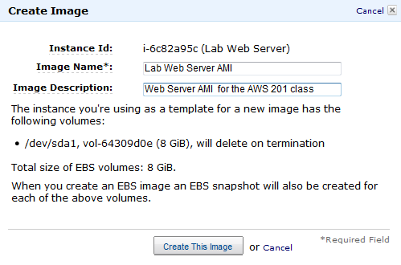](http://awshub.com.br/resources/amazon-web-services-hands-on-auto-scaling/attachment/402/)

  

Nos exemplos a seguir, usaremos uma AMI chamada Lab Web Server AMI.

  

## Pegando o ID

  

Uma maneira de pegar o ID do seu Lab Web Server AMI é usando o AWS Management Console (EC2 tab -> AMIs):

  

[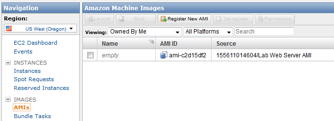](http://awshub.com.br/resources/amazon-web-services-hands-on-auto-scaling/403-2/)

  

Como estamos usando a linha de comando neste artigo, você pode usar também o *ec2-describe-images -o self*:

  

```
 C:\ec2>ec2-describe-images -o self A resposta do comando será parecida com: IMAGE   ami-c2d15df2    155611014604/Lab Web Server AMI 155611014604    pending private   x86_64  machine aki-fc37bacc           ebs     paravirtual     xen
```

  

Perceba que neste exemplo o nosso AMI ID é ami-c2d15df2. Nós iremos usar <ami-id> para indicar onde você deve substituir o seu AMI ID para que esses comandos funcionem para você.

  

## Criando uma Launch Configuration

  

Para criar uma Launch Configuration para o seu Auto Scaling, substitua o seu <ami-id> nos comandos abaixo (tudo em uma linha). Note que essas instruções assumem que você criou um security group chamado “Lab Web Tier” e um par de chaves chamado “Lab” nos artigos anteriores.

  

```
 C:\ec2>as-create-launch-config --image-id
```

  

```
 A resposta do comando será parecida com:
```

  

```
 OK-Created launch config
```

  

Os parametros para este comando são os seguintes:

  

Image-id – O nome do AMI do seu Lab Web Server AMI;

  

Instance Type – O hardware virtual que queremos usar. Estamos usando o t1.micro aqui;

  

Key – O par de chaves que você deseja usar. Não coloque o “.pem”no nome;

  

Group – O security group  — neste caso  “Lab Web Tier”;

  

Launch-config – O nome desta configuração. Nós usamos aws201-config.

## Criando um Auto Scaling Group

  

Nós iremos inicialmente lançar nossas instâncias de Auto Scaling na mesma AZ que usamos anteriormente. Localize a AZ que o seu Lab Web Servers esta rodando e substitua <your-AZ> no comando abaixo (tudo em uma linha):

  

```
 C:\ec2>as-create-auto-scaling-group aws201-as-group --availability-zones  --launch-configuration aws201-config --load-balancers LabELB --max-size 5  --min-size 1 –-region us-east-1 A resposta do comando será parecida com:
```

  

```
 OK-Created AutoScalingGroup
```

  

Os parametros são os seguintes:

  

AutoScalingGroupName = aws201-as-group;

  

AvailabilityZones = <your-AZ>;

  

LaunchConfigurationName = aws201-config;

  

LoadBalancerNames = LabELB;

  

MaxSize = 5;

  

MinSize = 1.

## Verifique se os servidores foram iniciados

  

Use o console AWS para verificar as instâncias. Você deverá ver outra instância EC2 no seu grupo, porque você definiu o tamanho mínimo para 1 (você deve esperar alguns minutos).

  

[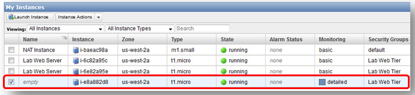](http://awshub.com.br/resources/amazon-web-services-hands-on-auto-scaling/attachment/404/)

  

Conecte-se à ela usando um navegador para verificar que está rodando corretamente:

  

[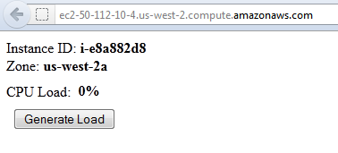](http://awshub.com.br/resources/amazon-web-services-hands-on-auto-scaling/attachment/405/)

  

## Verifique como o Auto Scaling trabalha

  

Tente terminar o servidor. Em alguns minutos ele reaparecerá, porque o Auto Scaling foi informado que o grupo ficou abaixo do tamanho mínimo – este é o motivo de você ter que deletar o Auto Scaling group através do as-delete-auto-scaling-group no final do dia.

  

[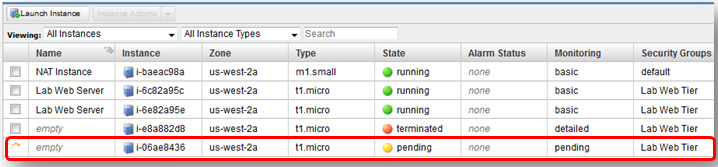](http://awshub.com.br/resources/amazon-web-services-hands-on-auto-scaling/attachment/406/)

  

Tente fazer a mesma coisa, desta vez desligando a instância (em vez de terminá-lo) entrando na nova instância e executando um comando de shutdown (sudo shutdown -h now) ou clicando com o botão direito na instância e selecionando Stop através do painel de genrenciamento AWS. Perceba que o Auto Scaling irá detectar que esta instância não está respondendo e irá teminá-la automaticamente e da mesma forma irá lançar uma instância para repor a falha para você.

  

[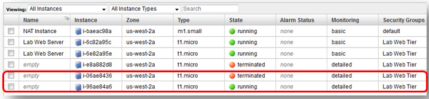](http://awshub.com.br/resources/amazon-web-services-hands-on-auto-scaling/attachment/407/)

  

## Tagueando recursos de Auto Scaling

  

Note que as instâncias de Auto Scaling são iniciadas sem nomes. Existem dois modos que lhe ajudam a identificar essas instâncias. O primeiro é adicionar uma nova coluna no painel de gerenciamento. Clique no botão Show/Hide, então selecione a opção aws:autoscaling:groupName abaixo de Your Tag Keys.

  

[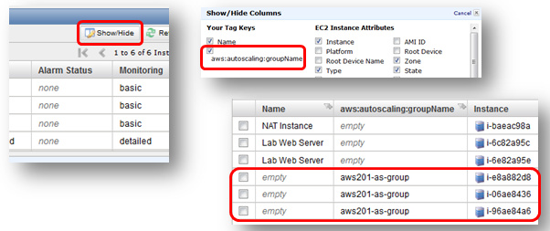](http://awshub.com.br/resources/amazon-web-services-hands-on-auto-scaling/attachment/408/)

  

O Auto Scaling criará e colocará os dados automaticamente em uma tag chamada aws:autoscaling:groupName para a sua instância Auto Scaling. O segundo modo de identificar melhor suas instâncias de Auto Scaling é modificando o seu Auto Scaling group para preencher a tag Name para você. Nós poderiamos ter criado uma tag Name para o Auto Scaling group durante a criação, apenas usando a opção –tag “k=Name, v=AS Web Server”. Uma vez que o nosso Auto Scaling group já existe, vamos modificar as tags existentes com o seguinte comando:

  

```
 C:\ec2>as-create-or-update-tags --tag "id=aws201-as-group, t=auto-scaling-group, k=Name, v=AS-Web-Server, p=true"
```

  

```
 A resposta do comando será parecida com: OK-Created/Updated tags
```

  

## Integração do Auto Scaling com ELB

  

Se você der uma olhada no seu ELB, perceberá que a instância Auto Scaling só serão adicionados ao seu ELB da mesma forma manual que configurou os web servers. Isso é feito com a opção “–load-balancers LabELB” quando estiver criando o Auto Scaling Group. Verifique se o seu ELB está distribuindo trafego através das suas três instâncias, então termine as duas que foram configuradas manualmente, pois elas não serão mais necessárias. Finalmente, modifique o ELB para remover as instâncias criadas manualmente.

  

[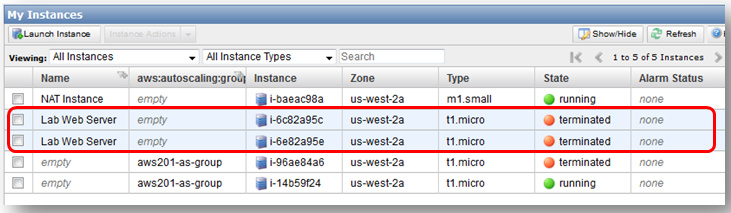](http://awshub.com.br/resources/amazon-web-services-hands-on-auto-scaling/attachment/409/)

  

## Notificações do Auto Scaling

  

Todas essas atividades do Auto Scaling ocorrem de forma transparente. Não seria interessante que o Auto Scaling lhe avisasse quando cria ou termina instâncias para você? O Auto Scaling está integrado com o Amazon Simple Notification Service (SNS) justamente por esse propósito. O SNS é um web service que torna fácil configurar, operar, e enviar notificações da nuvem. Ele permite que os desenvolvedores tenham um serviço altamente escalável, flexível e de baixo custo para enviar mensagens de uma aplicação e entregar imediatamente para os destinatários ou outras aplicações.

  

## Criando um Topico SNS

  

A primeira coisa que precisamos fazer é criar um tópico SNS que nós iremos usar para enviar as notificações SNS. No painel de controle AWS, clique na aba SNS e clique no botão Create New Topic.

  

[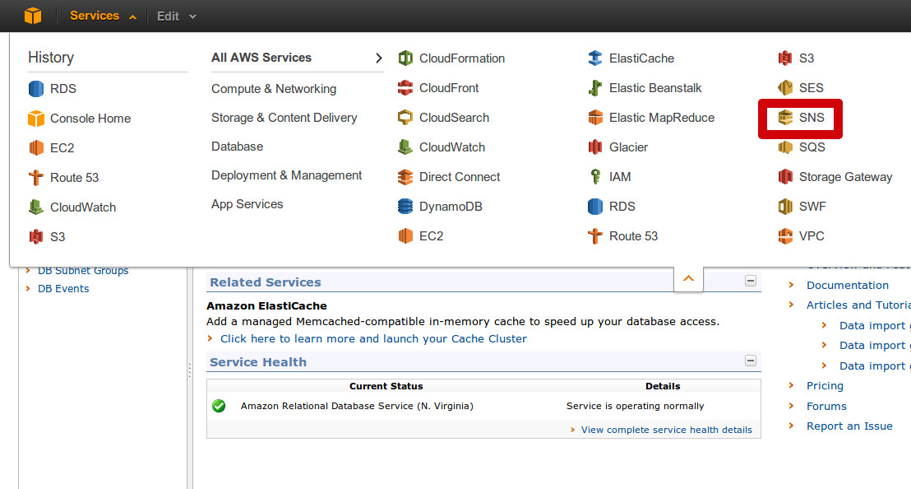](http://awshub.com.br/resources/amazon-web-services-hands-on-auto-scaling/attachment/410/) [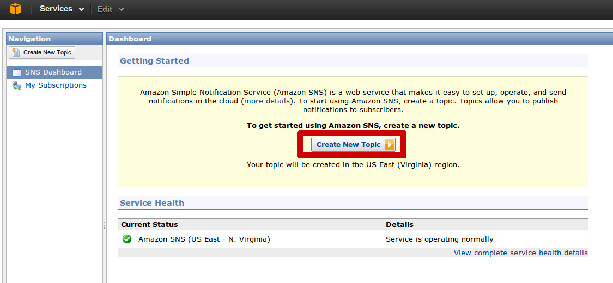](http://awshub.com.br/resources/amazon-web-services-hands-on-auto-scaling/sns2/)

  

Insira o nome do tópico (neste exemplo nós usamos aws201-as-topic) e clique Create Topic.

  

[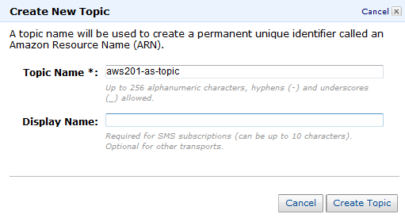](http://awshub.com.br/resources/amazon-web-services-hands-on-auto-scaling/attachment/411/)

  

Clique no botão Create Subscription, selecione a opção Email no campo Protocol e no Endpoint você digita o endereço de e-mail que deseja receber as notificações e clique em Subscribe. Verifique o seu endereço de e-mail e clique no link apropriado para verificar o seu email para este tópico.

  

[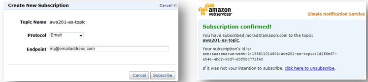](http://awshub.com.br/resources/amazon-web-services-hands-on-auto-scaling/attachment/412/)

  

Agora que o SNS está configurado, nós precisamos do Amazon Resource Number (ARN) para esse tópico SNS, para usar com o Auto Scaling. Selecione o topico SNS, localize o Topic ARN, e copie o ARN para usarmos no próximo passo.

  

[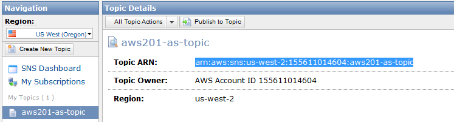](http://awshub.com.br/resources/amazon-web-services-hands-on-auto-scaling/attachment/413/)

  

## Criando as notificaçoes do Auto Scaling

  

Você pode usar o as-describe-auto-scaling-notification-types para definir quais os tipos de notificações o Auto Scaling irá suportar.

  

```
 C:\ec2>as-describe-auto-scaling-notification-types
```

  

```
 A resposta do comando será parecida com:
```

  

```
 NOTIFICATION-TYPE  autoscaling:EC2_INSTANCE_LAUNCH NOTIFICATION-TYPE  autoscaling:EC2_INSTANCE_LAUNCH_ERROR NOTIFICATION-TYPE  autoscaling:EC2_INSTANCE_TERMINATE NOTIFICATION-TYPE  autoscaling:EC2_INSTANCE_TERMINATE_ERROR NOTIFICATION-TYPE  autoscaling:TEST_NOTIFICATION
```

  

Nós iremos usar o comando as-put-notifications-configuration para criar notificações para quando instâncias forem criadas ou terminadas pelo nosso Auto Scaling group.

  

```
 C:\ec2>as-put-notification-configuration aws201-as-group --topic-arn  --notification-types autoscaling:EC2_INSTANCE_LAUNCH, autoscaling:EC2_INSTANCE_TERMINATE A resposta do comando será parecida com:
```

  

```
 OK-Put Notification Configuration
```

  

Você deverá receber uma mensagem de notificação de teste do Auto Scaling para confirmar essa configuração.

  

## Criando políticas de Auto Scaling

  

Atualmente você possui um Auto Scaling Group que irá verificar se você possui ao menos um servidor rodando. Você pode modificar o numero de servidores ativos manualmente, manipulando o número mínimo de servidores com o comando as-update-auto-scaling-group aws201-as-group –min-size #. Mas agora nós iremos dar um passo além. Ao invés de escalar manualmente, nós iremos configurar o Auto Scaling group para escalar automaticamente toda vez que o nosso processo de CPU do grupo de servidores ficar em >= 50%.

  

Nós iremos usar o comando as-put-scaling-policy para criar duas políticas de escalonamento que irão acrescentar um servidor em eventos que escalem para cima e retirar um servidor em eventos que escalem para baixo (e esperar 300 segundos de “resfriamento” antes de iniciar eventos de escalonamento para baixo/cima).

  

### *Politica de Scale Up*

  

```
 C:\ec2> as-put-scaling-policy Aws201ScaleUpPolicy --auto-scaling-group aws201-as-group   --adjustment=1 --type ChangeInCapacity --cooldown 300 A resposta do comando será parecida com:
```

  

```
 arn:aws:autoscaling:us-west-2:155611014604:scalingPolicy:55739d6c-0748-4a6e-9c57-ff371e555201:autoScalingGroupName/aws201-as-group:policyName/Aws201ScaleUpPolicy
```

  

### *Política de Scale Down*

  

Note que o nome da política muda, assim como o valor da opção –adjustment=-1 está entre aspas, e define um -1 para diminuir o número de instancias em 1.

  

```
 C:\ec2>as-put-scaling-policy Aws201ScaleDownPolicy --auto-scaling-group aws201-as-group   "--adjustment=-1" --type ChangeInCapacity --cooldown 300
```

  

```
 A resposta do comando será parecida com: arn:aws:autoscaling:us-west-2:155611014604:scalingPolicy:429421bc-91d2-4adf-8f8d-65c4f96b80d5:autoScalingGroupName/aws201-as-group:policyName/Aws201ScaleDownPolicy
```

  

## Criando um alerta de CloudWatch High CPU

  

Agora que temos as políticas apropriadas de Auto Scaling, nós temos que criar os gatilhos apropriados no CloudWatch para iniciar essas políticas. Nessa seção, nós iremos criar um alarme no CloudWatch para monitorar o aumento da CPU no conjunto de Auto Scaling e disparar a trigger Aws201ScaleUpPolicy. No painel de controle AWS, vá até a aba CloudWatch e clique no botão Create Alarm.

  

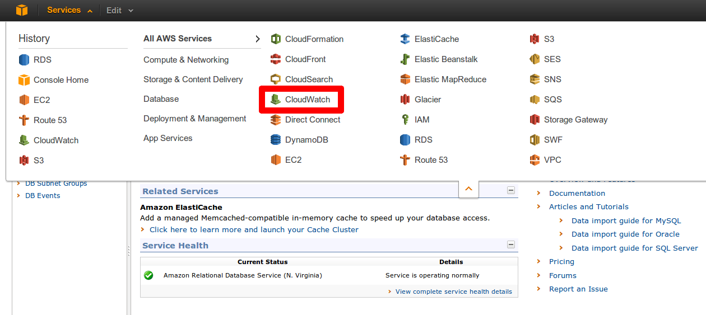  
  
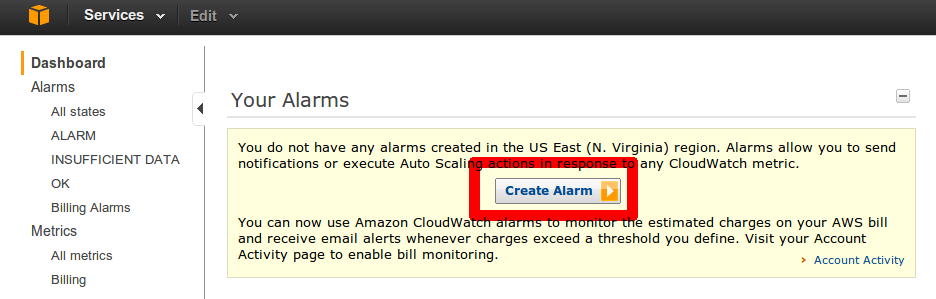

  

Faça uma busca por AutoScaling, selecione a estatística aws201-as-group CPUUtilization, mude a opção Period para 1 Minute e clique em Continue.

  

[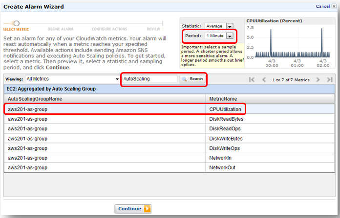](http://awshub.com.br/resources/amazon-web-services-hands-on-auto-scaling/attachment/415/)

  

Dê um Name e uma Description a este alarme de CPU. Então configure o alarme para a CPUUtilization para ser >= 50 por 3 minutos e clique em Continue.

  

[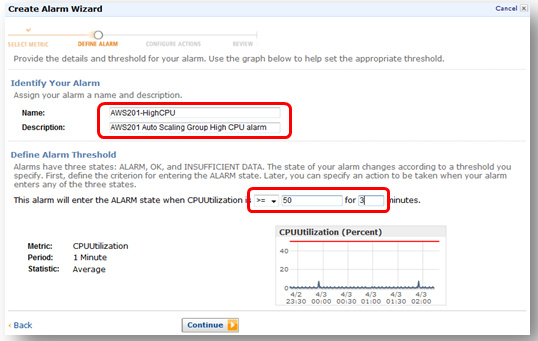](http://awshub.com.br/resources/amazon-web-services-hands-on-auto-scaling/attachment/416/)

  

Configure o take action para Auto Scaling Policy, o Auto Scaling Group para aws201-as-group, Policy para Aws201ScaleUpPolicy, clique no botão ADD ACTION, e clique em Continue.

  

[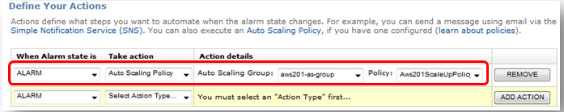](http://awshub.com.br/resources/amazon-web-services-hands-on-auto-scaling/attachment/417/)

  

Revise suas configurações e clique no botão Create Alarm.

  

## Criando um alerta para CloudWatch Low CPU

  

Agora teremos que repetir os passos anteriores, mas configuraremos o alerta para ser <=30% e a trigger para Aws201ScaleDownPolicy. Os screenshots abaixo contém apenas o que é diferente dos passos anteriores. Na aba CloudWatch, clique no link Alarms e clique no botão Create Alarms.

  

Não se esqueça de selecionar a estatística aws201-as-group CPUUtilization e mude o período para 1 minute. Isso é importante para definirmos o gatilho numa granulalidade de três minutos ao invés de cinco minutos.

  

Dê um Name e uma Description para este alarme. Então configure o alarme para o CPUUtilization para ser < 30 por três minutos e clique em Continue.

  

[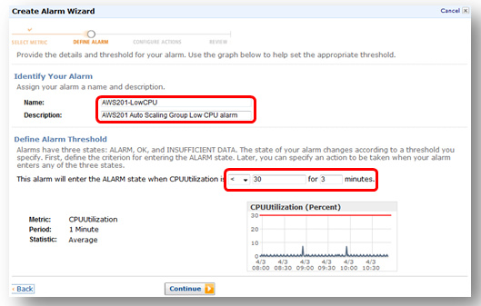](http://awshub.com.br/resources/amazon-web-services-hands-on-auto-scaling/attachment/418/)

  

Configure o take action para Auto Scaling Policy, Auto Scaling Group para aws201-as-group, Policy para Aws201ScaleDownPolicy, clique no botão ADD ACTION e clique em Continue.

  

[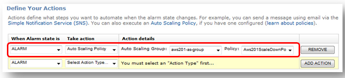](http://awshub.com.br/resources/amazon-web-services-hands-on-auto-scaling/attachment/419/)

  

**Nota:** Nós recomendamos fortemente que você configure as suas políticas de Auto Scaling para escalar para cima rapidamente e escalar para baixo bem devagar. Isso irá permitir que a sua aplicação responda ao aumento de trafego após um evento de escalonamento para cima, da mesma forma que torna mais econômico o uso de um ciclo de hora do AWS. Esse artigo é intencionalmente simples e curto. De uma perspectiva financeira, custa o mesmo valor se uma instancia descer após trê minutos ou se ela ficar rodando por 59 minutos.

  

## Testando o Auto Scaling

  

Agora todos os pedaços estão no lugar para demonstrarmos o Auto Scaling em uma aplicação em uso. Em resumo, nós criamos um Auto Scaling Group com no mínimo uma instância e no máximo cinco. Nós criamos políticas de Auto Scaling para acrescentar e retirar uma instância do grupo e um alarme de CloudWatch para disparar essas políticas quando a média de CPU do conjunto for >= 50% e < 30% respectivamente. Atualmente uma instência está rodando porque o tamanho mínimo do conjunto é um e não está sob nenhum load. Entã,o note que os alarmes atuais do CloudWatch estão em dois diferentes estados:

  

[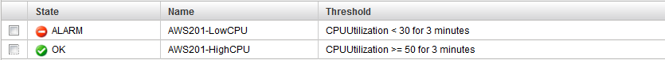](http://awshub.com.br/resources/amazon-web-services-hands-on-auto-scaling/attachment/420/)

  

Isso é porque a CPU Utilization do grupo é < 30%. Contudo, o Auto Scaling não está removendo nenhuma instância porque o tamanho do grupo está no mínimo (1).  Também se lembre de que nós definimos o tempo de “resfriamento” (cool down) para nossas políticas de Auto Scaling para cinco minutos (300 segundos) – isso é importante de se lembrar pois irá influenciar em quão rápido você estará capaz de ver as atividades do Auto Scaling.

  

Abra a URL do LabELB em uma janela do navegador. Quando você der um refresh em seu navegador, você deverá ver apenas um servidor. Clique no botão Generate Load e você irá ver o Load do CPU pular para 100% (talvez você precise dar um refresh no seu navegador para ver a mudança). Esse botão dispara uma trigger simples, que faz um processo de copiar, comprimir e descomprimir um arquivo de ~1GB vazio (/dev/zero) por 10-20 minutos em background.

  

[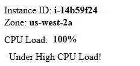](http://awshub.com.br/resources/amazon-web-services-hands-on-auto-scaling/attachment/421/)

  

Vamos voltar a aba CloudWatch e em 3-4 minutos você deverá ver os alarmes mudando, o de Low CPU para OK e o de High CPU para Alarm.

  

[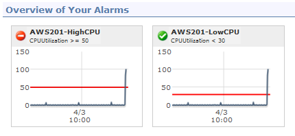](http://awshub.com.br/resources/amazon-web-services-hands-on-auto-scaling/attachment/422/)

  

Adicionalmente, você deverá receber um e-mail de notificação do Auto Scaling informando que a ação de scale up foi disparada.

  

Voltando novamente a aba EC2 -> Instances você verá a nova instância sendo adicionada ao seu grupo:

  

[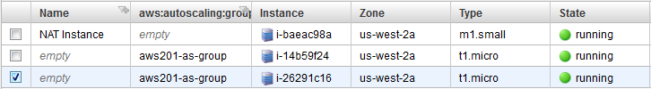](http://awshub.com.br/resources/amazon-web-services-hands-on-auto-scaling/attachment/423/)

  

Volte a aba do seu navegador com o ELB e atualize a página algumas vezes para ver um servidor com o load pesado enquanto o outro não:

  

[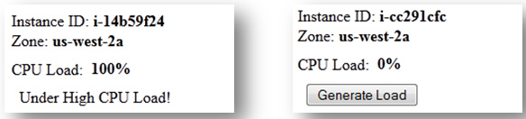](http://awshub.com.br/resources/amazon-web-services-hands-on-auto-scaling/attachment/424/)

  

Finalmente, volte à aba CloudWatch, você poderá ver a utilização de CPU do seu conjunto. É bem provável que você dispare um outro evento de Auto Scaling para o scale up pois a média está em 50% (uma instancia esta em ~100% e a outra em ~0%), e nós definimos o alarme para disparar a trigger em >= 50%.

  

[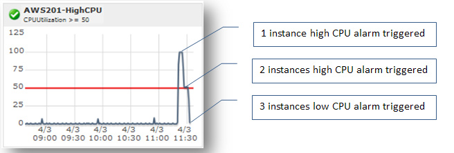](http://awshub.com.br/resources/amazon-web-services-hands-on-auto-scaling/attachment/425/)

  

Depois de 15-20 minutos, seu conjunto de Auto Scaling deverá ter subido 2-3 instâncias e depois abaixado um instância. Perceba que as instâncias são teminadas na mesma ordem em que são criadas, isso significa que a “mais velha” será terminada primeiro. Isso permite que você aplique novas mudanças na sua aplicação atualizando suas configurações de inicialização para uma nova AMI, e depois disparando os eventos de Auto Scaling (ex. Incrementando o min size).

  

[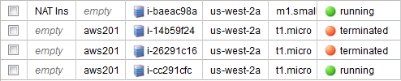](http://awshub.com.br/resources/amazon-web-services-hands-on-auto-scaling/attachment/426/)

  

**Nota**: Você deve ter percebido que este não é um teste real porque basicamente simula um usuário batendo em um único servidor e não tira vantagem do seu load balancer. Neste caso, o Auto Scaling irá ajudar outros clientes, mas não o load balance para trabalhar através de multiplos servidores. Nós usamos este exemplo pela simplicidade e para ser mais efetivo no nosso artigo.

  

## Conclusão

  

### Observando as atividades do Auto Scaling

  

A API de Auto Scaling prove um caminho programático para mostrar todas as atividades que tenham ocorrido. Vamos usar o comando as-describe-scaling-activities para demonstrar essa capacidade.

  

```
 C:\ec2>as-describe-scaling-activities
```

  

```
 A resposta do comando será parecida com:
```

  

```
 ACTIVITY  47a73b42-fa71-45f9-a5f6-4a2820977fcb  2012-04-03T11:45:48Z  aws201-as-group  Successful ACTIVITY  46a1c284-d019-4c1c-af6f-ae9a475d0de6  2012-04-03T11:38:57Z  aws201-as-group  Successful ACTIVITY  41ef6cf0-b6fb-481d-9864-79a6fd852fa2  2012-04-03T11:31:55Z  aws201-as-group  Successful ACTIVITY  c88f4d0c-369d-4c25-83bf-1db993d43ba1  2012-04-03T11:25:49Z  aws201-as-group  Successful ACTIVITY  e5c8d7e8-86db-4b44-a803-c4a5146ae175  2012-04-02T19:54:44Z  aws201-as-group  Successful
```

  

### Suspendendo/Retomando Processos de Auto Scaling

  

O Auto Scaling também permite que você diga, intencionalmente, a um Auto Scaling Group para suspender ou retomar um processo usando os comandos as-suspend-processes e as-resume processes. Isso pode ser útil quando você sabe o tempo de certas ativididades (ex. manutenção) e que irão disparar alertas de Auto Scaling mas você não quer que instâncias sejam adicionadas automaticamente ou removidas durante a execução deste evento.

  

### CLI Referencias

  

Por favor, visite a documentação do Auto Scaling para informações adicionais sobre o Auto Scaling – <http://aws.amazon.com/documentation/autoscaling/>

  

Também verifique o nosso cartão de referências para a linha de comando sobre os seus comandos e opções – <http://awsdocs.s3.amazonaws.com/AutoScaling/latest/as-qrc.pdf>

  

## Encerrando os serviços pagos

  

**Nota:** Futuros artigos da AWS irão precisar deste ambiente de Auto Scaling configurado e funcionando. Dessa forma, se você planeja continuar fazendo os nossos artigos, deixe este ambiente ativo.

  

### Descrevendo os Auto Scaling Groups

  

```
 C:\ec2>as-describe-auto-scaling-groups aws201-as-group
```

  

```
 A resposta do comando será parecida com:
```

  

```
 AUTO-SCALING-GROUP  aws201-as-group  aws201-config  us-west-2a  LabELB  2  5  4 INSTANCE  i-cc291cfc  us-west-2a  InService  Healthy  aws201-config INSTANCE  i-921722a2  us-west-2a  InService  Healthy  aws201-config TAG  aws201-as-group  auto-scaling-group  Name  AS-Web-Server  true
```

  

### Apagando o Auto Scaling Group

  

Usando a opção –force-delete com o comando as-delete-auto-scaling-group irá terminar todas as instâncias Auto Scaling, assim como apagar também o Auto Scaling Group.

  

```
 C:\ec2>as-delete-auto-scaling-group aws201-as-group --force-delete
```

  

```
 A resposta do comando será parecida com: Are you sure you want to delete this AutoScalingGroup? [Ny]y OK-Deleted AutoScalingGroup
```

  

### Apagando a configuração de Launch

  

```
 C:\ec2>as-describe-launch-configs
```

  

```
 A resposta do comando será parecida com:
```

  

```
 LAUNCH-CONFIG  aws201-config  ami-948173fd  t1.micro
```

  

```
 C:\ec2>as-delete-launch-config aws201-config A resposta do comando será parecida com:
```

  

```
 Are you sure you want to delete this launch configuration? [Ny]y OK-Deleted launch configuration
```

  

Confirme que todas as instâncias EC2, todos os Elastic Load Balancers e quaisquer outros serviços estejam encerrados.

  

—

  

**Atenção**: Reiteramos a importância de você desligar os recursos que você usou apenas para seguir esse tutorial. Não nos responsabilizamos por serviços não desligados.

  
[anexo ausente]  
  

[](http://share.feedsportal.com/viral/sendEmail.cfm?lang=pt&amp;title=M%C3%A3o+na+Massa+%E2%80%93+falando+sobre+Auto+Scaling&amp;link=http%3A%2F%2Fimasters.com.br%2Ftecnologia%2Faws%2Fmao-na-massa-falando-sobre-auto-scaling%2F)

  

[](http://res.feedsportal.com/viral/bookmark_pt.cfm?title=M%C3%A3o+na+Massa+%E2%80%93+falando+sobre+Auto+Scaling&amp;link=http%3A%2F%2Fimasters.com.br%2Ftecnologia%2Faws%2Fmao-na-massa-falando-sobre-auto-scaling%2F)

  
  
  
[[anexo ausente]](http://da.feedsportal.com/r/151885257002/u/49/f/546640/c/33212/s/280d1f29/a2.htm) [anexo ausente]  
  
[anexo ausente]  
  
  
  
from iMasters <http://imasters.com.br/tecnologia/aws/mao-na-massa-falando-sobre-auto-scaling/>
