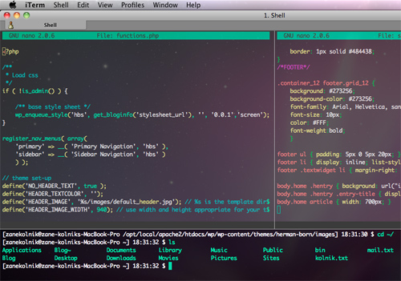

Boas ferramentas são de valor inestimável para descobrir onde os problemas estão, e também podem ajudar a prevenir a ocorrência de problemas ou apenas auxiliá-lo a ser mais eficiente em geral. As ferramentas de linha de comando são particularmente úteis porque são boas para a automação e para o scripting, onde podem ser combinadas e reutilizadas de várias formas diferentes. Vamos abordar aqui seis ferramentas particularmente poderosas e versáteis que podem ajudar a tornar sua vida mais fácil.

  

[](http://imasters.com.br/?attachment_id=36221)

  

*(Crédito da imagem: [kolnikcollection](http://kolnikcollection.com/web/articles/iterm2/iterm2-split-panes/))*

  

## Curl

  

Curl é uma ferramenta de transferência de rede que é muito semelhante ao Wget. A principal diferença é que, por padrão, o Wget salva para um arquivo e o curl joga a saída na linha de comando. Isso torna muito simples a visualização do conteúdo de um site. Aqui, por exemplo, podemos ter o nosso IP atual do site [ifconfig.me](http://ifconfig.me/):

  

`$ curl ifconfig.me`  
`93.96.141.93`

  

As opções *-i* (exibe cabeçalhos) e *-I* (exibe apenas cabeçalhos) do Curl o tornam uma ótima ferramenta para depurar respostas HTTP e para descobrir exatamente o que um servidor está enviando para você:

  

```
 $ curl -I news.ycombinator.com HTTP/1.1 200 OK Content-Type: text/html; charset=utf-8 Cache-Control: private Connection: close
```

  

A opção *-L* é útil e faz com que o *curl* automaticamente seguir redireções. O Curl possui suporte para HTTP Basic authentication, cookies, cabeçalhos de configuração manual e muito, muito mais.

  

## Ngrep

  

Para uma análise séria de pacotes de rede, existe o [Wireshark](http://www.wireshark.org/), com suas milhares de configurações, filtros e opções de configuração. Há também uma versão de linha de comando, o TShark. Para as tarefas simples, eu acho que o Wireshark pode ser um exagero, então, a menos que eu precise de algo mais poderoso, o Ngrep é minha ferramenta de escolha. Ele permite que você faça com pacotes de rede o que o grep faz com arquivos.

  

Para o tráfego da Web, você quase sempre vai quer a opção *-W*, que preserva quebras de linha, e *-q* é um argumento útil que suprime algumas saídas adicionais sobre pacotes não correspondentes. Aqui está um exemplo que captura todos os pacotes que contenham *GET* ou *POST*:

  

```
 ngrep -q -W byline "^(GET|POST) .*"
```

  

Você também pode ir a opções de filtros adicionais de pacotes, como a limitação dos pacotes correspondentes a um determinado host, IP ou porta. Aqui a gente filtra todo o tráfego indo ou vindo do Google, usando a porta 80 e contendo o termo “busca”.

  

```
 ngrep -q -W byline "search" host www.google.com and port 80
```

  

## Netcat

  

Netcat, ou *nc*, é uma rede auto descrita como um “canivete suíço”. É um aplicativo muito simples, mas também igualmente poderoso e versátil, que permite criar conexões de rede arbitrárias. Aqui o veremos sendo utilizado como um scanner de portas:

  

```
 $ nc -z example.com 20-100 Connection to example.com 22 port [tcp/ssh] succeeded! Connection to example.com 80 port [tcp/http] succeeded!
```

  

Além de criar conexões arbitrárias, o Netcat pode ouvir as conexões de entrada. Aqui nós usamos esse recurso do *nc*, combinado com *tar*, para muito rápida e eficientemente copiar arquivos entre servidores. No servidor, execute:

  

```
 $ nc -l 9090 | tar -xzf -
```

  

E no cliente:

  

```
 $ tar -czf dir/ | nc server 9090
```

  

Nós podemos usar o Netcat para expor qualquer aplicativo através da rede. Aqui expomos um shell através da porta 8080:

  

```
 $ mkfifo backpipe $ nc -l 8080 0<backpipe | /bin/bash > backpipe
```

  

Agora podemos acessar o servidor a partir de qualquer cliente:

  

```
 $ nc example.com 8080 uname -a Linux li228-162 2.6.39.1-linode34 ##1 SMP Tue Jun 21 10:29:24 EDT 2011 i686 GNU/Linux
```

  

Enquanto os dois últimos exemplos são um pouco artificiais (na realidade, você estaria mais propenso a usar ferramentas como o rsync para copiar arquivos e SSH para acessar remotamente um servidor), eles mostram o poder e a flexibilidade do Netcat, e dão dicas de todas as coisas diferentes que você pode conseguir através da combinação do Netcat com outros aplicativos.

  

## Sshuttle

  

O Sshuttle permite que você faça o tunelamento seguro do seu tráfego através de qualquer servidor SSH a que você tenha acesso. É extremamente fácil de configurar e usar, e você não precisa instalar nenhum software no servidor ou alterar as configurações de proxy local.

  

Ao fazer o tunelamento do seu tráfego por SSH, você se protege contra as ferramentas como [Firesheep](http://codebutler.com/firesheep/) e [dsniff](http://monkey.org/~dugsong/dsniff/) quando estiver em uma conexão Wi-Fi pública não segura ou em outras redes não confiáveis. Toda a comunicação da rede, incluindo as solicitações de DNS, pode ser enviada por meio do seu servidor SSH:

  

```
 $ sshuttle -r <server> --dns 0/0
```

  

Se você fornecer o argumento *–daemon*, sshuttle será executado em segundo plano como um daemon. Combinado com algumas outras opções, você pode fazer aliases para começar e parar de forma simples e rápida o tunelamento do seu tráfego:

  

```
 alias tunnel='sshuttle --D --pidfile=/tmp/sshuttle.pid -r <server> --dns 0/0' alias stoptunnel='[[ -f /tmp/sshuttle.pid ]] && kill `cat /tmp/sshuttle.pid`'
```

  

Você também pode utilizar o sshuttle para contornar os filtros de geolocalização baseados em IP que agora são utilizados por muitos serviços, como o iPlayer da BBC, que exige que você esteja no Reino Unido, e o Turntable, que exige que você esteja nos EUA. Para isso, você vai precisar de acesso a um servidor no país de destino. A Amazon tem uma [camada livre](http://aws.amazon.com/pt/free/) de instâncias EC2 Micro disponível em muitos países, ou você pode encontrar um virtual private server (VPS) barato em [quase todos os países do mundo](http://www.thevpslist.com/countries).

  

Nesse cenário, em vez fazer o tunelamento de todo o nosso tráfego, talvez queiramos enviar o tráfego apenas para o serviço que estamos querendo. Infelizmente, o sshuttle só aceita argumentos de endereços IP e não hostnames, por isso precisamos fazer uso de *dig* para primeiro resolver o hostname:

  

```
 $ sshuttle -r <server> `dig +short <hostname>`
```

  

## Siege

  

O Siege é uma ferramenta de benchmarking HTTP. Além de recursos de teste de carga ele possui uma opção *-g* acessível, que é muito semelhante ao *iL* do Curl, exceto que ele também exibe os cabeçalhos de solicitação. Aqui está um exemplo com o Google (eu removi alguns cabeçalhos para abreviar):

  

```
 $ siege -g www.google.com GET / HTTP/1.1 Host: www.google.com User-Agent: JoeDog/1.00 [en] (X11; I; Siege 2.70) Connection: close HTTP/1.1 302 Found Location: http://www.google.co.uk/ Content-Type: text/html; charset=UTF-8 Server: gws Content-Length: 221 Connection: close GET / HTTP/1.1 Host: www.google.co.uk User-Agent: JoeDog/1.00 [en] (X11; I; Siege 2.70) Connection: close HTTP/1.1 200 OK Content-Type: text/html; charset=ISO-8859-1 X-XSS-Protection: 1; mode=block Connection: close
```

  

O Siege é realmente muito bom no teste de carga do servidor. Assim como [ab](http://httpd.apache.org/docs/2.2/programs/ab.html) (uma ferramenta de benchmarking Apache), você pode enviar um número de solicitações simultâneas a um site e ver como ele lida com o tráfego. Com o comando a seguir, vamos testar o Google com 20 conexões simultâneas para 30 segundos, e obter um bom relatório no final:

  

```
 $ siege -c20 www.google.co.uk -b -t30s ... Lifting the server siege... done. Transactions: 1400 hits Availability: 100.00 % Elapsed time: 29.22 secs Data transferred: 13.32 MB Response time: 0.41 secs Transaction rate: 47.91 trans/sec Throughput: 0.46 MB/sec Concurrency: 19.53 Successful transactions: 1400 Failed transactions: 0 Longest transaction: 4.08 Shortest transaction: 0.08
```

  

Um dos recursos mais úteis do Siege é que ele pode pegar a URL de um arquivo como entrada e depois bater nessa URL, em vez de apenas uma única página. Isso é ótimo para testes de carga, porque você pode repetir o tráfego real contra o seu site e ver como ele se comporta, em vez de apenas acertar/atingir a mesma URL várias vezes. Veja como você usaria o Siege para reproduzir seus logs do Apache contra outro servidor para fazer testes de carga nele:

  

```
 $ cut -d ' ' -f7 /var/log/apache2/access.log > urls.txt $ siege -c<concurrency rate> -b -f urls.txt
```

  

## Mitmproxy

  

O Mitmproxy é um proxy HTTP intermediário com capacidade SSL que permite que você inspecione tráfego HTTP e HTTPS, e os pedidos de reescrita on the fly. O aplicativo está por trás de alguns escândalos de privacidade de aplicativos iOS, incluindo o [caso do app Path, que tinha acesso indevido à toda lista de contatos do usuário](http://mclov.in/2012/02/08/path-uploads-your-entire-address-book-to-their-servers.html). Sua capacidade de reescrever os pedidos on the fly também tem sido usada para atingir o iOS, incluindo o alcance de uma [falsa pontuação alta no GameCenter](http://mitmproxy.org/doc/tutorials/gamecenter.html).

  

Longe de ser apenas útil para ver o que os aplicativos móveis estão enviando pela conexão ou para fingir altas pontuações, o mitmproxy pode ajudar com uma série de tarefas de desenvolvimento web. Por exemplo, em vez de apertar F5 o tempo todo ou limpar o cache para se certificar de que você está vendo o conteúdo mais recente, você pode executar:

  

```
 $ mitmproxy --anticache
```

  

que automaticamente tira todos os cabeçalhos de controle de cache e garante que você sempre terá novos conteúdos. Infelizmente, ele não configura automaticamente o encaminhamento para você como sshuttle faz, por isso, depois de iniciar mitmproxy, você ainda precisa mudar todas as configurações de proxy para o sistema todo ou o browser.

  

Outro recurso extremamente útil do mitmproxy é a capacidade de gravar e reproduzir as interações HTTP. A documentação oficial dá um exemplo de um [login de rede sem fio](http://mitmproxy.org/doc/tutorials/30second.html). A mesma técnica pode ser utilizada como um framework web de teste. Por exemplo, para confirmar o seu fluxo de inscrição de usuários funciona, você pode começar a gravar a sessão:

  

```
 $ mitmdump -w user-signup
```

  

Em seguida, passe pelo processo de inscrição de usuário, que nesse momento deve funcionar como esperado. Interrompa a gravação da sessão com *Ctrl + C*. Em qualquer momento, podemos então reproduzir o que foi gravado e verificar o código de status 200:

  

```
 $ mitmdump -c user-signup | tail -n1 | grep 200 && echo "OK" || echo "FAIL"
```

  

Se o fluxo de inscrição falhar em qualquer ponto, vamos ver uma mensagem *FAIL*, em vez de um *OK*. Você pode criar todo um conjunto desses testes e executá-los regularmente para garantir que você seja notificado, caso você algum dia acidentalmente quebre algo em seu site.

  

\*\*\*

  

*Texto original disponível em <http://coding.smashingmagazine.com/2012/10/29/powerful-command-line-tools-developers/>*

  
[anexo ausente]  
  

[](http://share.feedsportal.com/viral/sendEmail.cfm?lang=pt&amp;title=Poderosas+ferramentas+de+linha+de+comando+para+desenvolvedores&amp;link=http%3A%2F%2Fimasters.com.br%2Fdesenvolvimento%2Fpoderosas-ferramentas-de-linha-de-comando-para-desenvolvedores%2F)

  

[](http://res.feedsportal.com/viral/bookmark_pt.cfm?title=Poderosas+ferramentas+de+linha+de+comando+para+desenvolvedores&amp;link=http%3A%2F%2Fimasters.com.br%2Fdesenvolvimento%2Fpoderosas-ferramentas-de-linha-de-comando-para-desenvolvedores%2F)

  
  
  
[[anexo ausente]](http://da.feedsportal.com/r/151884489529/u/49/f/546640/c/33212/s/2796b8ac/a2.htm) [anexo ausente]  
  
[anexo ausente]  
  
  
  
from iMasters <http://imasters.com.br/desenvolvimento/poderosas-ferramentas-de-linha-de-comando-para-desenvolvedores/>
