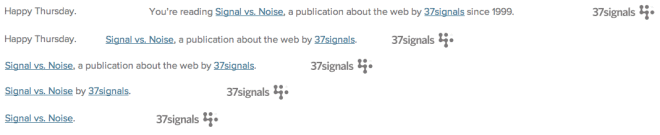

Para quem está chegando agora, **Design Responsivo** é a capacidade de um determinado website de se adaptar automaticamente a diferentes resoluções de tela, permitindo que o usuário tenha uma experiência relevante em qualquer tipo de dispositivo (desktop, tablets, smartphones, TVs) e em dispositivos de tamanhos diferentes.

  

Já falamos bastante por aqui sobre o assunto. [Quer ver](http://arquiteturadeinformacao.com/category/responsive-design/)?

  

No entanto, é comum que pensemos apenas em **elementos visuais** que se transformam e se adaptam dependendo do dispositivo onde a interface está sendo visualizada.

  

Mas a mesma coisa pode (e muitas vezes deve) acontecer com o **texto** que está sendo exibido. Vejo dois principais motivos para nos preocuparmos com isso:

  

1. As pessoas lêem menos em dispositivos menores.

     

   Telas menores permitem que menos texto seja exibido por vez.

Daí que os caras da 37signals tiveram uma ótima sacada em uma das frases que aparece no blog deles: **o tamanho da frase se adapta à medida em que você diminui a resolução de tela**.

  

  

Para quem se interessar em como isso é feito, tecnicamente, existe uma explicação mais detalhada [aqui](http://www.splatf.com/2013/01/responsive-design-text/).

  

Mas para nós, UX Designers, fica o lembrete de que é possível pensar na relevância do conteúdo em cada um dos detalhes que compõem a experiência.

  

Seus usuários agradecem.

  
  
  
  
  
  
from Arquitetura de Informação <http://arquiteturadeinformacao.com/2013/01/14/texto-responsivo-no-site-da-37signals/>
