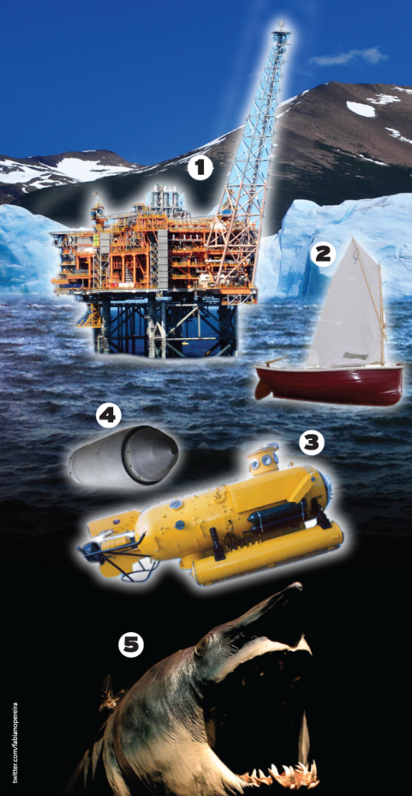

Nossas vidas e atitudes em sociedade são pautadas, normalmente, por dois filtros: o primeiro deles é o filtro legal, ou seja, o universo das leis que regem um país e que definem o que lícito ou ilícito dentro de determinada sociedade.

  

O outro diz respeito aos valores éticos e morais que cada indivíduo recebe, desde o berço. Tais valores, apesar de não estarem formalizados em forma de lei, são muito representativos de tudo aquilo que se faz a si mesmo e ao outro (sendo que, aqui, o “outro” é a representação da própria sociedade), norteiam condutas e garantem uma sociedade mais ou menos digna, de acordo com a forma que se encara o respeito ao próximo.

  

O que aconteceria se tais valorem não fossem vigentes? Qual seria a conduta humana sem os filtros comportamentais, sem a noção de responsabilidade? O que cada um faria, caso não prestasse contas (na esfera legal ou consciencial), de seus atos e de sua conduta, frente a uma sociedade inteira?

  

Há quem diga que seria o caos. Outros ainda, defensores da corrente de pensamento anárquica, lutam por uma sociedade assim, pois acham que o homem não precisa de mecanismos de controle, pois, segundo esta corrente, cada um de nós saberia, por natureza, respeitar o espaço do outro, sem a necessidade de um estado que repreende ou de correntes morais que castram. Será que é tão simples assim?

  

## A deep web

  

Se na vida “real” ainda não foi possível constatar se tal teoria funcionaria de fato, na vida digital temos um exemplo do que acontece ao homem que conta com a total liberdade, sem dispositivos de repreensão: a deep web.

  

Trata-se de uma parte (consideravelmente grande) da internet que, simplesmente, não “existe” para os mecanismos de busca por um simples motivo: em sua concepção, as páginas receberam a tag “”, que tem dupla função: faz com que os robôs dos mecanismos de busca (softwares que navegam, diuturnamente, por toda a web, buscando novos conteúdos e atualizações de conteúdos já indexados) não visualizem determinadas páginas (algo útil, por exemplo, quando o site está recebendo ajustes e ainda não está pronto para ser visualizado por todos) e também impede que os mesmos robôs sigam os links desses sites. Eis a receita do anonimato. Assim, curiosamente, os conteúdos só ficam acessíveis para quem tiver os links diretos, o que acontecerá somente se o dono do site resolver divulgar seus links em locais específicos da web.

  

## Garantia de anonimato para quem navega

  

Quando navegamos na internet, deixamos rastros por todos os lados: cookies (pequenos arquivos de texto que capturam diversas informações a nosso respeito, como, por exemplo, nossas preferências de navegação, localização aproximada, e-mail), históricos públicos, históricos no servidor / provedor de serviços e outras mais específicas. Assim, na superfície, na navegação tradicional, o anonimato é uma ilusão, pois bastam alguns conhecimentos básicos para rastrear a navegação de quem quer que seja. A Polícia Federal já utiliza recursos de rastreamento e consegue “pegar no pulo” alguns pedófilos desavisados. Assim, uma página ser protegida da indexação dos mecanismos de busca não garante o anonimato de quem navega.

  

Para que o usuário fique totalmente no anonimato, existe um browser específico, chamado Tor ( <https://www.torproject.org/download/download-easy.html.en>). Partindo da premissa de uma internet totalmente livre, o browser oferece anonimato absoluto, sendo ferramenta essencial de quem deseja ficar oculto em suas navegações pela deep web.

  

Por incrível que pareça, é simples assim: basta usar o antivírus no talo, uma [máquina virtual](https://www.virtualbox.org/wiki/Downloads) (que permite simular um outro computador dentro de seu sistema principal, garantindo mais segurança para os seus dados, a mais famosa é a Virtual Box), o Tor (já citado acima) e pronto: é só mergulhar no pântano lamacento da deep web.

  

## O que encontro na deep web?

  

O caminho comum, depois de instalar a máquina virtual, colocar o antivírus no modo paranoico e instalar o Tor, é acessar a Hidden Wiki, espécie de wikipedia do caos: desde os previsíveis documentos secretos dos governos, tutoriais de invasão de sistemas dos mais variados tipos, senhas de usuários incautos (de serviços populares como o Facebook) até links para grupos de estupradores, pedófilos, canibais e usuários de drogas. Tudo de forma natural e convivendo, harmoniosamente (se é que tal termo cabe aqui), com os demais conteúdos.

  

Todos os acessos da deep web passam por aqui, assim, trata-se de uma espécie de google do submundo. Sem filtros nem pudores, você acha tudo o que a doentia mente humana é capaz de conceber, de atos hediondos e macabros a anúncios de assassinos oferecendo seus serviços e de gente que se oferece para ser violentada. E quando mais se explora, mais bizarro é.

  

## Tutorial: como acessar a deep web

  

**Atenção: não há nenhuma garantia de segurança neste ambiente hostil e perigoso. Continue por sua própria conta e risco**.

  

**1. Atualize seu antivírus**. Não que isso garanta algo, porém, pode fazer a diferença quando você resolver mergulhar mais fundo nas entranhas da deep web;

  

**2. Instale o Tor**. Acesse [www.torproject.org](http://www.torproject.org/), escolha sua plataforma (Mac, PC ou Linux) e efetue o download. Após isso, proceda com a instalação, simples, no passo-a-passo;

  

**3. Pesquise e mergulhe**. Acesse, a partir do navegador Tor, o mecanismo de busca da deep web, a [Hidden Wiki](http://kpvz7ki2v5agwt35.onion/wiki/index.php/Main_Page) e inicie seu mergulho nos mares profundos;

  

## Infográfico: mergulhando na deep web:

  

  

………………………………..

  

## 1. Wikileaks

  

Julian Assange é o mentor do ([Wikileaks](http://wikileaks.org/) ), site que tem o objetivo de pesquisar documentos secretos de governos de todo mundo (sendo que tal busca se dá, mais facilmente, via deep web) e publicá-los, para o desespero de muita gente poderosa.

  

Assim como a pornografia (de maneira geral), o Wikileaks é um dos únicos sites que fazem a ponte entre a deep web e a “parte visível” da web, já que é normalmente indexado pelos mecanismos de busca. Não por acaso, [Julian Assange está com prisão decretada](http://sicnoticias.sapo.pt/mundo/2012/12/03/equador-considera-que-direitos-humanos-de-julian-assange-estao-a-ser-violados) em diversos países e corre risco de ser preso (ou assassinado) a qualquer momento.

  

## 2. Google

  

Maior site de buscas do mundo, o Google é o principal canal de pesquisas de qualquer assunto na internet. Na verdade, há quem dispense a barra de endereços do navegador e digite qualquer endereço de web somente pelo mecanismo de busca.

  

Muito do sucesso do Google se deve a mudança de paradigma de estabelecer a relevância de determinado site: o [PageRank](http://pt.wikipedia.org/wiki/PageRank) é um algoritmo de busca que define a relevância não só pela densidade de palavras-chave existentes, mas, sobretudo, pelo número de links que apontam para determinado site. Quanto mais links, maior a importância. Por isso, sites da deep web não aparecem, pois são ocultos aos olhos do gigante das buscas.

  

## 3. Governos

  

Os governos compartilham documentos secretos na internet através de dois canais distintos: um deles é a utilização de redes privadas ou fechadas, que, volta e meia, são invadidas por hackers militantes habilidosos, que o fazem por motivações filosóficas e políticas.

  

A outra forma é a utilização do mesmo atributo descrito na matéria que torna as páginas ocultas aos olhos dos mecanismos de busca. Tanto uma forma como a outra fazem a alegria de sites como o Wikileaks, que, no nível subterrâneo da deep web, torna estes documentos públicos, para a web que se vê na superfície. Há quem afirme já ter encontrado documentos muito mais reveladores no ambiente da deep web, que nem mesmo a Wikileaks teria coragem de publicar.

  

## 4. Hackers

  

A deep web é o habitat natural da maioria dos hackers, uma vez que já estão habituados a navegar em total anonimato. Hackers são, normalmente, movidos por questões políticas e conceituais, utilizando seus conhecimentos para derrubar governos, desmoralizar empresas de conduta desleal (dentro dos princípios hackers) ou simplesmente para se divertirem, testando habilidades e conhecimentos profundos de internet e segurança em rede.

  

Muito do combustível que alimenta sites como Wikileaks é oferecido graças ao trabalho habilidoso e dedicados dos hackers que, diferentemente dos crackers, não fazem por dinheiro, mas sim por amor a determinadas causas (e o fim das grandes corporações online e de governos corruptos são causas caras para tal grupo).

  

## 5. Pornografia

  

A pornografia da superfície move milhões de dólares e é a maior responsável pelos picos de tráfego da internet. Há, porém, o pornô ilegal, aquele proibido por tudo quanto é lei do mundo e que o mínimo de bom senso e decência condena violentamente. Trata-se de bizarrices envolvendo estupros, canibalismo erótico, pedofilia, necrofilia e outros termos, capazes de revirar os estômagos dos mais fortes. A pornografia oferece uma perigosa ponte entre a web visível e a invisível, sendo fator motivador do grande tráfego da deep web pelo mundo.

  

Podemos estabelecer uma relação com o deplorável mundo das drogas: enquanto o pornô legal e visível na superfície é oferecido como um cigarro de maconha, a pornografia das entranhas da deep web é como a heroína, droga pesada e difícil de ser encontrada.

  

## Eu devo conhecer a deep web?

  

De forma alguma. É fortemente recomendado que você não faça isso, pois as consequências psicológicas são imprevisíveis. Mesmo com todo o cuidado e todo o equilíbrio do mundo, é provável que tenha pesadelos terríveis e que tais conteúdos demorem muitos dias para se apagarem de sua mente.

  

Ainda há o risco de sua máquina ser interceptada e invadida. A deep web possui mais vírus que qualquer hospital público de baixa qualidade, assim, uma simples e rápida passagem por lá pode ser consideravelmente fatal, em termos computacionais, é claro.

  

Mesmo assim, se resolver mergulhar, saiba que muito do conteúdo mais extremo é inacessível para novos usuários e que para conhecer mais, o risco aumenta. As piores fotos, o acesso aos fóruns específicos, tudo exige uma dose de exposição e de coragem que somente quem tem pouco a perder está disposto a correr. Se resolver devastar os pântanos mais profundos dessa perigosa realidade paralela, estude muito e se prepare para ter sua máquina infestada de todo o tipo de praga virtual.

  

Assim, crianças, não se arrisquem, não se iludam e deixem as profundezas para os seus habitantes temerosos.

  

Sabemos que crimes horríveis ocorrem diariamente ao lado de nossas casas, sabemos que, andando nas ruas, cruzamos com todo tipo de gente violenta, que ao levar nossos filhos em parques infantis, podemos encontrar, sem nem imaginar, pedófilos que ficam no aguardo de qualquer vacilo para sequestrarem nossas crianças e que aquele senhor respeitável que cumprimentamos no fila do pão pode ser um sadomasoquista da pesada, que utiliza pesados artefatos de tortura. Porém, saber dessas verdades mudaria algo em nós? Seria realmente bom ou nos deixaria ainda mais paranoicos, a moda de quem assiste os programas vespertinos de sensacionalismo da TV aberta?

  

Existem duras realidades, porém o melhor caminho é se precaver e fugir delas, pois, como diria minha saudosa avó, “o que os olhos não enxergam, o coração não sente” e “péssimas companhias não pegam, mas sujam”. **[Webinsider]**

  

…………………………

  

**Leia também**:

  

[Crianças e predadores virtuais](http://webinsider.uol.com.br/2012/10/22/criancas-e-predadores-virtuais/)

  

[Você tem um comportamento saudável na internet?](http://webinsider.uol.com.br/2012/12/24/voce-tem-um-comportamento-saudavel-na-internet/)

…………………………

  

Acesse a [iStockphoto](http://ad.doubleclick.net/clk;261759762;85845762;d;pc=%5BTPAS_ID%5D). O maior banco de imagens royalty free do mundo.

  

Acompanhe o Webinsider no [Twitter](http://twitter.com/webinsider) e no [Facebook](http://www.facebook.com/webinsiderbrasil).

  

Assine [nossa newsletter](http://webinsider.uol.com.br/akna/form.php) e não perca nenhum conteúdo.

  
  
  
from Webinsider [http://webinsider.uol.com.br/2013/01/16/o-lado-obscuro-do-ser-humano-voce-encontra-na-deep-web/?utm\_source=rss&utm\_medium=rss&utm\_campaign=o-lado-obscuro-do-ser-humano-voce-encontra-na-deep-web](http://webinsider.uol.com.br/2013/01/16/o-lado-obscuro-do-ser-humano-voce-encontra-na-deep-web/?utm_source=rss&amp;utm_medium=rss&amp;utm_campaign=o-lado-obscuro-do-ser-humano-voce-encontra-na-deep-web)
