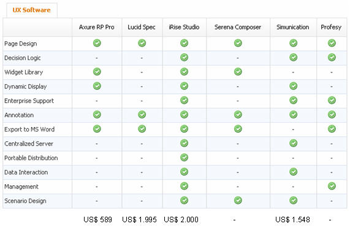

# **A**lgumas razões para cair de amores pelos protótipos navegáveis

Se você, assim como eu, nasceu na década de 70, provavelmente já teve contato com uma máquina de escrever**.** Este, que foi o principal instrumento de trabalho dos profissionais de comunicação durante muito tempo, forçava os usuários a escrever de forma doentiamente planejada, na maioria das vezes pressionados pelo medo de errar**.** Realocar uma frase em outro parágrafo significava ter que bater novamente toda uma página – 1**.**400 toques a mais (considerando uma lauda de 20 linhas com 70 toques cada) e cerca de 10 minutos perdidos (no caso de um datilógrafo mediano)**.** O editor de texto, com os recursos de apagar, copiar e colar causou uma verdadeira revolução na vida de milhões de pessoas, sobretudo de escritores e de jornalistas**.**

Vejo uma revolução bem parecida para os arquitetos de informação com a chegada dos programas que geram protótipos (e/ou wireframes) navegáveis em HTML**.** Nessa lista incluo o [Axure](http://www.axure.com) , o [iRise](http://www.irise.com)  e o [OmniGraffle](http://www.omnigroup.com/applications/omnigraffle/) , entre outros que listarei adiante**.** Não é mais necessário dedicar tempo e esforços para organizar *slides*, fazer ajustes em um grande volume de telas ou até mesmo publicar centenas de comentários sobre o fluxo de navegação**.** A preocupação agora é com o que realmente interessa – o *design* centrado no usuário**.**

Ok, o assunto não é novo**.** Mas como é cada vez mais recorrente alguém me perguntar sobre as vantagens deste tipo de protótipo vou pontuar algumas delas**.** Mais do que vantagens, são verdadeiras razões para cair de amores por estes *softwares*:

> **Experiência de navegação** – Este item vem no topo da lista porque acredito que é aqui onde está o maior ganho do protótipo em HTML**.** Por ser todo navegável ele simula realmente o que acontece a cada clique, resultado que víamos somente depois que o projeto já tinha passado pelo *design* e pela interface**.**
>
> **Dimensionamento do projeto** – Fica bem mais fácil entender quais são as telas-tipo (ou templates) com o uso dessas ferramentas**.** No Axure, por exemplo, é possível acessar com facilidade a lista de páginas e até mesmo gerar um mapa (também navegável) a partir dela**.**
>
> **Componentização** – O bom arquiteto tira proveito disso**.** Não é preciso desenhar novamente um fluxo de “enviar por *e-mail*” ou de “cadastro” a cada projeto que eles aparecem na matriz de escopo**.** Os *softwares* para desenvolvimento de wireframes permitem a criação de verdadeiras bibliotecas de padrões, que podem ser reaproveitadas com o mínimo de ajustes em outros trabalhos**.** Isso também dá uma grande agilidade na execução do protótipo**.**
>
> **Documentos mais enxutos (ou o fim do trabalho escravo)** – Em um passado não muito distante cheguei a criar wireframes em PowerPoint com mais de 2**.**000 *slides* para simular fluxos e cenários diversos – uma documentação burra, pesada e de eficácia totalmente discutível que ainda me causava algumas lesões por esforços repetitivos**.**
>
> **E o cliente**?**** – Pelas minhas estatísticas esta é a pergunta número 1**.** Devo ressaltar que só tenho tido resultados positivos**.** Os clientes não só estão compreendendo melhor a proposta como também estão aprovando mais rapidamente os trabalhos, com solicitações de ajustes cada vez menores**.** Alguns clientes inclusive já pediram (e pagaram**!**) para que documentações feitas inicialmente em PowerPoint fossem convertidas para HTML**.**
>
> **Fácil aprendizado** – Quando a diretoria da empresa em que trabalho autorizou a compra do Axure ficamos com receio de demorar a aprender o *software***.** Esse medo foi dissipado já no primeiro dia de uso da ferramenta – medo seria ter que voltar a usar o PowerPoint**.** O suporte do Axure, por exemplo, é muito bom: no *site* da empresa há tutoriais e um *blog* que realmente convida o usuário a compartilhar críticas e sugestões**.** Muitas melhorias já foram feitas partir delas.
>
> **Designers e programadores menos irritados** – Abrir um *wireframe* em Visio ou PowerPoint era, para os desenvolvedores, uma experiência semelhante a de ler “Os Sertões”, de Euclides da Cunha, em mandarim**.** Além de chato, muitas vezes o documento gerava uma série de dúvidas que simplesmente travavam o trabalho, a maioria delas referente ao fluxo de navegação**.** Por não conter *libraries*, os documentos em Visio e Powerpoint também traziam erros de consistência e muitas páginas escapavam da revisão, aumentando a incidência de erros**.** Para os programadores, um grande recurso destes programas é a geração da especificação técnica**.**
>
> **Reaproveitamento de código** – Aqui vale a pena fazer um alerta: protótipo é protótipo, código é outra coisa**.** Não encare este tipo de documento como um avanço na etapa do desenvolvimento**.** Os recursos de programação dessas ferramentas são limitados e geram códigos feios, sujos e gigantes, para não ser mais explícita**.**

Voltando aos *softwares* disponíveis no mercado, segue [um benchmark feito em março deste ano por Emmanuel Pays](http://alpha.benchmarkr.com/benchmarkrs/53) **.** Vale ressaltar que na relação custo-benefício o [Axure](http://www.axure.com)  (US$ 589) ganha disparado em comparação ao [iRise](http://www.irise.com)  (mais de US$ 2000,00), campeão na lista de funcionalidades**.**

E para finalizar fica o alerta: a empresa que não ainda não faz uso destas ferramentas está queimando horas de trabalho intelectual com trabalho braçal, além de desviar o foco do arquiteto para questões menores e nada lucrativas**.**

### Gostou do post?
