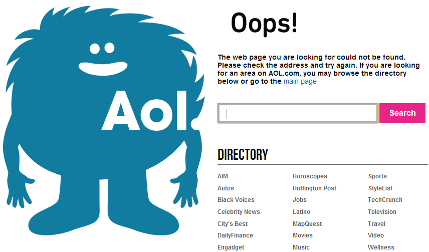
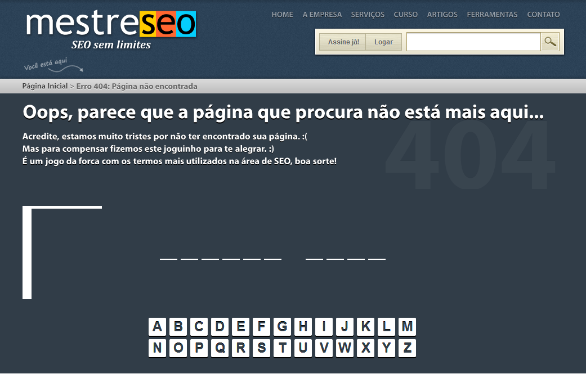
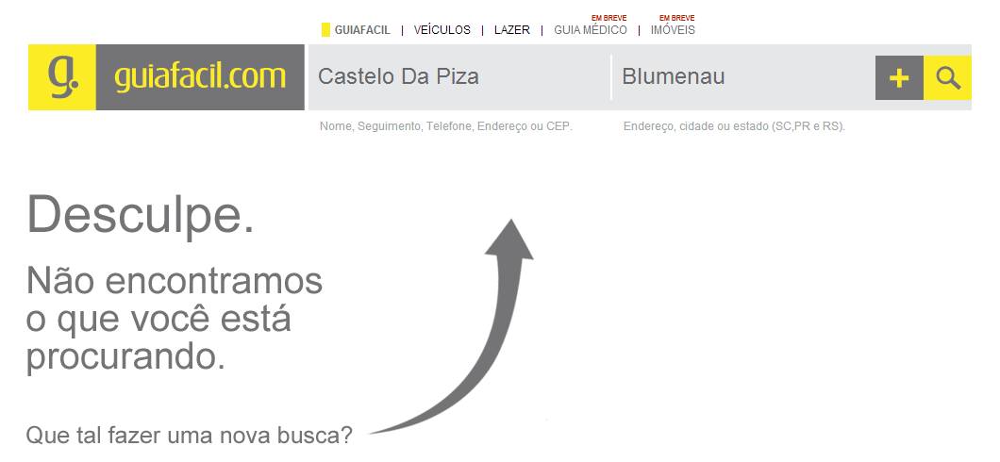
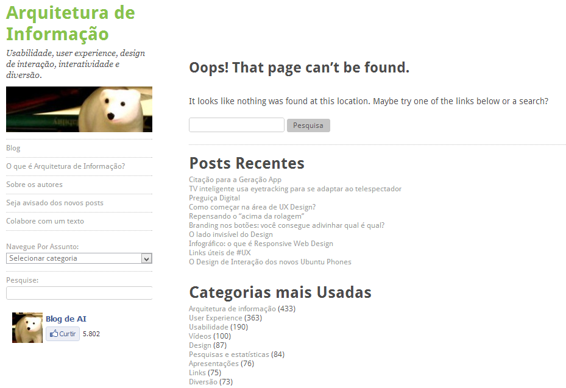
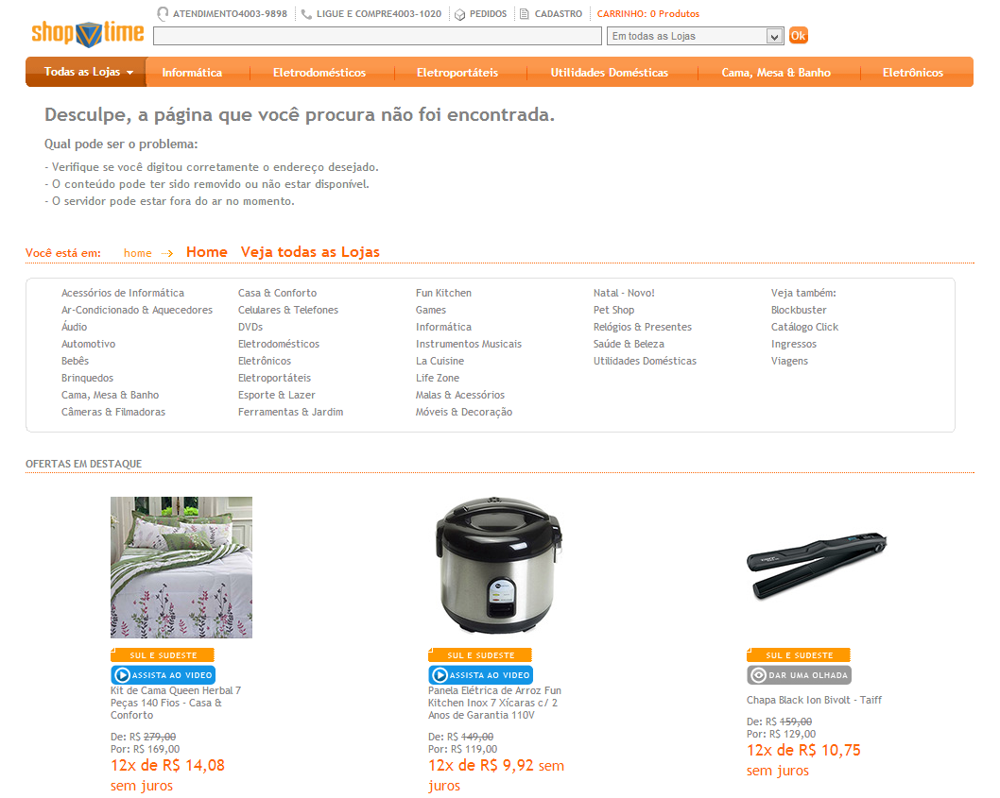

*O texto abaixo foi enviado pelo Fernando dos Santos e faz parte da série de colaborações que o Blog de AI está recebendo. Envie o seu também.*

  

–

  

Ter uma boa página de erro é provavelmente tão importante quanto ter um bom conteúdo. Sem intenção, um dos visitantes do seu site pode tentar acessar uma URL que não existe e então se deparar com uma mensagem de erro. Se essa mensagem não for adequada, o visitante pode deixar o seu site e nunca mais voltar.

  

Bom, se for para deixar, que seja em grande estilo.

  

Veja a seguir algumas soluções criativas para páginas de erros, assim como exemplos de sites que as utilizam.

  

#### Engajar o usuário em alguma ação específica

  

Uma ideia que vem sendo utilizada por vários sites é aproveitar a página de erro para fazer o visitante tomar uma ação específica, como curtir o site, cadastrar o e-mail, seguir no Twitter ou participar de uma campanha.

  

A página do [Instituto Eletrikus Brasiliensis](http://eletrikusbrasiliensis.bio.br/) é um bom exemplo deste modelo. Quando o usuário acessa uma página que não existe o site informa o erro e pede se ele gostaria de assinar uma petição para “salvar um animal fictício da extinção”.

  

  

#### Redirecionar o usuário para outra página

  

Diversos sites redirecionam os visitantes das páginas de erro para outras páginas, como por exemplo a página principal ou uma Landing Page. Mas não é recomendado fazer o redirecionamento automaticamente. Primeiro avise o usuário de que a página não existe e só então redirecione ele para outra página, para evitar que ele fique confuso.

  

Um exemplo de site que utiliza o redirecionamento após o erro é o da AOL, que após 10 segundos na página não encontrada envia os usuários para a página principal.

  

  

#### Oferecer jogos e atividades educativas

  

Em muitos casos pode ser interessante usar a página de erro para distrair o usuário com um jogo relacionado com o conteúdo do site, compensando o visitante pelo erro, mantendo ele no site e ainda fazendo com que ele se divirta um pouco.

  

O site da MestreSEO é um dos que utilizam essa ideia, tendo um jogo da forca com os termos mais utilizados na área de SEO para fazer o visitante esquecer do erro e continuar no site, inclusive aprendendo sobre otimização de buscas.

  

  

#### Destacar a busca interna do site

  

Se o seu site possui um campo de busca você pode chamar a atenção para esse campo caso os usuários se deparem com um erro.

  

Se possível você também pode na própria página de erro apresentar alguns resultados de busca relacionados com as palavras presentes na URL, por exemplo, se a URL com erro for “seusite.com.br/oculos-escuros” a página pode avisar sobre o erro e já apresentar resultados para a busca por “óculos escuros”.

  

O site do Guia Fácil optou por utilizar uma seta para indicar o campo de busca aos visitantes que tentarem acessar uma página que não existe.

  

  

#### Oferecer conteúdo relacionado

  

Se você possui um blog ou site de notícias pode usar a páginas de erro para destacar conteúdo, como as matérias mais acessadas, notícias mais recentes ou postagem em destaque. Outra ideia é listar na páginas as principais categorias do seu site.

  

O próprio Arquitetura de Informação é um ótimo exemplo de site que utiliza as duas opções.

  

  

#### Oferecer produtos em destaque

  

Se o seu site for um e-commerce, uma alternativa é usar essa página para divulgar produtos e aumentar as chances de conversão em vendas. Duas táticas adotadas por alguns sites são mostrar uma lista dos seus produtos mais vendidos ou então escolher manualmente os produtos que deverão aparecer.

  

O Shoptime, por exemplo, utiliza sua página de erro para mostrar algumas das suas melhores ofertas em destaque.

  

  

#### Abusar da criatividade

  

Outra opção é simplesmente criar uma página de erro divertida que faça as pessoas esquecerem que aquilo é uma página de erro e assim não se sentirem tão aborrecidas por não encontrarem o que buscavam. Essa tática é mais comum nos Estados Unidos do que no Brasil, onde é muito utilizada por sites relacionados com publicidade e design, que costumam usar o humor para evitar a impressão ruim que as páginas de erro causam.

  

O blog Choco la Design é um belo exemplo de site nacional que usou e abusou da criatividade para criar a sua página de erro.

  

  

Já o Kekanto mostra que páginas de erro criativas também não precisam alterar o design da página inteira, especialmente se o seu site é uma ferramenta. Nesse caso, descontrair um pouco já é suficiente.

  

  

Nesse artigo quase todos os exemplos são de sites brasileiros, mas a internet está repleta de ótimos exemplos para começar a se inspirar e nada impede que você combine dois ou mais dos modelos apresentados aqui.

  

Independente da forma como for criar a sua página de erro, lembre-se que o mais importante é preparar uma página que não faça seu visitante querer te matar :)

  

E você, conhece algum outro modelo interessante de página de erro? Deixe a sua opinião aí nos comentários!

  

–

  

*Fernando dos Santos*  
*Apenas alguém que é apaixonado por design em todas as sua inúmeras variações, mas estuda um pouco de tudo por pura necessidade.*

  
  
  
from Arquitetura de Informação <http://arquiteturadeinformacao.com/2013/02/25/boas-praticas-em-paginas-de-erro/>
