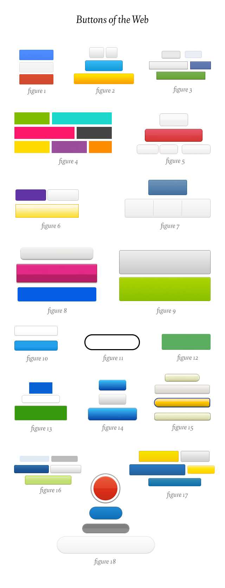

**“Buttons can be your site’s most recognizable brand element besides your logo”** – é o que diz [esse ótimo artigo](https://medium.com/design-ux/77eb4f9a439d) escrito por Marc Hemeon sobre branding em interfaces digitais. Segundo ele, os botões de seu site ou aplicativo podem ser um espaço valiosíssimo para ajudar a construir a identidade visual de sua marca.

  

3 dicas rápidas:

  

Escolha um tamanho só para todos os botões

  

Seja consistente nos estilos

  

Escolha no máximo 3 cores para os botões (a não ser que você seja a Microsoft)

E um teste: **você consegue olhar para os botões abaixo e identificar em qual site/aplicativo eles aparecem?**

  

  

A resposta vai mais abaixo.

  

.

  

.

  

.

  

.

  

.

  

.

  

.

  

.

  

.

  

1. Google 2. Twitter 3. Facebook 4. Microsoft 5. Pinterest 6. Yahoo 7. Instagram 8. Flickr 9. Spotify 10. Rdio 11. Svbtle 12. Medium 13. Basecamp 14. Square 15. Amazon 16. Quora 17. LinkedIn 18. Path

  

Link do artigo completo: [The button test >](https://medium.com/design-ux/77eb4f9a439d)

  
  
  
  
  
  
from Arquitetura de Informação <http://arquiteturadeinformacao.com/2013/02/03/branding-nos-botoes-voce-consegue-adivinhar-qual-e-qual/>
