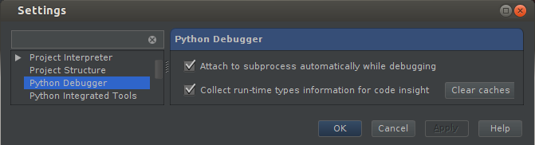
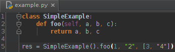
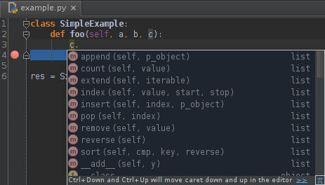
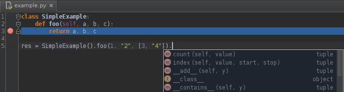
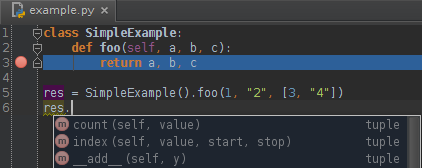
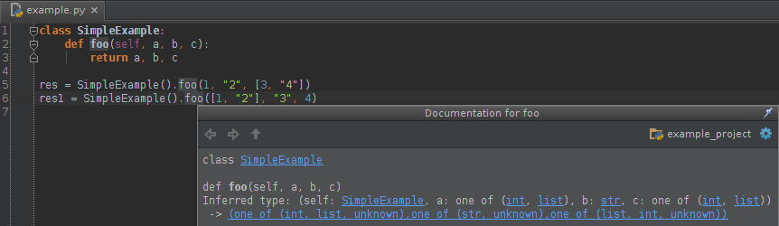
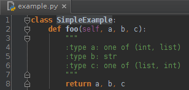

PyCharm’s debugger is now capable of **collecting type information at runtime** and using this information for improving code completion suggestions, code insight and quick documentation popups. This needs to be enabled in the debugger settings.

  

  

You debug your code all the time, and now in the course of debugging you can also collect type information. Afterwards, it will be used in auto-completion, and you will be able to puto the collected type information into docstrings as well. Please note that enabling this feature may affect debugger performance, so use it with care.

  

For example, let’s consider the following code snippet:

  

  

First, make sure that “Collect run-time types information for code insight” is enabled as shown above. Then run the debugger on your code. It doesn’t matter if you use breakpoints or other debugger tools. After the debugger steps into the “foo” method, it will record the types used in the call.

  

As you develop your code further, you will get suggestions based on this runtime experience. Please note that this will work even during the same debugger session, so you can get suggestions right after the debugger enters any function.

  

  

**Dynamically collected type information** is in use not only inside a function body:

  

  

Since PyCharm also makes static type inference, it will guess that “res” will be of the type returned by “foo”:

  

  

If different calls to the same function use different argument types, PyCharm will remember all the variants of the types encountered. As always, you can use **Quick Documentation Lookup** to get quick information on any symbol or just method signature information. Just place the caret on a symbol and press Ctrl+Q:

  

  

As you can see, **dynamically inferred types** are already shown in this popup.

  

There is also another usage of dynamic type inference: **generating docstrings** based on information collected by the debugger.

  

  
  
The basic steps are the same: enable “Collect run-time types information for code insight” and then debug your method/function. After this, place the caret anywhere within the function body and press Alt+Enter. This displays the “Generate docstrings with types” option. Select it to automatically generate a docstring for your method.

  

For more details please see “Using Docstrings to Specify Types” in Help.

  

Take advantage of this new feature to better control your source code and improve your user experience with PyCharm.

  

*Develop with pleasure!*  
*JetBrains PyCharm Team*

  
[anexo ausente]  
  
  
  
from Planet Python [http://blog.jetbrains.com/pycharm/2013/02/dynamic-runtime-type-inference-in-pycharm-2-7/?utm\_source=feedburner&utm\_medium=feed&utm\_campaign=Feed%3A+Pycharm+%28JetBrains+PyCharm+Blog%29](http://blog.jetbrains.com/pycharm/2013/02/dynamic-runtime-type-inference-in-pycharm-2-7/?utm_source=feedburner&amp;utm_medium=feed&amp;utm_campaign=Feed%3A+Pycharm+%28JetBrains+PyCharm+Blog%29)
