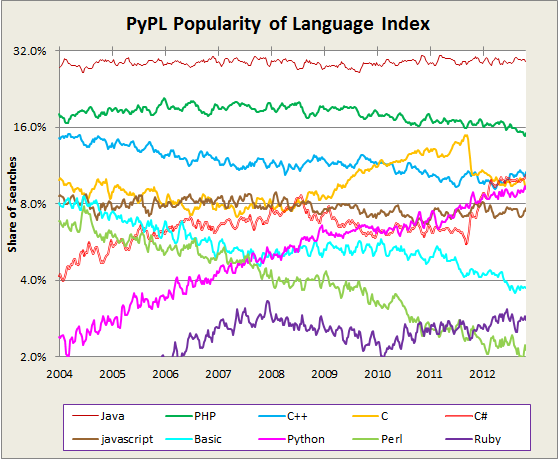

# Python - language of the decade

  

Recently I found a [PYPL](https://sites.google.com/site/pydatalog/pypl/PyPL-PopularitY-of-Programming-Language) - PopularitY of Programming Language index. It rediscovers the indicator of programming language popularity. Author argue that TIOBE index can be hypocritical due to the ambiguity of programming languages name, and introduce other phrases to use in Google Trends.

  

Looking at the author study, we can deduce that Python has the biggest increase in the last decade. What’s better we can see good linear growth for 10 years! Greetings for Python!

  
  
  

The plot is interesting indeed, because constant line doesn’t mean bad. It’s mean that constantly some group of people (for Java and PHP - a large group) wants to learn this language. Python is the only language which behaves different here.

  

As we known Python start from scripting and scientific fields, and now becomes increasingly popular, hitting the technologies which are dominated by web and business. Those technologies are supported by big companies (Java, C#, C++), which pay big money for support, and web (PHP, Ruby), which makes a lot of noise in the internet. It is very difficult to become popular in such big competition. And Python get it successively. For me this is the reason why *Python is the language of the decade.*

  

## Other interesting rankings:

  

[Linux journal](http://www.linuxjournal.com/slideshow/readers-choice-2012?page=27)

  
  
  
from Planet Python <http://rz.scale-it.pl/2013/01/07/python___language_of_the_decade.html>
