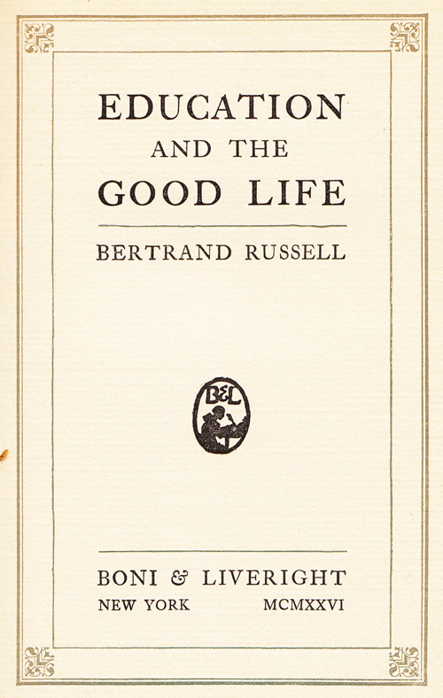
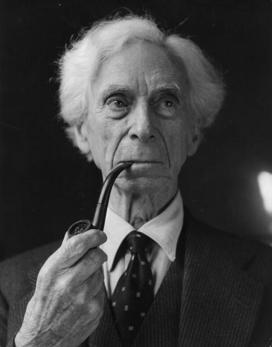
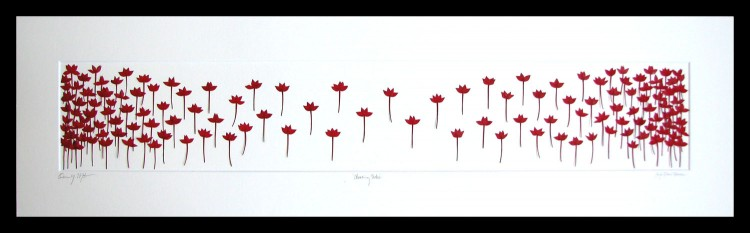

*On the art of acquiring “a high degree of intellectual culture without emotional atrophy.”*

  

 In 1926, British philosopher, mathematician, historian, and social critic **Bertrand Russell** — whose [10 commandments of teaching](http://www.brainpickings.org/index.php/2012/05/02/a-liberal-decalogue-bertrand-russell/) endure as a timeless manifesto for education, whose poignant admonition is among [history’s greatest insights on love](http://www.brainpickings.org/index.php/2013/01/01/what-is-love/), whose [message to descendants](http://www.brainpickings.org/index.php/2012/05/24/love-is-wise-hatred-is-foolish-bertrand-russell-1959/) should be etched into every living heart — penned [**Education and the Good Life**](http://www.amazon.com/Education-Good-Life-Bertrand-Russell/dp/0871402122/?tag=braipick-20) ([*public library*](http://www.worldcat.org/title/education-and-the-good-life/oclc/755296%26amp;referer=brief_results)), exploring the essential pillars of building character through proper education and how that might relate to broader questions of politics, psychology, and moral philosophy.

  

One of Russell’s key assertions is that science education — something that [leaves much to be desired](http://www.brainpickings.org/index.php/2013/02/12/saving-our-science-anissa-ramirez/) nearly a century later — is key to attaining a future of happiness and democracy:

  
> For the first time in history, it is now possible, owing to the industrial revolution and its byproducts, to create a world where everybody shall have a reasonable chance of happiness. Physical evil can, if we choose, be reduced to very small proportions. It would be possible, by organization and science, to feed and house the whole population of the world, not luxuriously, but sufficiently to prevent great suffering. It would be possible to combat disease, and to make chronic ill-health very rare. … All this is of such immeasurable value to human life that we dare not oppress the sort of education which will tend to bring it about. in such an education, applied science will have to be the chief ingredient. Without physics and physiology and psychology, we cannot build the new world.

  

Still, Russell is sure to offer a disclaimer, advocating for the equal importance of the humanities, and asks:

  
> What will be the good of the conquest of leisure and health, if no one remembers how to use them?

  

The humanities, he argues, help develop the imagination which, [like many great scientists](http://www.brainpickings.org/index.php/2012/06/01/the-art-of-scientific-investigation-beveridge-2/) have attested, is key to progress:

  
> It is only through imagination that men become aware of what the world might be; without it, ‘progress’ would become mechanical and trivial.
>
>   
>
> […]
>
>   
>
> Cast-iron rules are above all things to be avoided.
>
>   
>
> In a mechanistic civilization, there is grave danger of a crude utilitarianism, which sacrifices the whole aesthetic side of life to what is called ‘efficiency.’

  

  

Echoing [Galileo’s concerns about science and dogma](http://www.brainpickings.org/index.php/2013/02/15/galileo-letter-to-duchess-of-tuscany/), Russell writes:

  
> Passionate beliefs produce either progress or disaster, not stability. Science, even when it attacks traditional beliefs, has beliefs of its own, and can scarcely flourish in an atmosphere of literary skepticism. … And without science, democracy is impossible.
>
>   
>
> […]
>
>   
>
> Neither acquiescence in skepticism nor acquiescence in dogma is what education should produce. What it should produce is a belief that knowledge is attainable in a measure, though with difficulty; that much of what passes for knowledge at any given time is likely to be more or less mistaken, but that the mistakes can be rectified by care and industry. In acting upon our beliefs, we should be very cautious where a small error would mean disaster; nevertheless it is upon our beliefs that we must act. This state of mind is rather difficult: it requires a high degree of intellectual culture without emotional atrophy. But though difficult it is not impossible; it is in fact the scientific temper. Knowledge, like other good things, is difficult, but not impossible; the dogmatist forgets the difficulty, the skeptic denies the possibility. Both are mistaken, and their errors, when wide-spread, produce social disaster.

  

In a later chapter, he considers another double-edged sword of dogmatic thinking:

  
> It is a dangerous error to confound truth with matter-of-fact. Our life is governed not only by facts, but by hopes; the kind of truthfulness which sees nothing but facts is a prison for the human spirit.

  

But one of Russell’s most important assertions, reminiscent of the [old Cherokee parable of the two wolves](http://exp.lore.com/post/43616317195/an-old-cherokee-chief-took-his-grandchildren-into), explores the fundamental predispositions of human nature:

  
> In the immense majority of children, there is the raw material of a good citizen and also the raw material of a criminal.
>
>   
>
> […]
>
>   
>
> The raw material of instinct is ethically neutral, and can be shaped either to good or evil by the influence of the environment.

  

  

In a related meditation, Russell articulates beautifully something ineffable yet essential, something we too frequently forget, of which a dear friend recently [reminded me](https://twitter.com/CultureBrain/status/180054449098731520), and writes:

  
> Construction and destruction alike satisfy the will to power, but construction is more difficult as a rule, and therefore gives more satisfaction to the person who can achieve it. … We construct when we increase the potential energy of the system in which we are interested, and we destroy when we diminish the potential energy. … Whatever may be thought of these definitions, we all know in practice whether an activity is to be regarded as constructive or destructive, except in a few cases where a man professes to be destroying with a view to rebuilding and are not sure whether he is sincere.
>
>   
>
> […]
>
>   
>
> The first beginnings of many virtues arise out of experiencing the joys of construction.
>
>   
>
> […]
>
>   
>
> Those whose intelligence is adequate should be encouraged in using their imaginations to think out more productive ways of utilizing existing social forces or creating new ones.

  

*Artwork: “Choosing Sides” by Owen Mortensen, courtesy my living room wall*

  

**Donating = Loving**

  

Bringing you (ad-free) Brain Pickings takes hundreds of hours each month. If you find any joy and stimulation here, please consider becoming a Supporting Member with a recurring monthly [donation](http://www.brainpickings.org/index.php/donate/) of your choosing, between a cup of tea and a good dinner:

  
  
♥ $7 / month♥ $3 / month♥ $10 / month♥ $25 / month  
  

[anexo ausente]

  

You can also become a one-time patron with a single donation in any amount:

  
  
  
  
[anexo ausente]

  

[[anexo ausente]](http://www.brainpickings.org/index.php/newsletter/) Brain Pickings has a free weekly newsletter. It comes out on Sundays and offers the week’s best articles. Here’s [what to expect](http://us2.campaign-archive2.com/?u=13eb080d8a315477042e0d5b1&amp;id=0f830693e1). Like? [Sign up.](http://www.brainpickings.org/index.php/newsletter/)

  

*Brain Pickings takes 450+ hours a month to curate and edit across the different platforms, and remains banner-free. If it brings you any joy and inspiration, please consider a modest donation – it lets me know I'm doing something right.*  

  
[anexo ausente]  
  
  
  
from Brain Pickings [http://www.brainpickings.org/index.php/2013/02/21/education-and-the-good-life-bertrand-russell/?utm\_source=feedburner&utm\_medium=feed&utm\_campaign=Feed%3A+brainpickings%2Frss+%28Brain+Pickings%29](http://www.brainpickings.org/index.php/2013/02/21/education-and-the-good-life-bertrand-russell/?utm_source=feedburner&amp;utm_medium=feed&amp;utm_campaign=Feed%3A+brainpickings%2Frss+%28Brain+Pickings%29)
