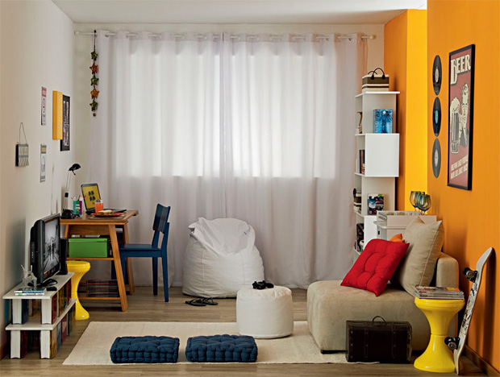
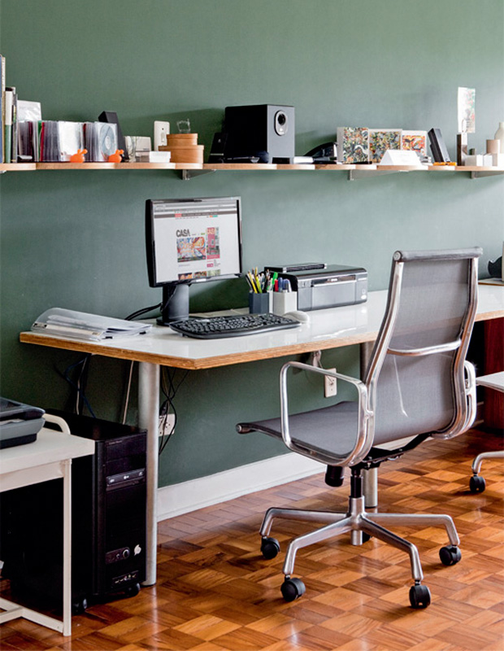
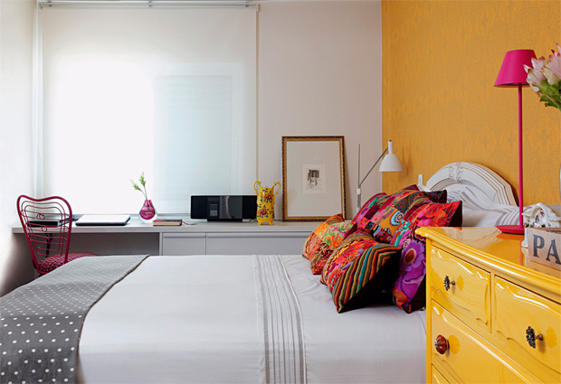
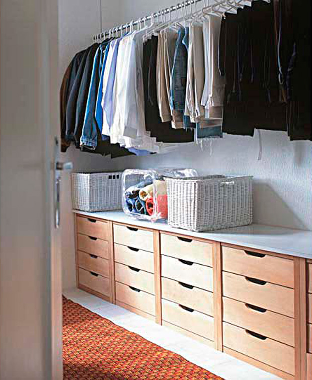
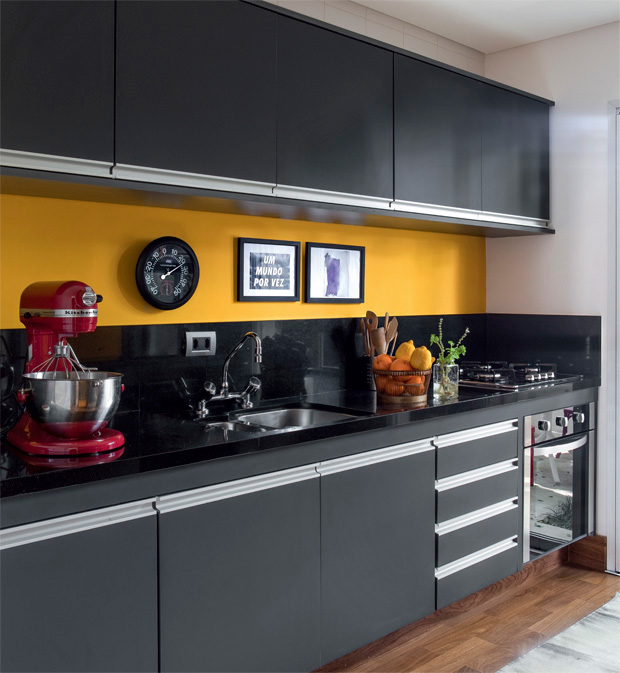
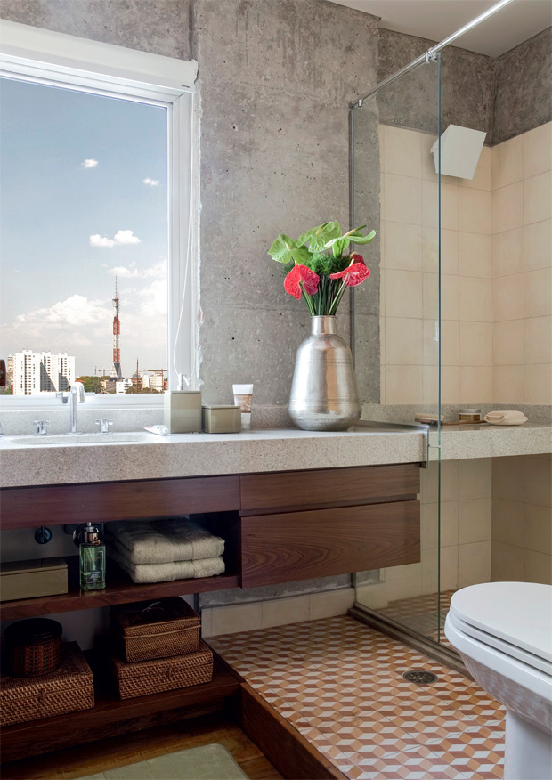

# **C**alendário da Organização: 38 dicas para arrumar a casa em 7 dias

### Organizar espaços pequenos é um desafio**.** Mas você pode, em uma única semana, deixar em ordem salas, home offices, banheiros, quartos, armários e cozinhas**.** Ensinamos como!

#### Por Nilbberth Silva

Alguma vez você comprou um objeto e, depois de um tempo, descobriu que já o tinha em casa**?** Acontece direto com os clientes da organizadora profissional Ana Ziccardi, de São Paulo**.** Ela já desenterrou da bagunça livros, sapatos, objetos de cozinha e até roupas com etiqueta – tudo em duplicidade**.** Se sua casa está assim, pare de perder dinheiro, tempo e o prazer de ter as coisas à mão**.** Livre-se dos objetos que você não necessita e deixe aqueles que você precisa em locais acessíveis**.** Com a ajuda de cinco consultoras de organização, montamos um calendário com dicas para fazer isso em apenas sete dias**.**

**Dia 1 e 2: Organize a sala**

**Luis Gomes**

****

***Dicas deAna Ziccardi, organizadora pessoal parceira da empresa OZ**!** Organize sua vida.***

1- Recolha todos os itens que não pertencem ao ambiente, como roupas, livros, papéis e DVDs**.** Coloque tudo em cestos plásticos, um para cada morador da casa e devolva-os para seus donos**.**

2- Jogue fora os jornais e revistas antigos que não cabem no revisteiro**.** Se quiser guardar páginas específicas, escaneie ou consulte as edições online**.** Caso colecione revistas, guarde-as em porta-revistas decorativos**.**

3- Crie um local perto da porta de entrada para deixar chaves, celulares, carteiras e correspondência**.** Pode ser uma bandeja ou tigela que combine com decoração**.** Ganchos são uma solução, mas não tão interessante: você precisará furar paredes**.**

4- “Fotos demais poluem o ambiente”, diz a organizadora pessoal Anna Ziccardi**.** Por isso, concentre os porta-retratos em uma mesa lateral ou use o porta-retrato digital**.** Outra opção: deixe sobre a mesa de centro um álbum ou fotolivro com as fotos favoritas**.**

5- Guarde CDs e DVDs em organizadores ou caixas decorativas**.** Se quiser mantê-los nas caixas originais, limpe a cada 15 dias, para evitar mofo e poeira**.**

6- Copos e pratos que não cabem na cozinha vão para um móvel próprio, como cristaleira ou buffet**.** Aproveite os copos que sobram para montar um pequeno bar**.** Para isso, coloque garrafas de vidro, copos em uma bandeja sobre o aparador**.**

7- Organize os quadros de parede**.** O centro do quadro deve estar a 1,6 m do piso. Quadros acima dos móveis devem estar distribuídos de forma simétrica a partir do centro do móvel**.** Coloque-os 25 cm acima do encosto do sofá e a 20 cm do aparador**.** Antes de furar as paredes teste se vocês gostará da nova disposição dos quadros**.** Para isso, corte folhas de papel craft com as dimensões do quadro, cole-as nos locais desejados, afaste-se e veja se tudo está do seu gosto**.**

8- Aprenda novos hábitos. Sempre que comer na sala, leve os pratos e copos para a cozinha; descarte jornais antigos; guarde bolsas e casacos assim que chegar da rua**.** E não deixe chaves e carteiras espalhadas.

**Dia 3: Organize papéis e a mesa do computador**

**Evelyn Müller**

****

**Home Office**

***DicasdeAna Ziccardi, organizadora profissional parceira da empresa OZ**!** Organize sua vida e Rafaela Oliveira, organizadora profissinal autora do blog [Organize sem Frescuras](http://www.organizesemfrescuras.com/) **.*****

9- A mesa do computador deve ter o mínimo possível de objetos**.** Deixe lá um porta-lápis, uma pasta, fichário ou caixa de entrada e saída para os papéis e uma agenda**.**

10- Reduza a quantidade de papéis. Quando receber novos papéis, jogue fora o que for desnecessário, como seus envelopes ou cartas promocionais**.**

11- Guarde apenas os papéis que vai guardar no trabalho e os indispensáveis, como comprovante de pagamentos de contas (até chegar o comprovante de quitação anual), documentos pessoais, da casa e do carro**.**

12- Coloque-os papéis do trabalho em caixas de entrada e saída, gavetas ou fichários**.** Separe-os de acordo com a função de cada um. Escaneie os outros papéis cujas informações você quer guardar**.** Desenhos das crianças e cartas de amigos podem virar quadros nas paredes**.**

**Dia 4: Livre o quarto (cheio de bagunça crônica)**

**Evelyn Müller**

****

**Quarto**

***Dicas de Rafaela Oliveira, organizadora profissional autora do blog [Organize sem Frescuras](http://www.organizesemfrescuras.com/) **.*****

13- Primeiro, jogue fora revistas e jornais velhos, papéis sem uso, e o lixo espalhado**.**

14- Diminua o número de objetos no criado-mudo**.** “Um livro, luminária e um enfeite estão de bom tamanho”, diz Rafaela**.**

15- Ordene os livros por tamanho ou pela cor das lombadas**.** Limpe-os com pano seco uma vez por semana – se você sofre de alergia, esse número aumenta**.**

16- Doe os brinquedos sem uso e jogue fora os quebrados**.** Guarde os brinquedos restantes em caixas diferentes, de acordo com seu tipo**.** Coloque etiquetas nas caixas para que as crianças saibam onde guardar os brinquedos**.** Se elas não souberem ler, desenhe o tipo de brinquedo na caixa**.**

17- Aproveite a semana da organização para começar novos hábitos**!** A cada manhã, tire do quarto objetos que não pertencem ao espaço, como canecas, pratos, livros da sala**.**

18- Também arrume a cama. “Já é mais de meio caminho andado”, diz Rafaela. Se você não acha difícil por a cama em ordem, facilite: use apenas dois edredons para cobri-la**.** Quando acordar, bastará esticar os edredons.

19- E antes de dormir, pendure ou guarde as roupas que vai usar novamente – vale à pena instalar ganchos e cabideiros no quarto se você não tiver**.** As peças sujas devem ir para um cesto ou saco de lavanderia**.**

**Dia 5: Organize roupas e sapatos no armário ou closet**

**Divulgação**

****

**Armário**

***Dicas deLuiza Altman – Arquiteta e Consultora da loja online [PortCasa](http://www.portcasa.com.br/)***

20- Primeiro, retire as roupas e sapatos do armário para tomar um ar**.** Separe para doação as roupas que não usa há mais de seis meses**.** Jogue fora as com defeito.

21- Separe as roupas de calor das de frio e as de trabalho das de passeio ou de ficar em casa**.** Dobre malhas, roupas de ginástica e camisetas. Elas podem ir empilhadas (em pilhas baixas) nas gavetas e prateleiras**.** Camisas, vestidos, casacos e ternos ficam em cabides - providencie modelos iguais feitos de plástico ou madeira, que são mais resistentes**.**

22- Posicione as roupas da estação onde for mais fácil pegá-las**.** No inverno, guarde os casacos pesados em cabides. No verão, guarde-os junto com malhas nos maleiros. Nessa épocam, guarde-os em sacos a vácuo**.** Essas embalagens têm uma entrada para a mangueira do aspirador de pó, o que permite retirar o ar das roupas, deixando-as menores**.**

23- Além de separar por estação, organize as roupas segundo uma lógica que você preferir: frequência de uso, tamanho ou cor**.**

24- Nas prateleiras, faça pilhas com poucas peças – assim elas amassam menos e ficam mais fáceis de retirar**.** Ana usa as seguintes quantidades máximas por pilha: doze blusas, quatro malhas, dez camisetas**.**

25- Dobre as roupas de cama e organize-as em conjuntos, colocando as fronhas por dentro do lençol**.** Enrole as toalhas em rolos apertados**.** Guarde-as em prateleiras ou gavetas.

26- Organize os calçados de forma que você possa ver todos de uma vez – vale usar uma prateleira deslizante, daquelas que funcionam como gavetas**.** Sapateiras de porta, de tecido ou arame, são uma alternativa mais barata**.** Adquira o hábito de deixar o suor secar nos sapatos antes de guardá-los**.**

27- Não deixe os calçados amassarem**.** Assim, evite empilhá-los. Se for inevitável, coloque as sandálias sobre os sapatos**.** Guarde botas com um enchimento dentro – caso tenham cano alto, coloque lá dentro garrafas PET com um pesinho**.** Outra opção é guardá-las presas a um cabide com presilhas ou pregadores**.**

**Dia 6: Enfrente o caos da cozinha**

**Cozinha**

****

**Salvador Cordaro**

***Dicas de Juliana Faria, arquiteta e organizadora pessoal da Yru Organizer***

28- Prepare o terreno**!** Primeiro, lave a louça e depois limpe o fogão, bancada e armários**.** Deixe na bancada apenas objetos de uso diário – como cafeteira e espremedor de frutas, se fizer suco todo dia**.**

29- Organize os armários. Empilhe pratos em um armário de fácil acesso**.** Para eles não trincarem, a pilha deve ter no máximo 16**.** Faça pilhas diferentes para pratos rasos e fundos**.** Empilhe também as tigelas – no máximo três por vez**.** Copos ficam de cabeça para baixo dentro do armário**.** Prenda as canecas pela asa em ganchos fixados acima das prateleiras ou na parte debaixo do armário**.**

30- Coloque talheres em gavetas com divisórias internas e separe os garfos das facas e colheres**.** Outra solução é colocá-los de pé em potes de vidro, também separados**.** Se você tem criança em casa, use acessórios que tranquem as gavetas onde há vidros e talheres**.**

31- Arrume os recipientes grandes**.** Instale no armário divisórias verticais e guarde lá frigideiras, formas, travessas e bandejas – assim, fica mais fácil retirá-las**.** Empilhe as panelas e enfileire suas tampas em uma caixa plástica, da maior para a menor**.**

32- O material de limpeza deve ir para um cesto plástico sem tampa**.** Só traga o cesto para cima da bancada quando precisar usar**.**

**Dia 7: Ponha cada coisa em seu lugar no banheiro**

**Salvador Cordaro**

****

**Banheiros**

***Dicas de Rafaela Oliveira, organizadora profissional autora do blog [Organize sem Frescuras](http://www.organizesemfrescuras.com/) e Cristiane Joffily, organizadora profissional e autora do blog [Simplesmente organizar](http://simplesmenteorganizar-cristiane.blogspot.com.br) **.*****

33- Primeiro, tire todos os produtos dos armários, prateleiras e bancadas**.** Descarte embalagens vazias, produtos abertos há mais de seis meses, fora da validade ou que não usa**.**

34- Separe os produtos de uso diário, como pasta de dentes, escova, desodorante de protetor solar**.** Guarde-os em uma bandeja sobre a bancada, para tornar a limpeza mais fácil**.** Deixe as escovas em um recipiente tampado, ou com protetores plásticos**.**

35- Só deixe no box os produtos usados durante o banho**.** Troque as esponjas do box a cada dois meses, evitando fungos e bactérias**.**

36- Divida os produtos que sobraram em categorias – por exemplo, produtos para unhas, cabelos, corpo ou dentes**.** Coloque-os em divisores de gavetas com rótulos ou caixinhas de plástico ou papelão**.** Mantenha um estoque de materiais de higiene no banheiro**.** Se tiver pouco espaço, deixe pelo menos um de reserva, para não ficar na mão na hora que mais precisa**.** Separe-os em caixas plásticas, fáceis de lavar**.**

37- Escovas, pentes e secadores de cabelo podem ir para gavetas**.** Se o banheiro não tiver espaço, guarde em caixas de plástico transparente abaixo da pia**.** Outra opção é guardá-los em gaveteiros com rodinhas**.** Também vale pendurar o secador em ganchos instalados no azulejo ou na porta do armário**.**

38- Toalhas podem ficar em toalheiros atrás da porta, se faltar espaço no banheiro**.** Mas se o banheiro tiver espaços sobrando, guarde ali rolos de papel higiênico e material de limpeza que não couberem na lavanderia**.**
