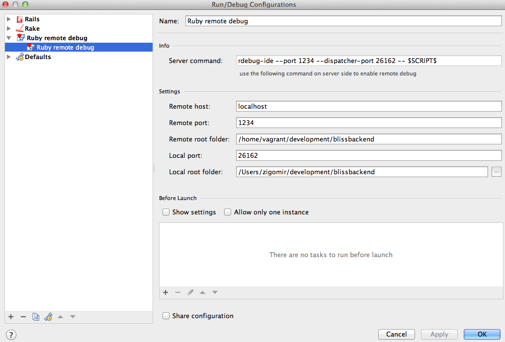

# **R**emote visual debugging with RubyMine

I like to use [Vagrant](http://vagrantup.com/)  for projects I'm working on**.**

I always thought that using virtual machines make you do compromises at least for visual debugging**.** But this is not the case for developing Ruby (and Rails) applications with [RubyMine](http://www.jetbrains.com/ruby/) **.**

You'll need to forward another port on your VM**.** If you're using Vagrant too, this is just one line of configuration inside your *Vagrantfile*

```
config.vm.forward_port 1234, 1234
```

Install ruby-debug-ide gem on your VM server

```
gem install ruby-debug-ide --pre --no-ri --no-rdoc
gem install debugger --no-ri --no-rdoc
```

Inside RubyMine add new run/debug configuration**.** *Run -> Edit configurations... -> Add new configuration (+ sign) -> Ruby remote debug*
Correctly set your remote root and local root folders**.**



To run your Rails app in debug mode on your VM you need to run it with *rdebug-ide* command**.** Beware to set correct host or just set it to 0.0.0**.**0 which will listen to all connections on port 1234**.**

```
rdebug-ide --port 1234 --dispatcher-port 26162 -h 0.0.0.0 -- script/rails server
```

When Rails app is running you can set breaking points inside RubyMine with clicking on a pane, left from line of code you want to debug**.** Debugger should stop execution on that line when you'll make a right request**.**

I haven't found any good example how to use remote debugger for Rails applications so I've written this post**.** I hope you find it useful.
