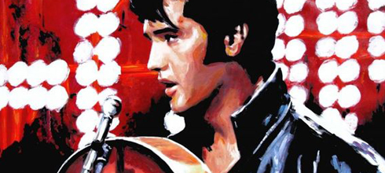

  
Frequentemente me perguntam o motivo pelo qual escolho certas músicas para ilustrar os meus livros. Na maioria das vezes, não existe uma razão específica, para falar a verdade. *Can’t Take my Eyes Off You* foi utilizada em várias passagens de “[Filhos do Éden: Herdeiros de Atlântida](http://filosofianerd.blogspot.com.br/2011/06/filhos-do-eden-herdeiros-de-atlantida.html)” simplesmente porque ela era (e ainda é) uma das canções mais conhecidas de todos os tempos, e eu precisava de uma melodia que as pessoas lessem e automaticamente a escutassem “tocando” no cérebro.  
  
Pesquisando para escrever “[Filhos do Éden: Anjos da Morte](http://filosofianerd.blogspot.com.br/2012/10/confira-uma-previa-da-capa-e-as-ultimas.html)”, uma das coisas que mais me chamou a atenção foi o crescimento – ou eu deveria dizer, a “explosão” – da chamada cultura pop nos anos que se sucederam à [Segunda Guerra Mundial](http://pt.wikipedia.org/wiki/Segunda_Guerra_Mundial). O [rock n’ roll](http://pt.wikipedia.org/wiki/Rock) nasceu nos [Estados Unidos](http://pt.wikipedia.org/wiki/Estados_Unidos), em fins dos anos 40, dando início a uma revolução musical que se alastraria pelo resto do globo. Os álbuns e as bandas (de rock e de outros estilos) passaram a determinar não apenas preferências, mas atitudes, sendo os grandes artistas verdadeiros líderes dessa nova geração que surgia.  
  
Justamente por isso, e uma vez que eu tinha me proposto, desta vez, a abordar o [século XX](http://pt.wikipedia.org/wiki/S%C3%A9culo_XX), era necessário dar um peso maior às canções desta vez. Para o caso de você querer conhecer mais sobre elas, fiz uma lista abaixo, incluindo um pequeno comentário a seguir.  
  
**Stardust**. Composta originalmente pelo pianista Hoagy Carmichael em 1927, tornou-se popular nos Estados Unidos pós-depressão, sendo tocada em clubes e bares de jazz. A versão que aparece no livro é instrumental apenas (a letra seria adicionada mais tarde). Stardust é tida como uma das obras mais regravadas do século XX, com aproximadamente 1.500 gravações.  
  
  
  
**Blue Skies**. Escrita em 1926 pelo compositor russo residente nos Estados Unidos Irving Berlin, é outro clássico americano. Mais animada que Stardust, apresenta acordes “dançantes”, o que costumava empolgavar as pessoas, especialmente as mulheres.  
  
  
  
**April in Paris**. Os acordes foram concebidos em 1936 pelo compositor americano Vernon Duke e a letra escrita pelo também americano Yip Harburg, responsável pela trilha sonora de O Mágico de Oz. April in Paris foi primeiramente encomendada para o musical da Broadway intitulado Walk a Little Faster.  
  
  
**In the Mood**. Provavelmente umas das “músicas de orquestra” mais aclamadas do planeta, o trabalho do jazzista Glenn Miller é algo que definitivamente resiste ao teste do tempo. O ritmo agitado convidava jovens e adultos às pistas de dança. Lançada em compacto (single) no ano de 1939, In The Mood virou uma espécie de “hino dançante” para os soldados aliados na guerra.  
  
  
**Hound Dog**. Gravada originalmente em 1952 pela cantora de blues Big Mama Thornton, a música ficou eternizada na voz do “imortal” Elvis Presley, que a regravou em 1956 e a cantou no programa do apresentador de televisão Ed Sullivan. Reconhecida pela revista Rolling Stones como uma das 500 maiores canções de todos os tempos, Hound Dog (Cão de Caça, em português) era à época uma marca da juventude transviada.  
  
  
**Only You**. Outra peça que é quase um sinônimo dos anos 50. Foi gravada pelo grupo The Platters, um dos mais populares conjuntos musicais da chamada “era do rock n’ roll”. Only You – tecnicamente batizada de Only You (and You Alone) – só foi desbancada por outra canção da mesma banda, The Great Pretender.   
  
  
**Break on Through (To the Other Side)**. A composição-chave que marcou o Vietnã foi na verdade Fortunate Son, da banda californiana Creedence Clearwater Revival, mas como o lançamento do compacto só aconteceria em 1969, quase um ano depois da data em que, no livro, Denyel chega à base de Da Nang, eu tive que escolher outra música para ilustrar a cena. Decidi então adotar Break on Through (To the Other Side), do álbum de estreia do The Doors, que chegaria ao mercado fonográfico em janeiro de 1968. Embora tenha feito pouco sucesso nas primeiras semanas, Break on Through conquistaria os ouvidos do público nos meses seguintes.   
  
  
**I Don't Know Why**. Esta é a música que os soldados da companhia de Denyel escutam dentro do galpão da base de Da Nang, antes do ataque dos vietcongues, durante o feriado do Tet (capítulo 37). Clarence “Frogman” Henry a gravou em 1961, mas ainda com os acordes rockabilly característicos dos anos 50. Ficou mais conhecida nos nossos dias ao fazer parte da trilha sonora do filme Forrest Gump (1994), dirigido por Robert Zemeckis.  
  
  
**California Dreamin'**. Outra canção nomeada pela revista Rolling Stone como uma das 500 melhores de todos os tempos. O grupo nova-iorquino The Mamas & the Papas gravou e lançou a balada em 1965, que posteriormente ganhou versões do The Beach Boys, The Carpeters, de George Benson e mais recentemente, do R.E.M.  
  
  
**Sgt. Pepper's Lonely Hearts Club Band**. Não só a música, mas o álbum homônimo dos Beatles é provavelmente uma das grandes obras de arte modernas. Sgt. Pepper's fez com que os quatro rapazes de Liverpool, antes vistos como animadores de uma bandinha pré-fabricada, ganhassem o respeito dos críticos. A capa do disco é curiosa e polêmica. Nela, estão estampadas figuras de celebridades, políticos, artistas e pessoas famosas – o barato na época era tentar reconhecer cada rosto. Uma dessas faces era do líder nazista Adolf Hitler, que acabou sendo excluída na versão final. Outra era do bruxo inglês Aleister Crowley, adotado como “guru” pelos hippies, considerado libertário por uns e satanista por outros.  
  
  
**Let's Stay Together**. Esta canção embalou muitos corações apaixonados nos anos 70, dos drive-ins às discotecas. O cantor de soul americano Al Green a gravou em 1971 e a lançou em compacto. O álbum de mesmo nome saiu em 1972, alcançando astronômico sucesso. A música chegou ao primeiro lugar no ranking da revista especializada Billboard.  
  
  
**Superstition**. Stevie Wonder escreveu, produziu e gravou essa música em 1972, que foi lançada em seguida pela Motown, a famosa gravadora norte-americana que revelou dezenas de artistas negros nos anos 70, incluindo Diana Ross e os Jackson Five (e depois, claro, Michael Jackson em sua carreira solo).  
  
  
**Blowin' in the Wind**. Embora tenha sido escrita e originalmente cantada por Bob Dylan em seu álbum The Freewheelin' Bob Dylan, em 1963, a música ganhou projeção com a versão de Joan Baez, tornando-se, a partir de então, um tipo de grito de protesto a favor dos direitos civis nos EUA e contra a Guerra do Vietnã.  
  
**Can You Tell Me How to Get to Sesame Street?**. Este foi por anos o tema do programa infantil Vila Sésamo. Quem o compôs foi o pianista Joe Raposo em 1969. Os acordes ficariam gravados na mente de muitas crianças dos anos 70 (inclusive na minha) para sempre.  
  
  
  
  
  
  
  
  
  
  
  
  
  
  
  
  
from Filosofia Nerd <http://filosofianerd.blogspot.com/2013/02/trilha-sonora-conheca-as-musicas-que.html>
