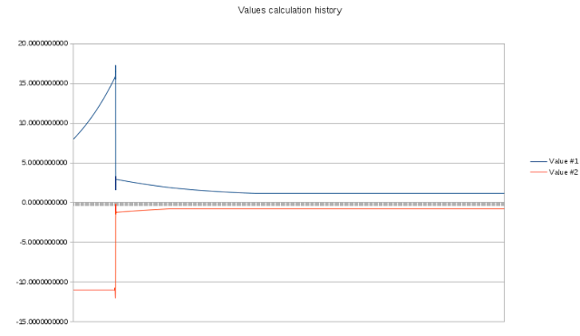

Existem inúmeros recursos na Internet que fornecem a descrição da teoria dos Algoritmos Genéticos e a explicação teórica dos mesmos. Eu, entretanto, não encontrei nenhum exemplo real (eu posso não ter procurado direito, é verdade!). Por isso, decidi tentar e implementar a teoria em um exemplo vivo. Embora existam milhares de áreas onde os algoritmos genéticos podem ser aplicados, eu decidi escolher o processo de solução da equação trivial quadrática por uma questão de simplicidade na implementação. A equação é y = 13x ^ 2 – 5x – 12. Ela possui duas raízes (pontos onde o gráfico intercepta o eixo X) em x = -0,7875184 e em x = 1,17213378. Embora, esta implementação particularmente não tenha aplicação na vida real (você pode resolver essa equação no papel em alguns segundos), ela demonstra o AG no seu melhor.

  

## Codificação de dados

  

A implementação clássica do AG implica na codificação de dados como cadeias de bits (cromossomos, onde cada gene é representado por um ou mais bits). No entanto, eu decidi mudar um pouco (o que não é proibido) e usar números reais ao invés das strings de bits. Cada cromossomo inclui dois genes e duas soluções possíveis – uma para cada raíz da equação.

  

```
 typedef struct _CHROMO_ { double   value1, value2; double   fitness; }chromo_t;
```

  

O terceiro membro do cromossomo é a aptidão e ela é usada apenas para armazenar a aptidão da solução representada por este cromossomo. Os genes (valores) são iniciados por valores aleatórios quando a população inicial é criada:

  

```
 #define POPULATION 2000 chromot_t population[POPULATION]; for(int i = 0; i < POPULATION; i++) { population[i].value1 = (double)(rand() % 10) + 5.0; population[i].value2 = -(double)(rand() % 10) - 5.0; }
```

  

## Função Fitness

  

A função Fitness é utilizada para estimar a adequação da solução atual. Neste caso particular, a função de adequação é a soma dos valores produzidos pela equação quando alimentadas com valores do cromossomo. Isso significa que, quanto menor o valor devolvido pela função fitness, mais perto chegaros à solução adequada.

  

```
 double fitness(chromo_t* ch) { return fabs(13.0 * pow(ch->value1, 2.0) - 5.0 * ch->value1 - 12.0) + fabs(13.0 * pow(ch->value2, 2.0) - 5.0 * ch->value2 - 12.0); }
```

  

Enquanto você iterar na população calculando o fitness para cada fenótipo, você deve salvar os índices de duas soluções (a quantidade pode variar de caso para caso), como os que seriam usados para produzir a próxima geração.

  

## Crossover

  

O operador de crossover é a parte crucial de qualquer implementação de AG. É uma função que recebe os dois (ou mais) melhores fenótipos e os utiliza para produzir uma nova geração. Minha sugestão é fazer um crossover desse par para fazer um (ou mais – depende da aplicação) descendente e, então, faça o crossover do melhor fenótipo com o restante da população; assim, substituindo inteiramente a geração antiga pela nova. Neste caso, a função do cruzamento é trivial:

  

```
 void cross(chromo_t* chMom, chromo_t* chDad, chromo_t* chChild) { static int  mutation = 0; // Which operation to use for crossover switch(mutation) { case 0: chChild->value1 = chMom->value1 + chDad->value1 * MUTATION_RATE; chChild->value2 = chMom->value2 + chDad->value2 * MUTATION_RATE; break; case 1: chChild->value1 = chMom->value1 + chDad->value1 * MUTATION_RATE; chChild->value2 = chMom->value2 - chDad->value2 * MUTATION_RATE; break; case 3: chChild->value1 = chMom->value1 - chDad->value1 * MUTATION_RATE; chChild->value2 = chMom->value2 + chDad->value2 * MUTATION_RATE; break; case 4: chChild->value1 = chMom->value1 - chDad->value1 * MUTATION_RATE; chChild->value2 = chMom->value2 - chDad->value2 * MUTATION_RATE; break; case 5: chChild->value1 = chDad->value1 - chMom->value1 * MUTATION_RATE; chChild->value2 = chDad->value2 - chMom->value2 * MUTATION_RATE; break; case 6: chChild->value1 = chDad->value1 + chMom->value1 * MUTATION_RATE; chChild->value2 = chDad->value2 - chMom->value2 * MUTATION_RATE; break; case 7: chChild->value1 = chDad->value1 - chMom->value1 * MUTATION_RATE; chChild->value2 = chDad->value2 + chMom->value2 * MUTATION_RATE; break; } mutation++; if(mutation > 7) mutation = 0; }
```

  

*MUTATION\_RATE* é a velocidade na qual as soluções evoluem (neste exemplo, definir a 0,0001). Quanto maior for a *MUTATION\_RATE*, mais depressa pode-se chegar à solução adequada – no entanto, elas podem ser menos exatas. O melhor seria reduzi-las ao se aproximar da solução.  
Como você deve ter notado, o crossover e a mutação são combinados em uma única função, enquanto a maior parte do tempo você gostaria para separá-los e usar a mutação apenas em caso de estagnação (incapacidade dos fenótipos de evoluir para uma solução adequada).

  

## Condição de parada

  

Não ha muito que possa ser dito aqui. Você deve parar a execução assim que alcançar a precisão desejada ou quando você perceber que não há solução, uma vez que é totalmente possível que certas equações quadráticas não possuam raízes, e ao invés disso terem o seu mínimo ou máximo. É importante mencionar que a precisão e rapidez das implementações de AG dependem da taxa da mutação e da quantidade de fenótipos na população. Na verdade, você pode implementar outra AG, a fim de encontrar os valores ideais para a atual.

  

## Testando o algoritmo implementado

  

Esta implementação específica aproxima as raízes da equação quadrática acima mencionada com um pouco menos de 23 segundos. As soluções geradas são precisas o suficiente para a maioria das necessidades.

  

Vamos dar uma olhada na evolução das soluções geradas pela implementação descrita de AG.

  

[](http://imasters.com.br/wp-content/uploads/2013/02/Values-history.png) A curva fitness é muito semelhante:

  

## [799f375e6974a5a88fbf5df4df1a0924.png](http://imasters.com.br/wp-content/uploads/2013/02/Fitness-history.png)

  

## Curva de fitness

  

Como você pode ver, a AG é capaz de encontrar a direção certa de maneira muito rápida.

  

## Conclusão

  

Embora esta aplicação específica seja trivial e, para ser honesto, muito superficial, espero que demonstre que as AGs são uma ferramenta muito poderosa. É sábio dizer que resolver uma equação quadrática é uma das tarefas mais simples, onde a AG pode ser aplicada com sucesso. Os algoritmos genéticos de diferentes tipos podem ser utilizados para a seleção da topologia de rede neural artificial, otimizações de algoritmos diferentes, etc. O sucesso de determinada AG só depende da exatidão das implementações do cromossomo e do crossover. Gostaria de reiterar que é sempre possível implementar outra AG, a fim de obter a aplicação adequada da atual.

  

Espero que este artigo tenha sido útil. Vejo você no próximo!

  

\*\*\*

  

Artigo original disponível em: <http://syprog.blogspot.com.br/2013/01/genetic-algorithms-lame-example-solving.html>

  

O post [Algoritmos genéticos: resolvendo a equação quadrática](http://imasters.com.br/desenvolvimento/algoritmos-geneticos-resolvendo-a-equacao-quadratica/) apareceu primeiro em [iMasters](http://imasters.com.br/).

  
[anexo ausente]  
  

[](http://share.feedsportal.com/viral/sendEmail.cfm?lang=pt&amp;title=Algoritmos+gen%C3%A9ticos%3A+resolvendo+a+equa%C3%A7%C3%A3o+quadr%C3%A1tica&amp;link=http%3A%2F%2Fimasters.com.br%2Fdesenvolvimento%2Falgoritmos-geneticos-resolvendo-a-equacao-quadratica%2F)

  

[](http://res.feedsportal.com/viral/bookmark_pt.cfm?title=Algoritmos+gen%C3%A9ticos%3A+resolvendo+a+equa%C3%A7%C3%A3o+quadr%C3%A1tica&amp;link=http%3A%2F%2Fimasters.com.br%2Fdesenvolvimento%2Falgoritmos-geneticos-resolvendo-a-equacao-quadratica%2F)

  
  
  
[[anexo ausente]](http://da.feedsportal.com/r/158873596116/u/49/f/546640/c/33212/s/28f5b08b/a2.htm) [anexo ausente]  
  
[anexo ausente]  
  
  
  
from iMasters <http://imasters.com.br/desenvolvimento/algoritmos-geneticos-resolvendo-a-equacao-quadratica/>
