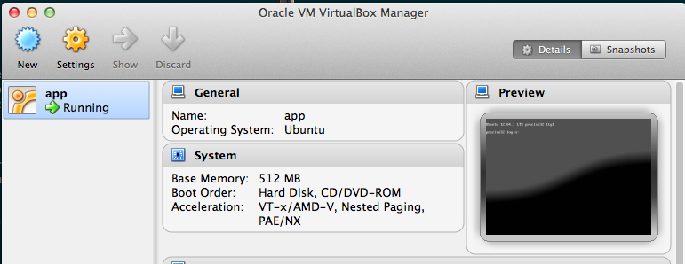
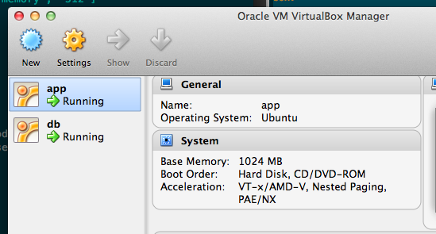

Esse é o último artigo da [sequência sobre Vagrant](http://imasters.com.br/desenvolvimento/conversando-sobre-vagrant-parte-02/). Antes de entrar no assunto de fato, devo contar algumas noviades sobre ele que aconteceu nesse meio tempo. A primeira coisa é que agora temos oficialmente um empresa por trás do Vagrant, assim como muitos outros projetos têm. A [Hashicorp](http://www.hashicorp.com/) promete levar o Vagrant a um outro nível. A outra novidade é no próprio Vagrant, que agora conta com um site e logo novos.

  

Voltando a falar sobre as configurações básicas da máquina, vamos ver agora como configurar um valor de memória para a máquina virtual e nomear a mesma. O procedimento é bem simples e basta adicionar mais uma linha no arquivo de configuração `Vagrantfile`:

  

`config.vm.customize ["modifyvm", :id, "--name", "app", "--memory", "512"]`

  

Então, nosso arquivo `Vagrantfile` já deve ter essa cara no momento:

  

```
 Vagrant::Config.run do |config| config.vm.box = "precise32" config.vm.forward_port 80, 8080 config.vm.share_folder "app", "/home/vagrant/app", "/Users/joaovrmaia/app" config.vm.customize ["modifyvm", :id, "--name", "app", "--memory", "512"] end
```

  

Agora, nossa VM tem um nome e um quantidade de memória definida. Uma forma de verificar isso é olhando no VirtualBox, veja:

  

[](http://imasters.com.br/wp-content/uploads/2013/01/virtualbox_vagrant1.png)

  

Talvez alguns de vocês ainda não estajam 100% convecidos de usar o Vagrant por não ter atendido de fato a necessidade de teste da sua aplicação. Um exemplo seria para pessoas que trabalham com VM exclusivas para a aplicação e uma para o banco de dados. Não fique triste! Veja que é possível:

  

```
 Vagrant::Config.run do |config| config.vm.define :app do |app_config| app_config.vm.customize ["modifyvm", :id, "--name", "app", "--memory", "1024"] app_config.vm.box = "precise32" app_config.vm.name = "app" app_config.vm.forward_port 22, 2222, :auto => true app_config.vm.forward_port 80, 8080 app_config.vm.network :hostonly, "10.0.0.100" app_config.vm.share_folder "app", "/home/vagrant/app", "/Users/joaovrmaia/app" end config.vm.define :db do |db_config| db_config.vm.customize ["modifyvm", :id, "--name", "db", "--memory", "512"] db_config.vm.box = "precise32" db_config.vm.name = "db" db_config.vm.forward_port 3306, 4306 db_config.vm.network :hostonly, "10.0.0.200" end end
```

  

Com a configuração feita, certifique-se de não ter nenhuma máquina rodando que venha a conflitar a rede com essa. Recomendo que desligue qualquer outra máquina virtual para esse teste. Basta rodar o seguinte comando agora:

  

`host $ vagrant up`

  

Resultado esperado:

  

```
 [app] Importing base box 'precise32'... [app] Matching MAC address for NAT networking... [app] Clearing any previously set forwarded ports... [app] Forwarding ports... [app] -- 22 => 2222 (adapter 1) [app] -- 80 => 8080 (adapter 1) [app] Creating shared folders metadata... [app] Clearing any previously set network interfaces... [app] Preparing network interfaces based on configuration... [app] Running any VM customizations... [app] Booting VM... [app] Waiting for VM to boot. This can take a few minutes. [app] VM booted and ready for use! [app] Configuring and enabling network interfaces... [app] Mounting shared folders... [app] -- v-root: /vagrant [app] -- app: /home/vagrant/app [db] Importing base box 'precise32'... [db] The guest additions on this VM do not match the install version of [db] Matching MAC address for NAT networking... [db] Clearing any previously set forwarded ports... [db] Fixed port collision for 22 => 2222. Now on port 2200. [db] Forwarding ports... [db] -- 22 => 2200 (adapter 1) [db] -- 3306 => 4306 (adapter 1) [db] Creating shared folders metadata... [db] Clearing any previously set network interfaces... [db] Preparing network interfaces based on configuration... [db] Running any VM customizations... [db] Booting VM... [db] Waiting for VM to boot. This can take a few minutes. [db] VM booted and ready for use! [db] Configuring and enabling network interfaces... [db] Mounting shared folders... [db] -- v-root: /vagrant
```

  

Fica assim nossa brincadeira:

  

[](http://imasters.com.br/wp-content/uploads/2013/01/virtualbox_vagrant2.png)

  

Para acessar as VMs é simples:

  

`host $ vagrant ssh app`

  

ou

  

`host $ vagrant ssh db`

  

Minha dica é não usar a máquina padrão do Ubuntu nesse passo, mas isso fica para dever de casa. Experimente criar sua máquina virtual padrão e testar com ela.

  

Com isso fecho esse ciclo sobre o Vagrant e talvez volte a falar dele por aqui ou de outras tecnologias parecidas com ele.

  

Abraços

  
[anexo ausente]  
  

[](http://share.feedsportal.com/viral/sendEmail.cfm?lang=pt&amp;title=Fechando+a+conversa+sobre+Vagrant&amp;link=http%3A%2F%2Fimasters.com.br%2Fdesenvolvimento%2Ffechando-a-conversa-sobre-vagrant%2F)

  

[](http://res.feedsportal.com/viral/bookmark_pt.cfm?title=Fechando+a+conversa+sobre+Vagrant&amp;link=http%3A%2F%2Fimasters.com.br%2Fdesenvolvimento%2Ffechando-a-conversa-sobre-vagrant%2F)

  
  
  
[[anexo ausente]](http://da.feedsportal.com/r/151885449143/u/49/f/546640/c/33212/s/2838c244/a2.htm) [anexo ausente]  
  
[anexo ausente]  
  
  
  
from iMasters <http://imasters.com.br/desenvolvimento/fechando-a-conversa-sobre-vagrant/>
