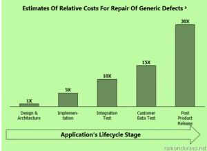

Tenho acompanhado o crescimento da indústria de software nos últimos 19 anos, desde quando passei a me dedicar profissionalmente e, dentro desse tempo, muita tecnologia nova surgiu, assim como todo o ciclo de desenvolvimento que antigamente era feito individualmente e está hoje coletivo, compartilhando até a mesma linha de código, completamente descentralizado, globalizado.

  

Apesar da evolução tecnológica, ainda encontramos vestígios desse passado em algumas práticas que teimam em persistir, por mais que gerem sofrimento e prejuízo a todo o ecossistema, tendo como base pensamentos ultrapassados dos velhos tempos da indústria fabril (industrial mesmo), criando uma controversa relação de alta pressão e falsos resultados. Se fosse na NASDAQ, eu diria que as técnicas em questão seriam inflacionar as ações de uma empresa (código), vender e entregar a alguém, depois, silenciosamente, esperar a caída ao momento real (bugs, bugs, bugs).

  

Você deve estar se perguntando onde desejo chegar com esse texto, falando de “inflacionar” e “falsos resultados”. Então respondo que, nosso ponto em questão, é desmistificar a ideia de que produzir software é igual a fabricar software; que o trabalho intelectual, planejamento e estratégia não devem ser desconsiderados na esperança de ser remendado à frente, justificando que desenvolvedor de software não precisa “pensar” e sim “copiar e colar”.

  

Se você passou pelo ecossistema de software nos últimos dez anos, certamente já foi questionado se projeto A ou projeto B era produtivo. O que ninguém lhe apresentou depois foi o resultado da conta ao fazer de qualquer jeito, como, por exemplo, encher uma fundação de um prédio qualquer com jornal velho misturado com cimento mascarando e depois com o prédio instável, balançando, fazer um escoramento para ele não cair e colocar uma plaquinha ‘entregue’.

  

Eu tenho visto muito planejamento e excursão de projetos nos últimos anos, mas ainda não encontrei ninguém apresentando o prejuízo que está tomando. Pelo contrário, por incrível que pareça, às vezes, as pessoas acabam se acostumando e normalizando que produção de software é assim mesmo. Os novos profissionais saem da faculdade e chegam ao mercado acreditando nisso também, e é justamente esse grupo que precisamos atingir, fazendo-os deixar de fazer documento e sim produzir software.

  

Para melhor exemplificarmos, eu separei algumas situações as quais chamo de “sintomas” para você avaliar se já passou por alguma delas e, caso se identifique com alguma, você, nesse exato momento deve passar a refletir como está produzindo o seu software.

  

Sintomas clássicos da falsa entrega de software:

  

1. Efeito bumerangue – você entrega e ele volta rapidinho;

     

   Efeito formigueiro – sempre tem que mudar em vários pontos;

     

   Efeito dinheiro velho – ninguém consegue reutilizar o código;

     

   Efeito piano – custos altíssimos operação e sustentação;

     

   Efeito laxante – manutenção complicada, sempre dá merda;

     

   Efeito pipoca – todos os códigos modificados estouram;

     

   Efeito navalha – alguém sempre sai cortado;

     

   Efeito previdência – só segurados conseguem manter o código;

     

   Efeito sabão – manutenção sempre escorrega no orçamento;

     

   Efeito furacão – remendar cansa e não segura ninguém;

     

   Efeito ex-esposa(o) – cliente perde amor pelo projeto.

Agora que você se identificou em algumas das situações apresentadas, separe um tempo para se questionar o que é produtividade. Eu faço essa pergunta com frequência aos meus clientes – isso provoca uma real reflexão sobre onde querem chegar. Estou falando de projetos consideráveis e que não basta mudar a tecnologia, mas todo o modelo mental e cultural envolvido.

  

Todos – sem exceção – pregam ao máximo o excesso de produtividade, acreditando fielmente que produção de software é fabricação de telas no processo “1,2,3”… No entanto, esquecem que resultado vem da reutilização (RiSE – Reuse in Software Engineering), padronização, estabilidade, integração e, principalmente, sustentabilidade da solução que está sendo implementada (continuous quality enablement).

  

É claro que alguém vai gritar que testar é caro. Lembra que falei no início que é mais fácil e barato jogar jornal velho na fundação do prédio? Nesse momento é muito fácil você provar o contrário. Basta olhar ao redor e questionar o custo de uma manutenção ou novo desenvolvimento. Se quiser soar mais “chic”, elevando a conversa ao um alto nível, pode citar um estudo realizado e publicado pelo Instituto Forrester que mostra que corrigir um defeito custa 30x mais que resolvê-lo na origem.

  

  

Na prática, todos sabem o tamanho do prejuízo, porém ninguém quer encarar o leão de frente, sendo mais prático passar a batata quente para frente, gerenciar o turnover de pessoas, disponibilizar uma equipe gigantesca de suporte no efeito uti e dizer para os clientes atuais que vão atender um simples ajuste em pelo menos seis meses. Na sequência, os novos clientes acabam tendo fila gigantesca de implantação e são servidos por um processo lento e caro que aos poucos mina o crescimento de qualquer negócio.

  

Nesse momento você fará uma nova pergunta: Prefere colocar o foco no problema ou na solução? Esse é o momento de dizer sim à mudança e trazer um novo momento ao negócio, procurando produzir software com estratégia e não mais fabricar aos modos “go horse”, pois o “débito técnico” acumulado é igual a cartão de crédito, a conta chega mesmo.

  

O post [O fantasma da produtividade](http://imasters.com.br/desenvolvimento/o-fantasma-da-produtividade/) apareceu primeiro em [iMasters](http://imasters.com.br/).

  
[anexo ausente]  
  

  

  
  
  
[[anexo ausente]](http://da.feedsportal.com/r/158873192027/u/49/f/546640/c/33212/s/28c43bc8/a2.htm) [anexo ausente]  
  
[anexo ausente]  
  
  
  
from iMasters <http://imasters.com.br/desenvolvimento/o-fantasma-da-produtividade/>
