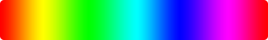
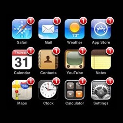
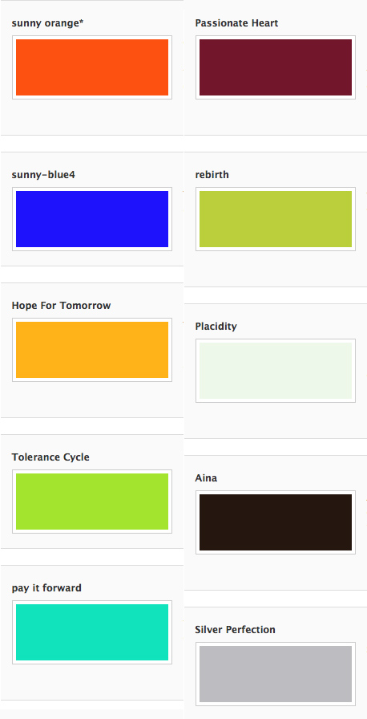
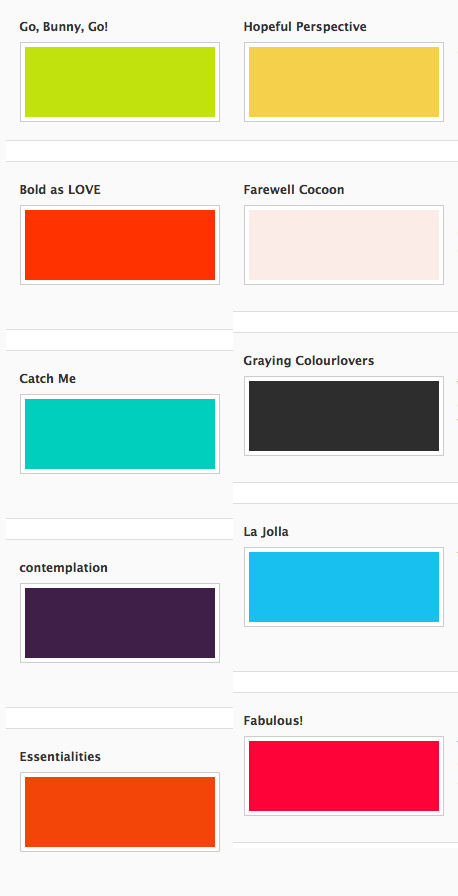
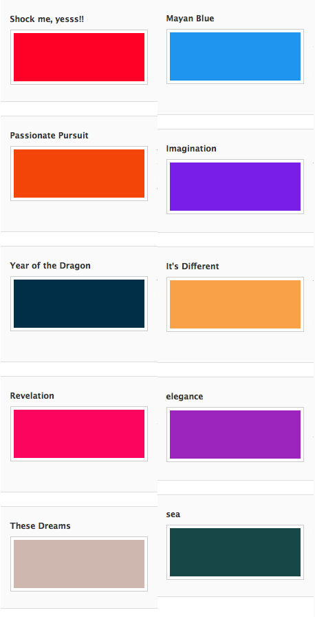
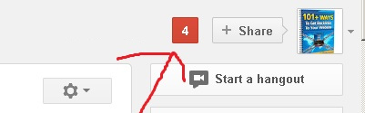
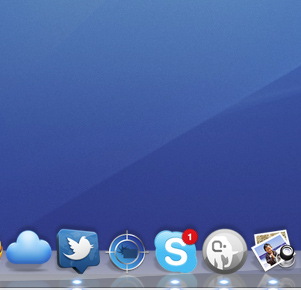
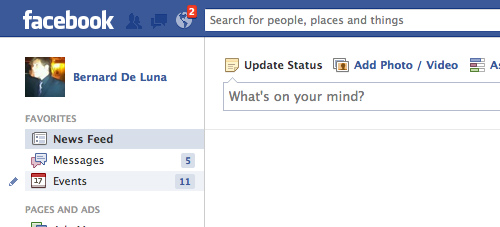
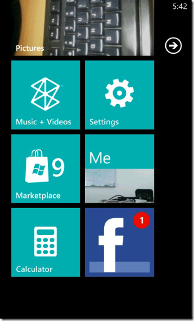

É sempre um assunto divertido conversar sobre cores – principalmente quando discutimos no ponto de vista de interfaces e suas impressões nos usuários. Uma das coisas mais interessantes que tenho percebido no último ano é o vermelho voltando a figurar como uma das cores importantes na interface. O encarnado começou a se tornar uma cor perigosa no final dos anos 90, quando o erro era mostrado para o usuário sempre utilizando a cor vermelha, punindo de forma agressiva o usuário por, muitas vezes, erros que não foi ele quem cometeu.

  

 A palheta que era utilizada no começo da web começou a migrar. O que era azul começou a se tornar um azul mais claro, dando um pouco mais de suavidade na empresa de tecnologia; o laranja surgiu como uma das maiores revoluções de aplicação e rapidamente começou a combinar com o azul, -em muitos casos o laranja substituiu o vermelho como cor para objetos importantes e que precisavam de destaque na interface.

  

  

Com a evolução dos monitores, o amarelo claro deixou de ser visto como invisível e passou a aparecer como mensagens de informações importantes, o que deixou o laranja mais livre para uma comunicação mais rápida e inovadora. O vermelho ainda era restrito nas aplicações que o logo necessitava, até que a empresa que menos usa cores em sua comunicação salvou a patria. A Apple deu uma aplicação até antes não popularizada de notificações:

  

O famoso push notification deu uma sensibilidade para o vermelho que antes não seria pensada. Possivelmente ao identificar um bullet vermelho em cima do meu app, claramente o usuário acharia no passado que o sistema estava com algum erro. Porém, novamente aprendemos em Design que a curva de aprendizado do usuário é a coisa mais importante e rapidamente o vermelho se tornou um objeto de representação para notificações, uma das coisas mais importantes nas interfaces atualmente.

  

Caso você não acredite nesse avanço do vermelho, segue uma listagem das cores mais populares de 2010 segundo o [Colour Lovers](http://www.colourlovers.com/coloroftheyear/2010/top):

  

 Nada de vermelho né? Agora vamos olhar as [trend colors de 2011](http://www.colourlovers.com/coloroftheyear/2012):

  

 As palhetas mais cítricas começam a aparecer mais nos sites, muito por causa da comunicação amigável para aproximar as empresas dos clientes. Assim chegamos a 2012, onde temos as seguintes cores:

  

 Ou seja, o vermelho deixou de ser considerado uma cor proibida e negativa para usabilidade de projetos. Esse renascimento permitiu que com uma pequena variação da tonalidade o vermelho possa aparecer em diversos projetos, além da sua utilização mais comum hoje – push notifications:

  

  

  

  

 E você? Como está usando o vermelho?

  

O post [O renascimento do vermelho em UI](http://imasters.com.br/design/o-renascimento-do-vermelho-em-ui/) apareceu primeiro em [iMasters](http://imasters.com.br/).

  
[anexo ausente]  
  

  

  
  
  
[[anexo ausente]](http://da.feedsportal.com/r/158873126262/u/49/f/546640/c/33212/s/28c3688e/a2.htm) [anexo ausente]  
  
[anexo ausente]  
  
  
  
from iMasters <http://imasters.com.br/design/o-renascimento-do-vermelho-em-ui/>
