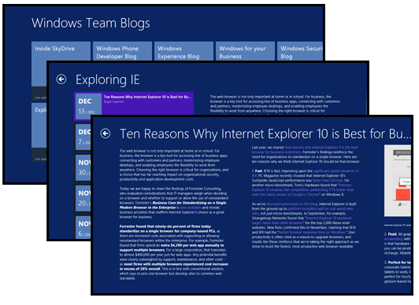
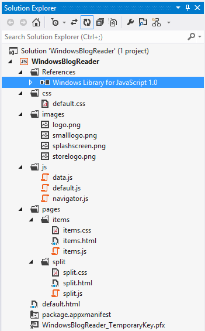
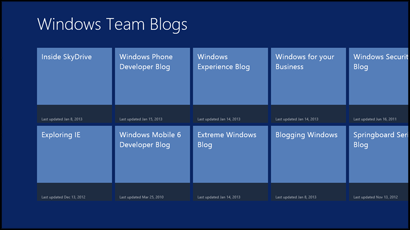
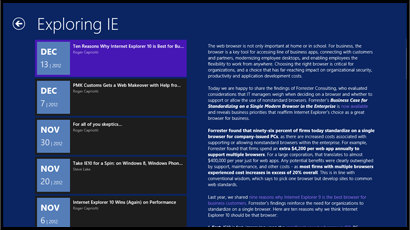
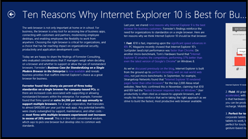
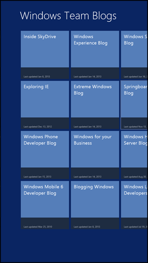
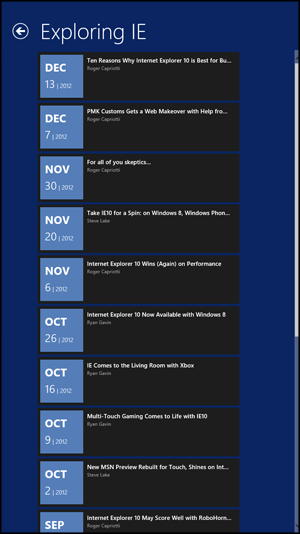

# **C**reate a blog reader (Windows Store apps using JavaScript and HTML) (Windows)

31 out of 73 rated this helpful - [Rate this topic](#feedback "Rate this topic")

This tutorial teaches you how to use the **Split App** Visual Studio template to create a blog reading app**.**

Learn how to:

- Define your own JSON data
- Use [**Windows**.**JS.xhr**](http://msdn.microsoft.com/en-us/library/windows/apps/br229787.aspx)  to retrieve RSS data
- Use [**PageControl**](http://msdn.microsoft.com/en-us/library/windows/apps/jj126158.aspx)  objects
- Display data in a [**ListView**](http://msdn.microsoft.com/en-us/library/windows/apps/br211837.aspx)
- Use the [**AppBar**](http://msdn.microsoft.com/en-us/library/windows/apps/br229670.aspx)  to respond to commands

### Before you start..**.**

### WindowsBlogReader

In this tutorial we create a basic reader for some of the Windows team blogs**.** The finished app looks like this:



The items page has the title "Windows Team Blogs" and contains a [**ListView**](http://msdn.microsoft.com/en-us/library/windows/apps/br211837.aspx)  control with one item per blog**.** When you click an item in the **ListView**, you navigate to a split page for the selected blog**.** The split page contains a **ListView** control with one item per blog post, plus a control that displays the contents of the currently selected blog post vertically**.** From the split page, you can navigate to an item detail page that displays the title of the blog post at the top and the contents of the currently selected blog post horizontally**.**

### Create a new project in Visual Studio

Let's create a new project named `WindowsBlogReader` for our app**.** Here's how:

1. Launch Visual Studio**.**
2. From the **Start Page** tab, click **New Project****.** The **New Project** dialog box opens**.**
3. In the **Installed** pane, expand **JavaScript** and select the **Windows Store app** template type**.** The available project templates for JavaScript are displayed in the center pane of the dialog box**.**
4. In the center pane, select the **Split App** project template**.**
5. In the **Name** text box, enter "WindowsBlogReader"**.**
6. Click **OK** to create the project**.** This will take a moment**.**

Here's the structure of the project, as shown in Solution Explorer**.** The pages folder contains two groups of files, one for the items page and one for the split pages**.** Each of these groups is a [**PageControl**](http://msdn.microsoft.com/en-us/library/windows/apps/jj126158.aspx) , a group of HTML, CSS, and JavaScript files that define a page that the app can navigate to or use as a custom control**.**

The new project contains the HTML, CSS, and JavaScript files that you need to create the items [**PageControl**](http://msdn.microsoft.com/en-us/library/windows/apps/jj126158.aspx)  and the split **PageControl****.** We'll add the files for the item detail **PageControl** later**.**



For more info about the different templates, see [JavaScript project templates for Windows Store apps](http://msdn.microsoft.com/en-us/library/windows/apps/hh758331.aspx) **.**

### Launch our new Windows Store app

If you're curious to see what a basic split app looks like, press F5 to build, deploy, and launch the app**.** The app appears as a full-screen page with the title "WindowsBlogReader" and a list of sample items displayed as a grid**.** Each item represents a group of data. Tap or click an item in the list to navigate to the split page**.** A split page has two core content areas. On the left side, you see the list of items associated with the selected group**.** On the right side, you see the content for the selected item**.** You can get back to the items page by tapping or clicking the back button on the page**.**

When you run the app, the app takes the HTML, CSS, and JavaScript in (or linked in) items.html and injects it into the default.html page that is the start page of your app**.** There are some restrictions on what code running in an app container can do by default**.** For example, your app can't access the Internet or your webcam unless you declare that the app needs this access and the user grants the access when the app is installed**.** To learn more, open package.appxmanifest and go to the **Capabilities** tab**.**

### Change the title and background color

Let's try two simple tasks to customize the app**.**

To change the title of the app, open items.html and replace the text for the **h1** element in `itemspage` with "Windows Team Blogs" as shown here**.**

```
<h1 class="titlearea win-type-ellipsis">
    <span class="pagetitle">Windows Team Blogs</span>
</h1>
```

To set the background color for the app, open default.css and add this **background-color** attribute to `#contenthost`**.**

```
#contenthost {
    height: 100%;
    width: 100%;    
    background-color: #0A2562;
}
```

Press F5 to build, deploy, and launch the app**.** Notice that the title of the items page changed and the background color of the items and split pages is blue**.**

> **Note**  The images folder in the project contains default files that the system uses for the tiles and the splash screen for your app when it's launched**.** We don't change those in this tutorial, but you can use other images if you like**.** Just add the image files that you want to use to the images folder**.** Open package.appxmanifest and replace the contents of **Logo**, **Small logo**, and **Splash screen** on the **Application UI** tab with the paths of your image files**.**

### Replace the sample data

The project template contains the sample data you see when you run the app**.** We use these steps to replace the sample data with data from the ATOM feeds for the Windows team blogs:

#### Delete the sample data

Open data**.**js, which contains the sample data for the app**.**

We don't need the `generateSampleData` function, so you can delete it**.**

```
// Returns an array of sample data that can be added to the application's
// data list. 
function generateSampleData() {
    // Omitted code.

        
}
```

We don't need this code, so you can delete it:

```
// TODO: Replace the data with your real data.
// You can add data from asynchronous sources whenever it becomes available.
generateSampleData().forEach(function (item) {
    list.push(item);
});
```

#### Set up variables and functions

Add this code to data**.**js just before the `var list = new WinJS.Binding.List();` statement toward the beginning of the file**.** This code sets up the variables we need and the functions that populate them**.** As we go through the steps in this tutorial, you can use the included comments to help you find where to put the code for each step**.**

```
// Set up array variables

var dataPromises = [];
var blogs;

// Create a data binding for our ListView

var blogPosts = new WinJS.Binding.List();

// Process the blog feeds

function getFeeds() { 
    // Create an object for each feed in the blogs array
    // Get the content for each feed in the blogs array
    // Return when all asynchronous operations are complete
}

function acquireSyndication(url) {
    // Call xhr for the URL to get results asynchronously
}

function getBlogPosts() {
    // Walk the results to retrieve the blog posts
}

function getItemsFromXml(articleSyndication, bPosts, feed) {
    // Get the info for each blog post
}
```

#### Define the blog list

To keep this sample simple, let's include a hard-coded list of URLs in the `blogs` array**.**

Add this code to the `getFeeds` function**.** The code adds JSON arrays to the `blogs` array**.** Each JSON array contains JSON objects to store content from the feed**.** A JSON object is an unordered container of name/value pairs**.** For example, the blog title is stored in a JSON object with the name `title` and a value retrieved from the ATOM feed**.** Using JSON objects makes it straightforward for us to bind the content from the feed to the controls of our app**.**

```
// Create an object for each feed in the blogs array
blogs = [
{
    key: "blog1",
    url: 'http://blogs.windows.com/skydrive/b/skydrive/atom.aspx',
    title: 'tbd', updated: 'tbd',
    acquireSyndication: acquireSyndication, dataPromise: null
},
{
    key: "blog2",
    url: 'http://blogs.windows.com/windows/b/windowsexperience/atom.aspx',
    title: 'tbd', updated: 'tbd',
    acquireSyndication: acquireSyndication, dataPromise: null
},
{
    key: "blog3",
    url: 'http://blogs.windows.com/windows/b/extremewindows/atom.aspx',
    title: 'tbd', updated: 'tbd',
    acquireSyndication: acquireSyndication, dataPromise: null
},
{
    key: "blog4",
    url: 'http://blogs.windows.com/windows/b/business/atom.aspx',
    title: 'tbd', updated: 'tbd',
    acquireSyndication: acquireSyndication, dataPromise: null
},
{
    key: "blog5",
    url: 'http://blogs.windows.com/windows/b/bloggingwindows/atom.aspx',
    title: 'tbd', updated: 'tbd',
    acquireSyndication: acquireSyndication, dataPromise: null
},
{
    key: "blog6",
    url: 'http://blogs.windows.com/windows/b/windowssecurity/atom.aspx',
    title: 'tbd', updated: 'tbd',
    acquireSyndication: acquireSyndication, dataPromise: null
},
{
    key: "blog7",
    url: 'http://blogs.windows.com/windows/b/springboard/atom.aspx',
    title: 'tbd', updated: 'tbd',
    acquireSyndication: acquireSyndication, dataPromise: null
},
{
    key: "blog8",
    url: 'http://blogs.windows.com/windows/b/windowshomeserver/atom.aspx',
    title: 'tbd', updated: 'tbd',
    acquireSyndication: acquireSyndication, dataPromise: null
},
{
    key: "blog9",
    url: 'http://blogs.windows.com/windows_live/b/developer/atom.aspx',
    title: 'tbd', updated: 'tbd',
    acquireSyndication: acquireSyndication, dataPromise: null
},
{
    key: "blog10",
    url: 'http://blogs.windows.com/ie/b/ie/atom.aspx',
    title: 'tbd', updated: 'tbd',
    acquireSyndication: acquireSyndication, dataPromise: null
},
{
    key: "blog11",
    url: 'http://blogs.windows.com/windows_phone/b/wpdev/atom.aspx',
    title: 'tbd', updated: 'tbd',
    acquireSyndication: acquireSyndication, dataPromise: null
},
{
    key: "blog12",
    url: 'http://blogs.windows.com/windows_phone/b/wmdev/atom.aspx',
    title: 'tbd', updated: 'tbd',
    acquireSyndication: acquireSyndication, dataPromise: null
}];
```

#### Retrieve the feed data

For the steps in this section, we use the Windows Library for JavaScript to manage the syndication feeds**.**

Add this code to the `acquireSyndication` function**.** We call the [**Windows.JS.xhr**](http://msdn.microsoft.com/en-us/library/windows/apps/br229787.aspx)  function to retrieve the feed content**.** This call is asynchronous. Fortunately, much of the complexity you might expect when making an asynchronous call is taken care of for us**.** When **xhr** returns, we receive a promise of results, which we return to the caller**.**

```
// Call xhr for the URL to get results asynchronously
return WinJS.xhr(
    {
        url: url,
        headers: { "If-Modified-Since": "Mon, 27 Mar 1972 00:00:00 GMT" }
                
    });
```

Now we add code to the `getFeeds` function to call the `acquireSyndication` function for each blog in the `blogs` array and add the promise returned to our array of promises, `dataPromises`**.** We call the [**WinJS.Promise.join**](http://msdn.microsoft.com/en-us/library/windows/apps/br211774.aspx)  function to wait until all promises have been fulfilled before we return from `getFeeds`**.** This ensures that we have all the info we need before we display the ListView control**.**

```
// Get the content for each feed in the blogs array
blogs.forEach(function (feed) {
    feed.dataPromise = feed.acquireSyndication(feed.url);
    dataPromises.push(feed.dataPromise);
});

// Return when all asynchronous operations are complete
return WinJS.Promise.join(dataPromises).then(function () {
    return blogs;
});
```

Next, we add this code to the `getBlogPosts` function**.** For each blog in the `blogs` array, we parse the XML feed data for the info we need**.** First, we use the [**responseXML**](http://msdn.microsoft.com/en-us/library/windows/apps/hh453359.aspx)  property to get the response body, then we use the **querySelector** method with the required selectors to get the title and last updated date of the blog**.** We use [**Windows.Globalization.DateTimeFormatting.DateTimeFormatter**](http://msdn.microsoft.com/en-us/library/windows/apps/windows.globalization.datetimeformatting.datetimeformatter.aspx)  to convert the last updated date for display**.**

If `articlesResponse.responseXML` is **null**, there was an error loading the blog, so we display an error message where the blog would appear**.**

```
// Walk the results to retrieve the blog posts
getFeeds().then(function () {
    // Process each blog
    blogs.forEach(function (feed) {
        feed.dataPromise.then(function (articlesResponse) {

            var articleSyndication = articlesResponse.responseXML;

            if (articleSyndication) {
                // Get the blog title 
                feed.title = articleSyndication.querySelector("feed > title").textContent;

                // Use the date of the latest post as the last updated date
                var published = articleSyndication.querySelector("feed > entry > published").textContent;

                // Convert the date for display
                var date = new Date(published);
                var dateFmt = new Windows.Globalization.DateTimeFormatting.DateTimeFormatter(
                    "month.abbreviated day year.full");
                var blogDate = dateFmt.format(date);
                feed.updated = "Last updated " + blogDate;

                // Get the blog posts
                getItemsFromXml(articleSyndication, blogPosts, feed);
            }
            else {
                        
                // There was an error loading the blog. 
                feed.title = "Error loading blog";
                feed.updated = "Error"; 
                blogPosts.push({
                    group: feed,
                    key: "Error loading blog",
                    title: feed.url,
                    author: "Unknown",
                    month: "?",
                    day: "?",
                    year: "?",
                    content: "Unable to load the blog at " + feed.url
                });

            }
        });
    });
});

return blogPosts;
```

Finally, we add this code to the `getItemsFromXml` function**.** First we use **querySelectorAll** to get the set of blog posts and the info for each blog post**.** Then we use **querySelector** to get the info for each blog post**.** We use [**Windows.Globalization.DateTimeFormatting.DateTimeFormatter**](http://msdn.microsoft.com/en-us/library/windows/apps/windows.globalization.datetimeformatting.datetimeformatter.aspx)  to convert the last updated date for display**.** Finally, we store the info for each blog post in its entry in the `bPosts` array using the **push** method**.**

```
// Get the info for each blog post
var posts = articleSyndication.querySelectorAll("entry");

// Process each blog post
for (var postIndex = 0; postIndex < posts.length; postIndex++) {
    var post = posts[postIndex];

    // Get the title, author, and date published
    var postTitle = post.querySelector("title").textContent;
    var postAuthor = post.querySelector("author > name").textContent;
    var postPublished = post.querySelector("published").textContent;

    // Convert the date for display
    var postDate = new Date(postPublished);
    var monthFmt = new Windows.Globalization.DateTimeFormatting.DateTimeFormatter(
        "month.abbreviated");
    var dayFmt = new Windows.Globalization.DateTimeFormatting.DateTimeFormatter(
        "day");
    var yearFmt = new Windows.Globalization.DateTimeFormatting.DateTimeFormatter(
        "year.full");
    var blogPostMonth = monthFmt.format(postDate);
    var blogPostDay = dayFmt.format(postDate);
    var blogPostYear = yearFmt.format(postDate);

    // Process the content so it displays nicely
    var staticContent = toStaticHTML(post.querySelector("content").textContent);

    // Store the post info we care about in the array
    bPosts.push({
        group: feed,
        key: feed.title,
        title: postTitle,
        author: postAuthor,
        month: blogPostMonth.toUpperCase(),
        day: blogPostDay,
        year: blogPostYear,
        content: staticContent
    });                                         
}
```

#### Make the data available

Now that we completed the code to store the feed data in our arrays, we need to group the feed data as expected by the [**ListView**](http://msdn.microsoft.com/en-us/library/windows/apps/br211837.aspx)  control**.** We also need to finish binding our feed data to the **ListView** control**.**

The `getItemsFromGroup` function calls the [**createFiltered**](http://msdn.microsoft.com/en-us/library/windows/apps/hh700741.aspx)  method and returns the blog posts for the specified blog**.** The `getItemsFromGroup` function relies on a variable, `list`**.**

```
var list = new WinJS.Binding.List();
```

Replace this definition with a call to our `getBlogPosts` function, which returns the `blogPosts` variable**.** This is a [**WinJS.Binding.List**](http://msdn.microsoft.com/en-us/library/windows/apps/hh700774.aspx)  object**.**

```
var list = getBlogPosts();
```

Note that the call to the [**createGrouped**](http://msdn.microsoft.com/en-us/library/windows/apps/hh700742.aspx)  method sorts the blog posts by the specified key (in this case, the blog each post belongs to)**.**

```
var groupedItems = list.createGrouped(
    function groupKeySelector(item) { return item.group.key; };
    function groupDataSelector(item) { return item.group; }
```

### Update the items PageControl

The main feature of the items [**PageControl**](http://msdn.microsoft.com/en-us/library/windows/apps/jj126158.aspx)  is the ListView control implemented using [**WinJS**.**UI.ListView**](http://msdn.microsoft.com/en-us/library/windows/apps/br211837.aspx) . Each blog has an item in this list**.** Let's modify the ListView item provided in the template to contain the blog title and the date the blog was last updated**.**

Open items.html**.** We need to update the HTML in this **div** tag to reflect the content in our `blogs` array**.**

```
<div class="itemtemplate" data-win-control="WinJS.Binding.Template">
    <div class="item">
        
        <div class="item-overlay">
            <h4 class="item-title" data-win-bind="textContent: title"></h4>
            <h6 class="item-subtitle win-type-ellipsis" data-win-bind="textContent: subtitle"></h6>
        </div>
    </div>
</div>
```

Make the following updates:

1. Because we don't have an image for each blog, remove the **img** tag**.**
2. In the **h6** tag, update `textContent: subtitle` to `textContent: updated`**.** This puts the last updated date in the overlay portion of the ListView item**.**
3. Move the **h4** tag before the **div** of class `item-overlay`**.** This puts the blog title in the main portion of the ListView item**.**

The result is as follows.

```
<div class="itemtemplate" data-win-control="WinJS.Binding.Template">
    <div class="item">
        <h4 class="item-title" data-win-bind="textContent: title"></h4>
        <div class="item-overlay">           
            <h6 class="item-subtitle win-type-ellipsis" data-win-bind="textContent: updated"></h6>
        </div>
    </div>
</div>
```

To set the color of the list items to light blue, open items.css and add the **background-color** attribute shown here**.** Also, reduce the size of the second row from 90px to 60px in the `-ms-grid-rows` attribute as shown here, because we are only displaying the last updated date in the overlay**.**

```
.itemspage .itemslist .item {
    -ms-grid-columns: 1fr;
    -ms-grid-rows: 1fr 60px;
    display: -ms-grid;
    height: 250px;
    width: 250px;
    background-color: #557EB9;
}
```

To set the font size and margin for the blog title, add this code to items.css**.**

```
.itemspage .itemslist .win-item .item-title {
    -ms-grid-row: 1;
    overflow: hidden;
    width: 220px;
    font-size:  24px;
    margin-top: 12px;
    margin-left: 15px;
}
```

### Update the split PageControl

Open split.html**.** The HTML for the split page in the template uses the same names as the sample data**.** We need to update the HTML in this **div** tag to reflect the names in our `blogPosts` array**.**

```
<div class="itemtemplate" data-win-control="WinJS.Binding.Template">
    <div class="item">
        
        <div class="item-info">
            <h3 class="item-title win-type-ellipsis" data-win-bind="textContent: title"></h3>
            <h6 class="item-subtitle win-type-ellipsis" data-win-bind="textContent: subtitle"></h6>
            <h4 class="item-description" data-win-bind="textContent: description"></h4>
        </div>
    </div>
</div>
```

Make the following updates:

1. Replace the **img** tag with a new `<div class="item-date">...</div>` node
2. In the **h6** tag, change `textContent: subtitle` to `textContent: author`
3. Delete the **h4** tag

The result is as follows**.**

```
<div class="itemtemplate" data-win-control="WinJS.Binding.Template">
    <div class="item">
       <div class="item-date">
          <p class="item-month" data-win-bind="innerHTML: month"></p>
          <span class="item-day" data-win-bind="innerHTML: day"></span> | 
          <span class="item-year" data-win-bind="innerHTML: year"></span>
       </div>
        <div class="item-info">
            <h3 class="item-title win-type-ellipsis" data-win-bind="textContent: title"></h3>
            <h6 class="item-subtitle win-type-ellipsis" data-win-bind="textContent: author"></h6>
        </div>
    </div>
</div>
```

Note that we use a pipe character as a separator because HTML doesn't include a tag to draw a vertical line**.**

Because we don't have all the info that's included in the sample data, delete this code from `articleSection` to simplify the page**.**

```
<header class="header">
    <div class="text">
        <h2 class="article-title win-type-ellipsis" data-win-bind="textContent: title"></h2>
        <h4 class="article-subtitle" data-win-bind="textContent: subtitle"></h4>
    </div>
    
</header>
```

To set the color of the text block with the item date and the font and margins for the text, open split.css and add this code**.**

```
.splitpage .itemlistsection .itemlist .item .item-date {
    -ms-grid-column:  1;
    background-color: #557EB9;
}

    .splitpage .itemlistsection .itemlist .item .item-date .item-month{
        margin-top: 12px;
        margin-left: 12px;
        margin-bottom: 4px;
        font-weight: bold;
        font-size: 28px;
    }

    .splitpage .itemlistsection .itemlist .item .item-date .item-day{
        margin-left: 12px;
        font-size: 28px;
    }
```

To get the page layout that we want, change this **-ms-grid-row** attribute from "1" to "2"**.** This causes the page title to fill the entire first row and puts the ListView and article in the second row**.**

```
.splitpage .articlesection {
    -ms-grid-column: 2;
    -ms-grid-row: 2;
    -ms-grid-row-span: 2;
    margin-left: 50px;
    overflow-y: auto;
    padding-right: 120px;
    position: relative;
    z-index: 0;
}
```

Now's a good time to try running the app again**.** Press F5 to build, deploy, and launch the app. You see the page title immediately, but there's a short delay while the app retrieves the feed data**.** When all the promises have been fulfilled, you see one item per blog in the ListView**.** (This code adds these items to the ListView in the order that the promises are fulfilled**.**) Tapping or clicking an item in the ListView takes you to a split page with the list of blog posts for the selected blog and the content of the selected blog post**.** The first blog post is selected by default.

Click the back arrow to return to the items page**.** Notice that the tiles return to the screen with a transition animation**.** This is a feature of the Windows Library for JavaScript that enables controls and other user interface elements to move according to the UX guidelines for Windows Store apps**.**



### Add the item detail PageControl

The item detail [**PageControl**](http://msdn.microsoft.com/en-us/library/windows/apps/jj126158.aspx)  displays the title of the blog post as its title, and contains an area for the contents of the blog post**.**

To add the item detail [**PageControl**](http://msdn.microsoft.com/en-us/library/windows/apps/jj126158.aspx) :

1. In Solution Explorer, right-click the pages folder and select **Add** > **New Folder****.**
2. Name the folder itemDetail.
3. In Solution Explorer, right-click the itemDetail folder and select **Add** > **New Item****.**
4. Select **JavaScript** > **Windows Store** > **Page Control** and use the file name itemDetail.html**.**
5. Click **Add** to create the itemDetail.css, itemDetail.html, and itemDetail**.**js files in the pages/itemDetail folder.

Open itemDetail.html and update the main section as shown here**.** This code defines the page layout. (This is a simplified version of the code in the itemDetail.html page included in the Grid App template**.**)

```
<!DOCTYPE html>
<html>
<head>
    <meta charset="utf-8" />
    <title>itemDetail</title>

    <!-- WinJS references -->
    <link href="//Microsoft.WinJS.1.0/css/ui-dark.css" rel="stylesheet" />
    <script src="//Microsoft.WinJS.1.0/js/base.js"></script>
    <script src="//Microsoft.WinJS.1.0/js/ui.js"></script>

    <link href="itemDetail.css" rel="stylesheet" />
    <script src="itemDetail.js"></script>
</head>
<body>
    <div class="itemDetail fragment">
        <header aria-label="Header content" role="banner">
            <button class="win-backbutton" aria-label="Back" disabled type="button"></button>
            <h1 class="titlearea win-type-ellipsis">
                <span class="pagetitle">Welcome to itemDetail</span>
            </h1>
        </header>
        <section aria-label="Main content" role="main">
            <p>Content goes here.</p>
        </section>
    </div>
</body>
</html>
```

Replace the `Main content` section with this one**.**

```
<section aria-label="Main content" role="main">
    <article>
        <div class="item-content"></div>
    </article>
</section>
```

Open itemDetail**.**js and update the code for the `ready` function as shown here**.** This code displays the title and content when users navigate to the page**.** (This is a simplified version of the code in the itemDetail**.**js page included in the Grid App template.)

```
ready: function (element, options) {
   // Display the appbar but hide the Full View button
   var appbar = document.getElementById('appbar');
   var appbarCtrl = appbar.winControl;
   appbarCtrl.hideCommands(["view"], false);

   var item = options && options.item ? options.item : Data.items.getAt(0);                                           
   element.querySelector(".titlearea .pagetitle").textContent = item.title;
   element.querySelector("article .item-content").innerHTML = item.content;
},
```

Now we define styles for the item detail page**.** Open itemDetail.css and replace the template code with the code shown here**.**

```
.itemDetail section[role=main] {
    -ms-grid-row: 2;
    display: block;
    height: 100%;
    overflow-x: auto;
    position: relative;
    width: 100%;
    z-index: 0;
}

    .itemDetail section[role=main] article {
        /* Define a multi-column, horizontally scrolling article by default. */
        column-fill: auto;
        column-gap: 80px;
        column-width: 480px;
        height: calc(100% - 50px);
        margin-left: 120px;
        width: 480px;
    }

        .itemDetail section[role=main] article .item-content p {
            margin-bottom: 20px;
            margin-right: 20px;
            vertical-align: baseline;
        }

@media screen and (-ms-view-state: snapped) {
    .itemDetail section[role=main] article {
        /* Define a single column, vertically scrolling article in snapped mode. */
        -ms-grid-columns: 300px 1fr;
        -ms-grid-row: 2;
        -ms-grid-rows: auto 60px;
        display: -ms-grid;
        height: 100%;
        margin-left: 20px;
        overflow-x: hidden;
        overflow-y: auto;
        width: 300px;
    }

        .itemDetail section[role=main] article .item-content {
            padding-bottom: 60px;
        }
}

@media screen and (-ms-view-state: fullscreen-portrait) {
    .itemDetail section[role=main] article {
        margin-left: 100px;
    }
}
```

### Add an app bar with a command to display the item detail page

Let's add an app bar that contains a button we can use to navigate to the item detail page, such that it appears only when we are on the split page**.**

Open default.html and uncomment this code**.**

```
<!-- <div id="appbar" data-win-control="WinJS.UI.AppBar">
    <button data-win-control="WinJS.UI.AppBarCommand" data-win-options="{id:'cmd', label:'Command', icon:'placeholder'}" type="button"></button>
</div> -->
```

Modify the definition of the placeholder button to create a button labeled **Full View** at the far right side of the app bar, as shown here**.**

```
<div id="appbar" data-win-control="WinJS.UI.AppBar">
    <button data-win-control="WinJS.UI.AppBarCommand" 
        data-win-options="{id:'view', label:'Full View', icon:'add'}" type="button">
    </button>
</div>
```

We don't want the **Full View** button to appear on the app bar when we navigate to the items and item detail pages**.** Add this code to items.js inside the `ready` function to hide the button**.** (This code is already present in the `ready` function in the itemDetail**.**js we created.)

```
// Display the appbar but hide the Full View button
var appbar = document.getElementById('appbar');
var appbarCtrl = appbar.winControl;
appbarCtrl.hideCommands(["view"], false);
```

The **Full View** button appears on the app bar when we navigate to the split page**.** Add the code to split.js inside the `ready` function to show the button**.**

```
// Display the appbar and show the Full View button
var appbar = document.getElementById('appbar');
var appbarCtrl = appbar.winControl;
appbarCtrl.showCommands(["view"], false);
```

### Navigate from the split PageControl to the item detail PageControl

When the user clicks the **Full View** button on the app bar, the app navigates to the item detail [**PageControl**](http://msdn.microsoft.com/en-us/library/windows/apps/jj126158.aspx)  and displays the title and contents of the selected blog post**.**

Open split**.**js. Add this variable declaration after the declaration of the `utils` variable**.**

```
// The selected item
var post;
```

Add this statement to the `ready` function just before the second call to **querySelector**, so that `this.items` is set up first**.** This code sets the `post` variable to the index of the first blog post whenever a user navigates to the page**.**

```
// Get the first item, which is the default selection
post = this._items.getAt(0);
```

Add this statement to the `_selectionChanged` function, after the statement that sets `this._itemSelectionIndex`. This code sets the `post` variable to the index of the blog post that the user selects**.**

```
// Get the item selected by the user
post = this._items.getAt(this._itemSelectionIndex);
```

Outside the `_selectionChanged` function, add this event handler function after the declaration of the `post` variable**.** This handler is called when the user clicks the **Full View** button**.** The [**WinJS.Navigation.navigate**](http://msdn.microsoft.com/en-us/library/windows/apps/br229837.aspx)  function loads the item detail page and passes the selected blog post as the item**.**

```
function displayFullView() {
    // Display the selected item in the item detail page
    nav.navigate('/pages/itemDetail/itemDetail.html', { item: post });
}
```

Add this code to the `ready` function right after the code we added to show the **Full View** button**.** This code registers our `displayFullView` function as the event handler for the **click** event for the **Full View** button**.**

```
// Register the event handler for the Full View button
document.getElementById('view').addEventListener("click", displayFullView, false);
```

Press F5 to run the app**.** Clicking an item on the items page takes you to a split page with the list of blog posts and the content of the selected blog post**.** Tap or click a blog post and its content is displayed in the right column**.** To display the app bar, swipe from the bottom or the top, or right-click if your system doesn't support touch**.**



Tap or click the **Full View** button and our app displays the content of the selected blog post in the item detail page**.**



If you tap or click the **Back** button, you return to the split page**.** The first item in the ListView is selected, which is not necessarily what you selected to display in the item detail page**.** You can add the code to save and restore the selection if you like**.**

The template code our app uses takes care of both landscape and portrait orientation**.** Rotate your PC, or run your app in the simulator in Microsoft Visual Studio Express 2012 for Windows 8 and rotate the display**.** The items page looks like this**.**



The split page looks like this**.** Notice that only the ListView control is displayed until you select an item**.** Then, the blog post is displayed vertically. If you click the `Full View` button, the blog post is displayed horizontally**.**



### Summary

We are done with the code for our app**!** We learned how to build on the built-in page templates, how to bind data to a [**ListView**](http://msdn.microsoft.com/en-us/library/windows/apps/br211837.aspx) , how to navigate to a new page, and how to add an app bar with a button**.**

For more info about other features you can add to your app, see [Roadmap for Windows Store apps using JavaScript](http://msdn.microsoft.com/en-us/library/windows/apps/hh465037.aspx) **.**

### See the complete code

Did you get stuck, or do you want to check your work**?** If so, see [Part 6 complete code](http://msdn.microsoft.com/en-us/library/windows/apps/jj663506.aspx) .

### Related topics

[Roadmap for Windows Store apps using JavaScript](http://msdn.microsoft.com/en-us/library/windows/apps/hh465037.aspx)

[Develop Windows Store apps using Visual Studio 11](http://msdn.microsoft.com/en-us/library/windows/apps/br211384.aspx)

[Programming Windows 8 Apps with HTML, CSS, and JavaScript (ebook)](http://go.microsoft.com/fwlink/?LinkId=269853)

Build date: 1/23/2013
