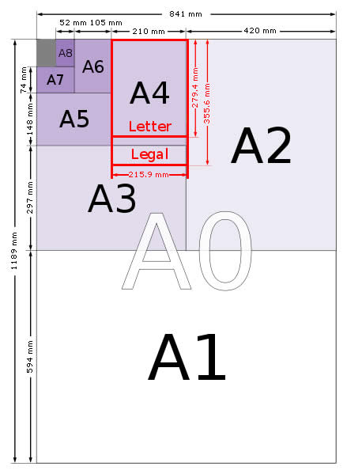

## Table of Paper Sizes From 4A0 to A10

A Series Paper Sizes Chart.

Image courtesy of [Office 365](http://www.office365.co.uk/1/Paper/1).

|  |  |  |
| --- | --- | --- |
| Size | Height x Width (mm) | Height x Width (in) |
| 4A0 | 2378 x 1682 mm | 93.6 x 66.2 in |
| 2A0 | 1682 x 1189 mm | 66.2 x 46.8 in |
| A0 | 1189 x 841 mm | 46.8 x 33.1 in |
| A1 | 841 x 594 mm | 33.1 x 23.4 in |
| A2 | 594 x 420 mm | 23.4 x 16.5 in |
| A3 | 420 x 297 mm | 16.5 x 11.7 in |
| A4 | 297 x 210 mm | 11.7 x 8.3 in |
| A5 | 210 x 148 mm | 8.3 x 5.8 in |
| A6 | 148 x 105 mm | 5.8 x 4.1 in |
| A7 | 105 x 74 mm | 4.1 x. 2.9 in |
| A8 | 74 x 52 mm | 2.9 x 2.0 in |
| A9 | 52 x 37 mm | 2.0 x 1.5 in |
| A10 | 37 x 26 mm | 1.5 x 1.0 in |
