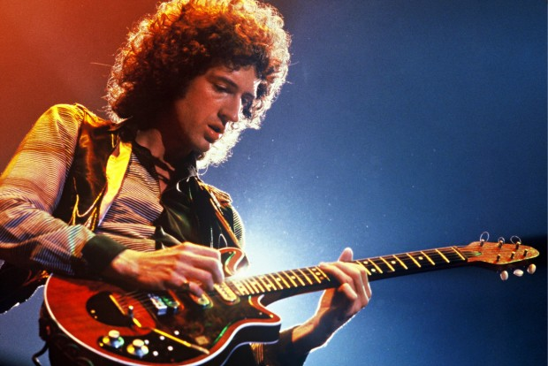

A livre disponibilidade de conhecimento mudou a forma como pensamos em educação. Porém, mesmo com tanta informação disponível e tantos cursos online de qualidade acessíveis a todos, as pessoas ainda têm um tabu ao falar de autodidatismo.

  

Parece que aprender sozinho é coisa de gênio, de nerd, nada que você  e eu, pessoas normais, possamos fazer.

  

Mudamos muita coisa em termos de interação e contato social mas não a maneira como pensamos sobre aprendizado.

  

### Um alerta: não estou defendendo a extinção dos professores

  

Em um texto como este, defendendo o autodidatismo, é importante deixar um aviso para não gerarmos um desvio desnecessário quando seguirmos o papo nos comentários. **Professores e escolas são importantes**.

  

Uma vez que você toma responsabilidade pela sua educação, tenta absorver e abordar o assunto e, ainda assim, sente que uma escola é o meio mais efetivo, vá fundo. Conhecimentos essenciais são melhores acessados quando podemos entrar em contato com grandes professores.

  

É claro que não faltam [formas de nos desescolarizarmos e começarmos a aprender por meios diferentes](http://papodehomem.com.br/desescolarizacao-precisamos-mesmo-das-escolas/).

  

Porém, talvez seja necessário deixar claro um bloqueio, prejudicial em alguns contextos. Por que a maioria das pessoas acha que não conseguem aprender sem professor? Por que não conseguem nem imaginar aprender fora da escola, por exemplo?

  

  
  

Brian May seguiu os dois percursos: autodidata na guitarra e PhD em astrofísica

  

### 1. Poupa bastante esforço em alguns casos

  

Digamos que você trabalhe com contabilidade e queira estudar sobre nanotecnologia. Bem, por mais informações a respeito que você possa encontrar por aí, cursar faculdade em alguma área científica e depois buscar uma pós-graduação no ramo vai ser muito mais prático do que se virar sozinho.

  

Enquanto autodidatismo é ideal para algumas áreas, não é recomendado para outras. **Se seu interesse é em setores regulados por lei, como engenharia, medicina ou advocacia, é melhor você buscar uma educação formal.** Já se seu interesse é em áreas como aprendizado de línguas, programação e marketing, você tem muita chance de se virar por conta própria.

  

### 2. Isenta elas da responsabilidade do aprendizado

  

[É muito mais cômodo ter alguém a quem culpar](http://papodehomem.com.br/os-mecanismos-da-culpa-id-8/). Se você se matricula num curso e vai às aulas, tem que absorver o conteúdo automaticamente, é assim que funciona! Não precisa prestar atenção,nem se esforçar; basta pagar e ir. Se não conseguir as habilidades que procura, [basta reclamar](http://papodehomem.com.br/21-dias-sem-reclamar/) da instituição e ir pagar em outro lugar, onde o ciclo recomeça.

  

Assumir responsabilidade pelas coisas que acontecem na sua vida é assustador. Você deixou de passar naquele concurso público não por causa do cursinho que era ruim, mas porque não se preparou o suficiente. Se você não sabe falar inglês mesmo depois de 5 anos de aula, a responsabilidade não é apenas da escola, mas também sua.

  

### 3. Traz a sensação de que aprendizado está acontecendo

  

Essa aqui é quase uma pegadinha. Você já sabe que não é nem de perto tão esperto quanto imagina; seu cérebro é bastante mal adaptado para sociedade atual: ele evoluiu para operar no mundo pré-civilizado, onde caçávamos e estávamos em constante perigo. Por isso, [há toda uma lista de disfunções da mente](http://pt.wikipedia.org/wiki/Anexo:Lista_de_vieses_cognitivos) que termina, invariavelmente, gerando erros de julgamento.

  

No caso de escolas e professores, ocorre o que é conhecido como [auto-sinalização](http://www.ncbi.nlm.nih.gov/pubmed/20026461): sinalizamos para nós mesmos que estamos aprendendo e, por isso, terminamos por não aprender (já que apenas o sinal é suficiente para satisfazer a parte de nosso cérebro que demanda por resultados). Nós nos agarramos à ideia de que vamos aprender porque estamos tendo aula, muito embora não tenhamos julgado se isso é verdade, simplesmente porque é mais cômodo achar que estamos aprendendo.

  

Isso ocorre em outras áreas da vida, como é o caso da caridade. psicólogos descobriram, através de experimentos, que [uma boa ação torna as pessoas menos propensas a fazer mais gentilezas](http://lesswrong.com/lw/1d9/doing_your_good_deed_for_the_day/). Por que? Porque já sinalizamos para nós mesmos que somos boas pessoas e não precisamos mais nos esforçar para fazer algo bom.

  

O interessante é que isso ocorre até mesmo entre os próprios autodidatas: muita gente prefere estudar assistindo vídeo-aulas, por exemplo, mesmo sem ser o método mais efetivo em si, pelo mesmo motivo explicado acima.

  

  
  

Pablo Picasso frequentou a Academia de Arte em Barcelona mas certamente essa estileira toda ele aprendeu sozinho

  

### 4. Fornece diplomas

  

Ter diplomas pode ser muito útil. Por exemplo, ter um diploma de um curso de especialização em estatística, ou de conclusão de um curso de línguas, pode te trazer vantagem na hora de uma seleção para emprego. Mas, de que adianta se você não sabe o que estudou? O domínio do conteúdo é mais importante que a certificação da proeficiência em si. Imagina precisar daquela estatística no primeiro dia de trabalho e não ter ideia para onde ir?

  

Sem mencionar que o mercado de trabalho está tão concorrido que para vagas que requerem habilidades diferenciadas, envolvendo iniciativa, trabalho criativo, etc, eles estão pulando a parte do “quais diplomas você tem” e indo direto ao “mostre o que você já fez e sabe fazer”.

  

### Quem é responsável por seu aprendizado?

  

O modelo atual de educação se popularizou de verdade com a Revolução Industrial. Toda essa ideia de professor, sala de aula e alunos, no modelo que conhecemos, parece vir dos [primeiros modelos de universidade](http://pt.wikipedia.org/wiki/Universidade_medieval), lá no século XI.

  

Com o advento da Revolução industrial, foi necessário qualificar mão de obra em massa, de modo que [o antigo modelo de ensino](http://www.lni.wa.gov/TradesLicensing/Apprenticeship/About/History/default.asp), envolvendo aluno e mestre, com conhecimento passado de pai para filho, não era mais suficiente. Por institucionalizar o processo, as escolas assumiram a responsabilidade por educar os alunos.

  

Tudo isso fazia sentido numa época quando informação era cara, escassa e mal organizada. Mas e hoje, quando além de ser fácil encontrar, já está boa parte [catalogada e estruturada](http://ocw.mit.edu/index.htm) para ser consumida?

  

### O que podemos aprender sem supervisão?

  

Bem, para responder a essa e outras perguntas [Sugata Mitra](http://en.wikipedia.org/wiki/Sugata_Mitra), agora professor da Universidade de Newcastle, conduziu uma série de experimentos ao redor do mundo. A ideia era bem simples: ele montou um computador em uma caixa fixada a uma parede, de modo que apenas o monitor, o teclado e um touchpad ficasse disponível, com internet e o navegador aberto no buscador. Instalou o equipamento nas ruas de Nova Delhi, próximo a uma favela, em frente ao escritório onde trabalhava.

  

O resultado? Menos de 8 horas depois, encontraram um garoto ensinando a uma criança mais nova como navegar. Ninguém tinha ensinado a eles e nem mesmo falavam inglês.

  

Situações similares ocorreram em outras pequenas vilas. Sempre o mesmo perfil: crianças pobres, que não sabiam falar inglês e sem ajuda de professores, aprenderam a usar o computador e **mais tarde já estavam utilizando vocabulários da língua inglesa entre s**i.

  

*Link Vídeo | “Nós precisamos de um processador mais rápido e um mouse melhor”, disse uma das crianças*

  

Daí você fala: *“ok, mas usar computador é fácil, isso não é ser autodidata”*. Bem, o número de escolas de informática espalhadas pelo país ensinando o básico, exatamente o que as crianças estavam fazendo, discorda de você. Sem mencionar que o experimento foi também realizado em outros moldes: poderiam essas crianças aprenderem biotecnologia sozinhas?

  

Ao que parece, elas conseguem. Sugata visitou uma vila, deixou um computador lá com as crianças e disse: *“tem algumas coisas bem complicadas em inglês no computador, eu não esperaria que vocês entendessem”* e partiu. Dois meses depois, ele volta e as crianças já parecem ser capazes de discutir como problemas na replicação do DNA causam doenças genéticas.

  

[Link Video](http://www.ted.com/talks/sugata_mitra_the_child_driven_education.html)

  

Então, ao que tudo indica, você não precisa necessariamente de professor. Ser autodidata, dentro de certas limitações, parece ser uma condição natural dos seres humanos e não algo restrito a gênios. Crianças pobres, com educação deficitária ao redor do mundo mostraram ser capazes, por que não você, bem alimentado e com boa base escolar?

  

Se você quer uma guia prático de como abordar e aprender qualquer assunto, eu já dei [uma ideia por aqui](http://papodehomem.com.br/se-eu-fosse-aprender-ingles-de-novo-e-assim-que-faria/).

  

Com pouco esforço, você pode encontrar cursos online de qualidade em basicamente qualquer área. Por exemplo:

  

[Veduca](http://www.veduca.com.br/) – disciplinas completas (vídeo-aulas, exercícios, etc) ensinadas em grandes universidades americanas (legendado);

  

[edX](https://www.edx.org/) – Instituição formada por Harvard e MIT, com cursos criados especificamente para serem ensinados online (só em inglês);

  

[Coursera](https://www.coursera.org/) – Centenas de cursos, nos mais variados tópicos, oferecidos por 33 universidades ao redor do mundo;

  

[Udacity](https://www.udacity.com/) - Modelo de curso online voltado para computação, com cursos completos em Introdução à programação (com legenda), Estatística etc.

Aproveitando, deixo algumas leituras para aprofundamento.

  

[Como Conseguir Sucesso Sem Diplomas, por Michael Ellsberg](http://estrategistas.com/sucesso-sem-diplomas-michael-ellsberg/)

  

[The Learning Revolution](http://cmap.upb.edu.co/rid=1GQBQRQMK-1GN76W1-7JB/The-Learning-Revolution.pdf)

  

[International Journal of Self-Directed Learning](http://www.sdlglobal.com/IJSDL/IJSDL8.1.v2.pdf)

  

[History Of Apprenticeship](http://www.lni.wa.gov/TradesLicensing/Apprenticeship/About/History/default.asp)

[anexo ausente]  
  

Artigos Relacionados

  

[Blake Mycoskie | Homens que você deveria conhecer #37](http://rss.feedsportal.com/c/32911/f/530922/s/28a48496/l/0Lpapodehomem0N0Bbr0Cblake0Emycoskie0Ehomens0Eque0Evoce0Edeveria0Econhecer0E370C/story01.htm)

  

[A beleza além do rótulo de vadia](http://rss.feedsportal.com/c/32911/f/530922/s/28a70b55/l/0Lpapodehomem0N0Bbr0Ca0Ebeleza0Ealem0Edo0Erotulo0Ede0Evadia0C/story01.htm)

  

[Atendendo ao chamado da natureza: agora na prática](http://rss.feedsportal.com/c/32911/f/530922/s/28b25e98/l/0Lpapodehomem0N0Bbr0Catendendo0Eao0Echamado0Eda0Enatureza0Eagora0Ena0Epratica0C/story01.htm)

  

[Sawubona: eu vejo você | Pare tudo #1](http://rss.feedsportal.com/c/32911/f/530922/s/28bf6e37/l/0Lpapodehomem0N0Bbr0Ceu0Evejo0Evoce0Epare0Etudo0E10C/story01.htm)

  

[A experiência gonzo como modo de consumismo](http://rss.feedsportal.com/c/32911/f/530922/s/28c49e9a/l/0Lpapodehomem0N0Bbr0Ca0Eexperiencia0Egonzo0Ecomo0Emodo0Ede0Econsumismo0C/story01.htm)

  
  
  
[[anexo ausente]](http://da.feedsportal.com/r/158873406361/u/49/f/530922/c/32911/s/28c78ef0/a2.htm) [anexo ausente]  
  

[[anexo ausente]](http://feeds.feedburner.com/~ff/PapodehomemLifestyleMagazine?a=s2A9Oh9DqtQ:5nuZDQPTDUo:yIl2AUoC8zA)  [[anexo ausente]](http://feeds.feedburner.com/~ff/PapodehomemLifestyleMagazine?a=s2A9Oh9DqtQ:5nuZDQPTDUo:qj6IDK7rITs) [[anexo ausente]](http://feeds.feedburner.com/~ff/PapodehomemLifestyleMagazine?a=s2A9Oh9DqtQ:5nuZDQPTDUo:-BTjWOF_DHI)

  
[anexo ausente]  
  
  
  
from Papo de Homem - Lifestyle Magazine <http://papodehomem.com.br/autodidatismo-nao-e-coisa-de-genio/>
