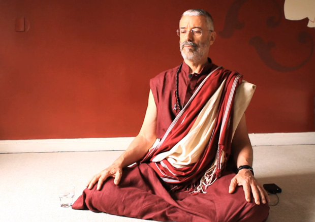
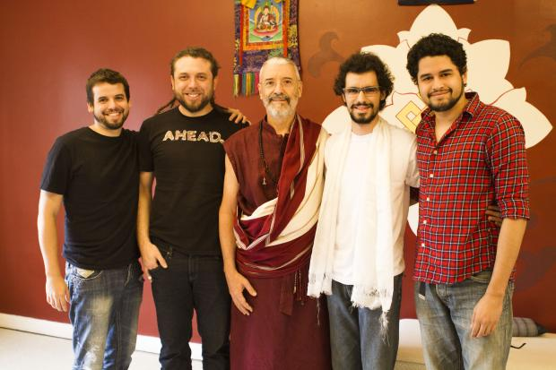
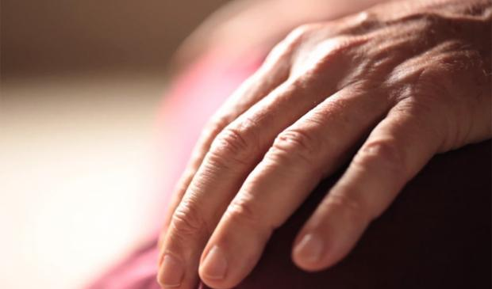

# **P**ara começar a meditar

> “Aprender a meditar é o maior presente que você pode se dar nessa vida**.**”  
> –Sogyal Rinpoche

Recebemos quase diariamente perguntas relacionadas ao treinamento da mente**.** Felicidade acompanhar como cada pessoa, ao seu jeito, percebe que é impossível viver melhor apenas no modo “Deixa a vida me levar”**.** Se queremos menos ansiedade, se queremos relações sem tantos conflitos, precisamos de práticas específicas, assim como fazemos quando queremos emagrecer**.**

Orientar essas pessoas, no entanto, é um desafio**.** Não somos professores de meditação e a maioria dos tutoriais online não é confiável: quem realmente ensina presencialmente (em retiros de ensinamentos aprofundados) não perde tempo gravando mil vídeos para o YouTube**.**

Diante dessa situação, convidamos um dos maiores professores brasileiros para gravar um vídeo com orientações precisas para quem deseja começar a meditar**.** Aqui está:

 *[Vimeo](http://vimeo.com/50875614)  | [YouTube](http://youtu.be/FWWZ52a3grg)  | Áudio em [MP3 para download](http://papodehomem.com.br/downloads/para-comecar-a-meditar-lama-padma-samten.mp3)  (clique com o botão direito e selecione “Salvar link como…”)*

Algumas pessoas talvez considerem o vídeo muito lento e longo… O vídeo está lento ou é você que está acelerado**?** Se você não consegue dedicar 24 minutos sem distrações para aprender a pacificar sua mente, mas consegue dedicar 24 minutos para um seriado de comédia, talvez você não queira realmente pacificar sua mente tanto quanto ser entretido**.**

Assistir ao vídeo já é parte do treino**.** Aliás, **podemos usar esse vídeo de 4’50” até 16’00” como uma meditação guiada**: você dá play, senta e vai ouvindo e testando as instruções para se familiarizar com sua própria mente e energia**.** Foi isso que aconteceu conosco durante a gravação**.**

### Lembretes úteis antes de começar

**1**.**** Meditação é um retorno à condição natural da mente – livre das perturbações que surgem de emoções, pensamentos e bolhas de realidade**.**

**2.** Não é necessário se vincular a uma religião ou qualquer espécie de esoterismo ou misticismo**.** O silêncio de base da mente, nossa condição natural não é religiosa nem mística**.** Ainda assim, é possível trazer a meditação com o contexto da religião, como fizeram muitos grandes mestres**.**

### Para seguir a prática

**1**.**** Comece com sessões curtas, de 5 ou 10 minutos, todo dia**.** A regularidade é mais importante do que a duração.

**2**.**** Não castigue seu corpo. Alongue-se, faça alguma prática de corpo (como ioga) e melhore sua alimentação**.**

**3.** Procure um centro de prática**.** É possível convidar outras pessoas para 30 minutos de estudo (leitura e conversa em cima de algum livro sobre o treinamento da mente) e 30 minutos de silêncio (duas sessões de 15, alongando e trocando de posição no meio, se necessário)**.**

**4**.**** Para aprofundar, participe de retiros de ensinamentos com um professor qualificado, que possa ajudar na remoção de obstáculos e oferecer instruções detalhadas**.**

### Sobre o Lama Padma Samten

Físico, com bacharelado e mestrado pela Universidade Federal do Rio Grande do Sul (UFRGS), Alfredo Aveline foi professor universitário de 1969 a 1994**.** Praticou meditação zen e realizou traduções e estudos sobre o treinamento da mente desde os anos 70**.** Em 1986 fundou o CEBB (Centro de Estudos Budistas Bodisatva)**.** Em 1996 foi ordenado lama (professor) pelo mestre tibetano Chagdud Tulku Rinpoche e desde então tem oferecido palestras e retiros por todo o Brasil e América do Sul, com uma abordagem que não separa a espiritualidade da vida cotidiana**.**

Um pouco mais sobre o Lama Padma Samten:

- Palestrou na [abertura do TEDx Amazônia](http://www.tedxamazonia.com.br/tedtalk/lama-samten) **.**
- É cidadão honorário de Curitiba (PR) e de Viamão (RS), devido a inúmeros trabalhos para o desenvolvimento de comunidades locais**.**
- Foi um dos responsáveis pelas vindas de Sua Santidade o Dalai Lama ao Brasil**.**
- Promove diálogos e oferece visões para advogados, educadores, economistas, investidores, sociólogos, políticos, psicólogos, empresários, médicos, artistas…

### Outras referências

Aos interessados no CEBB e no Lama Padma Samten, reuni em meu site pessoal uma série de [links e orientações](http://www.gustavogitti.com/portfolio/cebb/)  para quem deseja se iniciar na prática do silêncio**.** Nesse [canal no YouTube](http://www.youtube.com/lamapadmasamten)  há inúmeros vídeos de palestras e retiros**.**

Estou usando [essa almofada de meditação](http://loja.papodehomem.com.br/pd-1ef73-almofada-pdh-de-meditacao.html?locale=pt-br)  produzida pelo Fábio Rodrigues nos moldes tradicionais**.** Ela vem com uma URL escondida que leva os atentos para o manual de instrução: [“Como usar sua almofada de meditação”](http://papodehomem.com.br/como-usar-sua-almofada-de-meditacao/) **.**

Há poucos dias encontrei esse outro tutorial excelente, produzido pelos alunos de Sogyal Rinpoche: [“Dare to meditate”](http://whatmeditationreallyis.com/index.php/lang-en/dare-to-meditate.html) **.**

Recomendo também [essa fala de Robert Thurman](http://www.youtube.com/watch?v=E9O1RxXpiH8)  sobre como apenas meditar não adianta nada sem estudo, ação ética, atitude compassiva e desenvolvimento de sabedoria**.**

Para quem já tem professor, lembro desse vídeo que gravamos com Alan Wallace: [“Por que praticar (ou como retribuir a bondade dos professores)”](http://www.youtube.com/watch?v=tQzJE4h3DcQ&feature=relmfu) **.**

Faltou a principal responsável pelo vídeo: Luiza de Castro

### Reza brava

Se eu pudesse fazer uma macumba agora, se eu pudesse juntar as mãos e realmente desejar algo para nós todos, de coração, pra valer, sairia algo assim:

> “Que cada um de nós possa se familiarizar com o funcionamento da própria mente**.**
>
> Que cesse agora todas as correntes de pensamentos obsessivos, compulsivos, autocentrados e delusivos que levam a brigas, suicídios, violências, sofrimentos de todo tipo**.**
>
> Que nenhum inimigo ou culpado possa ser encontrado**.**
>
> Que preguiça, orgulho, ciúme, raiva, medo, inveja, preconceito, carência, ansiedade, desconfiança, depressão, aversão, apego, indiferença e todas as milhares de aflições emocionais e enganos cognitivos possam ser dissolvidos por métodos poderosos**.**
>
> Que cada um de nós embarque menos e menos nas narrativas, jogos e alucinações que fabricamos sem cessar**.**
>
> Que seja cada vez mais possível direcionar o próprio ânimo**.**
>
> Que possamos cultivar e nos relacionar com os outros a partir de bondade amorosa, flexibilidade, relaxamento, destemor, compaixão, equanimidade, ludicidade, alegria, generosidade, moralidade, atenção, estabilidade, curiosidade, energia constante, paz, espacialidade e sabedoria**.**
>
> Que ainda hoje você, eu e todos ao redor possamos enfim repousar**.**”

Boa prática a todos nós**.**

