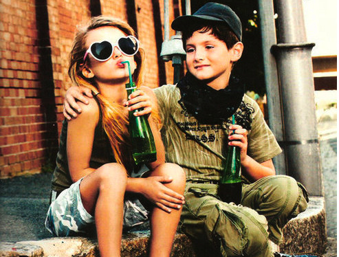
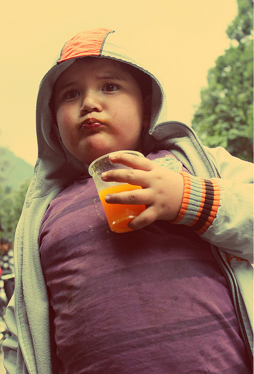
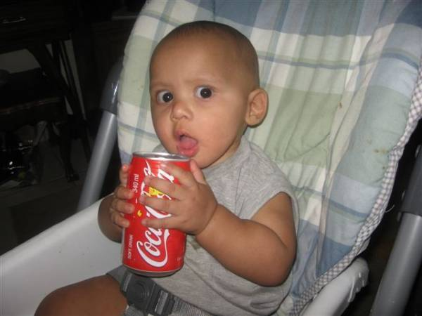
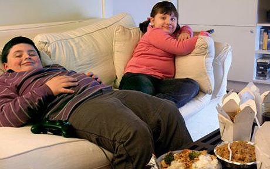
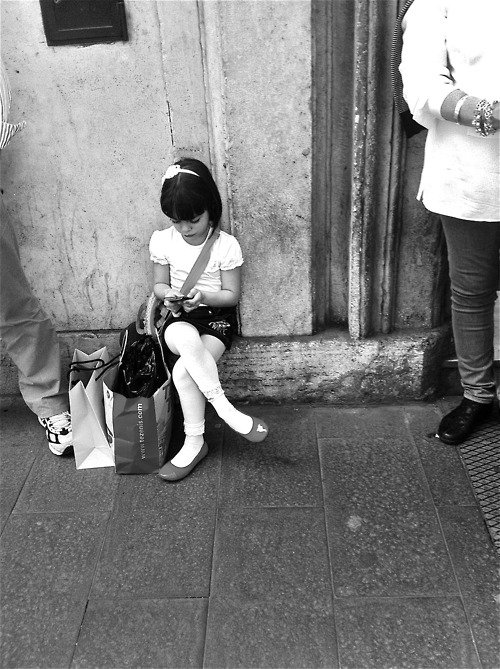

São dois documentários com apenas uma mensagem: a propaganda está enganando seu filho. Este, pequenininho, que não sabe ainda nem para que time torce.

  

*Link Youtube*

  

*Link Youtube*

  

Dois documentários excelentes feitos pela mesma dupla, Estela Renner e Marcos Nisti, esfregam na nossa cara a relação constrangedora que temos com a televisão, com o consumo, com os alimentos.

  

O primeiro, lançado em 2008, *“Criança, a alma do negócio”*, coloca o foco na propaganda infantil para nos mostrar como estamos deixando que publicitários eduquem nossos filhos. O segundo filme, *“Muito além do peso”*, tão brilhante quanto o primeiro, dá continuidade a isso, mostrando como a publicidade é apenas mais um dos fatores que contribuem para os maus hábitos alimentares.

  

Dos pontos que merecem destaque:

  

**1.** A publicidade é válida para o adulto, mas não para a criança, que ainda não tem discernimento. Seduzi-la por estes meios é covardia, é jogar com a imaginação, com a idealização. Adultos conseguem entender as armas da propaganda. Conseguem lidar com as expectativas. Crianças ainda não. “É por isso que não deixamos o traficante chegar perto da escola”, conta um pesquisador no documentário *“Muito além do peso”*.

  

**2.** Somos um povo que há pouco saiu da desnutrição, encontrou um obstáculo no caminho e acabou se tornando obeso. No supermercado, o alimento mais barato é também o de pior qualidade nutritiva. Anote aí: farinha, açúcar e óleo, justamente o que não deveria figurar na nossa alimentação é o que vem na cesta básica todo mês. E é o que está presente em todas as guloseimas ditas infantis.

  

**3.** [Quando vestimos crianças de mini-adultos](http://papodehomem.com.br/e-isso-que-estao-querendo-fazer-as-criancas-vestirem-hoje-em-dia/), estamos indiretamente ensinando nossas crianças que ter é o que eles devem desejar, que a experiência não vale a pena. O status, sim. Estimulamos a pose em detrimento do brincar. Explicamos que consumir é o que eles devem querer. Salto alto, biquínis com enchimento, maquiagem, apetrechos tecnológicos: tudo que não faz sentido no mundo da criança, ganha sentido como um fim – logo, educamos para o consumo. Algumas das imagens a seguir são horríveis – erotizam os pequenos e, para mim, estão a poucos passos da pedofilia. Todas estas imagens certamente seriam consideradas abuso infantil num mundo mais justo.

  

  

  

  

  

  

  

  

  

  

Longe das atuais tendências de culpar os pais, os documentários se colocam lado a lado com eles: estes pais também são vítimas da falta de informação. Em todas as classes sociais, a propaganda chega até a criança travestida de personagem infantil pela televisão, pelos amigos ou até mesmo – vejam só – auxiliada pela escola. Nossas crianças estão sendo educadas por adultos que não são culpados porque também são vítimas deste sistema.

  

Dois documentários que mostram que precisamos nos informar e nos empoderar na hora de educar as crianças que nos rodeiam. Que sirva de lição para a gente.

  
[anexo ausente]  
  

Artigos Relacionados

  

[Amor em escalas](http://rss.feedsportal.com/c/32911/f/530922/s/286b7ca4/l/0Lpapodehomem0N0Bbr0Camor0Eem0Eescalas0E20C/story01.htm)

  

[As prostitutas e o direito de existir](http://rss.feedsportal.com/c/32911/f/530922/s/286e9a78/l/0Lpapodehomem0N0Bbr0Cas0Eprostitutas0Etambem0Etem0Eo0Edireito0Ede0Eexistir0C/story01.htm)

  

[Bom dia, Анастасия](http://rss.feedsportal.com/c/32911/f/530922/s/28720ebc/l/0Lpapodehomem0N0Bbr0Cbom0Edia0E0Jd0A0Jb0A0Jd0A0Jbd0Jd0A0Jb0A0Jd10J810Jd10J820Jd0A0Jb0A0Jd10J810Jd0A0Jb80Jd10J8f0C/story01.htm)

  

[[18+] A introspecção em meio à festa](http://rss.feedsportal.com/c/32911/f/530922/s/287b7e4d/l/0Lpapodehomem0N0Bbr0C180Ea0Eintrospeccao0Eem0Emeio0Ea0Efesta0C/story01.htm)

  

[Nova etiqueta para a comunicação no século XXI](http://rss.feedsportal.com/c/32911/f/530922/s/287d9ea3/l/0Lpapodehomem0N0Bbr0Cnova0Eetiqueta0Epara0Ea0Ecomunicacao0Eno0Eseculo0Exxi0C/story01.htm)

  
  
  
[[anexo ausente]](http://da.feedsportal.com/r/151885510990/u/49/f/530922/c/32911/s/287552f7/a2.htm) [anexo ausente]  
  

[[anexo ausente]](http://feeds.feedburner.com/~ff/PapodehomemLifestyleMagazine?a=lQNSGODnA-o:UyfmMGao-3w:yIl2AUoC8zA)  [[anexo ausente]](http://feeds.feedburner.com/~ff/PapodehomemLifestyleMagazine?a=lQNSGODnA-o:UyfmMGao-3w:qj6IDK7rITs) [[anexo ausente]](http://feeds.feedburner.com/~ff/PapodehomemLifestyleMagazine?a=lQNSGODnA-o:UyfmMGao-3w:-BTjWOF_DHI)

  
[anexo ausente]  
  
  
  
from Papo de Homem - Lifestyle Magazine <http://papodehomem.com.br/para-os-pais-seu-filho-esta-sendo-enganado/>
