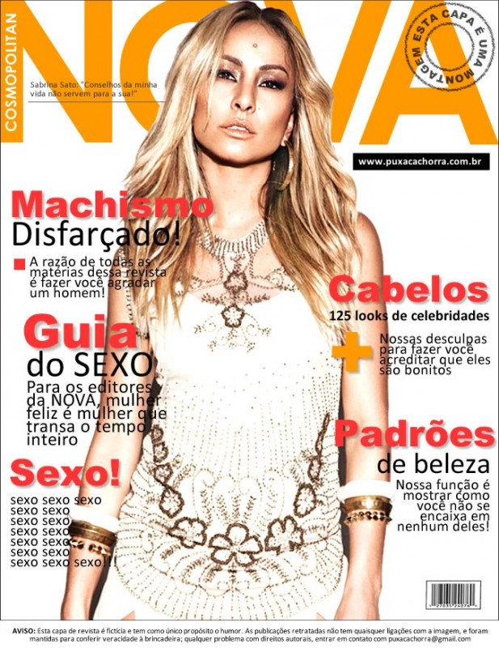
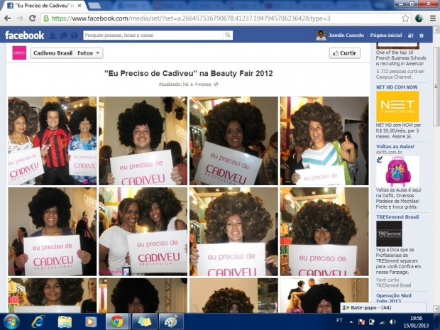

A sociedade não quer que você goste de si mesmo. A sociedade não quer que você confie em si mesmo. Quanto mais você gostar de si mesmo e confiar em si mesmo, mais perigoso você é para a sociedade na forma em que ela está organizada hoje. Porque você vai ser mais livre, mais independente, e você só vai fazer qualquer coisa se houver uma ressonância com o seu coração, com aquilo em que você acredita, com você mesmo.

  

  
  

“Confia em mim: você é feia, gorda e encalhada.”

  
  

Observe uma criança. Ela curte e muito ser ela mesma. Meu filho, quando se olha no espelho, vê um leão, um astronauta, um tubarão, o Homem-Aranha e todas as outras coisas que ele gosta de imaginar que é. Ele não fica analisando se está muito magro ou muito gordo, não fica pensando que seu cabelo black power poderia/deveria ser mais liso. A auto-estima das crianças ainda está – relativamente, dependendo da idade – intacta. Por isso mesmo, as crianças são meio imprevisíveis. E a sociedade não quer indivíduos imprevisíveis.

  

E, assim, uma meia-dúzia no poder usa de todas as artimanhas possíveis e imagináveis para convencer toda a humanidade de que todo mundo é errado, inadequado, defeituoso, problemático.

  

[Em um texto](http://interney.net/blogs/lll/2011/05/04/mito_mulheres_precisam_depilar_para_ser_desejadas_depilacao_3_de_3/) sobre suas amigas gordinhas e seus amigos homens que gostam de gordinhas, e por que esses dois grupos não se encontram, o escritor Alex Castro explica:

  
> “Minhas amigas gordinhas não querem ser amadas por homens que amam gordinhas: elas querem ser MAGRAS. Ponto. Sofreram uma lavagem cerebral tão intensa e tão perversa que não conseguem nem mesmo lidar com esse tipo de homem. (…) um louco tarado (…) que as ame logo por seu defeito”

  

Nos comentários, vários leitores complementam que as gordinhas sofrem preconceito não só por parte dos homens, mas da sociedade como um todo (e não só as gordinhas, mas os gordinhos também). Outro leitor levanta que não só a gordura, mas qualquer “diferença” costuma ser tratada com preconceito.

  

É verdade.

  

Um dos grandes instrumentos geradores de preconceito são as [revistas femininas](http://papodehomem.com.br/qual-a-funcao-revistas-femininas/), que impõem um padrão de magreza e gostosura praticamente inatingível para as reles mortais. Eu vou mais longe e digo que as revistas masculinas não fazem diferente, afinal o que se vê nelas são exatamente as mulheres “magras e gostosas” que as revistas femininas ensinam que as mulheres precisam ser.

  

Ou seja, de um lado, as mulheres são ensinadas que são feias/inadequadas porque são muito gordas, ou muito magras, ou muito baixas, ou muito altas, ou têm lábios muito finos, ou não têm cílios longos o bastante, ou, ou, ou. De outro, os homens são treinados a achar bonito um tipo bastante específico – e diga-se de passagem raro, na vida real – de mulher.

  

A meu ver, gera infelicidade para todos. A auto-estima da mulher cai porque ela não é quem ela “deveria” ser, e a do homem – que nunca ou quase nunca pegará a mulher que “deveria” estar pegando – também não deve ficar das melhores.

  
  

  
  

Mulher… você não precisa disso!

  
  

Mas a base de toda a propaganda – e do consumo em si – é justamente que você é ou está inadequado porque não tem ou usa determinado produto ou serviço. É assim que surge a necessidade por novas coisas.

  

Para usar um exemplo recente, há alguns anos toda a mulher fazia sua higiene íntima no banho com água e sabão. Assim vinha sendo por dezenas e dezenas de anos, e estava todo mundo satisfeito. Até que um belo dia surgiu o sabonete íntimo. E, de repente, aquela mulher que sempre se sentiu limpa começou receber a mensagem – publicitária, nas entrelinhas, nas revistas, nas propagandas – de que estava fazendo uma higiene inadequada. De repente, talvez-quem-sabe, ela não estivesse assim tão limpa quanto sempre havia se sentido.

  

(E, depois do sabonete íntimo, já surgiu o desodorante íntimo feminino também. E a mulher que adotou o sabonete íntimo e estava achando que estava limpa, agora está de novo ouvindo que está inadequada porque, ao longo do dia, aquela limpeza toda “vence” e, portanto, ela precisa também usar o desodorante.)

  

(Aguardo agora com uma certa ansiedade a criação do *penisil* e desodorante peniano. Não duvido mais de nada.)

  
  

  
  

O quê? Você não lava suas bolas com um produto próprio e cientificamente testado?!

  
  

Ou seja, não é novidade que encontraremos nas revistas e meios de comunicação a mensagem de que somos de alguma forma inadequados. Então, se sabemos onde está pelo menos uma das fontes do problema, por quê não fazemos nada?

  

Vou pegar emprestado de mim mesma um trecho que escrevi em [um texto sobre estupro](http://papodehomem.com.br/fui-estuprada/) para o Papo de Homem.

  
> “A propósito do 11 de setembro, lembro que na época do atentado uma das coisas que mais se falava era que eram tantos passageiros contra apenas uns poucos terroristas que, se tivessem se unido, o desfecho poderia ter sido tão diferente. Uma tragédia poderia ter sido evitada.”

  

Afinal, quem está em maior número? Quem impõe os padrões inatingíveis de beleza ou nós, os inadequados, os gordinhos, os de cabelos cacheados, os baixinhos, os diferentes? Aliás, quem são os diferentes, pensando bem?

  

O que aconteceria se os “inadequados” resolvessem reagir, em vez de ficar sentados quietinhos nos seus assentos assistindo a tragédia ser orquestrada por uma meia-dúzia?

  
  

  
  

Campanha no Facebook: “Eu preciso de… [marca de alisante]“

  
   

Recentemente, uma marca de alisantes de cabelo publicou no Facebook fotos de uma feira de beleza em que visitantes posavam com perucas black power e seguravam placas dizendo que precisavam do produto alisante de cabelo. A mensagem implícita era que os cabelos afro eram…inadequados, claro.

  

A reação do público foi negativa: os consumidores (negros ou não) se incomodaram com o preconceito e falta de respeito e [botaram a boca no mundo](http://www.facebook.com/NaoPrecisoDeCadiveu). A fundadora da empresa, que inicialmente declarou que tudo se tratava de uma “brincadeira”, acabou cedendo à pressão dos consumidores e publicou na página da empresa um pedido de desculpas e retratação.

  

(E desconfio que ela vai pensar um tantinho melhor da próxima vez em que for lançar uma ação social ou peça publicitária…)

  
  

  
  

Mas parece que nem todo mundo acha que precisa alisar o cabelo!

  
  

Eu acredito que a reação se dá em duas camadas. Na primeira, começamos a nos aceitar como somos e aceitar o outro como ele é, e suspendemos todo julgamento injusto tanto de nós mesmos quanto do outro. Passamos a nos curtir e confiar em nós mesmos. E curtir nos outros e confiar neles.

  

Não é fácil não. É extremamente difícil. É um trabalho diário, é nos olharmos no espelho a cada manhã e aceitarmos humildemente que somos o que somos, qualidades e “defeitos”. É entender que somos únicos, e essa sim é a nossa maior beleza. É voltarmos a nos ver com nossos olhos de criança, nos olharmos no espelho e vermos a bailarina, o bombeiro, a princesa, o super-herói.

  

(E, ao entendermos isso, entendemos por tabela também qual é a beleza do próximo, porque ele também é único. E aprendemos a respeitá-lo como gostamos de ser respeitados.)

  

Depois, levantamos dos nossos assentos, pegamos a faca das mãos dessa meia-dúzia de agressores e tomamos conta desse avião desgovernado.

  

*Leia também: Qual é a função das revistas femininas, por Alex Castro.*

  
[anexo ausente]  
  

Artigos Relacionados

  

[A beleza além do rótulo de vadia](http://rss.feedsportal.com/c/32911/f/530922/s/28a70b55/l/0Lpapodehomem0N0Bbr0Ca0Ebeleza0Ealem0Edo0Erotulo0Ede0Evadia0C/story01.htm)

  

[Atendendo ao chamado da natureza: agora na prática](http://rss.feedsportal.com/c/32911/f/530922/s/28b25e98/l/0Lpapodehomem0N0Bbr0Catendendo0Eao0Echamado0Eda0Enatureza0Eagora0Ena0Epratica0C/story01.htm)

  

[“Me escutem”](http://rss.feedsportal.com/c/32911/f/530922/s/28b9067e/l/0Lpapodehomem0N0Bbr0Cpor0Efavor0Eem0Etroca0Eda0Eminha0Epequena0Evida0Ecancele0Ea0Eintegracao0Eda0Eescola0C/story01.htm)

  

[A experiência gonzo como modo de consumismo](http://rss.feedsportal.com/c/32911/f/530922/s/28c49e9a/l/0Lpapodehomem0N0Bbr0Ca0Eexperiencia0Egonzo0Ecomo0Emodo0Ede0Econsumismo0C/story01.htm)

  

[Autodidatismo não é coisa de gênio](http://rss.feedsportal.com/c/32911/f/530922/s/28c78ef0/l/0Lpapodehomem0N0Bbr0Cautodidatismo0Enao0Ee0Ecoisa0Ede0Egenio0C/story01.htm)

  
  
  
[[anexo ausente]](http://da.feedsportal.com/r/158873215650/u/49/f/530922/c/32911/s/28c9aa8d/a2.htm) [anexo ausente]  
  

[[anexo ausente]](http://feeds.feedburner.com/~ff/PapodehomemLifestyleMagazine?a=A-vKaWXSW00:fq85gt8vszU:yIl2AUoC8zA)  [[anexo ausente]](http://feeds.feedburner.com/~ff/PapodehomemLifestyleMagazine?a=A-vKaWXSW00:fq85gt8vszU:qj6IDK7rITs) [[anexo ausente]](http://feeds.feedburner.com/~ff/PapodehomemLifestyleMagazine?a=A-vKaWXSW00:fq85gt8vszU:-BTjWOF_DHI)

  
[anexo ausente]  
  
  
  
from Papo de Homem - Lifestyle Magazine <http://papodehomem.com.br/quem-sao-os-diferentes/>
