*“Success is the product of the severest kind of mental and physical application.”*

  

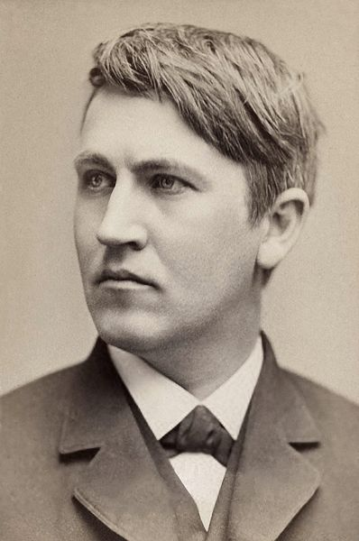  
  
It took **Thomas Edison**, born on this day in 1847, superhuman feats of biology to fuel his [astoundingly ambitious to-do list](http://www.brainpickings.org/index.php/2012/06/01/thomas-edison-to-do-list-1888/). He reportedly slept a mere three to four hours at night, “regarding sleep as a waste of time, ‘a heritage from our cave days,’” as James Maas tells us in his 1997 productivity bestseller [*Power Sleep*](http://www.amazon.com/Power-Sleep-Revolutionary-Prepares-Performance/dp/0060977604/?tag=braipick-20) ([*public library*](http://www.worldcat.org/title/power-sleep-the-revolutionary-program-that-prepares-your-mind-for-peak-performance/oclc/37345750%26amp;referer=brief_results)). In fact, Edison is often accused of having [forever disrupted our internal clocks](http://www.brainpickings.org/index.php/2012/05/11/internal-time-till-roenneber/) with his invention of the lightbulb — some researchers go as far as estimating that artificial light has stripped modern life of 1-2 hours of sleep per night. David K. Randall writes in [*Dreamland: Adventures in the Strange Science of Sleep*](http://www.brainpickings.org/index.php/2012/08/21/dreamland-science-of-sleep-david-randall/), one of the [best science books of 2012](http://www.brainpickings.org/index.php/2012/11/19/best-science-books-2012/):

  
> Thanks to Edison, sunset no longer meant the end of your social life; instead, it marked the beginning of it.
>
>   
>
> […]
>
>   
>
> Yet all of the artificial light in use around the world before Edison developed his lightbulb amounted to the brightness of a match compared to the lights of Times Square.

  

[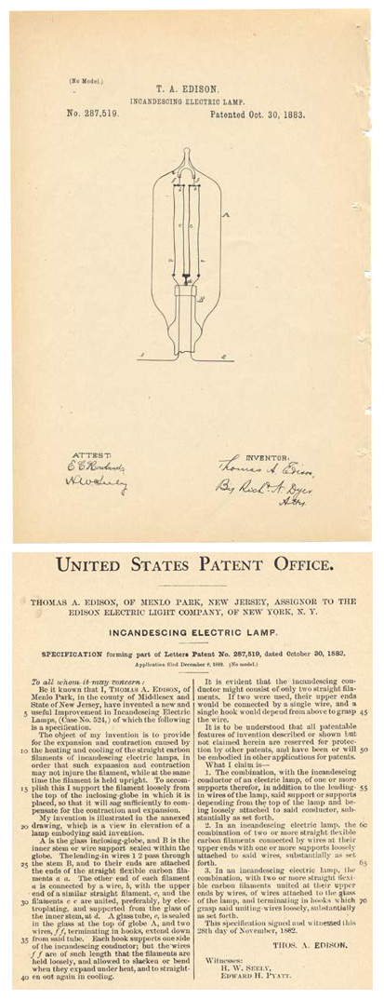](http://www.hfmgv.org/exhibits/collections/collections/library/manuscripts/edison/patent.html)  

*The Incandescing Electric Lamp, one of Edison's 1,093 inventions, was patented on October 30, 1883. His first functional incandescent electric lamp was successfully tested at his Menlo Park Lab on October 21, 1879, which marked the beginning of the electrical age.*

  

*Image: Henry Ford Foundation*

  

Indeed, Edison had so much faith in the power of his invention to liberate people from the burden of sleep that he made some boldly outlandish causal inferences. In [*Sleep Thieves*](http://www.amazon.com/Sleep-Thieves-Stanley-Coren/dp/0684831848/tag=braipick-20) ([*public library*](http://www.worldcat.org/title/sleep-thieves-an-eye-opening-exploration-into-the-science-and-mysteries-of-sleep/oclc/33983619%26amp;referer=brief_results)), Stanley Coren quotes the inventor:

  
> When I went through Switzerland in a motor-car, so that I could visit little towns and villages, I noted the effect of artificial light on the inhabitants. Where water power and electric light had been developed, everyone seemed normally intelligent. Where these appliances did not exist, and the natives went to bed with the chickens, staying there until daylight, they were far less intelligent.

  

So contemptuous was Edison’s attitude towards sleep that he [wrote](http://www.amazon.com/Diary-Sundry-Observations-Thomas-Edison/dp/0806529172/?tag=braipick-20) in 1921:

  

> > > > People will not only do what they like to do — they overdo it 100 per cent. Most people overeat 100 per cent, and oversleep 100 per cent, because they like it. That extra 100 per cent makes them unhealthy and inefficient. **The person who sleeps eight or ten hours a night is never fully asleep and never fully awake** — they have only different degrees of doze through the twenty-four hours. … **For myself I never found need of more than four or five hours’ sleep in the twenty-four**. I never dream. It’s real sleep. When by chance I have taken more I wake dull and indolent. We are always hearing people talk about ‘loss of sleep’ as a calamity. They better call it loss of time, vitality and opportunities. Just to satisfy my curiosity I have gone through files of the British Medical Journal and could not find a single case reported of anybody being hurt by loss of sleep. Insomnia is different entirely — but some people think they have insomnia if they can sleep only ten hours every night.

  

In hindsight, of course, his assertions were not only [scientifically misguided](http://www.brainpickings.org/index.php/2012/08/13/the-twenty-four-hour-mind-rosalind-cartwright/) but also rather hypocritical. We now know that [sleep is essential to overcoming creative blocks](http://www.brainpickings.org/index.php/2012/10/01/breakthrough-alex-cornell/#dm), and it turns out, so did Edison. While he carried his lack of sleep as a kind of badge of honor, he had a duplicitous little secret: Power-napping. Not only were napping cots scattered throughout his property, from labs to libraries, but he was also frequently photographed sneaking his stealthy shut-eye in unusual locations.

  

[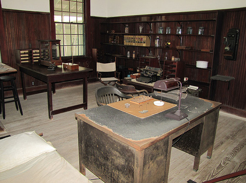](http://www.flickr.com/photos/mikeroush/5509131690/in/photostream/)  

*Edison's office, with napping cot*

  

*Image: Mike Roush*

  

[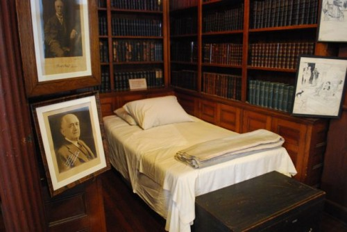](http://kids.baristanet.com/2012/12/day-trip-thomas-edison-historical-national-park/)  

*The cot in Edison’s library*

  

*Image: Holly Korus*

  

[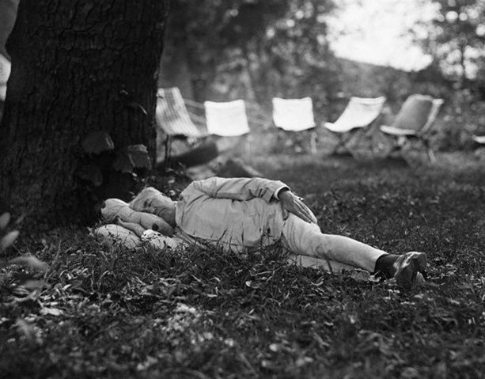](http://healthland.time.com/2012/04/16/the-artistry-of-sleep-photos-of-icons-getting-some-shut-eye/)  

*Thomas Edison taking a midday nap under a tree in the Blue Ridge Mountains (1921)*

  

*Image: Bettman/Corbis via TIME*

  

[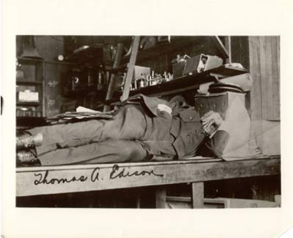](http://www.hfmgv.org/exhibits/collections/collections/library/manuscripts/edison/sleeping.html)  

*Thomas Edison sleeping at his West Orange, New Jersey laboratory (1924)*

  

*Image: Henry Ford Foundation*

  

[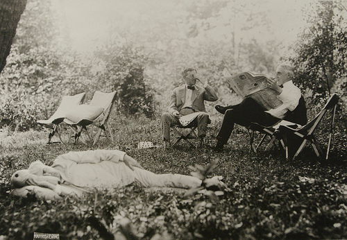](http://www.flickr.com/photos/bk1bennett/3420486153/)  

*Thomas Edison napping at the Ford Edison Camp in Hagerstown, Maryland, with President Warren Harding (right) and automobile tire magnate Harvey Firestone reading the newspapers in the background (1921)*

  

*Image: Edison-Ford Winter Estates Museum / Brian Bennett*

  

[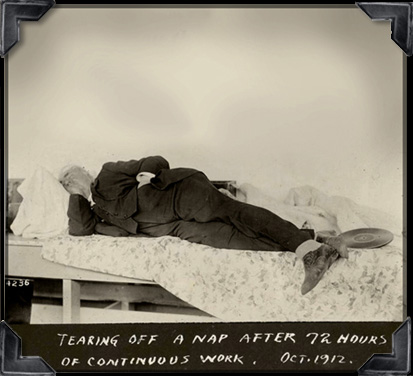](http://www.nmoe.org/edison/index.htm)  

*'Tearing off a nap after 72 hours of continuous work' (1912)*

  

*Image: National Museum of Education*

  

Edison used napping to counterbalance the intensity of his work. Most days, he took one or two brief naps — on his famous cots, outdoors in the grass, and even on a chair or stool if no better option was available. Per multiple first-hand accounts, he always awoke from his naps reinvigorated rather than groggy, ready to devour the rest of the day with full alertness and zest. Frank Lewis Dyer and Thomas Martin write of the West Orange laboratory in [*Edison: His Life And Inventions*](http://www.amazon.com/Edison-Inventions-Complete-Including-Fully-formatted/dp/1453750584/?tag=braipick-20) ([*public library*](http://www.worldcat.org/title/edison-his-life-and-inventions-1/oclc/634761529%26amp;referer=brief_results)):

  
> **As one is about to pass out of the library attention is arrested by an incongruity in the form of a cot, which stands in an alcove near the door. Here Edison, throwing himself down, sometimes seeks a short rest during specially long working hours. Sleep is practically instantaneous and profound, and he awakes in immediate and full possession of his faculties, arising from the cot and going directly “back to the job” without a moment’s hesitation**…

  

[Edison’s diary](http://www.amazon.com/The-diary-Thomas-A-Edison/dp/0856990175/?tag=braipick-20), which he kept only briefly while on vacation in the summer of 1885 and which was eventually published in 1971, reveals an even more conflicted and ambivalent relationship with sleep. On Sunday, July 12, he writes playfully, but in evident circadian distress:

  

[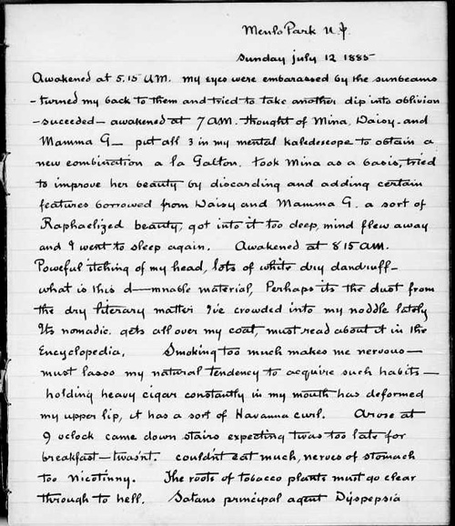](http://edison.rutgers.edu/NamesSearch/SingleDoc.php3?DocId=MA001)  

*Image: The Thomas Edison Papers at Rutgers*

  
> Awakened at 5:15 a.m. My eyes were embarrassed by the sunbeams. Turned my back to them and tried to take another dip into oblivion. Succeeded. Awakened at 7 a.m. Thought of Mina, Daisy, and Mamma G. Put all 3 in my mental kaleidoscope to obtain a new combination a la Galton. Took Mina as a basis, tried to improve her beauty by discarding and adding certain features borrowed from Daisy and Mamma G. A sort of Raphaelized beauty, got into it too deep, mind flew away and I went to sleep again.
>
>   
>
> Awakened at 8:15 a.m. … Arose at 9 o’clock, came down stairs expecting twas too late for breakfast. Twasn’t.
>
>   
>
> […]
>
>   
>
> Had dinner at 3 p.m. Ruins of a chicken, rice pudding.
>
>   
>
> […]
>
>   
>
> The sun has left us on time, am going to read from the Encyclopedia Britannica to steady my nerves and go to bed early. I will shut my eyes and imagine a terraced abyss, each terrace occupied by a beautiful maiden. To the first I will deliver my mind and they will pass it down down to the uttermost depths of silence and oblivion. Went to bed worked my imagination for a supply of maidens, only saw Mina, Daisy and Mamma [G]. Scheme busted. Sleep.

  

[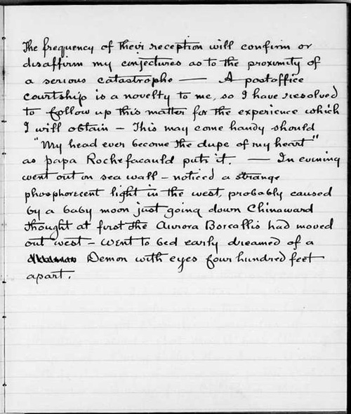](http://edison.rutgers.edu/NamesSearch/SingleDoc.php3?DocId=MA001)  

*Image: The Thomas Edison Papers at Rutgers*

  

On July 14, contradicting his contention that he never dreams, Edison notes:

  
> In evening went out on sea wall. Noticed a strange phosphorescent light in the west, probably caused by a baby moon just going down Chinaward, thought at first the Aurora Borealis had moved out west. Went to bed early dreamed of a demon with eyes four hundred feet apart.

  

Then, on July 19:

  
> Slept as sound as a bug in a barrel of morphine.

  

[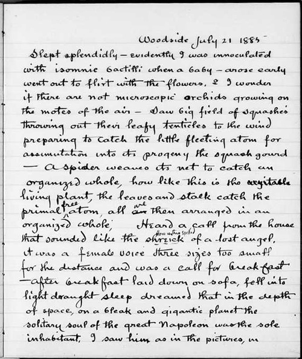](http://edison.rutgers.edu/NamesSearch/SingleDoc.php3?DocId=MA001)  

*Image: The Thomas Edison Papers at Rutgers*

  

Only July 21, another poetic vignette:

  
> Slept splendidly — evidently I was inoculated with insomnic bactilli when a baby. Arose early, went out to flirt with the flowers.

  

One thing that becomes apparent from Edison’s habits and cognitive dissonance about sleep is his extreme compulsion for productivity. In fact, Dyer and Martin cite an anecdote in which Edison tells his friend Milton Adams:

  
> I have got so much to do and life is so short, I am going to hustle.

  

And hustle he did. Writing in 1885, **Sarah Knowles Bolton** marvels at Edison’s remarkable work ethic:

  
> Five feet ten inches high, with boyish but earnest face, light gray eyes, his dark hair slightly gray falling over his forehead, his hat tipped to the back of his head, as he goes ardently to his work, which has averaged eighteen hours a day for ten years, he is indeed a pleasant man to see.
>
>   
>
> You perceive he is not the man to be daunted by obstacles. When one of his inventions failed — a printing machine — he took five men into the loft of his factory, declaring he would never come down till it worked satisfactorily. For two days, and nights and twelve hours — sixty hours in all — he worked continuously without sleep, until he had conquered the difficulty; and then he slept for thirty hours.
>
>   
>
> He often works all night, thinking best, he says, when the rest of the world sleeps.

  

In the same fantastic 1901 tome that gave us [Amelia E. Barr’s 9 rules for success](http://www.brainpickings.org/index.php/2013/02/05/9-rules-for-success-by-amelia-barr/), **Orison Swett Marden** sets out to discover the secret to Edison’s success, camping out in the vicinity of the inventor’s New Jersey laboratory for three weeks awaiting a chance to interview him. When he finally does, he is particularly interested in the inventor’s “untiring energy and phenomenal endurance” and asks 53-year-old Edison a number of questions about his [daily routine](http://www.brainpickings.org/index.php/2012/11/20/daily-routines-writers/), including his relationship with sleep:

  
> ‘Do you have regular hours, Mr. Edison?’ I asked.
>
>   
>
> ‘Oh,’ he said, ‘I do not work hard now. I come to the laboratory about eight o’clock every day and go home to tea at six, and then I study or work on some problem until eleven, which is my hour for bed.’
>
>   
>
> ‘Fourteen or fifteen hours a day can scarcely be called loafing,’ I suggested.
>
>   
>
> ‘Well,’ he replied, ‘for fifteen years I have worked on an average of twenty hours a day.’
>
>   
>
> When he was forty-seven years old, he estimated his true age at eighty-two, since working only eight hours a day would have taken till that time.
>
>   
>
> Mr. Edison has sometimes worked sixty consecutive hours upon one problem. Then after a long sleep, he was perfectly refreshed and ready for another.

  

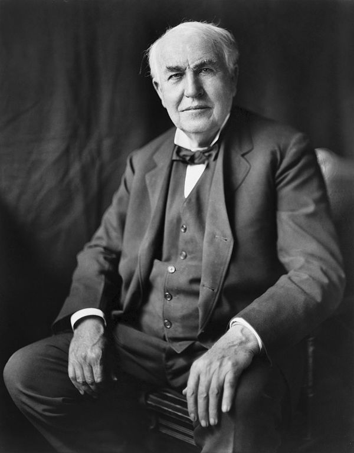

  

Still, Edison used much of the time others invested in sleep not merely for mindless sleeplessness but for building his [networked knowledge and combinatorial creativity](http://www.brainpickings.org/index.php/2011/08/01/networked-knowledge-combinatorial-creativity/):

  
> ‘I’ve known Edison since he was a boy of fourteen,’ said another friend; ‘and of my own knowledge I can say he never spent an idle day in his life. Often, when he should have been asleep, I have known him to sit up half the night reading. He did not take to novels or wild Western adventures, but read works on mechanics, chemistry, and electricity; and he mastered them too. But in addition to his reading, which he could only indulge in at odd hours, he carefully cultivated his wonderful powers of observation, till at length, when he was not actually asleep, it may be said he was learning all the time.’

  

Marden proceeds to inquire about Edison’s legendary work ethic, producing an anecdote you might recall from the timelessly fantastic [*How To Avoid Work*](http://www.brainpickings.org/index.php/2012/12/14/how-to-avoid-work/) and affirming the recurring theme of [focused persistence as the key to success](http://www.brainpickings.org/index.php/2013/02/05/9-rules-for-success-by-amelia-barr/):

  
> ‘You lay down rather severe rules for one who wishes to succeed in life,’ I ventured, ‘working eighteen hours a day.’
>
>   
>
> ‘Not at all,’ he said. ‘You do *something* all day long, don’t you? Every one does. If you get up at seven o’clock and go to bed at eleven, you have put in sixteen good hours, and it is certain with most men, that they have been doing something all the time. They have been either walking, or reading, or writing, or thinking. The only trouble is that they do it about a great many things and I do it about one. If they took the time in question and applied it in one direction, to one object, they would succeed. Success is sure to follow such application. The trouble lies in the fact that people do not have an object, one thing, to which they stick, letting all else go. Success is the product of the severest kind of mental and physical application.’

  

Complement with [the science of internal time](http://www.brainpickings.org/index.php/2012/05/11/internal-time-till-roenneber/) and [how dreaming regulates depression](http://www.brainpickings.org/index.php/2012/08/13/the-twenty-four-hour-mind-rosalind-cartwright/).

  

**Donating = Loving**

  

Bringing you (ad-free) Brain Pickings takes hundreds of hours each month. If you find any joy and stimulation here, please consider becoming a Supporting Member with a recurring monthly [donation](http://www.brainpickings.org/index.php/donate/) of your choosing, between a cup of tea and a good dinner:

  
  
♥ $7 / month♥ $3 / month♥ $10 / month♥ $25 / month  
  

[anexo ausente]

  

You can also become a one-time patron with a single donation in any amount:

  
  
  
  
[anexo ausente]

  

[[anexo ausente]](http://www.brainpickings.org/index.php/newsletter/) Brain Pickings has a free weekly newsletter and people [say it’s cool](http://www.brainpickings.org/index.php/newsletter/). It comes out on Sundays and offers the week’s best articles. Here’s [what to expect](http://us2.campaign-archive2.com/?u=13eb080d8a315477042e0d5b1&amp;id=0f830693e1). Like? [Sign up.](http://www.brainpickings.org/index.php/newsletter/)

  

*Brain Pickings takes 450+ hours a month to curate and edit across the different platforms, and remains banner-free. If it brings you any joy and inspiration, please consider a modest donation – it lets me know I'm doing something right.*  

  
[anexo ausente]  
  
  
  
from Brain Pickings [http://www.brainpickings.org/index.php/2013/02/11/thomas-edison-on-sleep-and-success/?utm\_source=feedburner&utm\_medium=feed&utm\_campaign=Feed%3A+brainpickings%2Frss+%28Brain+Pickings%29](http://www.brainpickings.org/index.php/2013/02/11/thomas-edison-on-sleep-and-success/?utm_source=feedburner&amp;utm_medium=feed&amp;utm_campaign=Feed%3A+brainpickings%2Frss+%28Brain+Pickings%29)
