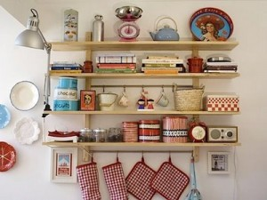
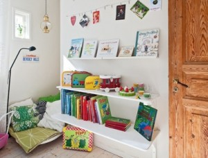
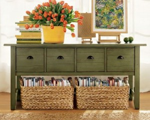

### Sent to you by Thiago Silva via Google Reader:

## 

[Como organizar seus livros](http://vidaorganizada.com/casa/comodos/escritorio/como-organizar-seus-livros/)

via [Vida Organizada](http://vidaorganizada.com) by Luciana Vaz Cameira on 2/20/13

  

Olá! Meu nome é Luciana Vaz e trabalho na área editorial há alguns anos, o que significa que vivo cercada de textos por todos os lados. Sou uma pessoa que trabalha no que realmente gosta, escrevo por profissão e por amor. Mantenho também o blog [Carmim & Café](http://carmimecafe.wordpress.com/) aonde escrevo, entre outras coisas, sobre cultura e literatura. Escrever para o **Vida Organizada** é um novo e delicioso desafio que compartilho com vocês. Espero que seja tão bacana e divertido para vocês ler esse texto, quanto foi para mim escrevê-lo.

Vamos lá?

Os apaixonados por livros sabem bem que manter seu acervo organizado de forma eficiente não é tarefa das mais simples. Conheça algumas dicas para manter esse tesouro a salvo da bagunça do dia-a-dia.

O primeiro passo é **separá-los de acordo com a frequência de leitura**. Este é um bom momento para separar aqueles que já não são lidos há muito tempo, não apresentam mais interesse ou estão desatualizados.

Dependendo de qual situação se encaixam, podem ser vendidos para sebos, doados ou até mesmo reciclados.

Feito isso, a sugestão é que os livros sejam **agrupados pelo gênero** (romance, drama, biografia, etc.) e posteriormente por ordem alfabética (primeiramente por título e posteriormente por autor).

Uma outra forma, mais simples e também bem interessante, é organizá-los por tema (culinária, viagens, arte, fotografia, etc.). Se você possui muitos livros que se encaixam nesse perfil, arrume-os em ordem alfabética (novamente por título e posteriormente por autor) e coloque-os em uma prateleira a parte.

Para os que gostam de adotar na decoração um estímulo mais visual, uma boa opção é **organizar o acervo pela cor das lombadas**. Neste caso, esqueça tudo que mencionei acima e apenas separe-os pela cor, dispondo-os nas prateleiras de forma divertida.

**Livros infantis devem sempre ser mantidos nas prateleiras mais baixas**, facilitando o acesso das crianças e incentivando a leitura. Neste caso, basta guardá-los do maior para o menor.

Para decorar e ao mesmo tempo organizar, separe alguns livros bem interessantes e disponha-os em cima de uma **mesa de centro**, dentro de cestos de vime pela casa ou em aparadores.

**Onde guardá-los?** Essa de fato é uma boa pergunta. O local escolhido para colocá-los influencia diretamente na conservação e na durabilidade das obras.

O essencial é que o local escolhido seja muito bem ventilado, preferencialmente, em estantes com fundo protetor ou a uma distância razoável de paredes úmida, evitando assim qualquer contato da superfície úmida com o papel.

Feito isso, literalmente, “mãos às obras”!

### Textos relacionados:

- [Não sei como ela consegue](http://vidaorganizada.com/organizacao/selo-de-aprovacao/l/livros/nao-sei-como-ela-consegue/)
- [Clutter Rehab](http://vidaorganizada.com/organizacao/selo-de-aprovacao/l/livros/clutter-rehab/)
- [O amor é feito de páginas](http://vidaorganizada.com/organizacao/selo-de-aprovacao/l/livros/o-amor-e-feito-de-paginas/)
- [Estamos de mudança: um guia para famílias em mudança de casa, de cidade, de país (2011)](http://vidaorganizada.com/organizacao/selo-de-aprovacao/l/livros/estamos-de-mudanca-um-guia-para-familias-em-mudanca-de-casa-de-cidade-de-pais-2011/)
- [Livros sobre organização que eu uso e recomendo](http://vidaorganizada.com/organizacao/selo-de-aprovacao/l/livros/livros-sobre-organizacao-que-eu-uso-e-recomendo/)
- [Planejando a volta às aulas](http://vidaorganizada.com/trabalho/estudos/planejando-a-volta-as-aulas/)
- [Organize sua mesa de trabalho agora!](http://vidaorganizada.com/casa/comodos/escritorio/organize-sua-mesa-de-trabalho-agora/)
- [Meu escritório](http://vidaorganizada.com/casa/comodos/escritorio/meu-escritorio/)
- [Libere a tralha da sua escrivaninha em 4 passos](http://vidaorganizada.com/casa/comodos/escritorio/libere-a-tralha-da-sua-escrivaninha-em-4-passos/)
- [Organizando a mesa do home office](http://vidaorganizada.com/casa/comodos/escritorio/organizando-a-mesa-do-home-office/)

The post [Como organizar seus livros](http://vidaorganizada.com/casa/comodos/escritorio/como-organizar-seus-livros/) appeared first on [Vida Organizada](http://vidaorganizada.com).

  

### Things you can do from here:

- [Subscribe to Vida Organizada](http://www.google.com/reader/view/feed%2Fhttp%3A%2F%2Fvidaorganizada.com%2Ffeed%2F?source=email) using **Google Reader**
- [Get started using Google Reader](http://www.google.com/reader/?source=email) to easily keep up with **all your favorite sites**
