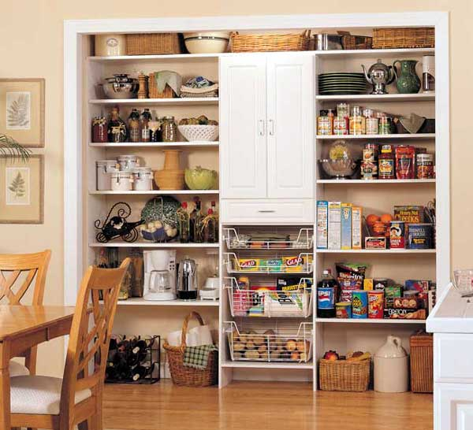

### Sent to you by Thiago Silva via Google Reader:

## 

[Questões práticas sobre a despensa de alimentos](http://vidaorganizada.com/casa/comodos/despensa/questoes-praticas-sobre-a-despensa-de-alimentos/)

via [Vida Organizada](http://vidaorganizada.com) by Thais Godinho on 2/22/13

  

Imagem: Blog Really Painting

Toda casa ou apartamento tem a sua despensa – mesmo que isso signifique uma porta específica do armário em cima da pia. Algumas pessoas têm a sorte de morar em uma casa ou apartamento com cômodo próprio para estocar alimentos e outros produtos, o que é o meu sonho de consumo. Para ter uma despensa organizada, é necessário pensar em algumas questões práticas:

### 1. Tenha uma lista ideal

Eu chamo de ideal aquela lista que contém todos os produtos que a sua família necessita durante um mês ou uma semana – depende da frequência em que você prefere ir ao mercado. Ter essa lista é importante porque, antes de fazer as compras, basta verificar nele o que falta. Para fazer isso, basta deixá-la na própria despensa com uma caneta ou lápis por perto, e ir fazendo o controle ao longo da semana. Pode parecer que leva tempo, mas bastam alguns segundos para fazer essa verificação. Um dia antes de ir às compras, você pode fazer essa vistoria final.

As vantagens de ter uma lista são inúmeras – economizar dinheiro e garantir que nada falta no dia a dia são as duas principais.

### 2. Tenha um orçamento mensal para compras no mercado

Sei que isso é difícil de fazer. O primeiro passo é, durante um mês, anotar todos os gastos relacionados a compras no mercado. No final do mês, somar esse valor e ter uma grande surpresa, porque geralmente o valor é mais alto do que imaginamos. Para o mês seguinte, estabeleça um orçamento menor e atenha-se a ele. Tente encontrar o valor ideal para que a sua família não passe necessidades nem gaste mais do que o necessário.

### 3. Otimize o espaço

Quando não temos espaço, precisamos encontrar uma solução. O que não dá é para viver na bagunça, especialmente no que for relacionado a alimentos, pois pode envolver contaminação, além do próprio desperdício. Assim, procure alternativas baratas. Estantes altas podem ser melhoradas com cestinhos ou mini-prateleiras compradas prontas em lojas de produtos organizadores.

É muito importante acondicionar os alimentos corretamente para não correr o risco de estragá-los ou atrair traças, por exemplo. Portanto, a organização não é um supérfluo, mas algo essencial nesse caso.

### 4. Controle as validades

A dica da vovó é colocar os produtos mais novos no fundo sempre que chegar do mercado, para consumir primeiro os que estão na frente. Além disso, procure verificar semanalmente o que está para vencer, pois assim você poderá aproveitar tais alimentos no seu menu semanal. Se quiser ser ainda mais organizado(a), escreva com uma caneta para CD as datas de validade bem grandes nas embalagens, para visualizar facilmente. Essa dica também é uma boa para quem mora com idosos ou pessoas com problemas de visão.

**Cuidar do estoque de alimentos é uma arte. Como você faz na sua casa?**

### Textos relacionados:

- [Simplificando as compras da semana](http://vidaorganizada.com/trabalho/financas/simplificando-as-compras-da-semana/)
- [Inspiração do dia: despensa rotulada](http://vidaorganizada.com/bem-estar/inspiracao/inspiracao-do-dia-despensa-rotulada/)
- [Como organizar a despensa](http://vidaorganizada.com/casa/comodos/despensa/como-organizar-a-despensa/)
- [Como limpar o microondas](http://vidaorganizada.com/casa/limpeza/como-limpar-o-microondas/)
- [Inspiração do dia: potes com comidinhas](http://vidaorganizada.com/bem-estar/inspiracao/inspiracao-do-dia-potes-com-comidinhas/)
- [8 maneiras de levantar o moral em tempo frio](http://vidaorganizada.com/bem-estar/equilibrio/8-maneiras-de-levantar-o-moral-em-tempo-frio/)
- [3 dicas para sair de casa com crianças pequenas](http://vidaorganizada.com/familia/criancas/3-dicas-para-sair-de-casa-com-criancas-pequenas/)
- [Economizando nas compras](http://vidaorganizada.com/trabalho/financas/economizando-nas-compras/)
- [Checklist de maio 2012](http://vidaorganizada.com/organizacao/checklists/checklist-de-maio-2012/)
- [Janeiro 2013](http://vidaorganizada.com/organizacao/blog/janeiro-2013/)

The post [Questões práticas sobre a despensa de alimentos](http://vidaorganizada.com/casa/comodos/despensa/questoes-praticas-sobre-a-despensa-de-alimentos/) appeared first on [Vida Organizada](http://vidaorganizada.com).

  

### Things you can do from here:

- [Subscribe to Vida Organizada](http://www.google.com/reader/view/feed%2Fhttp%3A%2F%2Fvidaorganizada.com%2Ffeed%2F?source=email) using **Google Reader**
- [Get started using Google Reader](http://www.google.com/reader/?source=email) to easily keep up with **all your favorite sites**
