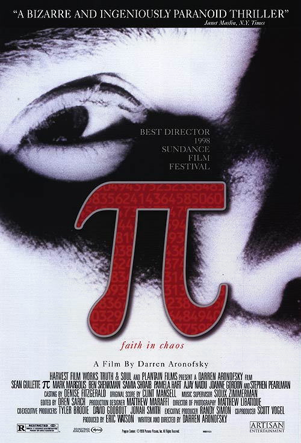
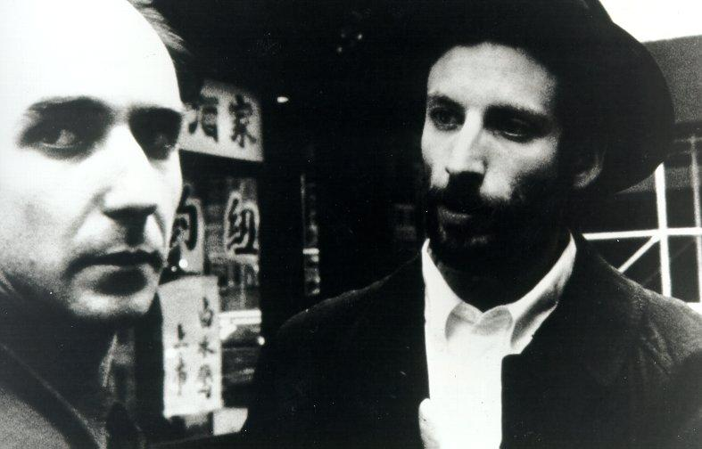
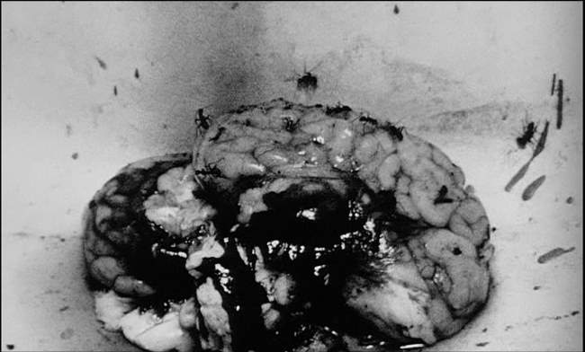

  

**Pi**, filme de estréia de **Darren Aronofsky**, ganhou Sundance em 1998, confirmando o diretor como um sucesso de crítica logo no início de sua carreira. Filmado com orçamento apertado e uma fotografia preto e branca extremamente granulada, Pi já possuía as principais características do cinema de Aronofsky e anunciava o cineasta que ele iria se tornar.

  

Pi se foca em Max Cohen, um matemático obcecado em pesquisar padrões nas casas decimais do pi. Aronofsky parece ser ele mesmo obcecado com as obsessões, no entanto ele sempre olha além do vício inicial de seus personagens e no caso de Cohen a obsessão não está no pi, mas no pi como chave para se entender o universo.

  

Cohen acredita que a matemática é a linguagem da natureza e ele busca desesperadamente fazer sentido dessa linguagem. O grande mérito de Aronofsky na construção de seu personagem e, principalmente, de sua obsessão é dar profundidade a ela ao mesmo tempo que prende o espectador na mesma teia de paranóia de Max.

  

  

Max Cohen não quer apenas achar um padrão no pi, ele quer provar para si mesmo que a natureza se constitui em padrões matemáticos, ele quer entender o universo. Enquanto seu antigo professor afirma que ele voa perto demais do sol e busca por algo que não pode ser encontrado, um judeu ortodoxo alimenta sua convicção ao afirmar que a matemática pode também ser a linguagem de Deus. No judaísmo, Deus não deve ser nomeado, embora diversas palavras sejam usadas para se referir a ele, seu verdadeiro nome é oculto, uma vez que Deus não deve estar submetido a conceitos humanos. Ou seja, a chave da criação do universo, o conhecedor de suas regras e padrões não pode ser conhecido pela mente humana, está fora do que cabe a nós.

  

Mas Max se convence de que sim, entender o universo cabe a ele. Seu sobrenome é o dos descendentes do alto sacerdote judaico que era o único a conhecer o nome verdadeiro de Deus, ele acerta os números da bolsa, ele foi capaz de olhar para o sol. Aronofsky constrói um personagem extraordinário com uma obsessão que vai além do óbvio (o entendimento, não o Pi, assim como a Nina de Cisne Negro não é obcecada com seu papel, mas com a perfeição) e que se consome por isso e constrói um filme que afirma isso a cada momento.

  

  

A fotografia é preto e branca e granulada de forma que toda a imagem as vezes parece uma massa cinza. Os planos fechados se tornam amontoados de forma, cheios, claustrofóbicos, como a mente do próprio Max. Além da imagem poluída, a trilha de **Clint Mansell** é incômoda, ensurdecedora e cheia de barulhos industriais, novamente emulando as dores de cabeça e a vivência do personagem. A montagem de Pi anuncia a de Réquiem para um Sonho: rápida e fragmentada ela torna mecânica certos atos do personagem e explicita à sua escravidão de certos atos enquanto impede o espectador de vê-lo como um ser inteiro.

  

Dessa forma Pi é um filme que experimenta e desconstrói, como se espera de um filme de estréia, e ao mesmo tempo apresenta os elementos que o diretor aprenderia a dominar com o tempo. É um filme imaturo, mas de uma força criativa imensa e que já anunciava um dos cineastas mais interessantes em atividade.

  
  
  
  
from Vortex Cultural - HQ's, Literatura, Games, Resenhas, Podcast, Cinema, Música e Séries <http://www.vortexcultural.com.br/cinema/critica-pi/>
