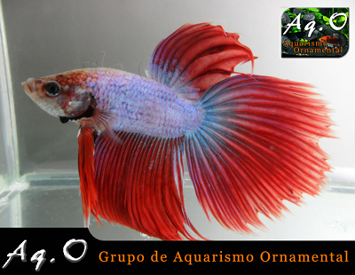
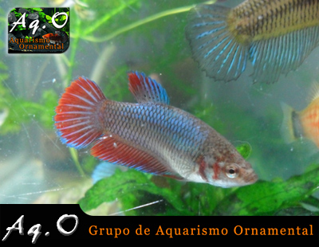
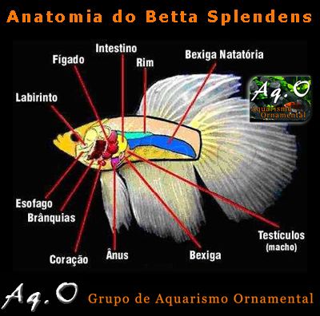

# **B**etta Splendens

Betta Splendens Macho

**Família:** Osphronemidae

**Espécie:** B**.** splendens

**Nome binomial:** Betta splendens (Regan, 1910)

**Nome Popular:** Betta splendens, Peixe-de-Briga (Brasil), Combatente ou Peixe Lutador (Portugal), Pez Luchador de Siam (Espanha), Kampffisch (Alemanha), Siamese Fighting Fish (EUA), ou simplesmente Betta**.**

**Origem:** Ásia (Tailândia, Indonésia, Vietnã, China e outros)**.**

**Comportamento:** Os machos só são agressivos com outros machos da mesma espécie e as fêmeas em geral são pacíficas**.**

**Tamanho adulto:** Aproximadamente 7cm

**pH:** 6,6 a 7,2 (Ideal= 7,0)

**Temperatura:** 25 a 32ºC (Ideal = 27,5ºC)

**Dimorfismo sexual:** O macho possui as nadadeiras mais desenvolvidas**.**

**Alimentação:** Carnívoro**.** Ração, patê, artêmia salina, branchonetas, tubifex, insetos, larvas, etc**.**

**Aquário recomendado:** 20 litros, entretanto podem ser usados tranqüilamente aquários menores**.**

**Reprodução:** Ovíparo

**Habitat:** Regiões alagadiças com águas estagnadas e pobres em oxigênio, como brejos, pântanos e campos de plantação de arroz**.**

Betta Splendens Fêmea

**Mais informações e curiosidades:**

Em 1849, Cantor foi o primeiro a descrever o peixe cientificamente, como Macropodus pugnax, mas em 1909 o ictiologista americano Tate Regan percebe que já havia espécie com esse nome e a rebatiza com o nome atual, Betta splendens**.**

A origem do seu nome vem da associação com uma tribo guerreira, os Ikan Bettah, a qual dominava as regiões do antigo Sião, onde os guerreiros eram chamados de Bettahs**.** A relação com os antigos guerreiros é evidente, uma vez que o Betta é um peixe bastante territorialista, tornando-se violento quando em contato com outros machos da mesma espécie**.**

Na sua forma selvagem os Bettas apresentam uma coloração discreta (cor opaca) que se confunde com o meio ambiente e com alguns tons de vermelho e azul nas barbatanas, são menores e menos agressivos que as formas domésticas**.** Na natureza podem ser encontrados nas bermas dos campos de arrozais, regatos, e pequenos lagos**.** O sistema social desta espécie é um sistema territorial em que durante a época de reprodução (época das chuvas) os machos defendem um território formado em redor de um “ninho-bolha”, que eles próprios constroem e mantém**.** As fêmeas visitam os machos que as cortejam até estas libertarem os ovos**.** Em seguida e após a fertilização, os machos colocam os ovos no ninho e expulsam as fêmeas do território**.**

A reprodução em cativeiro é relativamente simples, bastando para isso um aquário (que pode ser pequeno) e um pequeno recipiente transparente**.** No aquário, coloca-se um macho, enquanto coloca-se a fêmea no pequeno recipiente**.** Em seguida, o recipiente (com a boca para cima) é colocado dentro do aquário, que terá um nível de água insuficiente para cobrir o recipiente**.** Uma vez visualizando a fêmea, o macho irá iniciar a construção do ninho, formado por diversas bolhas na superfície**.** Essa tarefa pode ser facilitada por algo que fique na superfície da água, como um isopor ou pedaço de plástico, o que evita que o ninho se prenda ao recipiente da fêmea**.** Uma vez construído o ninho, é o momento de soltar a fêmea, que será cortejada e envolvida pelo macho (abraço nupcial)**.** Sob pressão, ela expelirá os ovos, que serão fertilizados e colocados no ninho pelo macho, com a boca**.** Uma vez concluído esta etapa, a fêmea deve ser retirada para não ser morta pelo macho**.** Este será responsável por cuidar dos ninhos e dos alevinos após o nascimento, devolvendo ao ninho os que caem**.**

Este peixe tem a particularidade de respirar o ar atmosférico, graças a órgãos chamados de labirintos, que fazem com que o ar passe bem próximo da corrente sanguínea dele, proporcionando a troca de oxigênio com o sangue por meio de difusão**.** Mas apesar dos Bettas serem labirintídeos, esse órgão faz com que ele consiga sobreviver em águas mais pobres em oxigênio, mas isso não é sinônimo de água poluída**.** Pode-se observar que o betta possuí a boca projetada para cima, para mais fácil absorção do ar na superfície**.**

Peixes com labirinto têm uma outra característica, todos os órgãos internos estão comprimidos na parte dianteira do corpo, de modo que a parte traseira tem somente a espinha, músculos e parte da bexiga natatória**.** O corpo do peixe é assim notavelmente flexível e explica a particular aerodinâmica dos Bettas**.**

Anatomia

O labirinto (Fig**.** acima) é composto por um número indeterminado de finas placas ósseas na cavidade do ouvido, unidas a um apoio ósseo e fixadas à extremidade superior do quarto arco branquial**.** O ar é aspirado sendo, então, automaticamente comprimido dentro do labirinto, o oxigênio é absorvido diretamente pelo fluxo sangüíneo, e o ar pobre de oxigênio é rejeitado sob a forma de simples bolhas**.**

[About these ads](http://en.wordpress.com/about-these-ads/)
