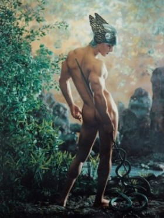
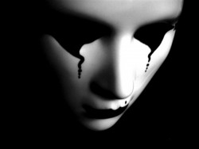
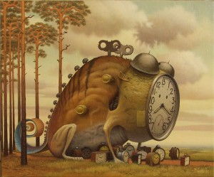
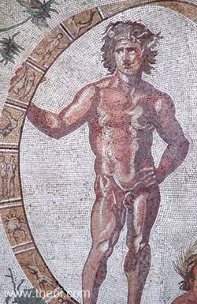
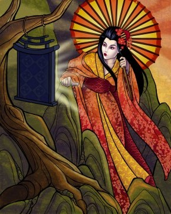
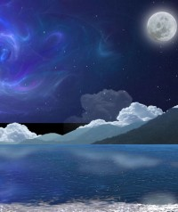
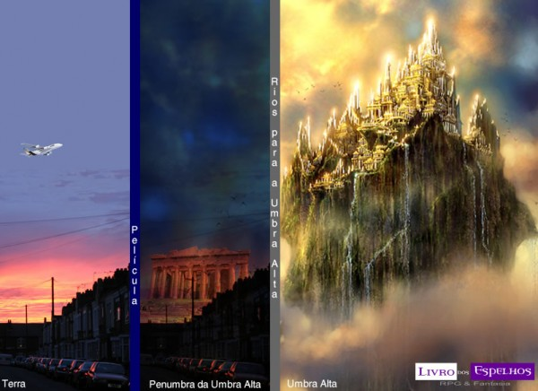

# [Guia da Umbra para o Mundo das Trevas – Parte 4](http://livrodosespelhos.com/guia-da-umbra-para-o-mundo-das-trevas-parte-4/)

Mercury – Pierre et Gilles

Finalmente, né gente**?** Depois de duas semanas sem novos artigos pela mais absoluta falta de tempo, estamos de volta com o **Guia da Umbra para o Clássico Mundo das Trevas****.** O motivo da falta de artigos novos é a absoluta e total falta de tempo desde o Carnaval pra cá**.**

Para quem sente saudades dos artigos diários é só ir até o [**Fórum Livro dos Espelhos**](http://forum.livrodosespelhos.com/ "Fórum Livro dos Espelhos") , onde a gente sempre responde – e aliás, onde estamos discutindo, em vários tópicos, muitas coisas interessantes que, no futuro, certeza que viram artigos, como é o caso do tópico recente da Emi com um guia das Esferas de Mago, nosso bate-papo sobre tradução de termos de Changeling e muito mais**.** Aliás, a galera tá até agitando mesas de RPG, tanto play by forum quanto procurando jogadores para mesas presenciais, então não deixa de conferir e participar ^-^

Mas, voltando para o artigo desta segunda, depois de passar pela Película, Periferia, Umbra Próxima e Umbra Média, chegou o momento de irmos para a Umbra Alta desta vez**.** Vai ser um tópico meio tortuoso demais para se começar a debater, e mais uma vez, apresento a minha visão da Umbra, enquanto Narradora de diversos títulos do Clássico Mundo das Trevas, então obviamente, outras pessoas podem (e devem) discordar das minhas concepções e ampliar o debate, pra gente ter visões bastante variadas do que é esse lugar tão… amplo que é a Umbra**.**

Se você perdeu algum dos artigos anteriores desta série, seguem os links:

[Guia da Umbra para o Mundo das Trevas – Parte 1](http://livrodosespelhos.com/guia-da-umbra-para-o-mundo-das-trevas-parte-1/ "Guia da Umbra para o Mundo das Trevas – Parte 1")   
[Guia da Umbra para o Mundo das Trevas – Parte 2](http://livrodosespelhos.com/guia-da-umbra-para-o-mundo-das-trevas-parte-2/ "Guia da Umbra para o Mundo das Trevas – Parte 2")   
[Guia da Umbra para o Mundo das Trevas – Parte 3](http://livrodosespelhos.com/guia-da-umbra-para-o-mundo-das-trevas-parte-3/ "Guia da Umbra para o Mundo das Trevas – Parte 3")

## A Umbra Alta

Enquanto a Umbra Média é mais animista, a Umbra Alta é algo totalmente conceitual**.** Diz-se que se, a partir da Penumbra, alguém fosse seguindo em direção aos céus, acabaria por alcançar a Umbra Alta – que também é chamada de Alcances Astrais, Plano Astral, Umbra Astral ou Umbra Superior**.** Os mokolé a chamam também de Memória de Gaia, e os metamorfos em geral consideram como parte da Umbra Profunda, a partir de certo trecho, ou de Mundo da Weaver, por ser criado pelo que a humanidade racionaliza ou personifica – que para eles, é a mesma coisa, embora não seja exatamente assim**.**

Enquanto que na Umbra Média as coisas simplesmente são, aqui, as coisas simplesmente se refletem, de acordo com o fluxo do consciente coletivo da humanidade**.**

Assim como a Umbra Média pode ser chamada de lar natural espiritual dos Garou, os Alcances Astrais são mais facilmente alcançados pelos magos**.** Pode-se dizer que, se um mago tentar entrar na Umbra sem precisar exatamente para onde está indo, ele tem imensas chances de vir parar justamente aqui**.** Diz-se que os Alcances Astrais são mais ligados ao que os magos chamam de Dinamismo, e como filhos do Dinamismo, não é de espantar a facilidade dos Despertos com este lugar**.**

Aqui, a dificuldade de precisar é por ser um lugar feito de conceitos, pensamentos, ideias e crenças**.** Enquanto que os lugares abstratos da Umbra Média independem dos humanos, aqui, as coisas que existem dependem de, algum dia, alguém já ter imaginado ou sonhado com as coisas, que então, tomam forma, personalidade e pensamento individuais, caso tenham força o bastante para isto**.**

### Entrando na Umbra Alta

Existem diversas formas de se entrar na Umbra Alta**.** Seres usando Projeção Astral (ou Psíquica), como vampiros usando Auspícios 5 ou magos usando Mente 4 podem vir parar na Penumbra da Umbra Alta, que reforça conceitos, emoções e ideias abstratas**.** Viajar para além da Película da Umbra Alta, entretanto, é tão difícil quanto fazer uma escalada totalmente metafórica na “escala” de abstrações**.** Primeiro, o viajante dos Alcances Astrais encontrará ideias abstratas básicas**.** Depois, passará por conceitos mais complexos, que é quando as primeiras ideias abstratas se tornam algo mais idealmente erigido**.** Depois, encontraremos reinos feitos de pensamentos mais enraizados e certamente coletivos, e muitas vezes religiosos**.** Mais além, encontramos abstrações que, muitas vezes, são absolutamente incompreensíveis pra limitada mente humana**.** O limite é a imaginação, pura e simplesmente**.** E qual é, afinal, o limite da imaginação humana?  

### Como Conceituar uma Abstração**?**

Lembram quando, lá no comecinho dos artigos, disse para que deixassem a mente lógica de lado**?** Pois é, aqui, isso é imperativo. Lembre-se quando, lá no colégio, aprendemos sobre substantivos concretos e abstratos**?** Pois é.

Aqui, aprenderemos que substantivos concretos **podem** se tornar abstratos**.** Pense, por exemplo, na palavra martelo. Quando eu escrevo (ou falo) martelo, vocês imediatamente criam a imagem mental de um martelo, certo**?** Enquanto a palavra martelo é um signo abstrato para algo que existe na realidade (aquele martelo que está junto com as outras ferramentas e que geralmente ao usar, acabamos por martelar também o dedo), o objeto a que ele se refere existe de fato na realidade consensual**.** Entretanto, a palavra martelo é apenas um signo – e quando solta assim, de repente, em cada mente, vai se referir a um martelo diferente, afinal, cada um faz uma imagem mental ligeiramente diferente do que seja um martelo, correto**?** Coisas como tamanho, cores e certos formatos podem variar**.** Porém, existe algo que é básico de um martelo, e isso é um conceito idealizado do que é um martelo**.** Quando chegamos a essa idealização do que é um objeto, encontramos uma personificação**.**

Vocês conseguem perceber a diferença quando eu digo solidão e quando eu digo A Solidão, assim, com esse maiúsculo – e muitas vezes com o artigo no início, também grafado em maiúscula**?** E quando eu escrevo martelo e O Martelo? E ideal e Ideal? E amor e Amor, ou O Amor**?** Se você percebeu a diferença, parabéns – entende, pelo menos, o princípio básico do que é toda essa abstração**.** Use sua mente poética, e você entenderá**.** Sem isso, não é possível sequer compreender como chegar até a Umbra, que dirá na Umbra Alta, que é pura abstração**.** Tenta lembrar dos seus tempos de escola e das aulas de literatura, ou use seu *Google-fu* pra pesquisar sobre Prosopopeia e sobre Personificação de conceitos abstratos**.**

### Caminhos para a Umbra Alta

Você entendeu o conceito do que é uma abstração**?** Ótimo, então podemos prosseguir**.** Como eu disse, chegar até os Alcances Astrais é como uma escalada metafórica**.** Você vai subindo**.** Ou talvez, você vai *se tornando* a subida, conforme você vai se tornando uma abstração de si mesmo**.** Vamos recorrer, mais uma vez, ao material de Mago: A Ascensão, que ajuda horrores em toda esta questão metafísica:

> Um mago não simplesmente conjura feitiços mágikos; ele ou ela se torna a mágika personificada, transcendendo os laços do que se acredita possível**.** Um mago –  qualquer mago verdadeiro – altera a realidade simplesmente se tornando consciente dela**.**

Esta citação foi retirada do **Book of Shadows**, que é o guia dos jogadores da 2ª edição**.** E é verdade para os viajantes umbrais, de qualquer raça ou “tipo” que seja ele**.** Como eu disse antes, indo até a Umbra, você **se torna** Umbra**.** E indo até o reino das abstrações, que são os Alcances Astrais, o viajante umbral se torna abstração, porque voltando àquela teoria bizarra minha sobre vibração, o viajante umbral começa a vibrar na mesma frequência em que ele se encontra da Umbra**.**

Se você for capaz de sentir a vibração “leve” das abstrações, toda a beleza ou o terror que elas encerram, você pode se tornar uno com ela, e ai, chegar, quem sabe, até além da Película dos Alcances Astrais**.** Aqui, não existe uma rota. Esteja avisado.

Mas, para simplificar, pode-se dizer que todos os conceitos humanos “sangram” para a Umbra**.** Por se tratarem de abstrações, eles são muito leves, e se juntam, formando rios que ascendem aos céus – portanto, alcançando a Umbra Alta**.** Um viajante umbral experiente pode navegar nestes rios de linguagem, rio acima, para entrar na Vulgata – a primeira camada da Umbra Alta além de sua Película**.** É importante prestar atenção em que rio se está navegando, o que é localizável pela linguagem (sim, estou falando de línguas humanas) que formou aquele rio**.** Caso decida seguir, por exemplo, o rio da linguagem do português brasileiro (que é totalmente diferente do português europeu), se chegará à Vulgata da civilização que a originou**.** Entretanto, o rio do português brasileiro receberia riachinhos de línguas indígenas, africanas, semitas, germânicas e muitas outras, e seria uma bifurcação do português europeu, que seria uma bifurcação da bacia formada pelo grego, pelo latim, que se alimentam de pequenos riachos que escapam dos rios das línguas árabes e célticas… a coisa é complicada**.** Alguns rios simplesmente se tornam secos, porque afinal, são rios originados por línguas mortas e que não deixaram muitos sinais em outras línguas**.** E todos, absolutamente todos os rios deságuam no Grande Oceano – que fica além da Vulgata e dos Pináculos, talvez em algum lugar das Epifanias, mas é um lugar perigoso, mortal e totalmente inóspito, além de absolutamente misterioso**.**

The Walking Lesson – Jacek Yerka

### As Camadas da Umbra Alta

Antes de ter Reinos, devemos compreender o conceito das camadas dos Alcances Astrais**.** A Película da Umbra Alta é curiosa. Em seu horizonte, veremos conceitos comuns que simbolizam as imagens que se tem de determinado lugar**.** Talvez, na Película da Umbra alta no Brasil, seja possível ver, tudo junto e a um só tempo, a Floresta Amazônica, o Pantanal, o Cristo Redentor, o Corcovado, a Avenida Paulista com o MASP em destaque… use a criatividade e pense bem na imagem que se tem de certos lugares**.** Sim, estou falando de clichês, porque são as visões pré-conceituais que o consciente coletivo tem de lugares que formam a paisagem da Película**.** E, subindo desses lugares, temos rios – o rio da linguagem de determinado lugar, por onde se navega para se escalar**.** E através de bifurcações ou pegando rios que deságuam num rio principal de determinado lugar, é possível viajar de um lugar para outro, de uma cidade para outra, e usar a Penumbra da Umbra Alta para viajar mais rápido de uma cidade para outra (não é este o princípio das Pontes da Lua**?**).

Logo que um viajante conseguir escalar além da Película da Umbra Alta, ele encontrará a Vulgata**.** Passando a Vulgata, pode-se chegar aos Pináculos. Pouco além dos Pináculos (ou algumas vezes em contato com eles), temos as Cortes**.** Então, passando as Cortes, temos as Epifanias. Mas, okay, vamos por parte.

#### A Vulgata

A Vulgata é a parte “mais densa” das abstrações presentes nos Alcances Astrais**.** Seguindo pelos rios, encontraremos pequenos reinos microcósmicos, onde ideias comuns e abstratas como amor, ódio, criatividade, interagem frequentemente com os ideais humanos e se sintonizam imediatamente a mudanças nas percepções a respeito destas abstrações**.** Ou seja, quando seguimos um rio, sairemos nos reinos microcósmicos da Vulgata de determinada civilização, então a coisa é muito variável**.**

Abstrações que se tornem ainda mais abstratas (sim, existem níveis diferentes de abstrações) acabam, por assim dizer, vazando para a próxima camada**.** Sabe quando eu grafei as coisas ali em cima com inicial maiúscula**?** Pois é, isso começa a ocorrer após a Vulgata. O reino mais “conhecido” (se é que alguém realmente esteve lá) da Vulgata é O Grande Salão**.**

#### Pináculos

Na medida em que as abstrações vão se tornando, bem, mais abstratas, elas vão passando por um processo de personificação**.** Então, alcançamos, na nossa subida, para os Pináculos dos Alcances Astrais – as civilizações da Vulgata, dos microcosmos presentes nela, vão erigindo torres de gelo, pináculos altíssimos, cujos topos e seus arredores representam os limites da capacidade de concepção humana, onde cometas dão rasantes e a coisa vai se tornando mais tumultuada**.** Aqui, o amor, enquanto conceito geral, signo para um sentimento humano abstrato, se torna personificado, se transformando em um Reino mais amplo**.** As coisas se tornam menos “densas” do que eram na Vulgata, justamente por serem mais abstratas**.** Então, o amor, enquanto conceito geral, se torna a personificação do próprio Amor**.** O ideal, enquanto conceito geral, se torna O Ideal**.** E cada um forma seus próprios reinos, que podem variar – será que o conceito de Amor de brasileiros que vive em uma cidade amazônica tem o mesmo conceito de Amor de toda uma população que viva no interior da Coréia do Norte**?** Viu como é difícil responder? Use a sua imaginação, e não tenha dó de usar de um processo chamado de *alteridade***.**
> *Alteridade (ou outridade) é a concepção que parte do pressuposto básico de que todo o homem social interage e interdepende do outro**.** Assim, como muitos antropólogos e cientistas sociais afirmam, a existência do “eu-individual” só é permitida mediante um contato com o outro (que em uma visão expandida se torna o Outro – a própria sociedade diferente do indivíduo)**.***
>
> *Relação de sociabilidade e diferença entre o indivíduo em conjunto e unidade, onde os dois sentidos interdependem na lógica de que para individualizar é necessário um coletivo**.** Dessa forma eu apenas existo a partir do outro, da visão do outro, o que me permite também compreender o mundo a partir de um olhar diferenciado, partindo tanto do diferente quanto de mim mesmo, sensibilizado que estou pela experiência do contato**.***
>
> ***Fonte:** [Wikipedia](http://pt.wikipedia.org/wiki/Alteridade "Alteridade")*

Assim, certeza, os seus Reinos criados para estarem nos Pináculos vão se tornar muito mais ricos e, de quebra, você e seus jogadores ainda têm a oportunidade de uma nova compreensão de mundo – e esta não é uma das maravilhas do RPG**?**

Um dos reinos de que se tem algum conhecimento dos Pináculos é conhecido como O Inventium**.**

Mas a coisa pode se tornar ainda mais leve e complexa**.** Porque acima dos Pináculos, nós temos…

#### Cortes

Conforme os seres humanos precisam lidar com seus medos, receios, conhecimentos, eles criam mitologias**.** Quando as abstrações tornam-se muito personalizadas e recebem nomes – Deus, Shiva, Hermes, Astarte – eles recebem todo um outro status de existência**.** E é aqui, nas Cortes, que as visões humanas de seus mitos tomam forma e consciência próprias, formando reinos imensos, com uma lógica e hierarquia muito próprios, e afetados pelos seres da Vulgata e dos Pináculos que tomaram consciência**.** É aqui que paraísos, deuses (e infernos, e demônios) tomam forma – não podemos dizer que sejam os paraísos e infernos verdadeiros, mas como a humanidade os vê**.** É aqui que você encontrará paraíso e infernos cristãos, pagãos, muçulmanos, papuaguinenses… são os conceitos abstratos coletivos nos quais muita fé foi depositada que chegam neste nível de abstração**.** Você pode escalar o Monte Olimpo, ou descer ao Caldeirão de Cerridwen**.** Mas cuidado para não provar comida ou bebida dos domínios de Hades, ou enfurecer os anjos tentando chegar perto das 72 virgens**.**

Apenas um aviso: ainda que todos os reinos paradisíacos ou infernais existentes nas Cortes sejam representações de pós-mundos das crenças humanas, ao morrer, pessoas não vão para lá – vão direto e reto para o Mundo Inferior da Umbra Baixa, de que falaremos mais adiante**.** Todos os habitantes de cada Corte são abstrações de crenças e fés puramente humanas – a menos que o seu Narrador diga o contrário, mas ai, já não é mais com o material oficial disponível para o Clássico Mundo das Trevas**.**

Dentre os reinos de que se tem conhecimento e que ficam nas Cortes, temos as Cortes Elementais, que ficam mais próximas dos Pináculos, e os Pós Mundos, que se aproximam mais, fisicamente, da camada superior (sim, existe algo além**!**) dos Alcances Astrais.

Mas a coisa pode ficar ainda mais complicada**.** Pois é – assim é a imaginação humana, ou melhor dizendo, o que vai além dela**.**  

#### Epifanias

É impossível descrever as Epifanias, lugares de abstração da própria abstração**.** Tudo o que estiver além da abstração, da idealização e da fé acaba ficando tão leve que vem parar aqui**.** Uma vez que se trata de abstrações além das abstrações, de meta-abstrações e de absurdos que seriam pesadelos para os dadaístas, é impossível descrever usando de uma tecnologia humana – como a linguagem, falada ou escrita**.** É um lugar simplesmente inacessível para a maioria dos viajantes umbrais**.**

Pois é**.** A coisa se torna tão completa, tão complexa, que é inominável**.** Se isto é bom ou ruim… eu recomendo fortemente uma *googlada* nos conceitos de grotesco e sublime na literatura e nas artes**.** Talvez ajude a começar a compreender o nível que tais abstrações, muito fugazes para serem descritas, possam alcançar – e ainda assim, como é um conhecimento meramente humano, ou seja, classificatório, fica impossível de apreender ao todo, já que se trata de uma abstração da abstração da abstração da abstração**.** Que confusão**!**

Diz-se por ai que reinos existem nas Epifanias, A Fonte das Almas e O Rio da Linguagem (ou o Grande Oceano, onde todos os rios de linguagens deságuam)**.** Mas será que alguém botaria muita fé na sanidade mental de um viajante umbral que diz ter estado nestes lugares**?**

### Onde Fica a Umbra Alta?

Isso é muito tenso de se descrever**.** Eu chuto que, assim como a Umbra Média termina mais ou menos no mesmo ponto da estratosfera, a Umbra Alta vá além, englobando pedaços da estratosfera, subindo pela mesosfera, pela termosfera (que é onde geralmente os satélites passeiam e onde ocorrem as auroras boreal e austral) e a exosfera, mas é importante pensar que cada uma das três camadas das *Umbrae* é infinita em si mesma**.** Aqui, os Reinos Etéreos juntam a Umbra Média em seu comecinho com a Umbra Alta, já que é nos Reinos Etéreos que nasceram Fobos, o Incarna de Luna, e Hyperion, o Incarna de Hélios, e outros espíritos poderosos do ar, das estrelas e os aspectos umbrais dos planetas do sistema solar**.** Entretanto, devemos lembrar que, a partir de certo ponto, ultrapassamos as Epifanias, pura e simplesmente – ou então, talvez, o conceito religioso dos metamorfos torna possível que um reino em uma das Cortes (já que os metamorfos possuem Parentes humanos, que sonham, racionalizam e teorizam, tem fé como qualquer mortal) toque aspectos além da Umbra Próxima**.**

Mas neste caso, estamos nos aproximando do que é chamado de Primeiro Horizonte – embora seja importante frisar, mais uma vez, que é impossível apreender a Umbra usando a nossa razão humana**.** Portais se abrem e se fecham, estradas se cruzam, Pontes da Lua estão por toda a Umbra Alta e os conceitos simplesmente se diluem**.**

Fiz uma imagem pra vocês, para que possam, se quiserem, ter uma ideia de como eu imagino que seja essa bagunça toda da Umbra Alta, e eu sou suuuper hábil na edição de imagens (só que não u.u)**.**

Pegue, por favor, estas informações e use como melhor couber na sua mesa**.** Depois, volta aqui e conta pra gente como foi ^\_~

**\* \* \***

Ufa**!** Acredito que este foi o texto mais difícil que eu já escrevi**.** Como abstrair a abstração e explicar a abstração da abstração, categorizando (já que explicar é limitar, é classificar**!**) o inclassificável? Sei que muitas vezes a coisa vai soar confusa e difícil**.** Neste caso, respire fundo, dê uma voltinha e leia o texto novamente**.**

Vou tentar ser breve para começar a escrever sobre a Umbra Baixa**.** Continuem mandando suas dúvidas e suas sugestões, okay**?** E é muito bacana se inscrever no [**fórum**](http://forum.livrodosespelhos.com/ "Fórum Livro dos Espelhos")  – é maravilhosa a sensação de aprender com outras pessoas, eu adoro**!**

Não deixem também de conferir a [**nossa loja**](http://loja.livrodosespelhos.com/ "Compre livros de RPG e dados na Loja Livro dos Espelhos") **.** Ela de fato tem ajudado o **Livro dos Espelhos** a continuar no ar, uma vez que toda a grana que tem vindo da loja tem ajudado a pagar a renovação do domínio (que foi renovado por mais um ano**!** Yay!) e a hospedagem (que talvez, em breve, precise de um upgrade)**.**

Beijo!

**Autora:** Eva  
**Agradecimentos:** Rafael Mastromauro

**Artigo Anterior:** [Guia da Umbra para o Mundo das Trevas – Parte 3 >](http://livrodosespelhos.com/guia-da-umbra-para-o-mundo-das-trevas-parte-3/ "Guia da Umbra para o Mundo das Trevas – Parte 3")   
**Próximo Artigo:** Guia da Umbra para o Mundo das Trevas – parte 5 *(em breve)*
